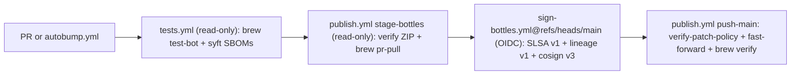

# Artagon AI Tools Homebrew Tap (`artagon/aitools`)

[](https://github.com/artagon/homebrew-aitools/actions/workflows/tests.yml)
[](https://github.com/artagon/homebrew-aitools/attestations)
[](https://github.com/artagon/homebrew-aitools/releases)
[](#formula-catalog-by-domain)
[](ABOUT.md#authors--license)

Curated developer CLIs, local MCP servers, memory graphs, evaluation harnesses, OpenTelemetry collectors, subscription-only AI routing & coding agents, and JDK 28 Valhalla-aware AST analyzers for AI coding agents.

> [!IMPORTANT]
> **Tap Security & Non-Invasiveness Contract**
> - **Zero live config mutation**: `brew install`, `upgrade`, and `uninstall` never modify `~/.claude*`, `~/.codex*`, `~/.gemini*`, `~/.config/*`, or shell profiles.
> - **Hardened local-first defaults**: Wrappers disable startup update checks, telemetry, and unsolicited cloud routing, default local services to `127.0.0.1`, and block or warn against in-place self-updaters.
> - **Cryptographic provenance**: Published bottles carry ref-bound SLSA v1 attestations, signed build lineage, keyless Sigstore `cosign` v3 bundles, and SPDX 2.3 + CycloneDX 1.6 SBOMs.

[Quick Start](#quick-start) · [Formula Catalog](#formula-catalog-by-domain) · [MCP Server Reference](#mcp-server-reference) · [Bundled Agent Skills](#bundled-agent-skills--plugins) · [Provenance & Verification](#build-provenance--verification) · [Publishing & Autobump](#publishing--automatic-updates) · [Troubleshooting](#troubleshooting--faq)

---

## Quick Start

```sh
# 1. Tap and trust this repository once:
brew tap artagon/aitools
brew trust --tap artagon/aitools

# 2. Install any formula with Homebrew attestation verification enabled:
HOMEBREW_VERIFY_ATTESTATIONS=1 brew install artagon/aitools/ripwire
```

Install curated domain bundles with fully qualified `artagon/aitools/<formula>` names:

```sh
# Code search, JDK 28 Valhalla Java AST, and hash-anchored editing:
brew install artagon/aitools/ripwire artagon/aitools/ast-grep-valhalla artagon/aitools/tree-sitter-java-valhalla \
  artagon/aitools/tgrep artagon/aitools/ck artagon/aitools/codesearch artagon/aitools/fff-mcp artagon/aitools/hashline

# Local agent memory, hybrid Markdown search, and token compression:
brew install artagon/aitools/basic-memory artagon/aitools/hindsight artagon/aitools/qmd artagon/aitools/squeez

# Multi-agent mail, NATS event bus, terminal workspaces, and Beads issue graphs:
brew install artagon/aitools/agent-mail artagon/aitools/br artagon/aitools/bd artagon/aitools/bv \
  artagon/aitools/nats artagon/aitools/herdr artagon/aitools/autoswarm

# Architecture decisions, skill lifecycle compilers, and skill optimization:
brew install artagon/aitools/adrkit artagon/aitools/agentsync artagon/aitools/skillfile \
  artagon/aitools/skillprism artagon/aitools/waza artagon/aitools/skillopt

# Live evaluation harnesses, versioned skill registries, and OpenTelemetry observability:
brew install artagon/aitools/mlflow artagon/aitools/inspect-ai artagon/aitools/langfuse-cli \
  artagon/aitools/phoenix-cli artagon/aitools/arize-phoenix artagon/aitools/openlit

# Subscription-only AI gateway & terminal coding agents (no API keys):
brew install artagon/aitools/magpie artagon/aitools/omp artagon/aitools/pi-agent-rust

# macOS native desktop casks (override defaults with HOMEBREW_* flags):
brew install --cask artagon/aitools/markdown-preview
```

> [!NOTE]
> Always qualify `artagon/aitools/{tgrep,nats,herdr}` (and `--cask artagon/aitools/markdown-preview`) so Homebrew selects this tap over same-named `homebrew/core` formulae or `homebrew/cask` casks. When a differently named core formula with overlapping binaries is linked (`ast-grep`, `beads`, `beads_viewer`, `adr-tools`, `cln`, `pi-coding-agent`, `pixie`, or `px`), run `brew unlink <formula>` first.

---

## Formula Catalog by Domain

### 1. Code Search, JDK 28 Valhalla Java AST & Hash-Anchored Editing

| Formula | Upstream & License | Binaries, Libraries & Assets | Tap Build & Runtime Hardening |
| :--- | :--- | :--- | :--- |
| [`tree-sitter-java-valhalla`](Formula/tree-sitter-java-valhalla.rb) | [tree-sitter/tree-sitter-java](https://github.com/tree-sitter/tree-sitter-java) (`MIT`) | `libtree-sitter-java-valhalla` + crate sources in `pkgshare` | Source ABI `14` C11 build with additive JEP 401/440/511/513 Java grammar patch; contextual `value` preserves standard Java ASTs |
| [`ast-grep-valhalla`](Formula/ast-grep-valhalla.rb) | [ast-grep/ast-grep](https://github.com/ast-grep/ast-grep) (`MIT`) | `ast-grep`, `sg`, shell completions | Source Rust build (`cargo install --locked`) compiling `tree-sitter-java-valhalla` into built-in `-l java`; `conflicts_with "ast-grep"` |
| [`ripwire`](Formula/ripwire.rb) | [redhat-et/ripwire](https://github.com/redhat-et/ripwire) (`Apache-2.0`) | `ripwire`, `ripwire-agent-install`, `pkgshare/{skills,hooks}` | Source CMake/C++23 build with Valhalla `parser.c` + Java query patch; opt-in skill/hook installer (`--hook` required for config edits) |
| [`tgrep`](Formula/tgrep.rb) | [microsoft/tgrep](https://github.com/microsoft/tgrep) (`MIT`) | `tgrep` | SHA-256-pinned release binary; local `.tgrep/` trigram index only; no background watcher started automatically |
| [`ck`](Formula/ck.rb) | [BeaconBay/ck](https://github.com/BeaconBay/ck) (`MIT OR Apache-2.0`) | `ck` (`--lex`, `--sem`, `--hybrid`, `--serve` MCP) | SHA-256-pinned release binary (`glibc >= 2.39` on Linux); `--lex`/`--regex` fully offline; ONNX models cached on first `--sem` |
| [`codesearch`](Formula/codesearch.rb) | [flupkede/codesearch](https://github.com/flupkede/codesearch) (`Apache-2.0`) | `codesearch` CLI + `mcp` / `serve`, `pkgshare/integrations/{claude-code,opencode}` | Source Rust build (`cargo install --locked`, `protobuf`, Linux `openssl@4`); defaults `CODESEARCH_SERVE_HOST=127.0.0.1`, `CODESEARCH_EMBED_PROVIDER=fastembed`, `DO_NOT_TRACK=true`, and blocks `update`/`self-update`/`upgrade` (`exit 2`) |
| [`fff-mcp`](Formula/fff-mcp.rb) | [dmtrKovalenko/fff](https://github.com/dmtrKovalenko/fff) (`MIT`) | `fff-mcp` stdio MCP server | SHA-256-pinned release binary + tag `LICENSE`; wrapper automatically passes `--no-update-check` |
| [`hashline`](Formula/hashline.rb) | [quangdang46/hashline](https://github.com/quangdang46/hashline) (`MIT OR Apache-2.0`) | `hashline` CLI + `hashline mcp` + `pkgshare/skills/hashline` | Source Rust build (`cargo install --locked`); wrapper exports `HASHLINE_NO_UPDATE_CHECK=1` |

<details>
<summary><strong>JDK 28 Valhalla Java syntax (`tree-sitter-java-valhalla`) & Ripwire CLI installer details</strong></summary>

| Syntax | Example | Specification |
| :--- | :--- | :--- |
| Value classes and value records | `value record Point(int x, int y) {}` | JEP 401 (preview) |
| Statements before `super(...)` and `this(...)` | `this.x = x; super();` | JEP 513 |
| Module imports | `import module java.base;` | JEP 511 |
| Qualified record patterns | `o instanceof Shape.Circle(int r)` | JEP 440 |
| Annotations before a varargs ellipsis | `Object @Nullable ... rest` | JLS 8.4.1 |

Opt-in Ripwire skill and hook activation (`ripwire-agent-install` / [`scripts/install-agent-skills.sh`](scripts/install-agent-skills.sh)):

```sh
ripwire-agent-install --list                  # inspect detected CLIs (no writes)
ripwire-agent-install --claude --codex --agy  # install skills only
ripwire-agent-install --claude --hook         # opt-in PreToolUse hook registration
"$(brew --prefix ripwire)/share/ripwire/skills/install.sh" --uninstall --target ~/.claude/skills
```

</details>

### 2. Local Agent Memory, Hybrid Markdown Search & Token Compression

| Formula | Upstream & License | Binaries & Assets | Tap Build & Runtime Hardening |
| :--- | :--- | :--- | :--- |
| [`basic-memory`](Formula/basic-memory.rb) | [basicmachines-co/basic-memory](https://github.com/basicmachines-co/basic-memory) (`AGPL-3.0-or-later`) | `basic-memory`, `bm`, `pkgshare/skills/memory-*` | Source `uv` Python `3.13` build (`preserve_rpath`); forces `BASIC_MEMORY_FORCE_LOCAL=true`, disables promos/Logfire, and blocks `cloud`, `update`, and HTTP/SSE transports |
| [`hindsight`](Formula/hindsight.rb) | [vectorize-io/hindsight](https://github.com/vectorize-io/hindsight) (`MIT`) | `hindsight`, `hindsight-mcp`, `hindsight-coding-agents`, `pkgshare/skills` | Source Rust CLI + TypeScript/Node MCP bundle; compiled defaults bind `http://127.0.0.1:8888` (`self-hosted`, `autoUpdate=false`), reject non-loopback URLs and `cloud`/`update`, and require `HINDSIGHT_MCP_HARNESS` |
| [`qmd`](Formula/qmd.rb) | [tobi/qmd](https://github.com/tobi/qmd) (`MIT`) | `qmd` CLI + `qmd mcp` + `pkgshare/skills/qmd` | Source TypeScript/Node build pruning foreign `prebuilds/*`; exports `QMD_SOURCE_MODE=0`; local SQLite BM25 + `sqlite-vec` + GGUF reranking |
| [`squeez`](Formula/squeez.rb) | [claudioemmanuel/squeez](https://github.com/claudioemmanuel/squeez) (`Apache-2.0`) | `squeez` CLI + `squeez mcp`, `NOTICE` | Source Rust build patching conservative defaults (`auto_compress_md=false`, `persona=off`, `wrap_bash=false`) and blocking `squeez update` |

### 3. Multi-Agent Coordination, Event Buses & Beads Graph Tracking

| Formula | Upstream & License | Binaries & Assets | Tap Build & Runtime Hardening |
| :--- | :--- | :--- | :--- |
| [`agent-mail`](Formula/agent-mail.rb) | [Dicklesworthstone/mcp_agent_mail_rust](https://github.com/Dicklesworthstone/mcp_agent_mail_rust) (`:cannot_represent` — MIT + Rider) | `mcp-agent-mail`, `am`, `LICENSE` | SHA-256-pinned archive; full custom `LICENSE` in `prefix`; local stdio or HTTP (`am serve-http`); warns against `am self-update` |
| [`br`](Formula/br.rb) | [Dicklesworthstone/beads_rust](https://github.com/Dicklesworthstone/beads_rust) (`:cannot_represent` — MIT + Rider) | `br`, shell completions, `LICENSE` | SHA-256-pinned archive; full custom `LICENSE` in `prefix`; local `.beads/` state only; warns against `br upgrade` |
| [`bd`](Formula/bd.rb) | [gastownhall/beads](https://github.com/gastownhall/beads) (`MIT`) | `bd`, shell completions, `LICENSE` | SHA-256-pinned archive with embedded pure-Go Dolt (`conflicts_with "beads"`); wrapper exports `BD_DISABLE_METRICS=1` and `DO_NOT_TRACK=1` |
| [`bv`](Formula/bv.rb) | [Dicklesworthstone/beads_viewer](https://github.com/Dicklesworthstone/beads_viewer) (`:cannot_represent` — MIT + Rider) | `bv`, shell completions, `LICENSE` | SHA-256-pinned archive; full custom `LICENSE` (`conflicts_with "beads_viewer"`); read-only `--robot-*` graph triage |
| [`nats`](Formula/nats.rb) | [nats-io/natscli](https://github.com/nats-io/natscli) (`Apache-2.0`) | `nats`, `bash`/`zsh` completions | Source Go build; stores contexts in `${XDG_CONFIG_HOME:-~/.config}/nats/context`; no daemon started |
| [`herdr`](Formula/herdr.rb) | [herdrdev/herdr](https://github.com/herdrdev/herdr) (`Apache-2.0`) | `herdr`, shell completions, `LICENSE` | SHA-256-pinned binary + tag `LICENSE`; local Unix socket session multiplexer; warns against `herdr update` |
| [`autoswarm`](Formula/autoswarm.rb) | [HKUDS/AutoSwarm](https://github.com/HKUDS/AutoSwarm) (`MIT`) | `autoswarm` (`desk`), `pkgshare/{skills/autoswarm,plugins/opencode}` | Source `uv` Python `3.13` build (`preserve_rpath`); patches `setup.py` to persist `opt_libexec` Python across upgrades, blocks `update`/`self-update`/`upgrade` (`exit 2`); opt-in `autoswarm setup --host <host>` |

### 4. Architecture Decisions, Skill Lifecycle & Benchmarking

| Formula | Upstream & License | Binaries & Assets | Tap Build & Runtime Hardening |
| :--- | :--- | :--- | :--- |
| [`adrkit`](Formula/adrkit.rb) | [mbeacom/adrkit](https://github.com/mbeacom/adrkit) (`Apache-2.0`) | `adr`, `adrkit`, `adrkit-mcp`, completions, `pkgshare/skills` | Source `bun` build targeting Homebrew `node` (`conflicts_with "adr-tools"`); local `docs/adr` governance |
| [`agentsync`](Formula/agentsync.rb) | [dallay/agentsync](https://github.com/dallay/agentsync) (`MIT`) | `agentsync`, `README.md`, `LICENSE` | SHA-256-pinned archive; wrapper exports `AGENTSYNC_NO_UPDATE_CHECK=1`; edits `.agents/agentsync.toml` only when run |
| [`skillfile`](Formula/skillfile.rb) | [eljulians/skillfile](https://github.com/eljulians/skillfile) (`Apache-2.0`) | `skillfile`, shell completions | Source Rust build (`cargo install --locked`); wrapper exports `SKILLFILE_NO_UPDATE_NOTIFIER=1` |
| [`skillprism`](Formula/skillprism.rb) | [Tuvren/skillprism](https://github.com/Tuvren/skillprism) (`Apache-2.0`) | `skillprism`, completions, `man1/skillprism.1` | Source Rust offline Jinja2 multi-harness `SKILL.md.j2` compiler (`./dist/`); zero network or live config writes |
| [`waza`](Formula/waza.rb) | [microsoft/waza](https://github.com/microsoft/waza) (`MIT`) | `waza` + embedded SPA, completions, `pkgshare/skills` | Source Vite/React + Go build (`PLAYWRIGHT_SKIP_BROWSER_DOWNLOAD=1`); exports `WAZA_NO_UPDATE_CHECK=1` and blocks `waza update` (`exit 2`) |
| [`skillopt`](Formula/skillopt.rb) | [microsoft/SkillOpt](https://github.com/microsoft/SkillOpt) (`MIT`) | `skillopt-{train,eval,sleep}`, `skillopt-sleep-mcp`, `pkgshare/{plugins,configs}` | Source `uv` Python `3.13` build; `skillopt-sleep` defaults to `--backend mock` (zero API spend) and human review before `adopt` |

### 5. Evaluation Harnesses, Skill Registries & OpenTelemetry Observability

| Formula | Upstream & License | Binaries & Assets | Tap Build & Runtime Hardening |
| :--- | :--- | :--- | :--- |
| [`mlflow`](Formula/mlflow.rb) | [mlflow/mlflow](https://github.com/mlflow/mlflow) (`Apache-2.0`) | `mlflow` (`mcp run`, `skills`), `mlflow-codex`, `mlflow-claude-code`, `pkgshare/skills` | Source Yarn 4 React UI + TypeScript agent CLIs + `uv` `mlflow[mcp]`; exports `MLFLOW_DISABLE_TELEMETRY=true` and `DO_NOT_TRACK=true` |
| [`inspect-ai`](Formula/inspect-ai.rb) | [UKGovernmentBEIS/inspect_ai](https://github.com/UKGovernmentBEIS/inspect_ai) (`MIT`) | `inspect` bundling `inspect-swe` (`0.3.0`) + `inspect-mlflow` (`0.9.0`) | Source `uv` Python `3.13` wheel bundle with `mcp`, `anthropic`, `openai`, and `google-genai`; exports `MLFLOW_DISABLE_TELEMETRY=true` |
| [`langfuse-cli`](Formula/langfuse-cli.rb) | [langfuse/langfuse-cli](https://github.com/langfuse/langfuse-cli) (`MIT`) | `langfuse` (`api`, `skills`), `pkgshare/skills` | Source `bun` build targeting Homebrew `node`; patches `DEFAULT_HOST` from `cloud.langfuse.com` to `http://127.0.0.1:3000` |
| [`phoenix-cli`](Formula/phoenix-cli.rb) | [Arize-ai/phoenix](https://github.com/Arize-ai/phoenix) (`Apache-2.0`) | `px`, `phoenix-cli`, `pxi`, `pkgshare/{skills,plugins}` | Source `pnpm` TypeScript build (`conflicts_with "pixie", "px"`); disables npm update checks, exports `SCARF_NO_ANALYTICS=true`, and blocks `px self update` (`exit 2`) |
| [`arize-phoenix`](Formula/arize-phoenix.rb) | [Arize-ai/phoenix](https://github.com/Arize-ai/phoenix) (`Elastic-2.0`) | `phoenix`, `arize-phoenix`, `LICENSE`, `IP_NOTICE`, `pkgshare/{skills,plugins}` | Source `pnpm` `phoenix-ui` + `uv` workspace wheels; defaults `PHOENIX_HOST=127.0.0.1`, `PHOENIX_TELEMETRY_ENABLED=false`, and `PHOENIX_ALLOW_EXTERNAL_RESOURCES=false` |
| [`openlit`](Formula/openlit.rb) | [openlit/openlit](https://github.com/openlit/openlit) (`Apache-2.0`) | `openlit`, completions, `pkgshare/{plugins,agent-guides}` | Source Go build; defaults OTLP HTTP to `http://127.0.0.1:4318` (`0600` `~/.config/openlit/config.env`); opt-in `openlit coding install` |

<details>
<summary><strong>Evaluation & OpenTelemetry coding-agent integration details (`inspect-ai` & `openlit`)</strong></summary>

`inspect-ai` pre-bundles live coding-agent trial adapters (`inspect_swe`: `claude_code`, `codex_cli`, `antigravity`, `gemini_cli`, `kimi_code`, `opencode`, `mini_swe_agent`) and MLflow trace hooks (`inspect_mlflow` via `MLFLOW_INSPECT_TRACING=true` + `MLFLOW_TRACKING_URI`). For task suites with custom Python dependencies, pin `inspect-ai` and `inspect-swe` in your project's `uv.lock` (`uv run inspect eval`).

`openlit` coding-agent CLI support (`openlit coding install --vendor=<vendor> --dry-run`):

| Agent CLI | Built-in `openlit coding` installer | Connection path |
| :--- | :--- | :--- |
| **Claude Code** | Yes (`--vendor=claude-code`) | Opt-in plugin hooks (`~/.claude/plugins/openlit-cc`) or `openlit coding launch claude`, plus optional native OTel export |
| **OpenAI Codex** | Yes (`--vendor=codex`) | Opt-in local marketplace & hooks (`~/.local/share/openlit/codex-marketplace`), or Codex native `[otel]` export |
| **Cursor** | Yes (`--vendor=cursor`) | Opt-in user hook merge (`~/.cursor/hooks.json`) |
| **OpenCode** | Yes (`--vendor=opencode`) | Opt-in OpenCode plugin installation or `openlit coding launch opencode` |
| **GitHub Copilot CLI** | No | Point native OpenTelemetry export (`OTEL_EXPORTER_OTLP_ENDPOINT`) at the OpenLIT collector |
| **Google Antigravity (`agy`)** | No | External hook script or OTLP bridge forwarding spans to `http://127.0.0.1:4318` |

</details>

### 6. Subscription-Only AI Gateway & Terminal Coding Agents

| Formula | Upstream & License | Binaries & Assets | Tap Build & Runtime Hardening |
| :--- | :--- | :--- | :--- |
| [`magpie`](Formula/magpie.rb) | [yetone/magpie](https://github.com/yetone/magpie) (`MIT`) | `magpie`, `THIRD_PARTY_NOTICES`, `pkgshare/examples/subscription-only/setup-groups.sh` | Source Go `packedassets` build (macOS WebKit tray + Linux static `nogui`); loopback `127.0.0.1:3425`, telemetry/auto-update/PII downloads disabled, API-key providers and paid credits blocked unless `MAGPIE_ALLOW_API_KEYS=1` / `MAGPIE_ALLOW_CREDITS=1`, `magpie update` blocked (`exit 2`) |
| [`omp`](Formula/omp.rb) | [can1357/oh-my-pi](https://github.com/can1357/oh-my-pi) (`MIT`) | `omp`, completions, `pkgshare/examples/subscription-only/{models.yml,config.yml}` | SHA-256-pinned binary + tag `LICENSE`; injects `homebrew-policy.yml` (`checkUpdate: false`, `update.auto: false`, `otlpExportEnabled: false`), disables OTel/AutoQA/Spotlight, scrubs ambient `*_API_KEY`, and blocks `omp update`, `--api-key`, and `--include-env` (`exit 2`) unless `OMP_ALLOW_API_KEYS=1` |
| [`pi-agent-rust`](Formula/pi-agent-rust.rb) | [Dicklesworthstone/pi_agent_rust](https://github.com/Dicklesworthstone/pi_agent_rust) (`:cannot_represent` — MIT + Rider) | `pi`, `rpi`, completions, `LICENSE`, `pkgshare/{skills/pi-agent-rust,examples/subscription-only}` | SHA-256-pinned archive + full custom `LICENSE` (`conflicts_with "cln", "pi-coding-agent"`); exports `PI_SKIP_VERSION_CHECK=1` and `DO_NOT_TRACK=true`, scrubs ambient `*_API_KEY`, and blocks `self-update` and `--api-key` (`exit 2`) unless `PI_ALLOW_API_KEYS=1` |

<details>
<summary><strong>Subscription-only OAuth onboarding (`magpie`, `omp`, & `pi-agent-rust`)</strong></summary>

```sh
# 1. Authenticate flat-rate CLI subscriptions in local Magpie (127.0.0.1:3425):
magpie accounts add claude
magpie accounts add codex
magpie accounts add copilot
magpie accounts add gemini
magpie serve

# 2. Authenticate omp directly via OAuth or route through Magpie:
omp auth-broker login anthropic
omp auth-broker login openai-codex
magpie oh-my-pi group/sub-coder
```

</details>

### 7. macOS Native Desktop Casks

| Cask | Upstream & License | App & CLI Assets | Tap Build & `postflight_steps` Hardening |
| :--- | :--- | :--- | :--- |
| [`markdown-preview`](Casks/markdown-preview.rb) | [pluk-inc/markdown-preview](https://github.com/pluk-inc/markdown-preview) (`MIT`) | `Markdown Preview.app` (macOS 15+), `mdp`, `md-preview`, `markdown-preview` | SHA-256-pinned `.dmg` depending on `duti`; `postflight_steps` disables Sparkle auto-updates, PostHog usage analytics, and Sentry crash reports on `doc.md-preview`, and registers `net.daringfireball.markdown` via `duti` once (skipped when already set or when `CI` is truthy); overridable via `HOMEBREW_MARKDOWN_PREVIEW_*` / `HOMEBREW_AITOOLS_*` |

<details>
<summary><strong>Cask install environment flags (`HOMEBREW_*`)</strong></summary>

Homebrew filters all custom environment variables unless they start with `HOMEBREW_`. Per-cask flags override tap-wide `HOMEBREW_AITOOLS_*` flags; accepted values are `1`/`true`/`yes`/`on` (truthy) and `0`/`false`/`no`/`off` (falsy), and invalid values warn on stderr and fail closed (`false`):

| Tap-Wide Flag | Per-Cask Flag | Default | Effect |
| :--- | :--- | :--- | :--- |
| `HOMEBREW_AITOOLS_SKIP_DEFAULTS` | `HOMEBREW_<CASK>_SKIP_DEFAULTS` | `0` | Skip all `postflight_steps` `defaults` and `duti` writes |
| `HOMEBREW_AITOOLS_AUTO_UPDATES` | `HOMEBREW_<CASK>_AUTO_UPDATES` | `0` | Keep Sparkle automatic update checks enabled (`SUEnableAutomaticChecks=true`) |
| `HOMEBREW_AITOOLS_TELEMETRY` | `HOMEBREW_MARKDOWN_PREVIEW_TELEMETRY` | `0` | Keep PostHog usage analytics and Sentry crash reporting enabled |
| `HOMEBREW_AITOOLS_SET_DEFAULT` | `HOMEBREW_MARKDOWN_PREVIEW_SET_DEFAULT` | `1` (`0` when `CI` is truthy) | Register `doc.md-preview` as default handler for `net.daringfireball.markdown` via `duti` |

```sh
# Example: install markdown-preview without changing the default .md handler:
HOMEBREW_MARKDOWN_PREVIEW_SET_DEFAULT=0 \
  brew install --cask artagon/aitools/markdown-preview
```

</details>

---

## MCP Server Reference

Thirteen formulae ship local MCP servers (`PREFIX="$(brew --prefix)"`, e.g. `/opt/homebrew` on Apple Silicon or `/home/linuxbrew/.linuxbrew` on Linux; for `ast-grep` MCP, point `ast-grep-mcp` at `AST_GREP_BINARY="$PREFIX/opt/ast-grep-valhalla/bin/ast-grep"`):

| Formula | Transport | Stable Entrypoint & Arguments | Required Env / Notes |
| :--- | :--- | :--- | :--- |
| `ripwire` | stdio | `"$PREFIX/opt/ripwire/bin/ripwire" --mcp` | Read-only call-graph & symbol queries |
| `ck` | stdio | `"$PREFIX/opt/ck/bin/ck" --serve` | Local BM25 + semantic hybrid code search |
| `codesearch` | stdio / HTTP | `"$PREFIX/opt/codesearch/bin/codesearch" mcp` | Or `codesearch serve` on loopback `127.0.0.1:39725` (`fastembed` offline CPU embeddings) |
| `fff-mcp` | stdio | `"$PREFIX/opt/fff-mcp/bin/fff-mcp"` | Wrapper injects `--no-update-check` automatically |
| `hashline` | stdio | `"$PREFIX/opt/hashline/bin/hashline" mcp` | Hash-anchored file read & patch tools |
| `basic-memory` | stdio | `"$PREFIX/opt/basic-memory/bin/basic-memory" mcp` | Local Markdown knowledge graph (`stdio` only) |
| `hindsight` | stdio | `"$PREFIX/opt/hindsight/bin/hindsight-mcp"` | Requires `HINDSIGHT_MCP_HARNESS=<claude-code\|codex\|antigravity-cli>`; talks only to loopback `:8888` |
| `qmd` | stdio / HTTP | `"$PREFIX/opt/qmd/bin/qmd" mcp` | Pass `--http` for loopback `127.0.0.1:8181` |
| `squeez` | stdio | `"$PREFIX/opt/squeez/bin/squeez" mcp` | Read-only CLI output token compressor |
| `agent-mail` | stdio / HTTP | `"$PREFIX/opt/agent-mail/bin/mcp-agent-mail"` | Or `"$PREFIX/opt/agent-mail/bin/am" serve-http` |
| `adrkit` | stdio | `"$PREFIX/opt/adrkit/bin/adrkit-mcp"` | Local `docs/adr` governance server |
| `skillopt` | stdio | `"$PREFIX/opt/skillopt/bin/skillopt-sleep-mcp"` | Defaults working repo to caller `cwd` (`SKILLOPT_SLEEP_REPO` overrides) |
| `mlflow` | stdio | `"$PREFIX/opt/mlflow/bin/mlflow" mcp run` | Set `MLFLOW_TRACKING_URI` (e.g. `http://127.0.0.1:5000` or `sqlite:///mlflow.db`) |
| `arize-phoenix` | Streamable HTTP | `http://127.0.0.1:6006/mcp` | Served automatically when `phoenix serve` is running |

Register any stdio server above in your coding agent (`hashline` shown as example):

```sh
# Claude Code (~/.claude.json or .mcp.json):
claude mcp add --transport stdio --scope user hashline -- "$(brew --prefix)/opt/hashline/bin/hashline" mcp

# OpenAI Codex (~/.codex/config.toml):
codex mcp add hashline -- "$(brew --prefix)/opt/hashline/bin/hashline" mcp

# Google Antigravity CLI (~/.gemini/config/mcp_config.json — omit "type" for stdio, use "serverUrl" for HTTP):
agy mcp add hashline --command "$(brew --prefix)/opt/hashline/bin/hashline" --args mcp
```

---

## Bundled Agent Skills & Plugins

Fourteen formulae stage reusable `SKILL.md` bundles, guides, or harness plugins passively under `pkgshare` without touching live agent directories (`magpie` and `omp` also stage subscription-only routing templates under `share/<formula>/examples/subscription-only/`):

| Formula | Installed Asset Path (`$(brew --prefix <formula>)/share/<formula>/...`) | Opt-In Activation |
| :--- | :--- | :--- |
| `ripwire` | `skills/ripwire-*`, `hooks/*` | `ripwire-agent-install --claude --codex --agy` |
| `hashline` | `skills/hashline/SKILL.md` | Symlink or `agentsync` / `skillfile` |
| `adrkit` | `skills/` (`decision-memory`, ADR workflows) | Symlink or `agentsync` / `skillfile` |
| `basic-memory` | `skills/memory-*` | Symlink or `agentsync` / `skillfile` |
| `hindsight` | `skills/hindsight-{architect,docs,local,self-hosted,coding-agent}` | `hindsight-coding-agents install <client> --server self-hosted` |
| `qmd` | `skills/qmd/SKILL.md` | Symlink or `agentsync` / `skillfile` |
| `waza` | `skills/{waza,waza-interactive}` | Symlink or `agentsync` / `skillfile` |
| `skillopt` | `plugins/{claude-code,codex,copilot}`, `configs/` | Symlink plugin or reference sample configs |
| `pi-agent-rust` | `skills/pi-agent-rust`, `examples/subscription-only/` | Symlink from `share/pi-agent-rust/skills` |
| `mlflow` | `skills/mlflow-*` (evaluation, trace analysis, instrumentation, onboarding) | `mlflow skills list` or symlink from `share/mlflow/skills` |
| `langfuse-cli` | `skills/{langfuse,migrate-to-langfuse}` | `langfuse skills` or symlink from `share/langfuse-cli/skills` |
| `phoenix-cli` | `skills/phoenix-{cli,error-analysis,evals,harbor,tracing}`, `plugins/{claude,codex}` | Symlink from `share/phoenix-cli/skills` |
| `arize-phoenix` | `skills/phoenix-*`, `plugins/{claude,codex}` | Symlink from `share/arize-phoenix/skills` |
| `openlit` | `plugins/{claude-code,codex,cursor,opencode}`, `agent-guides/` | `openlit coding install --vendor=<vendor> --dry-run` |
| `codesearch` | `integrations/{claude-code,opencode}` | Opt-in `codesearch hooks claude install` or drop `codesearch.ts` into OpenCode plugins |
| `autoswarm` | `skills/autoswarm`, `plugins/opencode` | Opt-in `autoswarm setup --host <host>` (`codex`, `claude-code`, `opencode`, etc.) |

---

## Build Provenance & Verification



Each GitHub Release (`<formula>-<pkg_version>`) ships the bottle tarball and **8** cryptographic provenance sidecars attested on `refs/heads/main`:

| Asset Suffix | Format | Purpose |
| :--- | :--- | :--- |
| `.sha256` | `shasum -a 256` | Bottle SHA-256 checksum matching `Formula/<name>.rb` |
| `.intoto.jsonl` | Sigstore bundle (JSONL) | SLSA v1 provenance binding both `--` (`Bottle::Filename#to_s`) and `-` (`Bottle::Filename#url_encode`) filenames |
| `.lineage.intoto.jsonl` | Sigstore bundle (JSONL) | Signed `bottle-lineage/v1` predicate binding builder run and SBOM SHA-256 digests |
| `.sigstore.json` | Sigstore v0.3 bundle | Keyless `cosign` v3 blob signature (`Fulcio` + `Rekor`) |
| `.spdx.json` | SPDX 2.3 JSON | Bottle archive SBOM generated by Anchore `syft` |
| `.spdx.sigstore.json` | Sigstore v0.3 DSSE bundle | Keyless `cosign` v3 SPDX attestation embedding `.spdx.json` |
| `.cdx.json` | CycloneDX 1.6 JSON | Bottle archive SBOM in CycloneDX format |
| `.provenance.json` | JSON | Human-readable summary of builder run, commit SHAs, and asset digests |

### 1. Native Homebrew verification

Requires `gh` authenticated to `github.com` or `HOMEBREW_GITHUB_API_TOKEN`:

```sh
HOMEBREW_VERIFY_ATTESTATIONS=1 brew install artagon/aitools/ripwire
brew verify --bottle-tag=arm64_tahoe artagon/aitools/ripwire
brew verify --bottle-tag=x86_64_linux artagon/aitools/ripwire
brew verify --bottle-tag=arm64_linux artagon/aitools/ripwire
```

### 2. Multi-layer & air-gapped offline verification (`scripts/verify-provenance.sh`)

[`scripts/verify-provenance.sh`](scripts/verify-provenance.sh) enforces the exact signer SAN (`sign-bottles.yml@refs/heads/main`), `--source-ref refs/heads/main`, `--deny-self-hosted-runners`, atomic `--` + `-` dual-subject binding, signed `bottle-lineage/v1` SBOM digests, and Sigstore `cosign` v3 bundles:

```sh
# Online check for one formula or all bottled formulae across all bottle tags:
./scripts/verify-provenance.sh --all-tags ripwire
./scripts/verify-provenance.sh --all --all-tags --require-cosign --homebrew

# Export bundles once, then verify strictly offline (provide a separately verified trusted_root.jsonl):
./scripts/verify-provenance.sh --save-bundles ./bundles ripwire
./scripts/verify-provenance.sh --offline \
  --bundle-dir ./bundles \
  --trusted-root /path/to/verified/trusted_root.jsonl \
  --require-cosign \
  ripwire
```

### 3. Direct CLI verification (`gh` and `cosign`)

```sh
gh attestation verify ripwire-0.6.10.arm64_tahoe.bottle.1.tar.gz \
  --repo artagon/homebrew-aitools \
  --cert-identity "https://github.com/artagon/homebrew-aitools/.github/workflows/sign-bottles.yml@refs/heads/main" \
  --source-ref "refs/heads/main" \
  --deny-self-hosted-runners

cosign verify-blob \
  --bundle ripwire-0.6.10.arm64_tahoe.bottle.1.tar.gz.sigstore.json \
  --certificate-identity "https://github.com/artagon/homebrew-aitools/.github/workflows/sign-bottles.yml@refs/heads/main" \
  --certificate-oidc-issuer "https://token.actions.githubusercontent.com" \
  ripwire-0.6.10.arm64_tahoe.bottle.1.tar.gz
```

### Published bottle versions, certificates, and provenance proofs

<details>
<summary><strong>Expand published bottle SHA-256 digests, SLSA/Sigstore certificates, and signed SBOM links</strong></summary>

<!-- BEGIN BOTTLE_PROVENANCE_TABLE -->
<!-- Auto-generated from Formula/*.rb by scripts/update-readme-bottles.sh (and refreshed automatically by publish.yml). Do not edit manually. -->

All published bottles are attested on `refs/heads/main` and indexed in the [GitHub Attestations transparency log](https://github.com/artagon/homebrew-aitools/attestations).

| Formula | Platform & Version | Bottle & SHA-256 | Provenance Certificates & Proofs | Signed SBOMs |
| :--- | :--- | :--- | :--- | :--- |
| [`agent-mail`](Formula/agent-mail.rb) | `arm64_tahoe` · `0.3.40` | [Release](https://github.com/artagon/homebrew-aitools/releases/tag/agent-mail-0.3.40) · [Bottle](https://github.com/artagon/homebrew-aitools/releases/download/agent-mail-0.3.40/agent-mail-0.3.40.arm64_tahoe.bottle.tar.gz) · [`2dcff69a3a2a…`](https://github.com/artagon/homebrew-aitools/releases/download/agent-mail-0.3.40/agent-mail-0.3.40.arm64_tahoe.bottle.tar.gz.sha256) | [SLSA v1](https://github.com/artagon/homebrew-aitools/releases/download/agent-mail-0.3.40/agent-mail-0.3.40.arm64_tahoe.bottle.tar.gz.intoto.jsonl) · [Lineage v1](https://github.com/artagon/homebrew-aitools/releases/download/agent-mail-0.3.40/agent-mail-0.3.40.arm64_tahoe.bottle.tar.gz.lineage.intoto.jsonl) · [Sigstore](https://github.com/artagon/homebrew-aitools/releases/download/agent-mail-0.3.40/agent-mail-0.3.40.arm64_tahoe.bottle.tar.gz.sigstore.json) · [Summary](https://github.com/artagon/homebrew-aitools/releases/download/agent-mail-0.3.40/agent-mail-0.3.40.arm64_tahoe.bottle.tar.gz.provenance.json) · [API Proof](https://api.github.com/repos/artagon/homebrew-aitools/attestations/sha256:2dcff69a3a2ac74e215f4f74bec75ad93e4124ce0e99f8de213abbb85721179f) | [SPDX 2.3](https://github.com/artagon/homebrew-aitools/releases/download/agent-mail-0.3.40/agent-mail-0.3.40.arm64_tahoe.bottle.tar.gz.spdx.json) · [SPDX Sig](https://github.com/artagon/homebrew-aitools/releases/download/agent-mail-0.3.40/agent-mail-0.3.40.arm64_tahoe.bottle.tar.gz.spdx.sigstore.json) · [CycloneDX 1.6](https://github.com/artagon/homebrew-aitools/releases/download/agent-mail-0.3.40/agent-mail-0.3.40.arm64_tahoe.bottle.tar.gz.cdx.json) |
| [`agentsync`](Formula/agentsync.rb) | `arm64_tahoe` · `1.53.1` | [Release](https://github.com/artagon/homebrew-aitools/releases/tag/agentsync-1.53.1) · [Bottle](https://github.com/artagon/homebrew-aitools/releases/download/agentsync-1.53.1/agentsync-1.53.1.arm64_tahoe.bottle.tar.gz) · [`a7ac20920d6d…`](https://github.com/artagon/homebrew-aitools/releases/download/agentsync-1.53.1/agentsync-1.53.1.arm64_tahoe.bottle.tar.gz.sha256) | [SLSA v1](https://github.com/artagon/homebrew-aitools/releases/download/agentsync-1.53.1/agentsync-1.53.1.arm64_tahoe.bottle.tar.gz.intoto.jsonl) · [Lineage v1](https://github.com/artagon/homebrew-aitools/releases/download/agentsync-1.53.1/agentsync-1.53.1.arm64_tahoe.bottle.tar.gz.lineage.intoto.jsonl) · [Sigstore](https://github.com/artagon/homebrew-aitools/releases/download/agentsync-1.53.1/agentsync-1.53.1.arm64_tahoe.bottle.tar.gz.sigstore.json) · [Summary](https://github.com/artagon/homebrew-aitools/releases/download/agentsync-1.53.1/agentsync-1.53.1.arm64_tahoe.bottle.tar.gz.provenance.json) · [API Proof](https://api.github.com/repos/artagon/homebrew-aitools/attestations/sha256:a7ac20920d6d1edbdb7d93d91db75f9fe113c285cf393309eb5fbd78d017de37) | [SPDX 2.3](https://github.com/artagon/homebrew-aitools/releases/download/agentsync-1.53.1/agentsync-1.53.1.arm64_tahoe.bottle.tar.gz.spdx.json) · [SPDX Sig](https://github.com/artagon/homebrew-aitools/releases/download/agentsync-1.53.1/agentsync-1.53.1.arm64_tahoe.bottle.tar.gz.spdx.sigstore.json) · [CycloneDX 1.6](https://github.com/artagon/homebrew-aitools/releases/download/agentsync-1.53.1/agentsync-1.53.1.arm64_tahoe.bottle.tar.gz.cdx.json) |
| [`ast-grep-valhalla`](Formula/ast-grep-valhalla.rb) | `arm64_tahoe` · `0.51.3` (rebuild 2) | [Release](https://github.com/artagon/homebrew-aitools/releases/tag/ast-grep-valhalla-0.51.3) · [Bottle](https://github.com/artagon/homebrew-aitools/releases/download/ast-grep-valhalla-0.51.3/ast-grep-valhalla-0.51.3.arm64_tahoe.bottle.2.tar.gz) · [`3118d656124f…`](https://github.com/artagon/homebrew-aitools/releases/download/ast-grep-valhalla-0.51.3/ast-grep-valhalla-0.51.3.arm64_tahoe.bottle.2.tar.gz.sha256) | [SLSA v1](https://github.com/artagon/homebrew-aitools/releases/download/ast-grep-valhalla-0.51.3/ast-grep-valhalla-0.51.3.arm64_tahoe.bottle.2.tar.gz.intoto.jsonl) · [Lineage v1](https://github.com/artagon/homebrew-aitools/releases/download/ast-grep-valhalla-0.51.3/ast-grep-valhalla-0.51.3.arm64_tahoe.bottle.2.tar.gz.lineage.intoto.jsonl) · [Sigstore](https://github.com/artagon/homebrew-aitools/releases/download/ast-grep-valhalla-0.51.3/ast-grep-valhalla-0.51.3.arm64_tahoe.bottle.2.tar.gz.sigstore.json) · [Summary](https://github.com/artagon/homebrew-aitools/releases/download/ast-grep-valhalla-0.51.3/ast-grep-valhalla-0.51.3.arm64_tahoe.bottle.2.tar.gz.provenance.json) · [API Proof](https://api.github.com/repos/artagon/homebrew-aitools/attestations/sha256:3118d656124f43a41f459f7c20f42037cb2d877d1d3c00a0c1a3ea4959b79448) | [SPDX 2.3](https://github.com/artagon/homebrew-aitools/releases/download/ast-grep-valhalla-0.51.3/ast-grep-valhalla-0.51.3.arm64_tahoe.bottle.2.tar.gz.spdx.json) · [SPDX Sig](https://github.com/artagon/homebrew-aitools/releases/download/ast-grep-valhalla-0.51.3/ast-grep-valhalla-0.51.3.arm64_tahoe.bottle.2.tar.gz.spdx.sigstore.json) · [CycloneDX 1.6](https://github.com/artagon/homebrew-aitools/releases/download/ast-grep-valhalla-0.51.3/ast-grep-valhalla-0.51.3.arm64_tahoe.bottle.2.tar.gz.cdx.json) |
| [`ast-grep-valhalla`](Formula/ast-grep-valhalla.rb) | `arm64_linux` · `0.51.3` (rebuild 2) | [Release](https://github.com/artagon/homebrew-aitools/releases/tag/ast-grep-valhalla-0.51.3) · [Bottle](https://github.com/artagon/homebrew-aitools/releases/download/ast-grep-valhalla-0.51.3/ast-grep-valhalla-0.51.3.arm64_linux.bottle.2.tar.gz) · [`ea20da9cf7eb…`](https://github.com/artagon/homebrew-aitools/releases/download/ast-grep-valhalla-0.51.3/ast-grep-valhalla-0.51.3.arm64_linux.bottle.2.tar.gz.sha256) | [SLSA v1](https://github.com/artagon/homebrew-aitools/releases/download/ast-grep-valhalla-0.51.3/ast-grep-valhalla-0.51.3.arm64_linux.bottle.2.tar.gz.intoto.jsonl) · [Lineage v1](https://github.com/artagon/homebrew-aitools/releases/download/ast-grep-valhalla-0.51.3/ast-grep-valhalla-0.51.3.arm64_linux.bottle.2.tar.gz.lineage.intoto.jsonl) · [Sigstore](https://github.com/artagon/homebrew-aitools/releases/download/ast-grep-valhalla-0.51.3/ast-grep-valhalla-0.51.3.arm64_linux.bottle.2.tar.gz.sigstore.json) · [Summary](https://github.com/artagon/homebrew-aitools/releases/download/ast-grep-valhalla-0.51.3/ast-grep-valhalla-0.51.3.arm64_linux.bottle.2.tar.gz.provenance.json) · [API Proof](https://api.github.com/repos/artagon/homebrew-aitools/attestations/sha256:ea20da9cf7eb073d6623c48a79686fe5e9ca4346aaa975ea163bd2b2eb07e664) | [SPDX 2.3](https://github.com/artagon/homebrew-aitools/releases/download/ast-grep-valhalla-0.51.3/ast-grep-valhalla-0.51.3.arm64_linux.bottle.2.tar.gz.spdx.json) · [SPDX Sig](https://github.com/artagon/homebrew-aitools/releases/download/ast-grep-valhalla-0.51.3/ast-grep-valhalla-0.51.3.arm64_linux.bottle.2.tar.gz.spdx.sigstore.json) · [CycloneDX 1.6](https://github.com/artagon/homebrew-aitools/releases/download/ast-grep-valhalla-0.51.3/ast-grep-valhalla-0.51.3.arm64_linux.bottle.2.tar.gz.cdx.json) |
| [`ast-grep-valhalla`](Formula/ast-grep-valhalla.rb) | `x86_64_linux` · `0.51.3` (rebuild 2) | [Release](https://github.com/artagon/homebrew-aitools/releases/tag/ast-grep-valhalla-0.51.3) · [Bottle](https://github.com/artagon/homebrew-aitools/releases/download/ast-grep-valhalla-0.51.3/ast-grep-valhalla-0.51.3.x86_64_linux.bottle.2.tar.gz) · [`1b0b89d301be…`](https://github.com/artagon/homebrew-aitools/releases/download/ast-grep-valhalla-0.51.3/ast-grep-valhalla-0.51.3.x86_64_linux.bottle.2.tar.gz.sha256) | [SLSA v1](https://github.com/artagon/homebrew-aitools/releases/download/ast-grep-valhalla-0.51.3/ast-grep-valhalla-0.51.3.x86_64_linux.bottle.2.tar.gz.intoto.jsonl) · [Lineage v1](https://github.com/artagon/homebrew-aitools/releases/download/ast-grep-valhalla-0.51.3/ast-grep-valhalla-0.51.3.x86_64_linux.bottle.2.tar.gz.lineage.intoto.jsonl) · [Sigstore](https://github.com/artagon/homebrew-aitools/releases/download/ast-grep-valhalla-0.51.3/ast-grep-valhalla-0.51.3.x86_64_linux.bottle.2.tar.gz.sigstore.json) · [Summary](https://github.com/artagon/homebrew-aitools/releases/download/ast-grep-valhalla-0.51.3/ast-grep-valhalla-0.51.3.x86_64_linux.bottle.2.tar.gz.provenance.json) · [API Proof](https://api.github.com/repos/artagon/homebrew-aitools/attestations/sha256:1b0b89d301be4b8b58521aead1eb4e07a11791efb65cc547daaec247a8529ba7) | [SPDX 2.3](https://github.com/artagon/homebrew-aitools/releases/download/ast-grep-valhalla-0.51.3/ast-grep-valhalla-0.51.3.x86_64_linux.bottle.2.tar.gz.spdx.json) · [SPDX Sig](https://github.com/artagon/homebrew-aitools/releases/download/ast-grep-valhalla-0.51.3/ast-grep-valhalla-0.51.3.x86_64_linux.bottle.2.tar.gz.spdx.sigstore.json) · [CycloneDX 1.6](https://github.com/artagon/homebrew-aitools/releases/download/ast-grep-valhalla-0.51.3/ast-grep-valhalla-0.51.3.x86_64_linux.bottle.2.tar.gz.cdx.json) |
| [`basic-memory`](Formula/basic-memory.rb) | `arm64_tahoe` · `1.0.0` (rebuild 2) | [Release](https://github.com/artagon/homebrew-aitools/releases/tag/basic-memory-1.0.0) · [Bottle](https://github.com/artagon/homebrew-aitools/releases/download/basic-memory-1.0.0/basic-memory-1.0.0.arm64_tahoe.bottle.2.tar.gz) · [`47807f25102c…`](https://github.com/artagon/homebrew-aitools/releases/download/basic-memory-1.0.0/basic-memory-1.0.0.arm64_tahoe.bottle.2.tar.gz.sha256) | [SLSA v1](https://github.com/artagon/homebrew-aitools/releases/download/basic-memory-1.0.0/basic-memory-1.0.0.arm64_tahoe.bottle.2.tar.gz.intoto.jsonl) · [Lineage v1](https://github.com/artagon/homebrew-aitools/releases/download/basic-memory-1.0.0/basic-memory-1.0.0.arm64_tahoe.bottle.2.tar.gz.lineage.intoto.jsonl) · [Sigstore](https://github.com/artagon/homebrew-aitools/releases/download/basic-memory-1.0.0/basic-memory-1.0.0.arm64_tahoe.bottle.2.tar.gz.sigstore.json) · [Summary](https://github.com/artagon/homebrew-aitools/releases/download/basic-memory-1.0.0/basic-memory-1.0.0.arm64_tahoe.bottle.2.tar.gz.provenance.json) · [API Proof](https://api.github.com/repos/artagon/homebrew-aitools/attestations/sha256:47807f25102ce5891408bd94ccbfa893ff2175caffef7c900e4ec951f86678f7) | [SPDX 2.3](https://github.com/artagon/homebrew-aitools/releases/download/basic-memory-1.0.0/basic-memory-1.0.0.arm64_tahoe.bottle.2.tar.gz.spdx.json) · [SPDX Sig](https://github.com/artagon/homebrew-aitools/releases/download/basic-memory-1.0.0/basic-memory-1.0.0.arm64_tahoe.bottle.2.tar.gz.spdx.sigstore.json) · [CycloneDX 1.6](https://github.com/artagon/homebrew-aitools/releases/download/basic-memory-1.0.0/basic-memory-1.0.0.arm64_tahoe.bottle.2.tar.gz.cdx.json) |
| [`basic-memory`](Formula/basic-memory.rb) | `arm64_linux` · `1.0.0` (rebuild 2) | [Release](https://github.com/artagon/homebrew-aitools/releases/tag/basic-memory-1.0.0) · [Bottle](https://github.com/artagon/homebrew-aitools/releases/download/basic-memory-1.0.0/basic-memory-1.0.0.arm64_linux.bottle.2.tar.gz) · [`f0fc4b61e71d…`](https://github.com/artagon/homebrew-aitools/releases/download/basic-memory-1.0.0/basic-memory-1.0.0.arm64_linux.bottle.2.tar.gz.sha256) | [SLSA v1](https://github.com/artagon/homebrew-aitools/releases/download/basic-memory-1.0.0/basic-memory-1.0.0.arm64_linux.bottle.2.tar.gz.intoto.jsonl) · [Lineage v1](https://github.com/artagon/homebrew-aitools/releases/download/basic-memory-1.0.0/basic-memory-1.0.0.arm64_linux.bottle.2.tar.gz.lineage.intoto.jsonl) · [Sigstore](https://github.com/artagon/homebrew-aitools/releases/download/basic-memory-1.0.0/basic-memory-1.0.0.arm64_linux.bottle.2.tar.gz.sigstore.json) · [Summary](https://github.com/artagon/homebrew-aitools/releases/download/basic-memory-1.0.0/basic-memory-1.0.0.arm64_linux.bottle.2.tar.gz.provenance.json) · [API Proof](https://api.github.com/repos/artagon/homebrew-aitools/attestations/sha256:f0fc4b61e71d22219e1efd77967530341fbd695c6d40f1959f640637b4b787e7) | [SPDX 2.3](https://github.com/artagon/homebrew-aitools/releases/download/basic-memory-1.0.0/basic-memory-1.0.0.arm64_linux.bottle.2.tar.gz.spdx.json) · [SPDX Sig](https://github.com/artagon/homebrew-aitools/releases/download/basic-memory-1.0.0/basic-memory-1.0.0.arm64_linux.bottle.2.tar.gz.spdx.sigstore.json) · [CycloneDX 1.6](https://github.com/artagon/homebrew-aitools/releases/download/basic-memory-1.0.0/basic-memory-1.0.0.arm64_linux.bottle.2.tar.gz.cdx.json) |
| [`basic-memory`](Formula/basic-memory.rb) | `x86_64_linux` · `1.0.0` (rebuild 2) | [Release](https://github.com/artagon/homebrew-aitools/releases/tag/basic-memory-1.0.0) · [Bottle](https://github.com/artagon/homebrew-aitools/releases/download/basic-memory-1.0.0/basic-memory-1.0.0.x86_64_linux.bottle.2.tar.gz) · [`54f864b976a3…`](https://github.com/artagon/homebrew-aitools/releases/download/basic-memory-1.0.0/basic-memory-1.0.0.x86_64_linux.bottle.2.tar.gz.sha256) | [SLSA v1](https://github.com/artagon/homebrew-aitools/releases/download/basic-memory-1.0.0/basic-memory-1.0.0.x86_64_linux.bottle.2.tar.gz.intoto.jsonl) · [Lineage v1](https://github.com/artagon/homebrew-aitools/releases/download/basic-memory-1.0.0/basic-memory-1.0.0.x86_64_linux.bottle.2.tar.gz.lineage.intoto.jsonl) · [Sigstore](https://github.com/artagon/homebrew-aitools/releases/download/basic-memory-1.0.0/basic-memory-1.0.0.x86_64_linux.bottle.2.tar.gz.sigstore.json) · [Summary](https://github.com/artagon/homebrew-aitools/releases/download/basic-memory-1.0.0/basic-memory-1.0.0.x86_64_linux.bottle.2.tar.gz.provenance.json) · [API Proof](https://api.github.com/repos/artagon/homebrew-aitools/attestations/sha256:54f864b976a3d3f03ed0d99d53d3b5f19e13c51d43a3633488991d5202dde778) | [SPDX 2.3](https://github.com/artagon/homebrew-aitools/releases/download/basic-memory-1.0.0/basic-memory-1.0.0.x86_64_linux.bottle.2.tar.gz.spdx.json) · [SPDX Sig](https://github.com/artagon/homebrew-aitools/releases/download/basic-memory-1.0.0/basic-memory-1.0.0.x86_64_linux.bottle.2.tar.gz.spdx.sigstore.json) · [CycloneDX 1.6](https://github.com/artagon/homebrew-aitools/releases/download/basic-memory-1.0.0/basic-memory-1.0.0.x86_64_linux.bottle.2.tar.gz.cdx.json) |
| [`br`](Formula/br.rb) | `arm64_tahoe` · `0.7.6` | [Release](https://github.com/artagon/homebrew-aitools/releases/tag/br-0.7.6) · [Bottle](https://github.com/artagon/homebrew-aitools/releases/download/br-0.7.6/br-0.7.6.arm64_tahoe.bottle.tar.gz) · [`e79478b19802…`](https://github.com/artagon/homebrew-aitools/releases/download/br-0.7.6/br-0.7.6.arm64_tahoe.bottle.tar.gz.sha256) | [SLSA v1](https://github.com/artagon/homebrew-aitools/releases/download/br-0.7.6/br-0.7.6.arm64_tahoe.bottle.tar.gz.intoto.jsonl) · [Lineage v1](https://github.com/artagon/homebrew-aitools/releases/download/br-0.7.6/br-0.7.6.arm64_tahoe.bottle.tar.gz.lineage.intoto.jsonl) · [Sigstore](https://github.com/artagon/homebrew-aitools/releases/download/br-0.7.6/br-0.7.6.arm64_tahoe.bottle.tar.gz.sigstore.json) · [Summary](https://github.com/artagon/homebrew-aitools/releases/download/br-0.7.6/br-0.7.6.arm64_tahoe.bottle.tar.gz.provenance.json) · [API Proof](https://api.github.com/repos/artagon/homebrew-aitools/attestations/sha256:e79478b198025358c79c6dc57d6f13c384bcc3ded7f1076aafb19978e3ea38c6) | [SPDX 2.3](https://github.com/artagon/homebrew-aitools/releases/download/br-0.7.6/br-0.7.6.arm64_tahoe.bottle.tar.gz.spdx.json) · [SPDX Sig](https://github.com/artagon/homebrew-aitools/releases/download/br-0.7.6/br-0.7.6.arm64_tahoe.bottle.tar.gz.spdx.sigstore.json) · [CycloneDX 1.6](https://github.com/artagon/homebrew-aitools/releases/download/br-0.7.6/br-0.7.6.arm64_tahoe.bottle.tar.gz.cdx.json) |
| [`bv`](Formula/bv.rb) | `arm64_tahoe` · `0.26.0` | [Release](https://github.com/artagon/homebrew-aitools/releases/tag/bv-0.26.0) · [Bottle](https://github.com/artagon/homebrew-aitools/releases/download/bv-0.26.0/bv-0.26.0.arm64_tahoe.bottle.tar.gz) · [`949c3e637953…`](https://github.com/artagon/homebrew-aitools/releases/download/bv-0.26.0/bv-0.26.0.arm64_tahoe.bottle.tar.gz.sha256) | [SLSA v1](https://github.com/artagon/homebrew-aitools/releases/download/bv-0.26.0/bv-0.26.0.arm64_tahoe.bottle.tar.gz.intoto.jsonl) · [Lineage v1](https://github.com/artagon/homebrew-aitools/releases/download/bv-0.26.0/bv-0.26.0.arm64_tahoe.bottle.tar.gz.lineage.intoto.jsonl) · [Sigstore](https://github.com/artagon/homebrew-aitools/releases/download/bv-0.26.0/bv-0.26.0.arm64_tahoe.bottle.tar.gz.sigstore.json) · [Summary](https://github.com/artagon/homebrew-aitools/releases/download/bv-0.26.0/bv-0.26.0.arm64_tahoe.bottle.tar.gz.provenance.json) · [API Proof](https://api.github.com/repos/artagon/homebrew-aitools/attestations/sha256:949c3e637953729383216d0af65738b4918120332f1190caf0c321c4e81d6eb3) | [SPDX 2.3](https://github.com/artagon/homebrew-aitools/releases/download/bv-0.26.0/bv-0.26.0.arm64_tahoe.bottle.tar.gz.spdx.json) · [SPDX Sig](https://github.com/artagon/homebrew-aitools/releases/download/bv-0.26.0/bv-0.26.0.arm64_tahoe.bottle.tar.gz.spdx.sigstore.json) · [CycloneDX 1.6](https://github.com/artagon/homebrew-aitools/releases/download/bv-0.26.0/bv-0.26.0.arm64_tahoe.bottle.tar.gz.cdx.json) |
| [`ck`](Formula/ck.rb) | `arm64_tahoe` · `0.8.1` | [Release](https://github.com/artagon/homebrew-aitools/releases/tag/ck-0.8.1) · [Bottle](https://github.com/artagon/homebrew-aitools/releases/download/ck-0.8.1/ck-0.8.1.arm64_tahoe.bottle.tar.gz) · [`5f2e284ae568…`](https://github.com/artagon/homebrew-aitools/releases/download/ck-0.8.1/ck-0.8.1.arm64_tahoe.bottle.tar.gz.sha256) | [SLSA v1](https://github.com/artagon/homebrew-aitools/releases/download/ck-0.8.1/ck-0.8.1.arm64_tahoe.bottle.tar.gz.intoto.jsonl) · [Lineage v1](https://github.com/artagon/homebrew-aitools/releases/download/ck-0.8.1/ck-0.8.1.arm64_tahoe.bottle.tar.gz.lineage.intoto.jsonl) · [Sigstore](https://github.com/artagon/homebrew-aitools/releases/download/ck-0.8.1/ck-0.8.1.arm64_tahoe.bottle.tar.gz.sigstore.json) · [Summary](https://github.com/artagon/homebrew-aitools/releases/download/ck-0.8.1/ck-0.8.1.arm64_tahoe.bottle.tar.gz.provenance.json) · [API Proof](https://api.github.com/repos/artagon/homebrew-aitools/attestations/sha256:5f2e284ae5689eab88e4ba9028e3cc43651d81b7a301b5b91cd5e71fc3c47630) | [SPDX 2.3](https://github.com/artagon/homebrew-aitools/releases/download/ck-0.8.1/ck-0.8.1.arm64_tahoe.bottle.tar.gz.spdx.json) · [SPDX Sig](https://github.com/artagon/homebrew-aitools/releases/download/ck-0.8.1/ck-0.8.1.arm64_tahoe.bottle.tar.gz.spdx.sigstore.json) · [CycloneDX 1.6](https://github.com/artagon/homebrew-aitools/releases/download/ck-0.8.1/ck-0.8.1.arm64_tahoe.bottle.tar.gz.cdx.json) |
| [`herdr`](Formula/herdr.rb) | `arm64_tahoe` · `0.9.5` | [Release](https://github.com/artagon/homebrew-aitools/releases/tag/herdr-0.9.5) · [Bottle](https://github.com/artagon/homebrew-aitools/releases/download/herdr-0.9.5/herdr-0.9.5.arm64_tahoe.bottle.tar.gz) · [`4dfdf6be14ea…`](https://github.com/artagon/homebrew-aitools/releases/download/herdr-0.9.5/herdr-0.9.5.arm64_tahoe.bottle.tar.gz.sha256) | [SLSA v1](https://github.com/artagon/homebrew-aitools/releases/download/herdr-0.9.5/herdr-0.9.5.arm64_tahoe.bottle.tar.gz.intoto.jsonl) · [Lineage v1](https://github.com/artagon/homebrew-aitools/releases/download/herdr-0.9.5/herdr-0.9.5.arm64_tahoe.bottle.tar.gz.lineage.intoto.jsonl) · [Sigstore](https://github.com/artagon/homebrew-aitools/releases/download/herdr-0.9.5/herdr-0.9.5.arm64_tahoe.bottle.tar.gz.sigstore.json) · [Summary](https://github.com/artagon/homebrew-aitools/releases/download/herdr-0.9.5/herdr-0.9.5.arm64_tahoe.bottle.tar.gz.provenance.json) · [API Proof](https://api.github.com/repos/artagon/homebrew-aitools/attestations/sha256:4dfdf6be14ea11c985bda408b1d946552e6a048e661e26c844df4fffd16a28c3) | [SPDX 2.3](https://github.com/artagon/homebrew-aitools/releases/download/herdr-0.9.5/herdr-0.9.5.arm64_tahoe.bottle.tar.gz.spdx.json) · [SPDX Sig](https://github.com/artagon/homebrew-aitools/releases/download/herdr-0.9.5/herdr-0.9.5.arm64_tahoe.bottle.tar.gz.spdx.sigstore.json) · [CycloneDX 1.6](https://github.com/artagon/homebrew-aitools/releases/download/herdr-0.9.5/herdr-0.9.5.arm64_tahoe.bottle.tar.gz.cdx.json) |
| [`nats`](Formula/nats.rb) | `arm64_tahoe` · `0.5.1` | [Release](https://github.com/artagon/homebrew-aitools/releases/tag/nats-0.5.1) · [Bottle](https://github.com/artagon/homebrew-aitools/releases/download/nats-0.5.1/nats-0.5.1.arm64_tahoe.bottle.tar.gz) · [`7b52481a53a5…`](https://github.com/artagon/homebrew-aitools/releases/download/nats-0.5.1/nats-0.5.1.arm64_tahoe.bottle.tar.gz.sha256) | [SLSA v1](https://github.com/artagon/homebrew-aitools/releases/download/nats-0.5.1/nats-0.5.1.arm64_tahoe.bottle.tar.gz.intoto.jsonl) · [Lineage v1](https://github.com/artagon/homebrew-aitools/releases/download/nats-0.5.1/nats-0.5.1.arm64_tahoe.bottle.tar.gz.lineage.intoto.jsonl) · [Sigstore](https://github.com/artagon/homebrew-aitools/releases/download/nats-0.5.1/nats-0.5.1.arm64_tahoe.bottle.tar.gz.sigstore.json) · [Summary](https://github.com/artagon/homebrew-aitools/releases/download/nats-0.5.1/nats-0.5.1.arm64_tahoe.bottle.tar.gz.provenance.json) · [API Proof](https://api.github.com/repos/artagon/homebrew-aitools/attestations/sha256:7b52481a53a5987e4b68941e3c3d27afe9f7f1d51fc4294e67c473a72b740fa1) | [SPDX 2.3](https://github.com/artagon/homebrew-aitools/releases/download/nats-0.5.1/nats-0.5.1.arm64_tahoe.bottle.tar.gz.spdx.json) · [SPDX Sig](https://github.com/artagon/homebrew-aitools/releases/download/nats-0.5.1/nats-0.5.1.arm64_tahoe.bottle.tar.gz.spdx.sigstore.json) · [CycloneDX 1.6](https://github.com/artagon/homebrew-aitools/releases/download/nats-0.5.1/nats-0.5.1.arm64_tahoe.bottle.tar.gz.cdx.json) |
| [`omp`](Formula/omp.rb) | `arm64_tahoe` · `18.22.2` | [Release](https://github.com/artagon/homebrew-aitools/releases/tag/omp-18.22.2) · [Bottle](https://github.com/artagon/homebrew-aitools/releases/download/omp-18.22.2/omp-18.22.2.arm64_tahoe.bottle.tar.gz) · [`63aef2cf2c00…`](https://github.com/artagon/homebrew-aitools/releases/download/omp-18.22.2/omp-18.22.2.arm64_tahoe.bottle.tar.gz.sha256) | [SLSA v1](https://github.com/artagon/homebrew-aitools/releases/download/omp-18.22.2/omp-18.22.2.arm64_tahoe.bottle.tar.gz.intoto.jsonl) · [Lineage v1](https://github.com/artagon/homebrew-aitools/releases/download/omp-18.22.2/omp-18.22.2.arm64_tahoe.bottle.tar.gz.lineage.intoto.jsonl) · [Sigstore](https://github.com/artagon/homebrew-aitools/releases/download/omp-18.22.2/omp-18.22.2.arm64_tahoe.bottle.tar.gz.sigstore.json) · [Summary](https://github.com/artagon/homebrew-aitools/releases/download/omp-18.22.2/omp-18.22.2.arm64_tahoe.bottle.tar.gz.provenance.json) · [API Proof](https://api.github.com/repos/artagon/homebrew-aitools/attestations/sha256:63aef2cf2c008db2c40f94de1e5deea3605f6d8e001c9d182322ece91f9748e5) | [SPDX 2.3](https://github.com/artagon/homebrew-aitools/releases/download/omp-18.22.2/omp-18.22.2.arm64_tahoe.bottle.tar.gz.spdx.json) · [SPDX Sig](https://github.com/artagon/homebrew-aitools/releases/download/omp-18.22.2/omp-18.22.2.arm64_tahoe.bottle.tar.gz.spdx.sigstore.json) · [CycloneDX 1.6](https://github.com/artagon/homebrew-aitools/releases/download/omp-18.22.2/omp-18.22.2.arm64_tahoe.bottle.tar.gz.cdx.json) |
| [`omp`](Formula/omp.rb) | `arm64_linux` · `18.22.2` | [Release](https://github.com/artagon/homebrew-aitools/releases/tag/omp-18.22.2) · [Bottle](https://github.com/artagon/homebrew-aitools/releases/download/omp-18.22.2/omp-18.22.2.arm64_linux.bottle.tar.gz) · [`3d76befddcdd…`](https://github.com/artagon/homebrew-aitools/releases/download/omp-18.22.2/omp-18.22.2.arm64_linux.bottle.tar.gz.sha256) | [SLSA v1](https://github.com/artagon/homebrew-aitools/releases/download/omp-18.22.2/omp-18.22.2.arm64_linux.bottle.tar.gz.intoto.jsonl) · [Lineage v1](https://github.com/artagon/homebrew-aitools/releases/download/omp-18.22.2/omp-18.22.2.arm64_linux.bottle.tar.gz.lineage.intoto.jsonl) · [Sigstore](https://github.com/artagon/homebrew-aitools/releases/download/omp-18.22.2/omp-18.22.2.arm64_linux.bottle.tar.gz.sigstore.json) · [Summary](https://github.com/artagon/homebrew-aitools/releases/download/omp-18.22.2/omp-18.22.2.arm64_linux.bottle.tar.gz.provenance.json) · [API Proof](https://api.github.com/repos/artagon/homebrew-aitools/attestations/sha256:3d76befddcddd95f8cbb34632d0d9c7acc2d07ffeecc92d1e5516853f939fe5a) | [SPDX 2.3](https://github.com/artagon/homebrew-aitools/releases/download/omp-18.22.2/omp-18.22.2.arm64_linux.bottle.tar.gz.spdx.json) · [SPDX Sig](https://github.com/artagon/homebrew-aitools/releases/download/omp-18.22.2/omp-18.22.2.arm64_linux.bottle.tar.gz.spdx.sigstore.json) · [CycloneDX 1.6](https://github.com/artagon/homebrew-aitools/releases/download/omp-18.22.2/omp-18.22.2.arm64_linux.bottle.tar.gz.cdx.json) |
| [`omp`](Formula/omp.rb) | `x86_64_linux` · `18.22.2` | [Release](https://github.com/artagon/homebrew-aitools/releases/tag/omp-18.22.2) · [Bottle](https://github.com/artagon/homebrew-aitools/releases/download/omp-18.22.2/omp-18.22.2.x86_64_linux.bottle.tar.gz) · [`1a840942ac6c…`](https://github.com/artagon/homebrew-aitools/releases/download/omp-18.22.2/omp-18.22.2.x86_64_linux.bottle.tar.gz.sha256) | [SLSA v1](https://github.com/artagon/homebrew-aitools/releases/download/omp-18.22.2/omp-18.22.2.x86_64_linux.bottle.tar.gz.intoto.jsonl) · [Lineage v1](https://github.com/artagon/homebrew-aitools/releases/download/omp-18.22.2/omp-18.22.2.x86_64_linux.bottle.tar.gz.lineage.intoto.jsonl) · [Sigstore](https://github.com/artagon/homebrew-aitools/releases/download/omp-18.22.2/omp-18.22.2.x86_64_linux.bottle.tar.gz.sigstore.json) · [Summary](https://github.com/artagon/homebrew-aitools/releases/download/omp-18.22.2/omp-18.22.2.x86_64_linux.bottle.tar.gz.provenance.json) · [API Proof](https://api.github.com/repos/artagon/homebrew-aitools/attestations/sha256:1a840942ac6cf4864eae594fc5175b77e4bb74768bcfbb744138eb93eacdd9c7) | [SPDX 2.3](https://github.com/artagon/homebrew-aitools/releases/download/omp-18.22.2/omp-18.22.2.x86_64_linux.bottle.tar.gz.spdx.json) · [SPDX Sig](https://github.com/artagon/homebrew-aitools/releases/download/omp-18.22.2/omp-18.22.2.x86_64_linux.bottle.tar.gz.spdx.sigstore.json) · [CycloneDX 1.6](https://github.com/artagon/homebrew-aitools/releases/download/omp-18.22.2/omp-18.22.2.x86_64_linux.bottle.tar.gz.cdx.json) |
| [`pi-agent-rust`](Formula/pi-agent-rust.rb) | `arm64_tahoe` · `0.8.0` | [Release](https://github.com/artagon/homebrew-aitools/releases/tag/pi-agent-rust-0.8.0) · [Bottle](https://github.com/artagon/homebrew-aitools/releases/download/pi-agent-rust-0.8.0/pi-agent-rust-0.8.0.arm64_tahoe.bottle.tar.gz) · [`dd8d8e2e3694…`](https://github.com/artagon/homebrew-aitools/releases/download/pi-agent-rust-0.8.0/pi-agent-rust-0.8.0.arm64_tahoe.bottle.tar.gz.sha256) | [SLSA v1](https://github.com/artagon/homebrew-aitools/releases/download/pi-agent-rust-0.8.0/pi-agent-rust-0.8.0.arm64_tahoe.bottle.tar.gz.intoto.jsonl) · [Lineage v1](https://github.com/artagon/homebrew-aitools/releases/download/pi-agent-rust-0.8.0/pi-agent-rust-0.8.0.arm64_tahoe.bottle.tar.gz.lineage.intoto.jsonl) · [Sigstore](https://github.com/artagon/homebrew-aitools/releases/download/pi-agent-rust-0.8.0/pi-agent-rust-0.8.0.arm64_tahoe.bottle.tar.gz.sigstore.json) · [Summary](https://github.com/artagon/homebrew-aitools/releases/download/pi-agent-rust-0.8.0/pi-agent-rust-0.8.0.arm64_tahoe.bottle.tar.gz.provenance.json) · [API Proof](https://api.github.com/repos/artagon/homebrew-aitools/attestations/sha256:dd8d8e2e36948a2f3b8d309553942e5dadefe40bb73f929ca19bff8f458aaa8c) | [SPDX 2.3](https://github.com/artagon/homebrew-aitools/releases/download/pi-agent-rust-0.8.0/pi-agent-rust-0.8.0.arm64_tahoe.bottle.tar.gz.spdx.json) · [SPDX Sig](https://github.com/artagon/homebrew-aitools/releases/download/pi-agent-rust-0.8.0/pi-agent-rust-0.8.0.arm64_tahoe.bottle.tar.gz.spdx.sigstore.json) · [CycloneDX 1.6](https://github.com/artagon/homebrew-aitools/releases/download/pi-agent-rust-0.8.0/pi-agent-rust-0.8.0.arm64_tahoe.bottle.tar.gz.cdx.json) |
| [`pi-agent-rust`](Formula/pi-agent-rust.rb) | `arm64_linux` · `0.8.0` | [Release](https://github.com/artagon/homebrew-aitools/releases/tag/pi-agent-rust-0.8.0) · [Bottle](https://github.com/artagon/homebrew-aitools/releases/download/pi-agent-rust-0.8.0/pi-agent-rust-0.8.0.arm64_linux.bottle.tar.gz) · [`f44a133dc5cd…`](https://github.com/artagon/homebrew-aitools/releases/download/pi-agent-rust-0.8.0/pi-agent-rust-0.8.0.arm64_linux.bottle.tar.gz.sha256) | [SLSA v1](https://github.com/artagon/homebrew-aitools/releases/download/pi-agent-rust-0.8.0/pi-agent-rust-0.8.0.arm64_linux.bottle.tar.gz.intoto.jsonl) · [Lineage v1](https://github.com/artagon/homebrew-aitools/releases/download/pi-agent-rust-0.8.0/pi-agent-rust-0.8.0.arm64_linux.bottle.tar.gz.lineage.intoto.jsonl) · [Sigstore](https://github.com/artagon/homebrew-aitools/releases/download/pi-agent-rust-0.8.0/pi-agent-rust-0.8.0.arm64_linux.bottle.tar.gz.sigstore.json) · [Summary](https://github.com/artagon/homebrew-aitools/releases/download/pi-agent-rust-0.8.0/pi-agent-rust-0.8.0.arm64_linux.bottle.tar.gz.provenance.json) · [API Proof](https://api.github.com/repos/artagon/homebrew-aitools/attestations/sha256:f44a133dc5cd6667a1e8632dcac3f60ca8d038ff81a7686e973214078a5b0ea6) | [SPDX 2.3](https://github.com/artagon/homebrew-aitools/releases/download/pi-agent-rust-0.8.0/pi-agent-rust-0.8.0.arm64_linux.bottle.tar.gz.spdx.json) · [SPDX Sig](https://github.com/artagon/homebrew-aitools/releases/download/pi-agent-rust-0.8.0/pi-agent-rust-0.8.0.arm64_linux.bottle.tar.gz.spdx.sigstore.json) · [CycloneDX 1.6](https://github.com/artagon/homebrew-aitools/releases/download/pi-agent-rust-0.8.0/pi-agent-rust-0.8.0.arm64_linux.bottle.tar.gz.cdx.json) |
| [`pi-agent-rust`](Formula/pi-agent-rust.rb) | `x86_64_linux` · `0.8.0` | [Release](https://github.com/artagon/homebrew-aitools/releases/tag/pi-agent-rust-0.8.0) · [Bottle](https://github.com/artagon/homebrew-aitools/releases/download/pi-agent-rust-0.8.0/pi-agent-rust-0.8.0.x86_64_linux.bottle.tar.gz) · [`226e8e5c4c7b…`](https://github.com/artagon/homebrew-aitools/releases/download/pi-agent-rust-0.8.0/pi-agent-rust-0.8.0.x86_64_linux.bottle.tar.gz.sha256) | [SLSA v1](https://github.com/artagon/homebrew-aitools/releases/download/pi-agent-rust-0.8.0/pi-agent-rust-0.8.0.x86_64_linux.bottle.tar.gz.intoto.jsonl) · [Lineage v1](https://github.com/artagon/homebrew-aitools/releases/download/pi-agent-rust-0.8.0/pi-agent-rust-0.8.0.x86_64_linux.bottle.tar.gz.lineage.intoto.jsonl) · [Sigstore](https://github.com/artagon/homebrew-aitools/releases/download/pi-agent-rust-0.8.0/pi-agent-rust-0.8.0.x86_64_linux.bottle.tar.gz.sigstore.json) · [Summary](https://github.com/artagon/homebrew-aitools/releases/download/pi-agent-rust-0.8.0/pi-agent-rust-0.8.0.x86_64_linux.bottle.tar.gz.provenance.json) · [API Proof](https://api.github.com/repos/artagon/homebrew-aitools/attestations/sha256:226e8e5c4c7b373d08f33a6a44dfeea2bbe930449c900768af2ae242b63ad5b3) | [SPDX 2.3](https://github.com/artagon/homebrew-aitools/releases/download/pi-agent-rust-0.8.0/pi-agent-rust-0.8.0.x86_64_linux.bottle.tar.gz.spdx.json) · [SPDX Sig](https://github.com/artagon/homebrew-aitools/releases/download/pi-agent-rust-0.8.0/pi-agent-rust-0.8.0.x86_64_linux.bottle.tar.gz.spdx.sigstore.json) · [CycloneDX 1.6](https://github.com/artagon/homebrew-aitools/releases/download/pi-agent-rust-0.8.0/pi-agent-rust-0.8.0.x86_64_linux.bottle.tar.gz.cdx.json) |
| [`ripwire`](Formula/ripwire.rb) | `arm64_tahoe` · `0.6.10` (rebuild 1) | [Release](https://github.com/artagon/homebrew-aitools/releases/tag/ripwire-0.6.10) · [Bottle](https://github.com/artagon/homebrew-aitools/releases/download/ripwire-0.6.10/ripwire-0.6.10.arm64_tahoe.bottle.1.tar.gz) · [`4349b25baf93…`](https://github.com/artagon/homebrew-aitools/releases/download/ripwire-0.6.10/ripwire-0.6.10.arm64_tahoe.bottle.1.tar.gz.sha256) | [SLSA v1](https://github.com/artagon/homebrew-aitools/releases/download/ripwire-0.6.10/ripwire-0.6.10.arm64_tahoe.bottle.1.tar.gz.intoto.jsonl) · [Lineage v1](https://github.com/artagon/homebrew-aitools/releases/download/ripwire-0.6.10/ripwire-0.6.10.arm64_tahoe.bottle.1.tar.gz.lineage.intoto.jsonl) · [Sigstore](https://github.com/artagon/homebrew-aitools/releases/download/ripwire-0.6.10/ripwire-0.6.10.arm64_tahoe.bottle.1.tar.gz.sigstore.json) · [Summary](https://github.com/artagon/homebrew-aitools/releases/download/ripwire-0.6.10/ripwire-0.6.10.arm64_tahoe.bottle.1.tar.gz.provenance.json) · [API Proof](https://api.github.com/repos/artagon/homebrew-aitools/attestations/sha256:4349b25baf93c575162b394236de7415a0123ec01b2089d1c7a64da46c49ab81) | [SPDX 2.3](https://github.com/artagon/homebrew-aitools/releases/download/ripwire-0.6.10/ripwire-0.6.10.arm64_tahoe.bottle.1.tar.gz.spdx.json) · [SPDX Sig](https://github.com/artagon/homebrew-aitools/releases/download/ripwire-0.6.10/ripwire-0.6.10.arm64_tahoe.bottle.1.tar.gz.spdx.sigstore.json) · [CycloneDX 1.6](https://github.com/artagon/homebrew-aitools/releases/download/ripwire-0.6.10/ripwire-0.6.10.arm64_tahoe.bottle.1.tar.gz.cdx.json) |
| [`ripwire`](Formula/ripwire.rb) | `arm64_linux` · `0.6.10` (rebuild 1) | [Release](https://github.com/artagon/homebrew-aitools/releases/tag/ripwire-0.6.10) · [Bottle](https://github.com/artagon/homebrew-aitools/releases/download/ripwire-0.6.10/ripwire-0.6.10.arm64_linux.bottle.1.tar.gz) · [`c5c564e12c57…`](https://github.com/artagon/homebrew-aitools/releases/download/ripwire-0.6.10/ripwire-0.6.10.arm64_linux.bottle.1.tar.gz.sha256) | [SLSA v1](https://github.com/artagon/homebrew-aitools/releases/download/ripwire-0.6.10/ripwire-0.6.10.arm64_linux.bottle.1.tar.gz.intoto.jsonl) · [Lineage v1](https://github.com/artagon/homebrew-aitools/releases/download/ripwire-0.6.10/ripwire-0.6.10.arm64_linux.bottle.1.tar.gz.lineage.intoto.jsonl) · [Sigstore](https://github.com/artagon/homebrew-aitools/releases/download/ripwire-0.6.10/ripwire-0.6.10.arm64_linux.bottle.1.tar.gz.sigstore.json) · [Summary](https://github.com/artagon/homebrew-aitools/releases/download/ripwire-0.6.10/ripwire-0.6.10.arm64_linux.bottle.1.tar.gz.provenance.json) · [API Proof](https://api.github.com/repos/artagon/homebrew-aitools/attestations/sha256:c5c564e12c57279e398931156dd6cd24ed3e470e602b43f547fcb80eacabdf7e) | [SPDX 2.3](https://github.com/artagon/homebrew-aitools/releases/download/ripwire-0.6.10/ripwire-0.6.10.arm64_linux.bottle.1.tar.gz.spdx.json) · [SPDX Sig](https://github.com/artagon/homebrew-aitools/releases/download/ripwire-0.6.10/ripwire-0.6.10.arm64_linux.bottle.1.tar.gz.spdx.sigstore.json) · [CycloneDX 1.6](https://github.com/artagon/homebrew-aitools/releases/download/ripwire-0.6.10/ripwire-0.6.10.arm64_linux.bottle.1.tar.gz.cdx.json) |
| [`ripwire`](Formula/ripwire.rb) | `x86_64_linux` · `0.6.10` (rebuild 1) | [Release](https://github.com/artagon/homebrew-aitools/releases/tag/ripwire-0.6.10) · [Bottle](https://github.com/artagon/homebrew-aitools/releases/download/ripwire-0.6.10/ripwire-0.6.10.x86_64_linux.bottle.1.tar.gz) · [`9906da2e0174…`](https://github.com/artagon/homebrew-aitools/releases/download/ripwire-0.6.10/ripwire-0.6.10.x86_64_linux.bottle.1.tar.gz.sha256) | [SLSA v1](https://github.com/artagon/homebrew-aitools/releases/download/ripwire-0.6.10/ripwire-0.6.10.x86_64_linux.bottle.1.tar.gz.intoto.jsonl) · [Lineage v1](https://github.com/artagon/homebrew-aitools/releases/download/ripwire-0.6.10/ripwire-0.6.10.x86_64_linux.bottle.1.tar.gz.lineage.intoto.jsonl) · [Sigstore](https://github.com/artagon/homebrew-aitools/releases/download/ripwire-0.6.10/ripwire-0.6.10.x86_64_linux.bottle.1.tar.gz.sigstore.json) · [Summary](https://github.com/artagon/homebrew-aitools/releases/download/ripwire-0.6.10/ripwire-0.6.10.x86_64_linux.bottle.1.tar.gz.provenance.json) · [API Proof](https://api.github.com/repos/artagon/homebrew-aitools/attestations/sha256:9906da2e0174dcfd966fff73fcafefc1add524058bc0f5185468f9aadc798a2b) | [SPDX 2.3](https://github.com/artagon/homebrew-aitools/releases/download/ripwire-0.6.10/ripwire-0.6.10.x86_64_linux.bottle.1.tar.gz.spdx.json) · [SPDX Sig](https://github.com/artagon/homebrew-aitools/releases/download/ripwire-0.6.10/ripwire-0.6.10.x86_64_linux.bottle.1.tar.gz.spdx.sigstore.json) · [CycloneDX 1.6](https://github.com/artagon/homebrew-aitools/releases/download/ripwire-0.6.10/ripwire-0.6.10.x86_64_linux.bottle.1.tar.gz.cdx.json) |
| [`skillopt`](Formula/skillopt.rb) | `arm64_tahoe` · `0.2.0` (rebuild 2) | [Release](https://github.com/artagon/homebrew-aitools/releases/tag/skillopt-0.2.0) · [Bottle](https://github.com/artagon/homebrew-aitools/releases/download/skillopt-0.2.0/skillopt-0.2.0.arm64_tahoe.bottle.2.tar.gz) · [`11efed20de60…`](https://github.com/artagon/homebrew-aitools/releases/download/skillopt-0.2.0/skillopt-0.2.0.arm64_tahoe.bottle.2.tar.gz.sha256) | [SLSA v1](https://github.com/artagon/homebrew-aitools/releases/download/skillopt-0.2.0/skillopt-0.2.0.arm64_tahoe.bottle.2.tar.gz.intoto.jsonl) · [Lineage v1](https://github.com/artagon/homebrew-aitools/releases/download/skillopt-0.2.0/skillopt-0.2.0.arm64_tahoe.bottle.2.tar.gz.lineage.intoto.jsonl) · [Sigstore](https://github.com/artagon/homebrew-aitools/releases/download/skillopt-0.2.0/skillopt-0.2.0.arm64_tahoe.bottle.2.tar.gz.sigstore.json) · [Summary](https://github.com/artagon/homebrew-aitools/releases/download/skillopt-0.2.0/skillopt-0.2.0.arm64_tahoe.bottle.2.tar.gz.provenance.json) · [API Proof](https://api.github.com/repos/artagon/homebrew-aitools/attestations/sha256:11efed20de6048f9469c141c6ceecea2847bdd67b41e113b37eafbc986f8f153) | [SPDX 2.3](https://github.com/artagon/homebrew-aitools/releases/download/skillopt-0.2.0/skillopt-0.2.0.arm64_tahoe.bottle.2.tar.gz.spdx.json) · [SPDX Sig](https://github.com/artagon/homebrew-aitools/releases/download/skillopt-0.2.0/skillopt-0.2.0.arm64_tahoe.bottle.2.tar.gz.spdx.sigstore.json) · [CycloneDX 1.6](https://github.com/artagon/homebrew-aitools/releases/download/skillopt-0.2.0/skillopt-0.2.0.arm64_tahoe.bottle.2.tar.gz.cdx.json) |
| [`skillopt`](Formula/skillopt.rb) | `arm64_linux` · `0.2.0` (rebuild 2) | [Release](https://github.com/artagon/homebrew-aitools/releases/tag/skillopt-0.2.0) · [Bottle](https://github.com/artagon/homebrew-aitools/releases/download/skillopt-0.2.0/skillopt-0.2.0.arm64_linux.bottle.2.tar.gz) · [`c09040f4468b…`](https://github.com/artagon/homebrew-aitools/releases/download/skillopt-0.2.0/skillopt-0.2.0.arm64_linux.bottle.2.tar.gz.sha256) | [SLSA v1](https://github.com/artagon/homebrew-aitools/releases/download/skillopt-0.2.0/skillopt-0.2.0.arm64_linux.bottle.2.tar.gz.intoto.jsonl) · [Lineage v1](https://github.com/artagon/homebrew-aitools/releases/download/skillopt-0.2.0/skillopt-0.2.0.arm64_linux.bottle.2.tar.gz.lineage.intoto.jsonl) · [Sigstore](https://github.com/artagon/homebrew-aitools/releases/download/skillopt-0.2.0/skillopt-0.2.0.arm64_linux.bottle.2.tar.gz.sigstore.json) · [Summary](https://github.com/artagon/homebrew-aitools/releases/download/skillopt-0.2.0/skillopt-0.2.0.arm64_linux.bottle.2.tar.gz.provenance.json) · [API Proof](https://api.github.com/repos/artagon/homebrew-aitools/attestations/sha256:c09040f4468b3d0bf420f77e2d90d65d3a2584e1fd8938a54c9bddc831af134b) | [SPDX 2.3](https://github.com/artagon/homebrew-aitools/releases/download/skillopt-0.2.0/skillopt-0.2.0.arm64_linux.bottle.2.tar.gz.spdx.json) · [SPDX Sig](https://github.com/artagon/homebrew-aitools/releases/download/skillopt-0.2.0/skillopt-0.2.0.arm64_linux.bottle.2.tar.gz.spdx.sigstore.json) · [CycloneDX 1.6](https://github.com/artagon/homebrew-aitools/releases/download/skillopt-0.2.0/skillopt-0.2.0.arm64_linux.bottle.2.tar.gz.cdx.json) |
| [`skillopt`](Formula/skillopt.rb) | `x86_64_linux` · `0.2.0` (rebuild 2) | [Release](https://github.com/artagon/homebrew-aitools/releases/tag/skillopt-0.2.0) · [Bottle](https://github.com/artagon/homebrew-aitools/releases/download/skillopt-0.2.0/skillopt-0.2.0.x86_64_linux.bottle.2.tar.gz) · [`2f09aef2891b…`](https://github.com/artagon/homebrew-aitools/releases/download/skillopt-0.2.0/skillopt-0.2.0.x86_64_linux.bottle.2.tar.gz.sha256) | [SLSA v1](https://github.com/artagon/homebrew-aitools/releases/download/skillopt-0.2.0/skillopt-0.2.0.x86_64_linux.bottle.2.tar.gz.intoto.jsonl) · [Lineage v1](https://github.com/artagon/homebrew-aitools/releases/download/skillopt-0.2.0/skillopt-0.2.0.x86_64_linux.bottle.2.tar.gz.lineage.intoto.jsonl) · [Sigstore](https://github.com/artagon/homebrew-aitools/releases/download/skillopt-0.2.0/skillopt-0.2.0.x86_64_linux.bottle.2.tar.gz.sigstore.json) · [Summary](https://github.com/artagon/homebrew-aitools/releases/download/skillopt-0.2.0/skillopt-0.2.0.x86_64_linux.bottle.2.tar.gz.provenance.json) · [API Proof](https://api.github.com/repos/artagon/homebrew-aitools/attestations/sha256:2f09aef2891bbfcad8dcd5773c7ff9fc3b6b06c94729aa932c35cb28f86101a5) | [SPDX 2.3](https://github.com/artagon/homebrew-aitools/releases/download/skillopt-0.2.0/skillopt-0.2.0.x86_64_linux.bottle.2.tar.gz.spdx.json) · [SPDX Sig](https://github.com/artagon/homebrew-aitools/releases/download/skillopt-0.2.0/skillopt-0.2.0.x86_64_linux.bottle.2.tar.gz.spdx.sigstore.json) · [CycloneDX 1.6](https://github.com/artagon/homebrew-aitools/releases/download/skillopt-0.2.0/skillopt-0.2.0.x86_64_linux.bottle.2.tar.gz.cdx.json) |
| [`skillprism`](Formula/skillprism.rb) | `arm64_tahoe` · `0.5.0` | [Release](https://github.com/artagon/homebrew-aitools/releases/tag/skillprism-0.5.0) · [Bottle](https://github.com/artagon/homebrew-aitools/releases/download/skillprism-0.5.0/skillprism-0.5.0.arm64_tahoe.bottle.tar.gz) · [`bc2d0a115955…`](https://github.com/artagon/homebrew-aitools/releases/download/skillprism-0.5.0/skillprism-0.5.0.arm64_tahoe.bottle.tar.gz.sha256) | [SLSA v1](https://github.com/artagon/homebrew-aitools/releases/download/skillprism-0.5.0/skillprism-0.5.0.arm64_tahoe.bottle.tar.gz.intoto.jsonl) · [Lineage v1](https://github.com/artagon/homebrew-aitools/releases/download/skillprism-0.5.0/skillprism-0.5.0.arm64_tahoe.bottle.tar.gz.lineage.intoto.jsonl) · [Sigstore](https://github.com/artagon/homebrew-aitools/releases/download/skillprism-0.5.0/skillprism-0.5.0.arm64_tahoe.bottle.tar.gz.sigstore.json) · [Summary](https://github.com/artagon/homebrew-aitools/releases/download/skillprism-0.5.0/skillprism-0.5.0.arm64_tahoe.bottle.tar.gz.provenance.json) · [API Proof](https://api.github.com/repos/artagon/homebrew-aitools/attestations/sha256:bc2d0a11595523e14ffd7ae94202485d47ba5199355f9febfb3f32a68c24fd56) | [SPDX 2.3](https://github.com/artagon/homebrew-aitools/releases/download/skillprism-0.5.0/skillprism-0.5.0.arm64_tahoe.bottle.tar.gz.spdx.json) · [SPDX Sig](https://github.com/artagon/homebrew-aitools/releases/download/skillprism-0.5.0/skillprism-0.5.0.arm64_tahoe.bottle.tar.gz.spdx.sigstore.json) · [CycloneDX 1.6](https://github.com/artagon/homebrew-aitools/releases/download/skillprism-0.5.0/skillprism-0.5.0.arm64_tahoe.bottle.tar.gz.cdx.json) |
| [`tgrep`](Formula/tgrep.rb) | `arm64_tahoe` · `1.2.7` | [Release](https://github.com/artagon/homebrew-aitools/releases/tag/tgrep-1.2.7) · [Bottle](https://github.com/artagon/homebrew-aitools/releases/download/tgrep-1.2.7/tgrep-1.2.7.arm64_tahoe.bottle.tar.gz) · [`718b1691a9b7…`](https://github.com/artagon/homebrew-aitools/releases/download/tgrep-1.2.7/tgrep-1.2.7.arm64_tahoe.bottle.tar.gz.sha256) | [SLSA v1](https://github.com/artagon/homebrew-aitools/releases/download/tgrep-1.2.7/tgrep-1.2.7.arm64_tahoe.bottle.tar.gz.intoto.jsonl) · [Lineage v1](https://github.com/artagon/homebrew-aitools/releases/download/tgrep-1.2.7/tgrep-1.2.7.arm64_tahoe.bottle.tar.gz.lineage.intoto.jsonl) · [Sigstore](https://github.com/artagon/homebrew-aitools/releases/download/tgrep-1.2.7/tgrep-1.2.7.arm64_tahoe.bottle.tar.gz.sigstore.json) · [Summary](https://github.com/artagon/homebrew-aitools/releases/download/tgrep-1.2.7/tgrep-1.2.7.arm64_tahoe.bottle.tar.gz.provenance.json) · [API Proof](https://api.github.com/repos/artagon/homebrew-aitools/attestations/sha256:718b1691a9b773922513479892c527484a738f3b0601385c080da6e6dec62d10) | [SPDX 2.3](https://github.com/artagon/homebrew-aitools/releases/download/tgrep-1.2.7/tgrep-1.2.7.arm64_tahoe.bottle.tar.gz.spdx.json) · [SPDX Sig](https://github.com/artagon/homebrew-aitools/releases/download/tgrep-1.2.7/tgrep-1.2.7.arm64_tahoe.bottle.tar.gz.spdx.sigstore.json) · [CycloneDX 1.6](https://github.com/artagon/homebrew-aitools/releases/download/tgrep-1.2.7/tgrep-1.2.7.arm64_tahoe.bottle.tar.gz.cdx.json) |
| [`tree-sitter-java-valhalla`](Formula/tree-sitter-java-valhalla.rb) | `arm64_tahoe` · `0.23.5` (rebuild 1) | [Release](https://github.com/artagon/homebrew-aitools/releases/tag/tree-sitter-java-valhalla-0.23.5) · [Bottle](https://github.com/artagon/homebrew-aitools/releases/download/tree-sitter-java-valhalla-0.23.5/tree-sitter-java-valhalla-0.23.5.arm64_tahoe.bottle.1.tar.gz) · [`b9eb087611d5…`](https://github.com/artagon/homebrew-aitools/releases/download/tree-sitter-java-valhalla-0.23.5/tree-sitter-java-valhalla-0.23.5.arm64_tahoe.bottle.1.tar.gz.sha256) | [SLSA v1](https://github.com/artagon/homebrew-aitools/releases/download/tree-sitter-java-valhalla-0.23.5/tree-sitter-java-valhalla-0.23.5.arm64_tahoe.bottle.1.tar.gz.intoto.jsonl) · [Lineage v1](https://github.com/artagon/homebrew-aitools/releases/download/tree-sitter-java-valhalla-0.23.5/tree-sitter-java-valhalla-0.23.5.arm64_tahoe.bottle.1.tar.gz.lineage.intoto.jsonl) · [Sigstore](https://github.com/artagon/homebrew-aitools/releases/download/tree-sitter-java-valhalla-0.23.5/tree-sitter-java-valhalla-0.23.5.arm64_tahoe.bottle.1.tar.gz.sigstore.json) · [Summary](https://github.com/artagon/homebrew-aitools/releases/download/tree-sitter-java-valhalla-0.23.5/tree-sitter-java-valhalla-0.23.5.arm64_tahoe.bottle.1.tar.gz.provenance.json) · [API Proof](https://api.github.com/repos/artagon/homebrew-aitools/attestations/sha256:b9eb087611d5596ce5aa84d932fea7c7db8f6f360aff709310d216ca0cfa85d3) | [SPDX 2.3](https://github.com/artagon/homebrew-aitools/releases/download/tree-sitter-java-valhalla-0.23.5/tree-sitter-java-valhalla-0.23.5.arm64_tahoe.bottle.1.tar.gz.spdx.json) · [SPDX Sig](https://github.com/artagon/homebrew-aitools/releases/download/tree-sitter-java-valhalla-0.23.5/tree-sitter-java-valhalla-0.23.5.arm64_tahoe.bottle.1.tar.gz.spdx.sigstore.json) · [CycloneDX 1.6](https://github.com/artagon/homebrew-aitools/releases/download/tree-sitter-java-valhalla-0.23.5/tree-sitter-java-valhalla-0.23.5.arm64_tahoe.bottle.1.tar.gz.cdx.json) |
| [`tree-sitter-java-valhalla`](Formula/tree-sitter-java-valhalla.rb) | `arm64_linux` · `0.23.5` (rebuild 1) | [Release](https://github.com/artagon/homebrew-aitools/releases/tag/tree-sitter-java-valhalla-0.23.5) · [Bottle](https://github.com/artagon/homebrew-aitools/releases/download/tree-sitter-java-valhalla-0.23.5/tree-sitter-java-valhalla-0.23.5.arm64_linux.bottle.1.tar.gz) · [`1a479854f137…`](https://github.com/artagon/homebrew-aitools/releases/download/tree-sitter-java-valhalla-0.23.5/tree-sitter-java-valhalla-0.23.5.arm64_linux.bottle.1.tar.gz.sha256) | [SLSA v1](https://github.com/artagon/homebrew-aitools/releases/download/tree-sitter-java-valhalla-0.23.5/tree-sitter-java-valhalla-0.23.5.arm64_linux.bottle.1.tar.gz.intoto.jsonl) · [Lineage v1](https://github.com/artagon/homebrew-aitools/releases/download/tree-sitter-java-valhalla-0.23.5/tree-sitter-java-valhalla-0.23.5.arm64_linux.bottle.1.tar.gz.lineage.intoto.jsonl) · [Sigstore](https://github.com/artagon/homebrew-aitools/releases/download/tree-sitter-java-valhalla-0.23.5/tree-sitter-java-valhalla-0.23.5.arm64_linux.bottle.1.tar.gz.sigstore.json) · [Summary](https://github.com/artagon/homebrew-aitools/releases/download/tree-sitter-java-valhalla-0.23.5/tree-sitter-java-valhalla-0.23.5.arm64_linux.bottle.1.tar.gz.provenance.json) · [API Proof](https://api.github.com/repos/artagon/homebrew-aitools/attestations/sha256:1a479854f1373430240636495725997e7af1601900702bc45c477634367c5072) | [SPDX 2.3](https://github.com/artagon/homebrew-aitools/releases/download/tree-sitter-java-valhalla-0.23.5/tree-sitter-java-valhalla-0.23.5.arm64_linux.bottle.1.tar.gz.spdx.json) · [SPDX Sig](https://github.com/artagon/homebrew-aitools/releases/download/tree-sitter-java-valhalla-0.23.5/tree-sitter-java-valhalla-0.23.5.arm64_linux.bottle.1.tar.gz.spdx.sigstore.json) · [CycloneDX 1.6](https://github.com/artagon/homebrew-aitools/releases/download/tree-sitter-java-valhalla-0.23.5/tree-sitter-java-valhalla-0.23.5.arm64_linux.bottle.1.tar.gz.cdx.json) |
| [`tree-sitter-java-valhalla`](Formula/tree-sitter-java-valhalla.rb) | `x86_64_linux` · `0.23.5` (rebuild 1) | [Release](https://github.com/artagon/homebrew-aitools/releases/tag/tree-sitter-java-valhalla-0.23.5) · [Bottle](https://github.com/artagon/homebrew-aitools/releases/download/tree-sitter-java-valhalla-0.23.5/tree-sitter-java-valhalla-0.23.5.x86_64_linux.bottle.1.tar.gz) · [`86bd920213ac…`](https://github.com/artagon/homebrew-aitools/releases/download/tree-sitter-java-valhalla-0.23.5/tree-sitter-java-valhalla-0.23.5.x86_64_linux.bottle.1.tar.gz.sha256) | [SLSA v1](https://github.com/artagon/homebrew-aitools/releases/download/tree-sitter-java-valhalla-0.23.5/tree-sitter-java-valhalla-0.23.5.x86_64_linux.bottle.1.tar.gz.intoto.jsonl) · [Lineage v1](https://github.com/artagon/homebrew-aitools/releases/download/tree-sitter-java-valhalla-0.23.5/tree-sitter-java-valhalla-0.23.5.x86_64_linux.bottle.1.tar.gz.lineage.intoto.jsonl) · [Sigstore](https://github.com/artagon/homebrew-aitools/releases/download/tree-sitter-java-valhalla-0.23.5/tree-sitter-java-valhalla-0.23.5.x86_64_linux.bottle.1.tar.gz.sigstore.json) · [Summary](https://github.com/artagon/homebrew-aitools/releases/download/tree-sitter-java-valhalla-0.23.5/tree-sitter-java-valhalla-0.23.5.x86_64_linux.bottle.1.tar.gz.provenance.json) · [API Proof](https://api.github.com/repos/artagon/homebrew-aitools/attestations/sha256:86bd920213aca579f69607e4ed9ef324068373a1b0a6d3af18e50ca960aa2c17) | [SPDX 2.3](https://github.com/artagon/homebrew-aitools/releases/download/tree-sitter-java-valhalla-0.23.5/tree-sitter-java-valhalla-0.23.5.x86_64_linux.bottle.1.tar.gz.spdx.json) · [SPDX Sig](https://github.com/artagon/homebrew-aitools/releases/download/tree-sitter-java-valhalla-0.23.5/tree-sitter-java-valhalla-0.23.5.x86_64_linux.bottle.1.tar.gz.spdx.sigstore.json) · [CycloneDX 1.6](https://github.com/artagon/homebrew-aitools/releases/download/tree-sitter-java-valhalla-0.23.5/tree-sitter-java-valhalla-0.23.5.x86_64_linux.bottle.1.tar.gz.cdx.json) |
<!-- END BOTTLE_PROVENANCE_TABLE -->

</details>

**Scope & SBOM coverage notes**:
- **21 source-built formulae** (`tree-sitter-java-valhalla`, `ast-grep-valhalla`, `ripwire`, `hashline`, `basic-memory`, `hindsight`, `qmd`, `squeez`, `adrkit`, `nats`, `skillfile`, `skillprism`, `waza`, `skillopt`, `magpie`, `mlflow`, `inspect-ai`, `langfuse-cli`, `phoenix-cli`, `arize-phoenix`, `openlit`) attest compilation in `tests.yml` on GitHub-hosted `macos-26` (`arm64_tahoe`), `ubuntu-24.04-arm` (`arm64_linux`), and `ubuntu-24.04` (`x86_64_linux`) runners; **11 upstream-binary formulae** (`tgrep`, `ck`, `fff-mcp`, `agent-mail`, `br`, `bd`, `bv`, `herdr`, `agentsync`, `omp`, `pi-agent-rust`) attest bottle packaging of SHA-256-pinned upstream release archives.
- Go binaries (`bd`, `bv`, `nats`, `tgrep`, `waza`, `magpie`, `openlit`), Python wheel metadata (`basic-memory`, `skillopt`, `mlflow`, `inspect-ai`, `arize-phoenix`), Node `package.json` inventories (`hindsight`, `qmd`, `langfuse-cli`, `phoenix-cli`), and `cargo-auditable` Rust binaries expose full package inventories to `syft`, whereas standard Rust/C/C++ binaries without embedded audit tables and single-file `bun` bundles (`adrkit`) expose bottle archive and manifest files only.

---

## Publishing & Automatic Updates

- **Publishing bottles (`publish.yml`)**: Every pull request runs [`tests.yml`](.github/workflows/tests.yml) across `macos-26`, `ubuntu-24.04`, and `ubuntu-24.04-arm`. Do **not** merge formula pull requests directly; publish from `main` so bottles, SBOMs, and attestations land atomically:
  ```sh
  gh workflow run publish.yml -f pull_request=<number> \
    -f head_sha="$(gh pr view <number> --json headRefOid --jq .headRefOid)"
  ```
- **Provenance backfill (`attest.yml`)**: Refresh sidecars on already-published releases from `main` with `gh workflow run attest.yml` (or `-f formulae="ripwire ast-grep-valhalla"`).
- **Daily livecheck (`autobump.yml`)**: Runs [`scripts/autobump.sh`](scripts/autobump.sh) daily to open one PR per new upstream release and dispatch `tests.yml` (cascading `revision` bumps to `ast-grep-valhalla` and `ripwire` when `tree-sitter-java-valhalla` updates).
- **Local validation suites**: See [`tests/README.md`](tests/README.md), [`docs/ast-grep.md`](docs/ast-grep.md), [`TOOLS.md`](TOOLS.md), and [`docs/agent-context.md`](docs/agent-context.md):
  ```sh
  ast-grep test --config sgconfig.yml
  ast-grep scan --config sgconfig.yml . .github/workflows
  BATS_BASH32=/bin/bash BATS_MODERN_BASH=/opt/homebrew/bin/bash bats --tap tests/*.bats
  ```

---

## Troubleshooting & FAQ

| Symptom | Cause | Fix |
| :--- | :--- | :--- |
| `Cannot install ... conflicting formulae are installed` | Core `ast-grep`, `beads`, `beads_viewer`, `adr-tools`, `pixie`, `px`, `cln`, or `pi-coding-agent` owns the same binary name | Run `brew unlink <conflicting-formula>`, then `brew install artagon/aitools/<formula>` |
| `brew install tgrep` (or `nats` / `herdr`) installs core formula | Unqualified name resolves to `homebrew/core` first | Use `brew install artagon/aitools/tgrep` (`nats`, `herdr`) |
| Homebrew ignores tap formulae (`Tap-Trust`) | Homebrew 7+ requires explicit tap trust | Run `brew trust --tap artagon/aitools` |
| `HOMEBREW_VERIFY_ATTESTATIONS=1` fails with GitHub auth error | `gh` is unauthenticated and `HOMEBREW_GITHUB_API_TOKEN` is unset | Run `gh auth login` or export `HOMEBREW_GITHUB_API_TOKEN` |
| `<tool> update` or `px self update` exits `2` | In-place self-updaters are blocked so binaries stay managed by Homebrew | Upgrade with `brew upgrade artagon/aitools/<formula>` |
| `hindsight-mcp` exits with `HINDSIGHT_MCP_HARNESS must be set` | Harness identity is required on stdio launch | Pass `HINDSIGHT_MCP_HARNESS=claude-code` (`codex`, `antigravity-cli`) in MCP `env` |
| `ck` fails to install on older Linux distros | Upstream `ck` Linux binary requires `glibc >= 2.39` | Run on Ubuntu 24.04+ or Debian Trixie+ (`glibc 2.39+`) |
