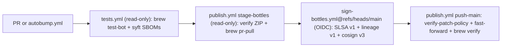

# Artagon AI Tools Homebrew Tap (`artagon/aitools`)

[](https://github.com/artagon/homebrew-aitools/actions/workflows/tests.yml)
[](https://github.com/artagon/homebrew-aitools/attestations)
[](https://github.com/artagon/homebrew-aitools/releases)
<!-- BEGIN TAP_BADGES -->
<!-- Auto-generated from Formula/*.rb and Casks/*.rb by scripts/update-tap-docs.sh (and refreshed automatically by publish.yml). Do not edit manually. -->
[](#complete-formula--cask-inventory)
[](#complete-formula--cask-inventory)
<!-- END TAP_BADGES -->
[](ABOUT.md#authors--license)

Curated developer CLIs, local MCP servers, memory graphs, cross-agent hook runners, build caches, evaluation harnesses, OpenTelemetry collectors, subscription-only AI routing & coding agents, JDK 28 Valhalla-aware AST analyzers, and macOS desktop automation casks for AI coding agents.

> [!IMPORTANT]
> **Tap Security & Non-Invasiveness Contract**
> - **Zero live config mutation**: `brew install`, `upgrade`, and `uninstall` never modify `~/.claude*`, `~/.codex*`, `~/.gemini*`, `~/.config/*`, `~/.hammerspoon`, or shell profiles; macOS casks configure only their own app `UserDefaults`, overridable via `HOMEBREW_*` environment flags.
> - **Hardened local-first defaults**: Wrappers disable startup update checks, telemetry, and unsolicited cloud routing, default local services to `127.0.0.1`, and block or warn against in-place self-updaters.
> - **Cryptographic provenance**: Published bottles carry ref-bound SLSA v1 attestations, signed build lineage, keyless Sigstore `cosign` v3 bundles, and SPDX 2.3 + CycloneDX 1.6 SBOMs.

[Quick Start](#quick-start) · [Formula Catalog](#formula-catalog-by-domain) · [Complete Inventory](#complete-formula--cask-inventory) · [MCP Server Reference](#mcp-server-reference) · [Bundled Agent Skills](#bundled-agent-skills--plugins) · [Provenance & Verification](#build-provenance--verification) · [Publishing & Autobump](#publishing--automatic-updates) · [Troubleshooting](#troubleshooting--faq)

---

## Quick Start

```sh
# 1. Tap and trust this repository once:
brew tap artagon/aitools
brew trust --tap artagon/aitools

# 2. Install any formula with Homebrew attestation verification enabled:
HOMEBREW_VERIFY_ATTESTATIONS=1 brew install artagon/aitools/ripwire
```

Install curated domain bundles with fully qualified `artagon/aitools/<formula>` names:

```sh
# Code search, JDK 28 Valhalla Java AST, and hash-anchored editing:
brew install artagon/aitools/ripwire artagon/aitools/entire-graph artagon/aitools/ast-grep-valhalla artagon/aitools/tree-sitter-java-valhalla \
  artagon/aitools/tgrep artagon/aitools/ck artagon/aitools/codesearch artagon/aitools/fff-mcp artagon/aitools/hashline

# Local agent memory, hybrid Markdown search, and token compression:
brew install artagon/aitools/basic-memory artagon/aitools/hindsight artagon/aitools/claude-mem \
  artagon/aitools/qmd artagon/aitools/squeez

# Multi-agent mail, NATS event bus, terminal workspaces, fact-intent graphs, and Beads issue graphs:
brew install artagon/aitools/agent-mail artagon/aitools/br artagon/aitools/bd artagon/aitools/bv \
  artagon/aitools/nats artagon/aitools/herdr artagon/aitools/autoswarm artagon/aitools/cairn

# Architecture decisions, hooks, Jinja2 templates, build caching, skill compilers, and benchmarking:
brew install artagon/aitools/adrkit artagon/aitools/agentsync artagon/aitools/agenthooks \
  artagon/aitools/skillfile artagon/aitools/skillprism artagon/aitools/minijinja-cli \
  artagon/aitools/python-minijinja artagon/aitools/waza artagon/aitools/skillopt \
  artagon/aitools/hyperfine artagon/aitools/kache

# Live evaluation harnesses, versioned skill registries, and OpenTelemetry observability:
brew install artagon/aitools/mlflow artagon/aitools/inspect-ai artagon/aitools/langfuse-cli \
  artagon/aitools/phoenix-cli artagon/aitools/arize-phoenix artagon/aitools/openlit

# Subscription-only AI gateway & terminal coding agents (no API keys):
brew install artagon/aitools/magpie artagon/aitools/omp artagon/aitools/pi-agent-rust

# macOS native desktop casks (override defaults with HOMEBREW_* flags):
brew install --cask artagon/aitools/ghostty artagon/aitools/hammerspoon artagon/aitools/markdown-preview
```

> [!NOTE]
> Always qualify `artagon/aitools/{tgrep,nats,herdr,hyperfine,minijinja-cli}` (and `--cask artagon/aitools/{ghostty,hammerspoon,markdown-preview}`) so Homebrew selects this tap over same-named `homebrew/core` formulae or `homebrew/cask` casks. When a differently named core formula with overlapping binaries is linked (`ast-grep`, `beads`, `beads_viewer`, `adr-tools`, `cln`, `pi-coding-agent`, `pixie`, or `px`), run `brew unlink <formula>` first.

---

## Formula Catalog by Domain

### 1. Code Search, JDK 28 Valhalla Java AST & Hash-Anchored Editing

| Formula | Upstream & License | Binaries, Libraries & Assets | Tap Build & Runtime Hardening |
| :--- | :--- | :--- | :--- |
| [`tree-sitter-java-valhalla`](Formula/tree-sitter-java-valhalla.rb) | [tree-sitter/tree-sitter-java](https://github.com/tree-sitter/tree-sitter-java) (`MIT`) | `libtree-sitter-java-valhalla` + crate sources in `pkgshare` | Source ABI `14` C11 build with additive JEP 401/440/511/513 Java grammar patch; contextual `value` preserves standard Java ASTs |
| [`ast-grep-valhalla`](Formula/ast-grep-valhalla.rb) | [ast-grep/ast-grep](https://github.com/ast-grep/ast-grep) (`MIT`) | `ast-grep`, `sg`, shell completions | Source Rust build (`cargo install --locked`) compiling `tree-sitter-java-valhalla` into built-in `-l java`; `conflicts_with "ast-grep"` |
| [`ripwire`](Formula/ripwire.rb) | [redhat-et/ripwire](https://github.com/redhat-et/ripwire) (`Apache-2.0`) | `ripwire`, `ripwire-agent-install`, `pkgshare/{skills,hooks}` | Source CMake/C++23 build with Valhalla `parser.c` + Java query patch; opt-in skill/hook installer (`--hook` required for config edits) |
| [`entire-graph`](Formula/entire-graph.rb) | [entireio/entire-graph](https://github.com/entireio/entire-graph) (`MIT`) | `entire-graph`, `NOTICES`, `entire-plugin.yml`, `pkgshare/{.claude-plugin,hooks,scripts,skills/stats}` | Source Go + CGO build (`CGO_ENABLED=1`) with standalone prompt-context hook fallback; strict no-egress static analysis (zero network/telemetry); opt-in `entire-graph setup --repo .` |
| [`tgrep`](Formula/tgrep.rb) | [microsoft/tgrep](https://github.com/microsoft/tgrep) (`MIT`) | `tgrep` | SHA-256-pinned release binary; local `.tgrep/` trigram index only; no background watcher started automatically |
| [`ck`](Formula/ck.rb) | [BeaconBay/ck](https://github.com/BeaconBay/ck) (`MIT OR Apache-2.0`) | `ck` (`--lex`, `--sem`, `--hybrid`, `--serve` MCP) | SHA-256-pinned release binary (`glibc >= 2.39` on Linux); `--lex`/`--regex` fully offline; ONNX models cached on first `--sem` |
| [`codesearch`](Formula/codesearch.rb) | [flupkede/codesearch](https://github.com/flupkede/codesearch) (`Apache-2.0`) | `codesearch` CLI + `mcp` / `serve`, `pkgshare/integrations/{claude-code,opencode}` | Source Rust build (`cargo install --locked`, `protobuf`, Linux `openssl@4`); defaults `CODESEARCH_SERVE_HOST=127.0.0.1`, `CODESEARCH_EMBED_PROVIDER=fastembed`, `DO_NOT_TRACK=true`, and blocks `update`/`self-update`/`upgrade` (`exit 2`) |
| [`fff-mcp`](Formula/fff-mcp.rb) | [dmtrKovalenko/fff](https://github.com/dmtrKovalenko/fff) (`MIT`) | `fff-mcp` stdio MCP server | SHA-256-pinned release binary + tag `LICENSE`; wrapper automatically passes `--no-update-check` |
| [`hashline`](Formula/hashline.rb) | [quangdang46/hashline](https://github.com/quangdang46/hashline) (`MIT OR Apache-2.0`) | `hashline` CLI + `hashline mcp` + `pkgshare/skills/hashline` | Source Rust build (`cargo install --locked`); wrapper exports `HASHLINE_NO_UPDATE_CHECK=1` |

<details>
<summary><strong>JDK 28 Valhalla Java syntax (`tree-sitter-java-valhalla`) & Ripwire CLI installer details</strong></summary>

| Syntax | Example | Specification |
| :--- | :--- | :--- |
| Value classes and value records | `value record Point(int x, int y) {}` | JEP 401 (preview) |
| Statements before `super(...)` and `this(...)` | `this.x = x; super();` | JEP 513 |
| Module imports | `import module java.base;` | JEP 511 |
| Qualified record patterns | `o instanceof Shape.Circle(int r)` | JEP 440 |
| Annotations before a varargs ellipsis | `Object @Nullable ... rest` | JLS 8.4.1 |

Opt-in Ripwire skill and hook activation (`ripwire-agent-install` / [`scripts/install-agent-skills.sh`](scripts/install-agent-skills.sh)):

```sh
ripwire-agent-install --list                  # inspect detected CLIs (no writes)
ripwire-agent-install --claude --codex --agy  # install skills only
ripwire-agent-install --claude --hook         # opt-in PreToolUse hook registration
"$(brew --prefix ripwire)/share/ripwire/skills/install.sh" --uninstall --target ~/.claude/skills
```

</details>

### 2. Local Agent Memory, Hybrid Markdown Search & Token Compression

| Formula | Upstream & License | Binaries & Assets | Tap Build & Runtime Hardening |
| :--- | :--- | :--- | :--- |
| [`basic-memory`](Formula/basic-memory.rb) | [basicmachines-co/basic-memory](https://github.com/basicmachines-co/basic-memory) (`AGPL-3.0-or-later`) | `basic-memory`, `bm`, `pkgshare/skills/memory-*` | Source `uv` Python `3.13` build (`preserve_rpath`); forces `BASIC_MEMORY_FORCE_LOCAL=true`, disables promos/Logfire, and blocks `cloud`, `update`, and HTTP/SSE transports |
| [`hindsight`](Formula/hindsight.rb) | [vectorize-io/hindsight](https://github.com/vectorize-io/hindsight) (`MIT`) | `hindsight`, `hindsight-mcp`, `hindsight-coding-agents`, `pkgshare/skills` | Source Rust CLI + TypeScript/Node MCP bundle; compiled defaults bind `http://127.0.0.1:8888` (`self-hosted`, `autoUpdate=false`), reject non-loopback URLs and `cloud`/`update`, and require `HINDSIGHT_MCP_HARNESS` |
| [`claude-mem`](Formula/claude-mem.rb) | [thedotmack/claude-mem](https://github.com/thedotmack/claude-mem) (`Apache-2.0`) | `claude-mem`, `claude-mem-mcp`, `NOTICE`, `pkgshare/{plugin,skills,hooks,modes}` | Source TypeScript/esbuild/Vite + frozen `plugin/bun.lock` build linking `tree-sitter-cli` and pruning foreign `prebuilds/*`; loopback `127.0.0.1`, PostHog/auto-update disabled, ambient `*_API_KEY` scrubbed unless `CLAUDE_MEM_ALLOW_API_KEYS=1`, `update`/`upgrade`/`self-update` blocked (`exit 2`) |
| [`qmd`](Formula/qmd.rb) | [tobi/qmd](https://github.com/tobi/qmd) (`MIT`) | `qmd` CLI + `qmd mcp` + `pkgshare/skills/qmd` | Source TypeScript/Node build pruning foreign `prebuilds/*`; exports `QMD_SOURCE_MODE=0`; local SQLite BM25 + `sqlite-vec` + GGUF reranking |
| [`squeez`](Formula/squeez.rb) | [claudioemmanuel/squeez](https://github.com/claudioemmanuel/squeez) (`Apache-2.0`) | `squeez` CLI + `squeez mcp`, `NOTICE` | Source Rust build patching conservative defaults (`auto_compress_md=false`, `persona=off`, `wrap_bash=false`) and blocking `squeez update` |

### 3. Multi-Agent Coordination, Event Buses & Beads Graph Tracking

| Formula | Upstream & License | Binaries & Assets | Tap Build & Runtime Hardening |
| :--- | :--- | :--- | :--- |
| [`agent-mail`](Formula/agent-mail.rb) | [Dicklesworthstone/mcp_agent_mail_rust](https://github.com/Dicklesworthstone/mcp_agent_mail_rust) (`:cannot_represent` — MIT + Rider) | `mcp-agent-mail`, `am`, `LICENSE` | SHA-256-pinned archive; full custom `LICENSE` in `prefix`; local stdio or HTTP (`am serve-http`); warns against `am self-update` |
| [`br`](Formula/br.rb) | [Dicklesworthstone/beads_rust](https://github.com/Dicklesworthstone/beads_rust) (`:cannot_represent` — MIT + Rider) | `br`, shell completions, `LICENSE` | SHA-256-pinned archive; full custom `LICENSE` in `prefix`; local `.beads/` state only; warns against `br upgrade` |
| [`bd`](Formula/bd.rb) | [gastownhall/beads](https://github.com/gastownhall/beads) (`MIT`) | `bd`, shell completions, `LICENSE` | SHA-256-pinned archive with embedded pure-Go Dolt (`conflicts_with "beads"`); wrapper exports `BD_DISABLE_METRICS=1` and `DO_NOT_TRACK=1` |
| [`bv`](Formula/bv.rb) | [Dicklesworthstone/beads_viewer](https://github.com/Dicklesworthstone/beads_viewer) (`:cannot_represent` — MIT + Rider) | `bv`, shell completions, `LICENSE` | SHA-256-pinned archive; full custom `LICENSE` (`conflicts_with "beads_viewer"`); read-only `--robot-*` graph triage |
| [`nats`](Formula/nats.rb) | [nats-io/natscli](https://github.com/nats-io/natscli) (`Apache-2.0`) | `nats`, `bash`/`zsh` completions | Source Go build; stores contexts in `${XDG_CONFIG_HOME:-~/.config}/nats/context`; no daemon started |
| [`herdr`](Formula/herdr.rb) | [herdrdev/herdr](https://github.com/herdrdev/herdr) (`Apache-2.0`) | `herdr`, shell completions, `LICENSE` | SHA-256-pinned binary + tag `LICENSE`; local Unix socket session multiplexer; warns against `herdr update` |
| [`autoswarm`](Formula/autoswarm.rb) | [HKUDS/AutoSwarm](https://github.com/HKUDS/AutoSwarm) (`MIT`) | `autoswarm` (`desk`), `pkgshare/{skills/autoswarm,plugins/opencode}` | Source `uv` Python `3.13` build (`preserve_rpath`); patches `setup.py` to persist `opt_libexec` Python across upgrades, blocks `update`/`self-update`/`upgrade` (`exit 2`); opt-in `autoswarm setup --host <host>` |
| [`cairn`](Formula/cairn.rb) | [oritera/Cairn](https://github.com/oritera/Cairn) (`AGPL-3.0-only`) | `cairn` (`serve`, `dispatch`), `pkgshare/{examples,docs,skills}` | Source `uv` Python `3.13` build (`preserve_rpath`) stripping upstream Aliyun PyPI mirror/lockfile; `cairn serve` binds `127.0.0.1:8000`, exports `DO_NOT_TRACK=1`, and blocks `update`/`self-update`/`upgrade` (`exit 2`) |

### 4. Architecture Decisions, Hooks, Build Caching, Skill Lifecycle & Benchmarking

| Formula | Upstream & License | Binaries & Assets | Tap Build & Runtime Hardening |
| :--- | :--- | :--- | :--- |
| [`adrkit`](Formula/adrkit.rb) | [mbeacom/adrkit](https://github.com/mbeacom/adrkit) (`Apache-2.0`) | `adr`, `adrkit`, `adrkit-mcp`, completions, `pkgshare/skills` | Source `bun` build targeting Homebrew `node` (`conflicts_with "adr-tools"`); local `docs/adr` governance |
| [`agentsync`](Formula/agentsync.rb) | [dallay/agentsync](https://github.com/dallay/agentsync) (`MIT`) | `agentsync`, `README.md`, `LICENSE` | SHA-256-pinned archive; wrapper exports `AGENTSYNC_NO_UPDATE_CHECK=1`; edits `.agents/agentsync.toml` only when run |
| [`agenthooks`](Formula/agenthooks.rb) | [speakeasy-api/agenthooks](https://github.com/speakeasy-api/agenthooks) (`MIT`) | `agenthooks-secretguard`, Go module + `DESIGN.md` + `examples/` in `pkgshare` | Source Go build (`CGO_ENABLED=0`) disabling `claude`/`codex mcp list` subprocess probes (`WithoutMCPListFallback`); masks detected secrets and blocks `update`/`self-update`/`upgrade` (`exit 2`) |
| [`skillfile`](Formula/skillfile.rb) | [eljulians/skillfile](https://github.com/eljulians/skillfile) (`Apache-2.0`) | `skillfile`, shell completions | Source Rust build (`cargo install --locked`); wrapper exports `SKILLFILE_NO_UPDATE_NOTIFIER=1` |
| [`skillprism`](Formula/skillprism.rb) | [Tuvren/skillprism](https://github.com/Tuvren/skillprism) (`Apache-2.0`) | `skillprism`, completions, `man1/skillprism.1` | Source Rust offline Jinja2 multi-harness `SKILL.md.j2` compiler (`./dist/`); zero network or live config writes |
| [`minijinja-cli`](Formula/minijinja-cli.rb) | [mitsuhiko/minijinja](https://github.com/mitsuhiko/minijinja) (`Apache-2.0`) | `minijinja-cli`, `man1/minijinja-cli.1`, `bash`/`zsh`/`fish`/`pwsh` completions, `pkgshare/skills/minijinja-cli` | Source Rust build (`cargo install --locked`, `ASSET_OUT_DIR`); pure offline Jinja2 CLI renderer & expression evaluator with `--no-include`/`--safe-path`/`--fuel` sandboxing |
| [`python-minijinja`](Formula/python-minijinja.rb) | [mitsuhiko/minijinja](https://github.com/mitsuhiko/minijinja) (`Apache-2.0`) | `minijinja` Python 3 (`3.13`–`3.15`) ABI3 wheels + `pkgshare/skills/minijinja-python` | Offline `maturin` + `cargo fetch --locked` PEP 517 build across Homebrew Pythons; zero runtime network/telemetry deps and deterministic `fuel` + `load_from_path` sandboxing |
| [`waza`](Formula/waza.rb) | [microsoft/waza](https://github.com/microsoft/waza) (`MIT`) | `waza` + embedded SPA, completions, `pkgshare/skills` | Source Vite/React + Go build (`PLAYWRIGHT_SKIP_BROWSER_DOWNLOAD=1`); exports `WAZA_NO_UPDATE_CHECK=1` and blocks `waza update` (`exit 2`) |
| [`skillopt`](Formula/skillopt.rb) | [microsoft/SkillOpt](https://github.com/microsoft/SkillOpt) (`MIT`) | `skillopt-{train,eval,sleep}`, `skillopt-sleep-mcp`, `pkgshare/{plugins,configs}` | Source `uv` Python `3.13` build; `skillopt-sleep` defaults to `--backend mock` (zero API spend) and human review before `adopt` |
| [`hyperfine`](Formula/hyperfine.rb) | [sharkdp/hyperfine](https://github.com/sharkdp/hyperfine) (`MIT OR Apache-2.0`) | `hyperfine`, `man1/hyperfine.1`, `bash`/`zsh`/`fish`/`pwsh` completions | Source Rust build (`cargo install --locked`); direct offline execution (`--shell=none`) with zero telemetry or update checks |
| [`kache`](Formula/kache.rb) | [kunobi-ninja/kache](https://github.com/kunobi-ninja/kache) (`Apache-2.0`) | `kache`, `kache-engine`, completions, `libexec/shims`, `pkgshare/{schemas,examples}` | Source Rust build (`cargo install --locked`, `RUSTC_WRAPPER=""`); local store + Unix socket daemon (`daemon.sock`) with no remote cache, planner, or telemetry configured; `kache update` exits `2` |

### 5. Evaluation Harnesses, Skill Registries & OpenTelemetry Observability

| Formula | Upstream & License | Binaries & Assets | Tap Build & Runtime Hardening |
| :--- | :--- | :--- | :--- |
| [`mlflow`](Formula/mlflow.rb) | [mlflow/mlflow](https://github.com/mlflow/mlflow) (`Apache-2.0`) | `mlflow` (`mcp run`, `skills`), `mlflow-codex`, `mlflow-claude-code`, `pkgshare/skills` | Source Yarn 4 React UI + TypeScript agent CLIs + `uv` `mlflow[mcp]`; exports `MLFLOW_DISABLE_TELEMETRY=true` and `DO_NOT_TRACK=true` |
| [`inspect-ai`](Formula/inspect-ai.rb) | [UKGovernmentBEIS/inspect_ai](https://github.com/UKGovernmentBEIS/inspect_ai) (`MIT`) | `inspect` bundling `inspect-swe` (`0.3.0`) + `inspect-mlflow` (`0.9.0`) | Source `uv` Python `3.13` wheel bundle with `mcp`, `anthropic`, `openai`, and `google-genai`; exports `MLFLOW_DISABLE_TELEMETRY=true` |
| [`langfuse-cli`](Formula/langfuse-cli.rb) | [langfuse/langfuse-cli](https://github.com/langfuse/langfuse-cli) (`MIT`) | `langfuse` (`api`, `skills`), `pkgshare/skills` | Source `bun` build targeting Homebrew `node`; patches `DEFAULT_HOST` from `cloud.langfuse.com` to `http://127.0.0.1:3000` |
| [`phoenix-cli`](Formula/phoenix-cli.rb) | [Arize-ai/phoenix](https://github.com/Arize-ai/phoenix) (`Apache-2.0`) | `px`, `phoenix-cli`, `pxi`, `pkgshare/{skills,plugins}` | Source `pnpm` TypeScript build (`conflicts_with "pixie", "px"`); disables npm update checks, exports `SCARF_NO_ANALYTICS=true`, and blocks `px self update` (`exit 2`) |
| [`arize-phoenix`](Formula/arize-phoenix.rb) | [Arize-ai/phoenix](https://github.com/Arize-ai/phoenix) (`Elastic-2.0`) | `phoenix`, `arize-phoenix`, `LICENSE`, `IP_NOTICE`, `pkgshare/{skills,plugins}` | Source `pnpm` `phoenix-ui` + `uv` workspace wheels; defaults `PHOENIX_HOST=127.0.0.1`, `PHOENIX_TELEMETRY_ENABLED=false`, and `PHOENIX_ALLOW_EXTERNAL_RESOURCES=false` |
| [`openlit`](Formula/openlit.rb) | [openlit/openlit](https://github.com/openlit/openlit) (`Apache-2.0`) | `openlit`, completions, `pkgshare/{plugins,agent-guides}` | Source Go build; defaults OTLP HTTP to `http://127.0.0.1:4318` (`0600` `~/.config/openlit/config.env`); opt-in `openlit coding install` |

<details>
<summary><strong>Evaluation & OpenTelemetry coding-agent integration details (`inspect-ai` & `openlit`)</strong></summary>

`inspect-ai` pre-bundles live coding-agent trial adapters (`inspect_swe`: `claude_code`, `codex_cli`, `antigravity`, `gemini_cli`, `kimi_code`, `opencode`, `mini_swe_agent`) and MLflow trace hooks (`inspect_mlflow` via `MLFLOW_INSPECT_TRACING=true` + `MLFLOW_TRACKING_URI`). For task suites with custom Python dependencies, pin `inspect-ai` and `inspect-swe` in your project's `uv.lock` (`uv run inspect eval`).

`openlit` coding-agent CLI support (`openlit coding install --vendor=<vendor> --dry-run`):

| Agent CLI | Built-in `openlit coding` installer | Connection path |
| :--- | :--- | :--- |
| **Claude Code** | Yes (`--vendor=claude-code`) | Opt-in plugin hooks (`~/.claude/plugins/openlit-cc`) or `openlit coding launch claude`, plus optional native OTel export |
| **OpenAI Codex** | Yes (`--vendor=codex`) | Opt-in local marketplace & hooks (`~/.local/share/openlit/codex-marketplace`), or Codex native `[otel]` export |
| **Cursor** | Yes (`--vendor=cursor`) | Opt-in user hook merge (`~/.cursor/hooks.json`) |
| **OpenCode** | Yes (`--vendor=opencode`) | Opt-in OpenCode plugin installation or `openlit coding launch opencode` |
| **GitHub Copilot CLI** | No | Point native OpenTelemetry export (`OTEL_EXPORTER_OTLP_ENDPOINT`) at the OpenLIT collector |
| **Google Antigravity (`agy`)** | No | External hook script or OTLP bridge forwarding spans to `http://127.0.0.1:4318` |

</details>

### 6. Subscription-Only AI Gateway & Terminal Coding Agents

| Formula | Upstream & License | Binaries & Assets | Tap Build & Runtime Hardening |
| :--- | :--- | :--- | :--- |
| [`magpie`](Formula/magpie.rb) | [yetone/magpie](https://github.com/yetone/magpie) (`MIT`) | `magpie`, `THIRD_PARTY_NOTICES`, `pkgshare/examples/subscription-only/setup-groups.sh` | Source Go `packedassets` build (macOS WebKit tray + Linux static `nogui`); loopback `127.0.0.1:3425`, telemetry/auto-update/PII downloads disabled, API-key providers and paid credits blocked unless `MAGPIE_ALLOW_API_KEYS=1` / `MAGPIE_ALLOW_CREDITS=1`, `magpie update` blocked (`exit 2`) |
| [`omp`](Formula/omp.rb) | [can1357/oh-my-pi](https://github.com/can1357/oh-my-pi) (`MIT`) | `omp`, completions, `pkgshare/examples/subscription-only/{models.yml,config.yml}` | SHA-256-pinned binary + tag `LICENSE`; injects `homebrew-policy.yml` (`checkUpdate: false`, `update.auto: false`, `otlpExportEnabled: false`), disables OTel/AutoQA/Spotlight, scrubs ambient `*_API_KEY`, and blocks `omp update`, `--api-key`, and `--include-env` (`exit 2`) unless `OMP_ALLOW_API_KEYS=1` |
| [`pi-agent-rust`](Formula/pi-agent-rust.rb) | [Dicklesworthstone/pi_agent_rust](https://github.com/Dicklesworthstone/pi_agent_rust) (`:cannot_represent` — MIT + Rider) | `pi`, `rpi`, completions, `LICENSE`, `pkgshare/{skills/pi-agent-rust,examples/subscription-only}` | SHA-256-pinned archive + full custom `LICENSE` (`conflicts_with "cln", "pi-coding-agent"`); exports `PI_SKIP_VERSION_CHECK=1` and `DO_NOT_TRACK=true`, scrubs ambient `*_API_KEY`, and blocks `self-update` and `--api-key` (`exit 2`) unless `PI_ALLOW_API_KEYS=1` |

<details>
<summary><strong>Subscription-only OAuth onboarding (`magpie`, `omp`, & `pi-agent-rust`)</strong></summary>

```sh
# 1. Authenticate flat-rate CLI subscriptions in local Magpie (127.0.0.1:3425):
magpie accounts add claude
magpie accounts add codex
magpie accounts add copilot
magpie accounts add gemini
magpie serve

# 2. Authenticate omp directly via OAuth or route through Magpie:
omp auth-broker login anthropic
omp auth-broker login openai-codex
magpie oh-my-pi group/sub-coder
```

</details>

### 7. macOS Native Desktop Casks

| Cask | Upstream & License | App & CLI Assets | Tap Build & `postflight_steps` Hardening |
| :--- | :--- | :--- | :--- |
| [`ghostty`](Casks/ghostty.rb) | [ghostty-org/ghostty](https://github.com/ghostty-org/ghostty) (`MIT`) | `Ghostty.app` (`1.4.0`, macOS 13+), `ghostty(1)`/`ghostty(5)`, `bash`/`zsh`/`fish` completions | SHA-256-pinned universal `.dmg` (`conflicts_with cask: "ghostty@tip"`); `postflight_steps` disables Sparkle auto-updates (`SUEnableAutomaticChecks`/`SUAutomaticallyUpdate`/`SUSendProfileInfo = false`); never edits `~/.config/ghostty` or shell profiles |
| [`hammerspoon`](Casks/hammerspoon.rb) | [Hammerspoon/hammerspoon](https://github.com/Hammerspoon/hammerspoon) (`MIT`) | `Hammerspoon.app` (`1.1.1`, macOS 13+), `hs` CLI (`Contents/Frameworks/hs/hs`) | SHA-256-pinned `.zip`; `postflight_steps` disables Sparkle auto-updates (`SUEnableAutomaticChecks`/`SUAutomaticallyUpdate`/`SUSendProfileInfo = false`); never edits `~/.hammerspoon`, coding-agent configs, or shell profiles |
| [`markdown-preview`](Casks/markdown-preview.rb) | [pluk-inc/markdown-preview](https://github.com/pluk-inc/markdown-preview) (`MIT`) | `Markdown Preview.app` (macOS 15+), `mdp`, `md-preview`, `markdown-preview` | SHA-256-pinned `.dmg` depending on `duti`; `postflight_steps` disables Sparkle auto-updates, PostHog usage analytics, and Sentry crash reports on `doc.md-preview`, and registers `net.daringfireball.markdown` via `duti` once (skipped when already set or when `CI` is truthy); overridable via `HOMEBREW_MARKDOWN_PREVIEW_*` / `HOMEBREW_AITOOLS_*` |

<details>
<summary><strong>Cask install environment flags (`HOMEBREW_*`)</strong></summary>

Homebrew filters all custom environment variables unless they start with `HOMEBREW_`. Per-cask flags override tap-wide `HOMEBREW_AITOOLS_*` flags; accepted values are `1`/`true`/`yes`/`on` (truthy) and `0`/`false`/`no`/`off` (falsy), and invalid values warn on stderr and fail closed (`false`):

| Tap-Wide Flag | Per-Cask Flag (`<CASK>` = `GHOSTTY` \| `HAMMERSPOON` \| `MARKDOWN_PREVIEW`) | Default | Effect |
| :--- | :--- | :--- | :--- |
| `HOMEBREW_AITOOLS_SKIP_DEFAULTS` | `HOMEBREW_<CASK>_SKIP_DEFAULTS` | `0` | Skip all `postflight_steps` `defaults` and `duti` writes |
| `HOMEBREW_AITOOLS_AUTO_UPDATES` | `HOMEBREW_<CASK>_AUTO_UPDATES` | `0` | Keep Sparkle automatic update checks enabled (`SUEnableAutomaticChecks=true`) |
| `HOMEBREW_AITOOLS_TELEMETRY` | `HOMEBREW_MARKDOWN_PREVIEW_TELEMETRY` | `0` | Keep PostHog usage analytics and Sentry crash reporting enabled |
| `HOMEBREW_AITOOLS_SET_DEFAULT` | `HOMEBREW_MARKDOWN_PREVIEW_SET_DEFAULT` | `1` (`0` when `CI` is truthy) | Register `doc.md-preview` as default handler for `net.daringfireball.markdown` via `duti` |

```sh
# Example: install markdown-preview without changing the default .md handler:
HOMEBREW_MARKDOWN_PREVIEW_SET_DEFAULT=0 \
  brew install --cask artagon/aitools/markdown-preview
```

</details>

---

## Complete Formula & Cask Inventory

<!-- BEGIN TAP_INVENTORY -->
<!-- Auto-generated from Formula/*.rb and Casks/*.rb by scripts/update-tap-docs.sh (and refreshed automatically by publish.yml). Do not edit manually. -->

Total packaged tools: **45** (**42** formulae: **33** bottled, **9** source-only; **3** macOS casks).

### Formulae (42)

| Formula | Version | License | Bottles | Description |
| :--- | :--- | :--- | :--- | :--- |
| [`adrkit`](Formula/adrkit.rb) | `0.20.0_1` | `Apache-2.0` | `arm64_tahoe` · `arm64_linux` · `x86_64_linux` | [mbeacom/adrkit](https://github.com/mbeacom/adrkit) — Architecture governance CLI and MCP server for AI coding agents |
| [`agent-mail`](Formula/agent-mail.rb) | `0.3.41` | Custom (`LICENSE`) | `arm64_tahoe` · `arm64_linux` · `x86_64_linux` | [Dicklesworthstone/mcp_agent_mail_rust](https://github.com/Dicklesworthstone/mcp_agent_mail_rust) — Asynchronous coordination MCP server and CLI for AI coding agents |
| [`agenthooks`](Formula/agenthooks.rb) | `0.7.7` | `MIT` | `arm64_tahoe` · `arm64_linux` · `x86_64_linux` | [speakeasy-api/agenthooks](https://github.com/speakeasy-api/agenthooks) — Cross-agent hook Go library and credential-scanning hook runner |
| [`agentsync`](Formula/agentsync.rb) | `1.53.1` | `MIT` | `arm64_tahoe` | [dallay/agentsync](https://github.com/dallay/agentsync) — Sync AI agent configurations and MCP servers via symbolic links |
| [`arize-phoenix`](Formula/arize-phoenix.rb) | `22.0.1` | `Elastic-2.0` | source | [arize.com/docs/phoenix](https://arize.com/docs/phoenix) — Local-first OpenTelemetry AI observability and evaluation server |
| [`ast-grep-valhalla`](Formula/ast-grep-valhalla.rb) | `0.51.3` | `MIT` | `arm64_tahoe` · `arm64_linux` · `x86_64_linux` | [ast-grep.github.io](https://ast-grep.github.io/) — Code searching, linting, rewriting with a Valhalla-aware Java grammar |
| [`autoswarm`](Formula/autoswarm.rb) | `0.1.1` | `MIT` | `arm64_tahoe` · `arm64_linux` · `x86_64_linux` | [HKUDS/AutoSwarm](https://github.com/HKUDS/AutoSwarm) — Coordinate installed coding agents from one conversation |
| [`basic-memory`](Formula/basic-memory.rb) | `1.0.0` | `AGPL-3.0-or-later` | `arm64_tahoe` · `arm64_linux` · `x86_64_linux` | [basicmachines-co/basic-memory](https://github.com/basicmachines-co/basic-memory) — Local-first knowledge graph and stdio MCP server for AI agents |
| [`bd`](Formula/bd.rb) | `1.3.4_1` | `MIT` | `arm64_tahoe` · `arm64_linux` · `x86_64_linux` | [gastownhall/beads](https://github.com/gastownhall/beads) — Git-backed graph issue tracker for AI coding agents |
| [`br`](Formula/br.rb) | `0.7.6` | Custom (`LICENSE`) | `arm64_tahoe` | [Dicklesworthstone/beads_rust](https://github.com/Dicklesworthstone/beads_rust) — Local-first issue tracker for AI coding agents |
| [`bv`](Formula/bv.rb) | `0.27.0` | Custom (`LICENSE`) | `arm64_tahoe` · `arm64_linux` · `x86_64_linux` | [Dicklesworthstone/beads_viewer](https://github.com/Dicklesworthstone/beads_viewer) — Graph-aware terminal viewer and triage engine for Beads projects |
| [`cairn`](Formula/cairn.rb) | `0.2.1` | `AGPL-3.0-only` | `arm64_tahoe` · `arm64_linux` · `x86_64_linux` | [oritera/Cairn](https://github.com/oritera/Cairn) — Blackboard fact-intent graph server and dispatcher for AI agents |
| [`ck`](Formula/ck.rb) | `0.8.1` | `MIT OR Apache-2.0` | `arm64_tahoe` | [BeaconBay/ck](https://github.com/BeaconBay/ck) — Local semantic and hybrid BM25 code search with an MCP server |
| [`claude-mem`](Formula/claude-mem.rb) | `16.1.0` | `Apache-2.0` | source | [thedotmack/claude-mem](https://github.com/thedotmack/claude-mem) — Persistent cross-session memory CLI and local MCP server for coding agents |
| [`codesearch`](Formula/codesearch.rb) | `1.8.11` | `Apache-2.0` | `arm64_tahoe` · `arm64_linux` · `x86_64_linux` | [flupkede/codesearch](https://github.com/flupkede/codesearch) — Multi-repo semantic code search CLI and MCP server |
| [`entire-graph`](Formula/entire-graph.rb) | `0.6.0` | `MIT` | `arm64_tahoe` · `arm64_linux` · `x86_64_linux` | [entireio/entire-graph](https://github.com/entireio/entire-graph) — Deterministic local code graph for coding agents |
| [`fff-mcp`](Formula/fff-mcp.rb) | `0.11.0_1` | `MIT` | `arm64_tahoe` · `arm64_linux` · `x86_64_linux` | [dmtrKovalenko/fff](https://github.com/dmtrKovalenko/fff) — Fast, frecency-ranked file search MCP server for AI agents |
| [`hashline`](Formula/hashline.rb) | `0.9.24_1` | `MIT OR Apache-2.0` | `arm64_tahoe` · `arm64_linux` · `x86_64_linux` | [quangdang46/hashline](https://github.com/quangdang46/hashline) — Hash-anchored line editing for AI coding agents |
| [`herdr`](Formula/herdr.rb) | `0.9.5` | `Apache-2.0` | `arm64_tahoe` | [herdrdev/herdr](https://github.com/herdrdev/herdr) — Multiplexed terminal manager for AI coding agent sessions |
| [`hindsight`](Formula/hindsight.rb) | `1.2.3` | `MIT` | `arm64_tahoe` · `arm64_linux` · `x86_64_linux` | [vectorize-io/hindsight](https://github.com/vectorize-io/hindsight) — Semantic agent memory CLI and local MCP server |
| [`hyperfine`](Formula/hyperfine.rb) | `2.0.0` | `MIT OR Apache-2.0` | `arm64_tahoe` · `arm64_linux` · `x86_64_linux` | [sharkdp/hyperfine](https://github.com/sharkdp/hyperfine) — Command-line benchmarking tool |
| [`inspect-ai`](Formula/inspect-ai.rb) | `0.3.291` | `MIT` | source | [inspect.aisi.org.uk](https://inspect.aisi.org.uk/) — Agentic LLM evaluation harness bundling Inspect SWE and MLflow hooks |
| [`kache`](Formula/kache.rb) | `2.3.0` | `Apache-2.0` | source | [kunobi-ninja/kache](https://github.com/kunobi-ninja/kache) — Zero-copy, content-addressed build cache for Rust, C/C++, and CUDA |
| [`langfuse-cli`](Formula/langfuse-cli.rb) | `1.4.0` | `MIT` | source | [langfuse/langfuse-cli](https://github.com/langfuse/langfuse-cli) — Command-line client for Langfuse API and versioned agent skills |
| [`magpie`](Formula/magpie.rb) | `0.1.4704` | `MIT` | source | [usemagpie.ai](https://usemagpie.ai) — Subscription-first local gateway and router for AI coding agents |
| [`minijinja-cli`](Formula/minijinja-cli.rb) | `3.1.0` | `Apache-2.0` | `arm64_tahoe` · `arm64_linux` · `x86_64_linux` | [mitsuhiko/minijinja](https://github.com/mitsuhiko/minijinja) — Render Jinja2 templates directly from the command-line to stdout |
| [`mlflow`](Formula/mlflow.rb) | `3.18.0` | `Apache-2.0` | `arm64_tahoe` · `arm64_linux` · `x86_64_linux` | [mlflow.org](https://mlflow.org) — AI evaluation, trace, dataset, and skill registry platform with agent CLIs |
| [`nats`](Formula/nats.rb) | `0.5.2` | `Apache-2.0` | `arm64_tahoe` · `arm64_linux` · `x86_64_linux` | [nats-io/natscli](https://github.com/nats-io/natscli) — Utility to interact with and manage NATS messaging systems |
| [`omp`](Formula/omp.rb) | `19.1.1` | `MIT` | source | [omp.sh](https://omp.sh) — Terminal AI coding agent with Rust native core, LSP, and DAP |
| [`openlit`](Formula/openlit.rb) | `2.2.0` | `Apache-2.0` | source | [openlit/openlit](https://github.com/openlit/openlit) — OpenTelemetry collector CLI for AI coding agents |
| [`phoenix-cli`](Formula/phoenix-cli.rb) | `1.24.0` | `Apache-2.0` | source | [arize.com/docs/phoenix](https://arize.com/docs/phoenix) — Command-line trace, dataset, experiment, and agent setup client for Phoenix |
| [`pi-agent-rust`](Formula/pi-agent-rust.rb) | `0.9.0` | Custom (`LICENSE`) | `arm64_tahoe` · `arm64_linux` · `x86_64_linux` | [Dicklesworthstone/pi_agent_rust](https://github.com/Dicklesworthstone/pi_agent_rust) — Safe-Rust AI coding agent CLI with hashline editing |
| [`python-minijinja`](Formula/python-minijinja.rb) | `3.1.0` | `Apache-2.0` | `arm64_tahoe` · `arm64_linux` · `x86_64_linux` | [mitsuhiko/minijinja](https://github.com/mitsuhiko/minijinja) — Python bindings for the MiniJinja Rust template engine |
| [`qmd`](Formula/qmd.rb) | `2.9.0` | `MIT` | `arm64_tahoe` · `arm64_linux` · `x86_64_linux` | [tobi/qmd](https://github.com/tobi/qmd) — On-device hybrid BM25 and vector search CLI and MCP server |
| [`ripwire`](Formula/ripwire.rb) | `0.6.10` | `Apache-2.0` | `arm64_tahoe` · `arm64_linux` · `x86_64_linux` | [redhat-et/ripwire](https://github.com/redhat-et/ripwire) — Codebase symbol maps and call graphs for AI agents |
| [`skillfile`](Formula/skillfile.rb) | `1.9.3` | `Apache-2.0` | `arm64_tahoe` · `arm64_linux` · `x86_64_linux` | [eljulians/skillfile](https://github.com/eljulians/skillfile) — Declarative package manager for AI coding agent skills |
| [`skillopt`](Formula/skillopt.rb) | `0.2.0` | `MIT` | `arm64_tahoe` · `arm64_linux` · `x86_64_linux` | [microsoft/SkillOpt](https://github.com/microsoft/SkillOpt) — Text-space optimizer and offline sleep consolidation for AI agent skills |
| [`skillprism`](Formula/skillprism.rb) | `0.6.0` | `Apache-2.0` | `arm64_tahoe` · `arm64_linux` · `x86_64_linux` | [Tuvren/skillprism](https://github.com/Tuvren/skillprism) — Template compiler for multi-harness AI coding agent skills |
| [`squeez`](Formula/squeez.rb) | `1.49.3_1` | `Apache-2.0` | `arm64_tahoe` · `arm64_linux` · `x86_64_linux` | [claudioemmanuel/squeez](https://github.com/claudioemmanuel/squeez) — Token compressor and stdio MCP server for AI coding agents |
| [`tgrep`](Formula/tgrep.rb) | `1.2.8` | `MIT` | `arm64_tahoe` · `arm64_linux` · `x86_64_linux` | [microsoft/tgrep](https://github.com/microsoft/tgrep) — Trigram-indexed grep for fast regex search in large codebases |
| [`tree-sitter-java-valhalla`](Formula/tree-sitter-java-valhalla.rb) | `0.23.5` | `MIT` | `arm64_tahoe` · `arm64_linux` · `x86_64_linux` | [tree-sitter/tree-sitter-java](https://github.com/tree-sitter/tree-sitter-java) — Tree-sitter Java grammar with JDK 28 Valhalla value classes and records |
| [`waza`](Formula/waza.rb) | `0.42.0` | `MIT` | `arm64_tahoe` · `arm64_linux` · `x86_64_linux` | [microsoft.github.io/waza](https://microsoft.github.io/waza/) — Evaluate and benchmark AI agent workflows, custom agents, and skills |

### macOS Casks (3)

| Cask | Version | Description |
| :--- | :--- | :--- |
| [`ghostty`](Casks/ghostty.rb) | `1.4.0` | [ghostty.org](https://ghostty.org/) — Terminal emulator that uses platform-native UI and GPU acceleration |
| [`hammerspoon`](Casks/hammerspoon.rb) | `1.1.1` | [www.hammerspoon.org](https://www.hammerspoon.org/) — Desktop automation application |
| [`markdown-preview`](Casks/markdown-preview.rb) | `0.0.74` | [markdownpreview.app](https://markdownpreview.app/) — Markdown previewer with bundled Quick Look extension |
<!-- END TAP_INVENTORY -->

---

## MCP Server Reference

Formulae shipping local MCP servers (`PREFIX="$(brew --prefix)"`, e.g. `/opt/homebrew` on Apple Silicon or `/home/linuxbrew/.linuxbrew` on Linux; for `ast-grep` MCP, point `ast-grep-mcp` at `AST_GREP_BINARY="$PREFIX/opt/ast-grep-valhalla/bin/ast-grep"`):

| Formula | Transport | Stable Entrypoint & Arguments | Required Env / Notes |
| :--- | :--- | :--- | :--- |
| `ripwire` | stdio | `"$PREFIX/opt/ripwire/bin/ripwire" --mcp` | Read-only call-graph & symbol queries |
| `ck` | stdio | `"$PREFIX/opt/ck/bin/ck" --serve` | Local BM25 + semantic hybrid code search |
| `codesearch` | stdio / HTTP | `"$PREFIX/opt/codesearch/bin/codesearch" mcp` | Or `codesearch serve` on loopback `127.0.0.1:39725` (`fastembed` offline CPU embeddings) |
| `fff-mcp` | stdio | `"$PREFIX/opt/fff-mcp/bin/fff-mcp"` | Wrapper injects `--no-update-check` automatically |
| `hashline` | stdio | `"$PREFIX/opt/hashline/bin/hashline" mcp` | Hash-anchored file read & patch tools |
| `basic-memory` | stdio | `"$PREFIX/opt/basic-memory/bin/basic-memory" mcp` | Local Markdown knowledge graph (`stdio` only) |
| `hindsight` | stdio | `"$PREFIX/opt/hindsight/bin/hindsight-mcp"` | Requires `HINDSIGHT_MCP_HARNESS=<claude-code\|codex\|antigravity-cli>`; talks only to loopback `:8888` |
| `claude-mem` | stdio / HTTP | `"$PREFIX/opt/claude-mem/bin/claude-mem-mcp"` | Pass `--http` for loopback `127.0.0.1`; scrubs ambient `*_API_KEY` unless `CLAUDE_MEM_ALLOW_API_KEYS=1` |
| `qmd` | stdio / HTTP | `"$PREFIX/opt/qmd/bin/qmd" mcp` | Pass `--http` for loopback `127.0.0.1:8181` |
| `squeez` | stdio | `"$PREFIX/opt/squeez/bin/squeez" mcp` | Read-only CLI output token compressor |
| `agent-mail` | stdio / HTTP | `"$PREFIX/opt/agent-mail/bin/mcp-agent-mail"` | Or `"$PREFIX/opt/agent-mail/bin/am" serve-http` |
| `adrkit` | stdio | `"$PREFIX/opt/adrkit/bin/adrkit-mcp"` | Local `docs/adr` governance server |
| `skillopt` | stdio | `"$PREFIX/opt/skillopt/bin/skillopt-sleep-mcp"` | Defaults working repo to caller `cwd` (`SKILLOPT_SLEEP_REPO` overrides) |
| `mlflow` | stdio | `"$PREFIX/opt/mlflow/bin/mlflow" mcp run` | Set `MLFLOW_TRACKING_URI` (e.g. `http://127.0.0.1:5000` or `sqlite:///mlflow.db`) |
| `arize-phoenix` | Streamable HTTP | `http://127.0.0.1:6006/mcp` | Served automatically when `phoenix serve` is running |

Register any stdio server above in your coding agent (`hashline` shown as example):

```sh
# Claude Code (~/.claude.json or .mcp.json):
claude mcp add --transport stdio --scope user hashline -- "$(brew --prefix)/opt/hashline/bin/hashline" mcp

# OpenAI Codex (~/.codex/config.toml):
codex mcp add hashline -- "$(brew --prefix)/opt/hashline/bin/hashline" mcp

# Google Antigravity CLI (~/.gemini/config/mcp_config.json — omit "type" for stdio, use "serverUrl" for HTTP):
agy mcp add hashline --command "$(brew --prefix)/opt/hashline/bin/hashline" --args mcp
```

---

## Bundled Agent Skills & Plugins

Formulae staging reusable `SKILL.md` bundles, guides, or harness plugins passively under `pkgshare` without touching live agent directories (`magpie`, `omp`, `kache`, and `agenthooks` also stage local-first config templates, JSON schemas, or Go hook modules under `share/<formula>/`):

| Formula | Installed Asset Path (`$(brew --prefix <formula>)/share/<formula>/...`) | Opt-In Activation |
| :--- | :--- | :--- |
| `ripwire` | `skills/ripwire-*`, `hooks/*` | `ripwire-agent-install --claude --codex --agy` |
| `entire-graph` | `skills/stats/SKILL.md`, `hooks/hooks.json`, `.claude-plugin/`, `scripts/` | Opt-in `entire-graph setup --repo .` or symlink from `share/entire-graph/` |
| `hashline` | `skills/hashline/SKILL.md` | Symlink or `agentsync` / `skillfile` |
| `minijinja-cli` | `skills/minijinja-cli/SKILL.md` | Symlink or `agentsync` / `skillfile` |
| `python-minijinja` | `skills/minijinja-python/SKILL.md` | Symlink or `agentsync` / `skillfile` |
| `adrkit` | `skills/` (`decision-memory`, ADR workflows) | Symlink or `agentsync` / `skillfile` |
| `basic-memory` | `skills/memory-*` | Symlink or `agentsync` / `skillfile` |
| `hindsight` | `skills/hindsight-{architect,docs,local,self-hosted,coding-agent}` | `hindsight-coding-agents install <client> --server self-hosted` |
| `claude-mem` | `plugin/`, `skills/mem-search/SKILL.md`, `hooks/`, `modes/` | `claude --plugin-dir $(brew --prefix claude-mem)/share/claude-mem/plugin` or symlink |
| `qmd` | `skills/qmd/SKILL.md` | Symlink or `agentsync` / `skillfile` |
| `cairn` | `skills/tsec-actions/SKILL.md`, `examples/dispatch*.yaml`, `docs/specs/` | Symlink skill or pass `--config` to `cairn dispatch` |
| `waza` | `skills/{waza,waza-interactive}` | Symlink or `agentsync` / `skillfile` |
| `skillopt` | `plugins/{claude-code,codex,copilot}`, `configs/` | Symlink plugin or reference sample configs |
| `pi-agent-rust` | `skills/pi-agent-rust`, `examples/subscription-only/` | Symlink from `share/pi-agent-rust/skills` |
| `mlflow` | `skills/mlflow-*` (evaluation, trace analysis, instrumentation, onboarding) | `mlflow skills list` or symlink from `share/mlflow/skills` |
| `langfuse-cli` | `skills/{langfuse,migrate-to-langfuse}` | `langfuse skills` or symlink from `share/langfuse-cli/skills` |
| `phoenix-cli` | `skills/phoenix-{cli,error-analysis,evals,harbor,tracing}`, `plugins/{claude,codex}` | Symlink from `share/phoenix-cli/skills` |
| `arize-phoenix` | `skills/phoenix-*`, `plugins/{claude,codex}` | Symlink from `share/arize-phoenix/skills` |
| `openlit` | `plugins/{claude-code,codex,cursor,opencode}`, `agent-guides/` | `openlit coding install --vendor=<vendor> --dry-run` |
| `codesearch` | `integrations/{claude-code,opencode}` | Opt-in `codesearch hooks claude install` or drop `codesearch.ts` into OpenCode plugins |
| `autoswarm` | `skills/autoswarm`, `plugins/opencode` | Opt-in `autoswarm setup --host <host>` (`codex`, `claude-code`, `opencode`, etc.) |

---

## Build Provenance & Verification



Each GitHub Release (`<formula>-<pkg_version>`) ships the bottle tarball and **8** cryptographic provenance sidecars attested on `refs/heads/main`:

| Asset Suffix | Format | Purpose |
| :--- | :--- | :--- |
| `.sha256` | `shasum -a 256` | Bottle SHA-256 checksum matching `Formula/<name>.rb` |
| `.intoto.jsonl` | Sigstore bundle (JSONL) | SLSA v1 provenance binding both `--` (`Bottle::Filename#to_s`) and `-` (`Bottle::Filename#url_encode`) filenames |
| `.lineage.intoto.jsonl` | Sigstore bundle (JSONL) | Signed `bottle-lineage/v1` predicate binding builder run and SBOM SHA-256 digests |
| `.sigstore.json` | Sigstore v0.3 bundle | Keyless `cosign` v3 blob signature (`Fulcio` + `Rekor`) |
| `.spdx.json` | SPDX 2.3 JSON | Bottle archive SBOM generated by Anchore `syft` |
| `.spdx.sigstore.json` | Sigstore v0.3 DSSE bundle | Keyless `cosign` v3 SPDX attestation embedding `.spdx.json` |
| `.cdx.json` | CycloneDX 1.6 JSON | Bottle archive SBOM in CycloneDX format |
| `.provenance.json` | JSON | Human-readable summary of builder run, commit SHAs, and asset digests |

### 1. Native Homebrew verification

Requires `gh` authenticated to `github.com` or `HOMEBREW_GITHUB_API_TOKEN`:

```sh
HOMEBREW_VERIFY_ATTESTATIONS=1 brew install artagon/aitools/ripwire
brew verify --bottle-tag=arm64_tahoe artagon/aitools/ripwire
brew verify --bottle-tag=x86_64_linux artagon/aitools/ripwire
brew verify --bottle-tag=arm64_linux artagon/aitools/ripwire
```

### 2. Multi-layer & air-gapped offline verification (`scripts/verify-provenance.sh`)

[`scripts/verify-provenance.sh`](scripts/verify-provenance.sh) enforces the exact signer SAN (`sign-bottles.yml@refs/heads/main`), `--source-ref refs/heads/main`, `--deny-self-hosted-runners`, atomic `--` + `-` dual-subject binding, signed `bottle-lineage/v1` SBOM digests, and Sigstore `cosign` v3 bundles:

```sh
# Online check for one formula or all bottled formulae across all bottle tags:
./scripts/verify-provenance.sh --all-tags ripwire
./scripts/verify-provenance.sh --all --all-tags --require-cosign --homebrew

# Export bundles once, then verify strictly offline (provide a separately verified trusted_root.jsonl):
./scripts/verify-provenance.sh --save-bundles ./bundles ripwire
./scripts/verify-provenance.sh --offline \
  --bundle-dir ./bundles \
  --trusted-root /path/to/verified/trusted_root.jsonl \
  --require-cosign \
  ripwire
```

### 3. Direct CLI verification (`gh` and `cosign`)

```sh
gh attestation verify ripwire-0.6.10.arm64_tahoe.bottle.1.tar.gz \
  --repo artagon/homebrew-aitools \
  --cert-identity "https://github.com/artagon/homebrew-aitools/.github/workflows/sign-bottles.yml@refs/heads/main" \
  --source-ref "refs/heads/main" \
  --deny-self-hosted-runners

cosign verify-blob \
  --bundle ripwire-0.6.10.arm64_tahoe.bottle.1.tar.gz.sigstore.json \
  --certificate-identity "https://github.com/artagon/homebrew-aitools/.github/workflows/sign-bottles.yml@refs/heads/main" \
  --certificate-oidc-issuer "https://token.actions.githubusercontent.com" \
  ripwire-0.6.10.arm64_tahoe.bottle.1.tar.gz
```

### Published bottle versions, certificates, and provenance proofs

<details>
<summary><strong>Expand published bottle SHA-256 digests, SLSA/Sigstore certificates, and signed SBOM links</strong></summary>

<!-- BEGIN BOTTLE_PROVENANCE_TABLE -->
<!-- Auto-generated from Formula/*.rb by scripts/update-readme-bottles.sh (and refreshed automatically by publish.yml). Do not edit manually. -->

All published bottles are attested on `refs/heads/main` and indexed in the [GitHub Attestations transparency log](https://github.com/artagon/homebrew-aitools/attestations).

| Formula | Platform & Version | Bottle & SHA-256 | Provenance Certificates & Proofs | Signed SBOMs |
| :--- | :--- | :--- | :--- | :--- |
| [`adrkit`](Formula/adrkit.rb) | `arm64_tahoe` · `0.20.0_1` (rebuild 1) | [Release](https://github.com/artagon/homebrew-aitools/releases/tag/adrkit-0.20.0_1) · [Bottle](https://github.com/artagon/homebrew-aitools/releases/download/adrkit-0.20.0_1/adrkit-0.20.0_1.arm64_tahoe.bottle.1.tar.gz) · [`1c4e62789980…`](https://github.com/artagon/homebrew-aitools/releases/download/adrkit-0.20.0_1/adrkit-0.20.0_1.arm64_tahoe.bottle.1.tar.gz.sha256) | [SLSA v1](https://github.com/artagon/homebrew-aitools/releases/download/adrkit-0.20.0_1/adrkit-0.20.0_1.arm64_tahoe.bottle.1.tar.gz.intoto.jsonl) · [Lineage v1](https://github.com/artagon/homebrew-aitools/releases/download/adrkit-0.20.0_1/adrkit-0.20.0_1.arm64_tahoe.bottle.1.tar.gz.lineage.intoto.jsonl) · [Sigstore](https://github.com/artagon/homebrew-aitools/releases/download/adrkit-0.20.0_1/adrkit-0.20.0_1.arm64_tahoe.bottle.1.tar.gz.sigstore.json) · [Summary](https://github.com/artagon/homebrew-aitools/releases/download/adrkit-0.20.0_1/adrkit-0.20.0_1.arm64_tahoe.bottle.1.tar.gz.provenance.json) · [API Proof](https://api.github.com/repos/artagon/homebrew-aitools/attestations/sha256:1c4e6278998095f04cd0e36b86c0c74c58bf05f6f5c71a41ade3a5b0c920cd43) | [SPDX 2.3](https://github.com/artagon/homebrew-aitools/releases/download/adrkit-0.20.0_1/adrkit-0.20.0_1.arm64_tahoe.bottle.1.tar.gz.spdx.json) · [SPDX Sig](https://github.com/artagon/homebrew-aitools/releases/download/adrkit-0.20.0_1/adrkit-0.20.0_1.arm64_tahoe.bottle.1.tar.gz.spdx.sigstore.json) · [CycloneDX 1.6](https://github.com/artagon/homebrew-aitools/releases/download/adrkit-0.20.0_1/adrkit-0.20.0_1.arm64_tahoe.bottle.1.tar.gz.cdx.json) |
| [`adrkit`](Formula/adrkit.rb) | `arm64_linux` · `0.20.0_1` (rebuild 1) | [Release](https://github.com/artagon/homebrew-aitools/releases/tag/adrkit-0.20.0_1) · [Bottle](https://github.com/artagon/homebrew-aitools/releases/download/adrkit-0.20.0_1/adrkit-0.20.0_1.arm64_linux.bottle.1.tar.gz) · [`89d34e6edd17…`](https://github.com/artagon/homebrew-aitools/releases/download/adrkit-0.20.0_1/adrkit-0.20.0_1.arm64_linux.bottle.1.tar.gz.sha256) | [SLSA v1](https://github.com/artagon/homebrew-aitools/releases/download/adrkit-0.20.0_1/adrkit-0.20.0_1.arm64_linux.bottle.1.tar.gz.intoto.jsonl) · [Lineage v1](https://github.com/artagon/homebrew-aitools/releases/download/adrkit-0.20.0_1/adrkit-0.20.0_1.arm64_linux.bottle.1.tar.gz.lineage.intoto.jsonl) · [Sigstore](https://github.com/artagon/homebrew-aitools/releases/download/adrkit-0.20.0_1/adrkit-0.20.0_1.arm64_linux.bottle.1.tar.gz.sigstore.json) · [Summary](https://github.com/artagon/homebrew-aitools/releases/download/adrkit-0.20.0_1/adrkit-0.20.0_1.arm64_linux.bottle.1.tar.gz.provenance.json) · [API Proof](https://api.github.com/repos/artagon/homebrew-aitools/attestations/sha256:89d34e6edd177c0723a9bdb44404c89a13d43fb7876d4c5aec4e5120dc6eec39) | [SPDX 2.3](https://github.com/artagon/homebrew-aitools/releases/download/adrkit-0.20.0_1/adrkit-0.20.0_1.arm64_linux.bottle.1.tar.gz.spdx.json) · [SPDX Sig](https://github.com/artagon/homebrew-aitools/releases/download/adrkit-0.20.0_1/adrkit-0.20.0_1.arm64_linux.bottle.1.tar.gz.spdx.sigstore.json) · [CycloneDX 1.6](https://github.com/artagon/homebrew-aitools/releases/download/adrkit-0.20.0_1/adrkit-0.20.0_1.arm64_linux.bottle.1.tar.gz.cdx.json) |
| [`adrkit`](Formula/adrkit.rb) | `x86_64_linux` · `0.20.0_1` (rebuild 1) | [Release](https://github.com/artagon/homebrew-aitools/releases/tag/adrkit-0.20.0_1) · [Bottle](https://github.com/artagon/homebrew-aitools/releases/download/adrkit-0.20.0_1/adrkit-0.20.0_1.x86_64_linux.bottle.1.tar.gz) · [`1030f6d80314…`](https://github.com/artagon/homebrew-aitools/releases/download/adrkit-0.20.0_1/adrkit-0.20.0_1.x86_64_linux.bottle.1.tar.gz.sha256) | [SLSA v1](https://github.com/artagon/homebrew-aitools/releases/download/adrkit-0.20.0_1/adrkit-0.20.0_1.x86_64_linux.bottle.1.tar.gz.intoto.jsonl) · [Lineage v1](https://github.com/artagon/homebrew-aitools/releases/download/adrkit-0.20.0_1/adrkit-0.20.0_1.x86_64_linux.bottle.1.tar.gz.lineage.intoto.jsonl) · [Sigstore](https://github.com/artagon/homebrew-aitools/releases/download/adrkit-0.20.0_1/adrkit-0.20.0_1.x86_64_linux.bottle.1.tar.gz.sigstore.json) · [Summary](https://github.com/artagon/homebrew-aitools/releases/download/adrkit-0.20.0_1/adrkit-0.20.0_1.x86_64_linux.bottle.1.tar.gz.provenance.json) · [API Proof](https://api.github.com/repos/artagon/homebrew-aitools/attestations/sha256:1030f6d8031447eb17547d2814df9339f8c06e7048fb36ac053b1942ba806a91) | [SPDX 2.3](https://github.com/artagon/homebrew-aitools/releases/download/adrkit-0.20.0_1/adrkit-0.20.0_1.x86_64_linux.bottle.1.tar.gz.spdx.json) · [SPDX Sig](https://github.com/artagon/homebrew-aitools/releases/download/adrkit-0.20.0_1/adrkit-0.20.0_1.x86_64_linux.bottle.1.tar.gz.spdx.sigstore.json) · [CycloneDX 1.6](https://github.com/artagon/homebrew-aitools/releases/download/adrkit-0.20.0_1/adrkit-0.20.0_1.x86_64_linux.bottle.1.tar.gz.cdx.json) |
| [`agent-mail`](Formula/agent-mail.rb) | `arm64_tahoe` · `0.3.41` | [Release](https://github.com/artagon/homebrew-aitools/releases/tag/agent-mail-0.3.41) · [Bottle](https://github.com/artagon/homebrew-aitools/releases/download/agent-mail-0.3.41/agent-mail-0.3.41.arm64_tahoe.bottle.tar.gz) · [`6473e005db9d…`](https://github.com/artagon/homebrew-aitools/releases/download/agent-mail-0.3.41/agent-mail-0.3.41.arm64_tahoe.bottle.tar.gz.sha256) | [SLSA v1](https://github.com/artagon/homebrew-aitools/releases/download/agent-mail-0.3.41/agent-mail-0.3.41.arm64_tahoe.bottle.tar.gz.intoto.jsonl) · [Lineage v1](https://github.com/artagon/homebrew-aitools/releases/download/agent-mail-0.3.41/agent-mail-0.3.41.arm64_tahoe.bottle.tar.gz.lineage.intoto.jsonl) · [Sigstore](https://github.com/artagon/homebrew-aitools/releases/download/agent-mail-0.3.41/agent-mail-0.3.41.arm64_tahoe.bottle.tar.gz.sigstore.json) · [Summary](https://github.com/artagon/homebrew-aitools/releases/download/agent-mail-0.3.41/agent-mail-0.3.41.arm64_tahoe.bottle.tar.gz.provenance.json) · [API Proof](https://api.github.com/repos/artagon/homebrew-aitools/attestations/sha256:6473e005db9dc41f9fba49de6774d2e970ceac14444580f837a32f1974f9d194) | [SPDX 2.3](https://github.com/artagon/homebrew-aitools/releases/download/agent-mail-0.3.41/agent-mail-0.3.41.arm64_tahoe.bottle.tar.gz.spdx.json) · [SPDX Sig](https://github.com/artagon/homebrew-aitools/releases/download/agent-mail-0.3.41/agent-mail-0.3.41.arm64_tahoe.bottle.tar.gz.spdx.sigstore.json) · [CycloneDX 1.6](https://github.com/artagon/homebrew-aitools/releases/download/agent-mail-0.3.41/agent-mail-0.3.41.arm64_tahoe.bottle.tar.gz.cdx.json) |
| [`agent-mail`](Formula/agent-mail.rb) | `arm64_linux` · `0.3.41` | [Release](https://github.com/artagon/homebrew-aitools/releases/tag/agent-mail-0.3.41) · [Bottle](https://github.com/artagon/homebrew-aitools/releases/download/agent-mail-0.3.41/agent-mail-0.3.41.arm64_linux.bottle.tar.gz) · [`d1837e257efc…`](https://github.com/artagon/homebrew-aitools/releases/download/agent-mail-0.3.41/agent-mail-0.3.41.arm64_linux.bottle.tar.gz.sha256) | [SLSA v1](https://github.com/artagon/homebrew-aitools/releases/download/agent-mail-0.3.41/agent-mail-0.3.41.arm64_linux.bottle.tar.gz.intoto.jsonl) · [Lineage v1](https://github.com/artagon/homebrew-aitools/releases/download/agent-mail-0.3.41/agent-mail-0.3.41.arm64_linux.bottle.tar.gz.lineage.intoto.jsonl) · [Sigstore](https://github.com/artagon/homebrew-aitools/releases/download/agent-mail-0.3.41/agent-mail-0.3.41.arm64_linux.bottle.tar.gz.sigstore.json) · [Summary](https://github.com/artagon/homebrew-aitools/releases/download/agent-mail-0.3.41/agent-mail-0.3.41.arm64_linux.bottle.tar.gz.provenance.json) · [API Proof](https://api.github.com/repos/artagon/homebrew-aitools/attestations/sha256:d1837e257efca7f3a655902ae16f589a3cc6baaad61009daba1a78ca34030810) | [SPDX 2.3](https://github.com/artagon/homebrew-aitools/releases/download/agent-mail-0.3.41/agent-mail-0.3.41.arm64_linux.bottle.tar.gz.spdx.json) · [SPDX Sig](https://github.com/artagon/homebrew-aitools/releases/download/agent-mail-0.3.41/agent-mail-0.3.41.arm64_linux.bottle.tar.gz.spdx.sigstore.json) · [CycloneDX 1.6](https://github.com/artagon/homebrew-aitools/releases/download/agent-mail-0.3.41/agent-mail-0.3.41.arm64_linux.bottle.tar.gz.cdx.json) |
| [`agent-mail`](Formula/agent-mail.rb) | `x86_64_linux` · `0.3.41` | [Release](https://github.com/artagon/homebrew-aitools/releases/tag/agent-mail-0.3.41) · [Bottle](https://github.com/artagon/homebrew-aitools/releases/download/agent-mail-0.3.41/agent-mail-0.3.41.x86_64_linux.bottle.tar.gz) · [`885a0c7bcf5d…`](https://github.com/artagon/homebrew-aitools/releases/download/agent-mail-0.3.41/agent-mail-0.3.41.x86_64_linux.bottle.tar.gz.sha256) | [SLSA v1](https://github.com/artagon/homebrew-aitools/releases/download/agent-mail-0.3.41/agent-mail-0.3.41.x86_64_linux.bottle.tar.gz.intoto.jsonl) · [Lineage v1](https://github.com/artagon/homebrew-aitools/releases/download/agent-mail-0.3.41/agent-mail-0.3.41.x86_64_linux.bottle.tar.gz.lineage.intoto.jsonl) · [Sigstore](https://github.com/artagon/homebrew-aitools/releases/download/agent-mail-0.3.41/agent-mail-0.3.41.x86_64_linux.bottle.tar.gz.sigstore.json) · [Summary](https://github.com/artagon/homebrew-aitools/releases/download/agent-mail-0.3.41/agent-mail-0.3.41.x86_64_linux.bottle.tar.gz.provenance.json) · [API Proof](https://api.github.com/repos/artagon/homebrew-aitools/attestations/sha256:885a0c7bcf5db4a47577993b4ba4aa6b0905399fb031d4e658fd7e1f9953a802) | [SPDX 2.3](https://github.com/artagon/homebrew-aitools/releases/download/agent-mail-0.3.41/agent-mail-0.3.41.x86_64_linux.bottle.tar.gz.spdx.json) · [SPDX Sig](https://github.com/artagon/homebrew-aitools/releases/download/agent-mail-0.3.41/agent-mail-0.3.41.x86_64_linux.bottle.tar.gz.spdx.sigstore.json) · [CycloneDX 1.6](https://github.com/artagon/homebrew-aitools/releases/download/agent-mail-0.3.41/agent-mail-0.3.41.x86_64_linux.bottle.tar.gz.cdx.json) |
| [`agenthooks`](Formula/agenthooks.rb) | `arm64_tahoe` · `0.7.7` (rebuild 1) | [Release](https://github.com/artagon/homebrew-aitools/releases/tag/agenthooks-0.7.7) · [Bottle](https://github.com/artagon/homebrew-aitools/releases/download/agenthooks-0.7.7/agenthooks-0.7.7.arm64_tahoe.bottle.1.tar.gz) · [`39c09d6803b1…`](https://github.com/artagon/homebrew-aitools/releases/download/agenthooks-0.7.7/agenthooks-0.7.7.arm64_tahoe.bottle.1.tar.gz.sha256) | [SLSA v1](https://github.com/artagon/homebrew-aitools/releases/download/agenthooks-0.7.7/agenthooks-0.7.7.arm64_tahoe.bottle.1.tar.gz.intoto.jsonl) · [Lineage v1](https://github.com/artagon/homebrew-aitools/releases/download/agenthooks-0.7.7/agenthooks-0.7.7.arm64_tahoe.bottle.1.tar.gz.lineage.intoto.jsonl) · [Sigstore](https://github.com/artagon/homebrew-aitools/releases/download/agenthooks-0.7.7/agenthooks-0.7.7.arm64_tahoe.bottle.1.tar.gz.sigstore.json) · [Summary](https://github.com/artagon/homebrew-aitools/releases/download/agenthooks-0.7.7/agenthooks-0.7.7.arm64_tahoe.bottle.1.tar.gz.provenance.json) · [API Proof](https://api.github.com/repos/artagon/homebrew-aitools/attestations/sha256:39c09d6803b1a21f90bc3dbfb3271e8faa9074d5d6d6d7742e74b1e148d2f58b) | [SPDX 2.3](https://github.com/artagon/homebrew-aitools/releases/download/agenthooks-0.7.7/agenthooks-0.7.7.arm64_tahoe.bottle.1.tar.gz.spdx.json) · [SPDX Sig](https://github.com/artagon/homebrew-aitools/releases/download/agenthooks-0.7.7/agenthooks-0.7.7.arm64_tahoe.bottle.1.tar.gz.spdx.sigstore.json) · [CycloneDX 1.6](https://github.com/artagon/homebrew-aitools/releases/download/agenthooks-0.7.7/agenthooks-0.7.7.arm64_tahoe.bottle.1.tar.gz.cdx.json) |
| [`agenthooks`](Formula/agenthooks.rb) | `arm64_linux` · `0.7.7` (rebuild 1) | [Release](https://github.com/artagon/homebrew-aitools/releases/tag/agenthooks-0.7.7) · [Bottle](https://github.com/artagon/homebrew-aitools/releases/download/agenthooks-0.7.7/agenthooks-0.7.7.arm64_linux.bottle.1.tar.gz) · [`38cb59c26288…`](https://github.com/artagon/homebrew-aitools/releases/download/agenthooks-0.7.7/agenthooks-0.7.7.arm64_linux.bottle.1.tar.gz.sha256) | [SLSA v1](https://github.com/artagon/homebrew-aitools/releases/download/agenthooks-0.7.7/agenthooks-0.7.7.arm64_linux.bottle.1.tar.gz.intoto.jsonl) · [Lineage v1](https://github.com/artagon/homebrew-aitools/releases/download/agenthooks-0.7.7/agenthooks-0.7.7.arm64_linux.bottle.1.tar.gz.lineage.intoto.jsonl) · [Sigstore](https://github.com/artagon/homebrew-aitools/releases/download/agenthooks-0.7.7/agenthooks-0.7.7.arm64_linux.bottle.1.tar.gz.sigstore.json) · [Summary](https://github.com/artagon/homebrew-aitools/releases/download/agenthooks-0.7.7/agenthooks-0.7.7.arm64_linux.bottle.1.tar.gz.provenance.json) · [API Proof](https://api.github.com/repos/artagon/homebrew-aitools/attestations/sha256:38cb59c26288d62d9a9bfdbd53aaee6edb5ba9e97d9e6a9f89ec4c4347c9664a) | [SPDX 2.3](https://github.com/artagon/homebrew-aitools/releases/download/agenthooks-0.7.7/agenthooks-0.7.7.arm64_linux.bottle.1.tar.gz.spdx.json) · [SPDX Sig](https://github.com/artagon/homebrew-aitools/releases/download/agenthooks-0.7.7/agenthooks-0.7.7.arm64_linux.bottle.1.tar.gz.spdx.sigstore.json) · [CycloneDX 1.6](https://github.com/artagon/homebrew-aitools/releases/download/agenthooks-0.7.7/agenthooks-0.7.7.arm64_linux.bottle.1.tar.gz.cdx.json) |
| [`agenthooks`](Formula/agenthooks.rb) | `x86_64_linux` · `0.7.7` (rebuild 1) | [Release](https://github.com/artagon/homebrew-aitools/releases/tag/agenthooks-0.7.7) · [Bottle](https://github.com/artagon/homebrew-aitools/releases/download/agenthooks-0.7.7/agenthooks-0.7.7.x86_64_linux.bottle.1.tar.gz) · [`27defd66bd35…`](https://github.com/artagon/homebrew-aitools/releases/download/agenthooks-0.7.7/agenthooks-0.7.7.x86_64_linux.bottle.1.tar.gz.sha256) | [SLSA v1](https://github.com/artagon/homebrew-aitools/releases/download/agenthooks-0.7.7/agenthooks-0.7.7.x86_64_linux.bottle.1.tar.gz.intoto.jsonl) · [Lineage v1](https://github.com/artagon/homebrew-aitools/releases/download/agenthooks-0.7.7/agenthooks-0.7.7.x86_64_linux.bottle.1.tar.gz.lineage.intoto.jsonl) · [Sigstore](https://github.com/artagon/homebrew-aitools/releases/download/agenthooks-0.7.7/agenthooks-0.7.7.x86_64_linux.bottle.1.tar.gz.sigstore.json) · [Summary](https://github.com/artagon/homebrew-aitools/releases/download/agenthooks-0.7.7/agenthooks-0.7.7.x86_64_linux.bottle.1.tar.gz.provenance.json) · [API Proof](https://api.github.com/repos/artagon/homebrew-aitools/attestations/sha256:27defd66bd359d99964468f05807dab622728797f34d956458e736593a90c58c) | [SPDX 2.3](https://github.com/artagon/homebrew-aitools/releases/download/agenthooks-0.7.7/agenthooks-0.7.7.x86_64_linux.bottle.1.tar.gz.spdx.json) · [SPDX Sig](https://github.com/artagon/homebrew-aitools/releases/download/agenthooks-0.7.7/agenthooks-0.7.7.x86_64_linux.bottle.1.tar.gz.spdx.sigstore.json) · [CycloneDX 1.6](https://github.com/artagon/homebrew-aitools/releases/download/agenthooks-0.7.7/agenthooks-0.7.7.x86_64_linux.bottle.1.tar.gz.cdx.json) |
| [`agentsync`](Formula/agentsync.rb) | `arm64_tahoe` · `1.53.1` | [Release](https://github.com/artagon/homebrew-aitools/releases/tag/agentsync-1.53.1) · [Bottle](https://github.com/artagon/homebrew-aitools/releases/download/agentsync-1.53.1/agentsync-1.53.1.arm64_tahoe.bottle.tar.gz) · [`a7ac20920d6d…`](https://github.com/artagon/homebrew-aitools/releases/download/agentsync-1.53.1/agentsync-1.53.1.arm64_tahoe.bottle.tar.gz.sha256) | [SLSA v1](https://github.com/artagon/homebrew-aitools/releases/download/agentsync-1.53.1/agentsync-1.53.1.arm64_tahoe.bottle.tar.gz.intoto.jsonl) · [Lineage v1](https://github.com/artagon/homebrew-aitools/releases/download/agentsync-1.53.1/agentsync-1.53.1.arm64_tahoe.bottle.tar.gz.lineage.intoto.jsonl) · [Sigstore](https://github.com/artagon/homebrew-aitools/releases/download/agentsync-1.53.1/agentsync-1.53.1.arm64_tahoe.bottle.tar.gz.sigstore.json) · [Summary](https://github.com/artagon/homebrew-aitools/releases/download/agentsync-1.53.1/agentsync-1.53.1.arm64_tahoe.bottle.tar.gz.provenance.json) · [API Proof](https://api.github.com/repos/artagon/homebrew-aitools/attestations/sha256:a7ac20920d6d1edbdb7d93d91db75f9fe113c285cf393309eb5fbd78d017de37) | [SPDX 2.3](https://github.com/artagon/homebrew-aitools/releases/download/agentsync-1.53.1/agentsync-1.53.1.arm64_tahoe.bottle.tar.gz.spdx.json) · [SPDX Sig](https://github.com/artagon/homebrew-aitools/releases/download/agentsync-1.53.1/agentsync-1.53.1.arm64_tahoe.bottle.tar.gz.spdx.sigstore.json) · [CycloneDX 1.6](https://github.com/artagon/homebrew-aitools/releases/download/agentsync-1.53.1/agentsync-1.53.1.arm64_tahoe.bottle.tar.gz.cdx.json) |
| [`ast-grep-valhalla`](Formula/ast-grep-valhalla.rb) | `arm64_tahoe` · `0.51.3` (rebuild 2) | [Release](https://github.com/artagon/homebrew-aitools/releases/tag/ast-grep-valhalla-0.51.3) · [Bottle](https://github.com/artagon/homebrew-aitools/releases/download/ast-grep-valhalla-0.51.3/ast-grep-valhalla-0.51.3.arm64_tahoe.bottle.2.tar.gz) · [`3118d656124f…`](https://github.com/artagon/homebrew-aitools/releases/download/ast-grep-valhalla-0.51.3/ast-grep-valhalla-0.51.3.arm64_tahoe.bottle.2.tar.gz.sha256) | [SLSA v1](https://github.com/artagon/homebrew-aitools/releases/download/ast-grep-valhalla-0.51.3/ast-grep-valhalla-0.51.3.arm64_tahoe.bottle.2.tar.gz.intoto.jsonl) · [Lineage v1](https://github.com/artagon/homebrew-aitools/releases/download/ast-grep-valhalla-0.51.3/ast-grep-valhalla-0.51.3.arm64_tahoe.bottle.2.tar.gz.lineage.intoto.jsonl) · [Sigstore](https://github.com/artagon/homebrew-aitools/releases/download/ast-grep-valhalla-0.51.3/ast-grep-valhalla-0.51.3.arm64_tahoe.bottle.2.tar.gz.sigstore.json) · [Summary](https://github.com/artagon/homebrew-aitools/releases/download/ast-grep-valhalla-0.51.3/ast-grep-valhalla-0.51.3.arm64_tahoe.bottle.2.tar.gz.provenance.json) · [API Proof](https://api.github.com/repos/artagon/homebrew-aitools/attestations/sha256:3118d656124f43a41f459f7c20f42037cb2d877d1d3c00a0c1a3ea4959b79448) | [SPDX 2.3](https://github.com/artagon/homebrew-aitools/releases/download/ast-grep-valhalla-0.51.3/ast-grep-valhalla-0.51.3.arm64_tahoe.bottle.2.tar.gz.spdx.json) · [SPDX Sig](https://github.com/artagon/homebrew-aitools/releases/download/ast-grep-valhalla-0.51.3/ast-grep-valhalla-0.51.3.arm64_tahoe.bottle.2.tar.gz.spdx.sigstore.json) · [CycloneDX 1.6](https://github.com/artagon/homebrew-aitools/releases/download/ast-grep-valhalla-0.51.3/ast-grep-valhalla-0.51.3.arm64_tahoe.bottle.2.tar.gz.cdx.json) |
| [`ast-grep-valhalla`](Formula/ast-grep-valhalla.rb) | `arm64_linux` · `0.51.3` (rebuild 2) | [Release](https://github.com/artagon/homebrew-aitools/releases/tag/ast-grep-valhalla-0.51.3) · [Bottle](https://github.com/artagon/homebrew-aitools/releases/download/ast-grep-valhalla-0.51.3/ast-grep-valhalla-0.51.3.arm64_linux.bottle.2.tar.gz) · [`ea20da9cf7eb…`](https://github.com/artagon/homebrew-aitools/releases/download/ast-grep-valhalla-0.51.3/ast-grep-valhalla-0.51.3.arm64_linux.bottle.2.tar.gz.sha256) | [SLSA v1](https://github.com/artagon/homebrew-aitools/releases/download/ast-grep-valhalla-0.51.3/ast-grep-valhalla-0.51.3.arm64_linux.bottle.2.tar.gz.intoto.jsonl) · [Lineage v1](https://github.com/artagon/homebrew-aitools/releases/download/ast-grep-valhalla-0.51.3/ast-grep-valhalla-0.51.3.arm64_linux.bottle.2.tar.gz.lineage.intoto.jsonl) · [Sigstore](https://github.com/artagon/homebrew-aitools/releases/download/ast-grep-valhalla-0.51.3/ast-grep-valhalla-0.51.3.arm64_linux.bottle.2.tar.gz.sigstore.json) · [Summary](https://github.com/artagon/homebrew-aitools/releases/download/ast-grep-valhalla-0.51.3/ast-grep-valhalla-0.51.3.arm64_linux.bottle.2.tar.gz.provenance.json) · [API Proof](https://api.github.com/repos/artagon/homebrew-aitools/attestations/sha256:ea20da9cf7eb073d6623c48a79686fe5e9ca4346aaa975ea163bd2b2eb07e664) | [SPDX 2.3](https://github.com/artagon/homebrew-aitools/releases/download/ast-grep-valhalla-0.51.3/ast-grep-valhalla-0.51.3.arm64_linux.bottle.2.tar.gz.spdx.json) · [SPDX Sig](https://github.com/artagon/homebrew-aitools/releases/download/ast-grep-valhalla-0.51.3/ast-grep-valhalla-0.51.3.arm64_linux.bottle.2.tar.gz.spdx.sigstore.json) · [CycloneDX 1.6](https://github.com/artagon/homebrew-aitools/releases/download/ast-grep-valhalla-0.51.3/ast-grep-valhalla-0.51.3.arm64_linux.bottle.2.tar.gz.cdx.json) |
| [`ast-grep-valhalla`](Formula/ast-grep-valhalla.rb) | `x86_64_linux` · `0.51.3` (rebuild 2) | [Release](https://github.com/artagon/homebrew-aitools/releases/tag/ast-grep-valhalla-0.51.3) · [Bottle](https://github.com/artagon/homebrew-aitools/releases/download/ast-grep-valhalla-0.51.3/ast-grep-valhalla-0.51.3.x86_64_linux.bottle.2.tar.gz) · [`1b0b89d301be…`](https://github.com/artagon/homebrew-aitools/releases/download/ast-grep-valhalla-0.51.3/ast-grep-valhalla-0.51.3.x86_64_linux.bottle.2.tar.gz.sha256) | [SLSA v1](https://github.com/artagon/homebrew-aitools/releases/download/ast-grep-valhalla-0.51.3/ast-grep-valhalla-0.51.3.x86_64_linux.bottle.2.tar.gz.intoto.jsonl) · [Lineage v1](https://github.com/artagon/homebrew-aitools/releases/download/ast-grep-valhalla-0.51.3/ast-grep-valhalla-0.51.3.x86_64_linux.bottle.2.tar.gz.lineage.intoto.jsonl) · [Sigstore](https://github.com/artagon/homebrew-aitools/releases/download/ast-grep-valhalla-0.51.3/ast-grep-valhalla-0.51.3.x86_64_linux.bottle.2.tar.gz.sigstore.json) · [Summary](https://github.com/artagon/homebrew-aitools/releases/download/ast-grep-valhalla-0.51.3/ast-grep-valhalla-0.51.3.x86_64_linux.bottle.2.tar.gz.provenance.json) · [API Proof](https://api.github.com/repos/artagon/homebrew-aitools/attestations/sha256:1b0b89d301be4b8b58521aead1eb4e07a11791efb65cc547daaec247a8529ba7) | [SPDX 2.3](https://github.com/artagon/homebrew-aitools/releases/download/ast-grep-valhalla-0.51.3/ast-grep-valhalla-0.51.3.x86_64_linux.bottle.2.tar.gz.spdx.json) · [SPDX Sig](https://github.com/artagon/homebrew-aitools/releases/download/ast-grep-valhalla-0.51.3/ast-grep-valhalla-0.51.3.x86_64_linux.bottle.2.tar.gz.spdx.sigstore.json) · [CycloneDX 1.6](https://github.com/artagon/homebrew-aitools/releases/download/ast-grep-valhalla-0.51.3/ast-grep-valhalla-0.51.3.x86_64_linux.bottle.2.tar.gz.cdx.json) |
| [`autoswarm`](Formula/autoswarm.rb) | `arm64_tahoe` · `0.1.1` (rebuild 1) | [Release](https://github.com/artagon/homebrew-aitools/releases/tag/autoswarm-0.1.1) · [Bottle](https://github.com/artagon/homebrew-aitools/releases/download/autoswarm-0.1.1/autoswarm-0.1.1.arm64_tahoe.bottle.1.tar.gz) · [`6d6ec4acfab8…`](https://github.com/artagon/homebrew-aitools/releases/download/autoswarm-0.1.1/autoswarm-0.1.1.arm64_tahoe.bottle.1.tar.gz.sha256) | [SLSA v1](https://github.com/artagon/homebrew-aitools/releases/download/autoswarm-0.1.1/autoswarm-0.1.1.arm64_tahoe.bottle.1.tar.gz.intoto.jsonl) · [Lineage v1](https://github.com/artagon/homebrew-aitools/releases/download/autoswarm-0.1.1/autoswarm-0.1.1.arm64_tahoe.bottle.1.tar.gz.lineage.intoto.jsonl) · [Sigstore](https://github.com/artagon/homebrew-aitools/releases/download/autoswarm-0.1.1/autoswarm-0.1.1.arm64_tahoe.bottle.1.tar.gz.sigstore.json) · [Summary](https://github.com/artagon/homebrew-aitools/releases/download/autoswarm-0.1.1/autoswarm-0.1.1.arm64_tahoe.bottle.1.tar.gz.provenance.json) · [API Proof](https://api.github.com/repos/artagon/homebrew-aitools/attestations/sha256:6d6ec4acfab848c46dc6eb84c17c8f5105664d684a195fa05e678b3c4c47d504) | [SPDX 2.3](https://github.com/artagon/homebrew-aitools/releases/download/autoswarm-0.1.1/autoswarm-0.1.1.arm64_tahoe.bottle.1.tar.gz.spdx.json) · [SPDX Sig](https://github.com/artagon/homebrew-aitools/releases/download/autoswarm-0.1.1/autoswarm-0.1.1.arm64_tahoe.bottle.1.tar.gz.spdx.sigstore.json) · [CycloneDX 1.6](https://github.com/artagon/homebrew-aitools/releases/download/autoswarm-0.1.1/autoswarm-0.1.1.arm64_tahoe.bottle.1.tar.gz.cdx.json) |
| [`autoswarm`](Formula/autoswarm.rb) | `arm64_linux` · `0.1.1` (rebuild 1) | [Release](https://github.com/artagon/homebrew-aitools/releases/tag/autoswarm-0.1.1) · [Bottle](https://github.com/artagon/homebrew-aitools/releases/download/autoswarm-0.1.1/autoswarm-0.1.1.arm64_linux.bottle.1.tar.gz) · [`854cb5532630…`](https://github.com/artagon/homebrew-aitools/releases/download/autoswarm-0.1.1/autoswarm-0.1.1.arm64_linux.bottle.1.tar.gz.sha256) | [SLSA v1](https://github.com/artagon/homebrew-aitools/releases/download/autoswarm-0.1.1/autoswarm-0.1.1.arm64_linux.bottle.1.tar.gz.intoto.jsonl) · [Lineage v1](https://github.com/artagon/homebrew-aitools/releases/download/autoswarm-0.1.1/autoswarm-0.1.1.arm64_linux.bottle.1.tar.gz.lineage.intoto.jsonl) · [Sigstore](https://github.com/artagon/homebrew-aitools/releases/download/autoswarm-0.1.1/autoswarm-0.1.1.arm64_linux.bottle.1.tar.gz.sigstore.json) · [Summary](https://github.com/artagon/homebrew-aitools/releases/download/autoswarm-0.1.1/autoswarm-0.1.1.arm64_linux.bottle.1.tar.gz.provenance.json) · [API Proof](https://api.github.com/repos/artagon/homebrew-aitools/attestations/sha256:854cb553263067458e8bac191af28a2e495082321293a096adcd911a696187e6) | [SPDX 2.3](https://github.com/artagon/homebrew-aitools/releases/download/autoswarm-0.1.1/autoswarm-0.1.1.arm64_linux.bottle.1.tar.gz.spdx.json) · [SPDX Sig](https://github.com/artagon/homebrew-aitools/releases/download/autoswarm-0.1.1/autoswarm-0.1.1.arm64_linux.bottle.1.tar.gz.spdx.sigstore.json) · [CycloneDX 1.6](https://github.com/artagon/homebrew-aitools/releases/download/autoswarm-0.1.1/autoswarm-0.1.1.arm64_linux.bottle.1.tar.gz.cdx.json) |
| [`autoswarm`](Formula/autoswarm.rb) | `x86_64_linux` · `0.1.1` (rebuild 1) | [Release](https://github.com/artagon/homebrew-aitools/releases/tag/autoswarm-0.1.1) · [Bottle](https://github.com/artagon/homebrew-aitools/releases/download/autoswarm-0.1.1/autoswarm-0.1.1.x86_64_linux.bottle.1.tar.gz) · [`b3b9edf5f979…`](https://github.com/artagon/homebrew-aitools/releases/download/autoswarm-0.1.1/autoswarm-0.1.1.x86_64_linux.bottle.1.tar.gz.sha256) | [SLSA v1](https://github.com/artagon/homebrew-aitools/releases/download/autoswarm-0.1.1/autoswarm-0.1.1.x86_64_linux.bottle.1.tar.gz.intoto.jsonl) · [Lineage v1](https://github.com/artagon/homebrew-aitools/releases/download/autoswarm-0.1.1/autoswarm-0.1.1.x86_64_linux.bottle.1.tar.gz.lineage.intoto.jsonl) · [Sigstore](https://github.com/artagon/homebrew-aitools/releases/download/autoswarm-0.1.1/autoswarm-0.1.1.x86_64_linux.bottle.1.tar.gz.sigstore.json) · [Summary](https://github.com/artagon/homebrew-aitools/releases/download/autoswarm-0.1.1/autoswarm-0.1.1.x86_64_linux.bottle.1.tar.gz.provenance.json) · [API Proof](https://api.github.com/repos/artagon/homebrew-aitools/attestations/sha256:b3b9edf5f9795202cbe956040cbc4932f10544566addc4027288ad287bd76400) | [SPDX 2.3](https://github.com/artagon/homebrew-aitools/releases/download/autoswarm-0.1.1/autoswarm-0.1.1.x86_64_linux.bottle.1.tar.gz.spdx.json) · [SPDX Sig](https://github.com/artagon/homebrew-aitools/releases/download/autoswarm-0.1.1/autoswarm-0.1.1.x86_64_linux.bottle.1.tar.gz.spdx.sigstore.json) · [CycloneDX 1.6](https://github.com/artagon/homebrew-aitools/releases/download/autoswarm-0.1.1/autoswarm-0.1.1.x86_64_linux.bottle.1.tar.gz.cdx.json) |
| [`basic-memory`](Formula/basic-memory.rb) | `arm64_tahoe` · `1.0.0` (rebuild 2) | [Release](https://github.com/artagon/homebrew-aitools/releases/tag/basic-memory-1.0.0) · [Bottle](https://github.com/artagon/homebrew-aitools/releases/download/basic-memory-1.0.0/basic-memory-1.0.0.arm64_tahoe.bottle.2.tar.gz) · [`47807f25102c…`](https://github.com/artagon/homebrew-aitools/releases/download/basic-memory-1.0.0/basic-memory-1.0.0.arm64_tahoe.bottle.2.tar.gz.sha256) | [SLSA v1](https://github.com/artagon/homebrew-aitools/releases/download/basic-memory-1.0.0/basic-memory-1.0.0.arm64_tahoe.bottle.2.tar.gz.intoto.jsonl) · [Lineage v1](https://github.com/artagon/homebrew-aitools/releases/download/basic-memory-1.0.0/basic-memory-1.0.0.arm64_tahoe.bottle.2.tar.gz.lineage.intoto.jsonl) · [Sigstore](https://github.com/artagon/homebrew-aitools/releases/download/basic-memory-1.0.0/basic-memory-1.0.0.arm64_tahoe.bottle.2.tar.gz.sigstore.json) · [Summary](https://github.com/artagon/homebrew-aitools/releases/download/basic-memory-1.0.0/basic-memory-1.0.0.arm64_tahoe.bottle.2.tar.gz.provenance.json) · [API Proof](https://api.github.com/repos/artagon/homebrew-aitools/attestations/sha256:47807f25102ce5891408bd94ccbfa893ff2175caffef7c900e4ec951f86678f7) | [SPDX 2.3](https://github.com/artagon/homebrew-aitools/releases/download/basic-memory-1.0.0/basic-memory-1.0.0.arm64_tahoe.bottle.2.tar.gz.spdx.json) · [SPDX Sig](https://github.com/artagon/homebrew-aitools/releases/download/basic-memory-1.0.0/basic-memory-1.0.0.arm64_tahoe.bottle.2.tar.gz.spdx.sigstore.json) · [CycloneDX 1.6](https://github.com/artagon/homebrew-aitools/releases/download/basic-memory-1.0.0/basic-memory-1.0.0.arm64_tahoe.bottle.2.tar.gz.cdx.json) |
| [`basic-memory`](Formula/basic-memory.rb) | `arm64_linux` · `1.0.0` (rebuild 2) | [Release](https://github.com/artagon/homebrew-aitools/releases/tag/basic-memory-1.0.0) · [Bottle](https://github.com/artagon/homebrew-aitools/releases/download/basic-memory-1.0.0/basic-memory-1.0.0.arm64_linux.bottle.2.tar.gz) · [`f0fc4b61e71d…`](https://github.com/artagon/homebrew-aitools/releases/download/basic-memory-1.0.0/basic-memory-1.0.0.arm64_linux.bottle.2.tar.gz.sha256) | [SLSA v1](https://github.com/artagon/homebrew-aitools/releases/download/basic-memory-1.0.0/basic-memory-1.0.0.arm64_linux.bottle.2.tar.gz.intoto.jsonl) · [Lineage v1](https://github.com/artagon/homebrew-aitools/releases/download/basic-memory-1.0.0/basic-memory-1.0.0.arm64_linux.bottle.2.tar.gz.lineage.intoto.jsonl) · [Sigstore](https://github.com/artagon/homebrew-aitools/releases/download/basic-memory-1.0.0/basic-memory-1.0.0.arm64_linux.bottle.2.tar.gz.sigstore.json) · [Summary](https://github.com/artagon/homebrew-aitools/releases/download/basic-memory-1.0.0/basic-memory-1.0.0.arm64_linux.bottle.2.tar.gz.provenance.json) · [API Proof](https://api.github.com/repos/artagon/homebrew-aitools/attestations/sha256:f0fc4b61e71d22219e1efd77967530341fbd695c6d40f1959f640637b4b787e7) | [SPDX 2.3](https://github.com/artagon/homebrew-aitools/releases/download/basic-memory-1.0.0/basic-memory-1.0.0.arm64_linux.bottle.2.tar.gz.spdx.json) · [SPDX Sig](https://github.com/artagon/homebrew-aitools/releases/download/basic-memory-1.0.0/basic-memory-1.0.0.arm64_linux.bottle.2.tar.gz.spdx.sigstore.json) · [CycloneDX 1.6](https://github.com/artagon/homebrew-aitools/releases/download/basic-memory-1.0.0/basic-memory-1.0.0.arm64_linux.bottle.2.tar.gz.cdx.json) |
| [`basic-memory`](Formula/basic-memory.rb) | `x86_64_linux` · `1.0.0` (rebuild 2) | [Release](https://github.com/artagon/homebrew-aitools/releases/tag/basic-memory-1.0.0) · [Bottle](https://github.com/artagon/homebrew-aitools/releases/download/basic-memory-1.0.0/basic-memory-1.0.0.x86_64_linux.bottle.2.tar.gz) · [`54f864b976a3…`](https://github.com/artagon/homebrew-aitools/releases/download/basic-memory-1.0.0/basic-memory-1.0.0.x86_64_linux.bottle.2.tar.gz.sha256) | [SLSA v1](https://github.com/artagon/homebrew-aitools/releases/download/basic-memory-1.0.0/basic-memory-1.0.0.x86_64_linux.bottle.2.tar.gz.intoto.jsonl) · [Lineage v1](https://github.com/artagon/homebrew-aitools/releases/download/basic-memory-1.0.0/basic-memory-1.0.0.x86_64_linux.bottle.2.tar.gz.lineage.intoto.jsonl) · [Sigstore](https://github.com/artagon/homebrew-aitools/releases/download/basic-memory-1.0.0/basic-memory-1.0.0.x86_64_linux.bottle.2.tar.gz.sigstore.json) · [Summary](https://github.com/artagon/homebrew-aitools/releases/download/basic-memory-1.0.0/basic-memory-1.0.0.x86_64_linux.bottle.2.tar.gz.provenance.json) · [API Proof](https://api.github.com/repos/artagon/homebrew-aitools/attestations/sha256:54f864b976a3d3f03ed0d99d53d3b5f19e13c51d43a3633488991d5202dde778) | [SPDX 2.3](https://github.com/artagon/homebrew-aitools/releases/download/basic-memory-1.0.0/basic-memory-1.0.0.x86_64_linux.bottle.2.tar.gz.spdx.json) · [SPDX Sig](https://github.com/artagon/homebrew-aitools/releases/download/basic-memory-1.0.0/basic-memory-1.0.0.x86_64_linux.bottle.2.tar.gz.spdx.sigstore.json) · [CycloneDX 1.6](https://github.com/artagon/homebrew-aitools/releases/download/basic-memory-1.0.0/basic-memory-1.0.0.x86_64_linux.bottle.2.tar.gz.cdx.json) |
| [`bd`](Formula/bd.rb) | `arm64_tahoe` · `1.3.4_1` (rebuild 1) | [Release](https://github.com/artagon/homebrew-aitools/releases/tag/bd-1.3.4_1) · [Bottle](https://github.com/artagon/homebrew-aitools/releases/download/bd-1.3.4_1/bd-1.3.4_1.arm64_tahoe.bottle.1.tar.gz) · [`d2dcbe80bd51…`](https://github.com/artagon/homebrew-aitools/releases/download/bd-1.3.4_1/bd-1.3.4_1.arm64_tahoe.bottle.1.tar.gz.sha256) | [SLSA v1](https://github.com/artagon/homebrew-aitools/releases/download/bd-1.3.4_1/bd-1.3.4_1.arm64_tahoe.bottle.1.tar.gz.intoto.jsonl) · [Lineage v1](https://github.com/artagon/homebrew-aitools/releases/download/bd-1.3.4_1/bd-1.3.4_1.arm64_tahoe.bottle.1.tar.gz.lineage.intoto.jsonl) · [Sigstore](https://github.com/artagon/homebrew-aitools/releases/download/bd-1.3.4_1/bd-1.3.4_1.arm64_tahoe.bottle.1.tar.gz.sigstore.json) · [Summary](https://github.com/artagon/homebrew-aitools/releases/download/bd-1.3.4_1/bd-1.3.4_1.arm64_tahoe.bottle.1.tar.gz.provenance.json) · [API Proof](https://api.github.com/repos/artagon/homebrew-aitools/attestations/sha256:d2dcbe80bd513a3baa4eaf1700c5d826cb8e566fb661fa5d5074571f990eb317) | [SPDX 2.3](https://github.com/artagon/homebrew-aitools/releases/download/bd-1.3.4_1/bd-1.3.4_1.arm64_tahoe.bottle.1.tar.gz.spdx.json) · [SPDX Sig](https://github.com/artagon/homebrew-aitools/releases/download/bd-1.3.4_1/bd-1.3.4_1.arm64_tahoe.bottle.1.tar.gz.spdx.sigstore.json) · [CycloneDX 1.6](https://github.com/artagon/homebrew-aitools/releases/download/bd-1.3.4_1/bd-1.3.4_1.arm64_tahoe.bottle.1.tar.gz.cdx.json) |
| [`bd`](Formula/bd.rb) | `arm64_linux` · `1.3.4_1` (rebuild 1) | [Release](https://github.com/artagon/homebrew-aitools/releases/tag/bd-1.3.4_1) · [Bottle](https://github.com/artagon/homebrew-aitools/releases/download/bd-1.3.4_1/bd-1.3.4_1.arm64_linux.bottle.1.tar.gz) · [`c8b8b77fce19…`](https://github.com/artagon/homebrew-aitools/releases/download/bd-1.3.4_1/bd-1.3.4_1.arm64_linux.bottle.1.tar.gz.sha256) | [SLSA v1](https://github.com/artagon/homebrew-aitools/releases/download/bd-1.3.4_1/bd-1.3.4_1.arm64_linux.bottle.1.tar.gz.intoto.jsonl) · [Lineage v1](https://github.com/artagon/homebrew-aitools/releases/download/bd-1.3.4_1/bd-1.3.4_1.arm64_linux.bottle.1.tar.gz.lineage.intoto.jsonl) · [Sigstore](https://github.com/artagon/homebrew-aitools/releases/download/bd-1.3.4_1/bd-1.3.4_1.arm64_linux.bottle.1.tar.gz.sigstore.json) · [Summary](https://github.com/artagon/homebrew-aitools/releases/download/bd-1.3.4_1/bd-1.3.4_1.arm64_linux.bottle.1.tar.gz.provenance.json) · [API Proof](https://api.github.com/repos/artagon/homebrew-aitools/attestations/sha256:c8b8b77fce191460b7183d48a144d2f2cc90d864f9478b01cd4d85579b2cd6e5) | [SPDX 2.3](https://github.com/artagon/homebrew-aitools/releases/download/bd-1.3.4_1/bd-1.3.4_1.arm64_linux.bottle.1.tar.gz.spdx.json) · [SPDX Sig](https://github.com/artagon/homebrew-aitools/releases/download/bd-1.3.4_1/bd-1.3.4_1.arm64_linux.bottle.1.tar.gz.spdx.sigstore.json) · [CycloneDX 1.6](https://github.com/artagon/homebrew-aitools/releases/download/bd-1.3.4_1/bd-1.3.4_1.arm64_linux.bottle.1.tar.gz.cdx.json) |
| [`bd`](Formula/bd.rb) | `x86_64_linux` · `1.3.4_1` (rebuild 1) | [Release](https://github.com/artagon/homebrew-aitools/releases/tag/bd-1.3.4_1) · [Bottle](https://github.com/artagon/homebrew-aitools/releases/download/bd-1.3.4_1/bd-1.3.4_1.x86_64_linux.bottle.1.tar.gz) · [`4640e09db202…`](https://github.com/artagon/homebrew-aitools/releases/download/bd-1.3.4_1/bd-1.3.4_1.x86_64_linux.bottle.1.tar.gz.sha256) | [SLSA v1](https://github.com/artagon/homebrew-aitools/releases/download/bd-1.3.4_1/bd-1.3.4_1.x86_64_linux.bottle.1.tar.gz.intoto.jsonl) · [Lineage v1](https://github.com/artagon/homebrew-aitools/releases/download/bd-1.3.4_1/bd-1.3.4_1.x86_64_linux.bottle.1.tar.gz.lineage.intoto.jsonl) · [Sigstore](https://github.com/artagon/homebrew-aitools/releases/download/bd-1.3.4_1/bd-1.3.4_1.x86_64_linux.bottle.1.tar.gz.sigstore.json) · [Summary](https://github.com/artagon/homebrew-aitools/releases/download/bd-1.3.4_1/bd-1.3.4_1.x86_64_linux.bottle.1.tar.gz.provenance.json) · [API Proof](https://api.github.com/repos/artagon/homebrew-aitools/attestations/sha256:4640e09db20229d6c281e3ae71bd19dc68c0914f06affaf853e1e17b54bf77ae) | [SPDX 2.3](https://github.com/artagon/homebrew-aitools/releases/download/bd-1.3.4_1/bd-1.3.4_1.x86_64_linux.bottle.1.tar.gz.spdx.json) · [SPDX Sig](https://github.com/artagon/homebrew-aitools/releases/download/bd-1.3.4_1/bd-1.3.4_1.x86_64_linux.bottle.1.tar.gz.spdx.sigstore.json) · [CycloneDX 1.6](https://github.com/artagon/homebrew-aitools/releases/download/bd-1.3.4_1/bd-1.3.4_1.x86_64_linux.bottle.1.tar.gz.cdx.json) |
| [`br`](Formula/br.rb) | `arm64_tahoe` · `0.7.6` | [Release](https://github.com/artagon/homebrew-aitools/releases/tag/br-0.7.6) · [Bottle](https://github.com/artagon/homebrew-aitools/releases/download/br-0.7.6/br-0.7.6.arm64_tahoe.bottle.tar.gz) · [`e79478b19802…`](https://github.com/artagon/homebrew-aitools/releases/download/br-0.7.6/br-0.7.6.arm64_tahoe.bottle.tar.gz.sha256) | [SLSA v1](https://github.com/artagon/homebrew-aitools/releases/download/br-0.7.6/br-0.7.6.arm64_tahoe.bottle.tar.gz.intoto.jsonl) · [Lineage v1](https://github.com/artagon/homebrew-aitools/releases/download/br-0.7.6/br-0.7.6.arm64_tahoe.bottle.tar.gz.lineage.intoto.jsonl) · [Sigstore](https://github.com/artagon/homebrew-aitools/releases/download/br-0.7.6/br-0.7.6.arm64_tahoe.bottle.tar.gz.sigstore.json) · [Summary](https://github.com/artagon/homebrew-aitools/releases/download/br-0.7.6/br-0.7.6.arm64_tahoe.bottle.tar.gz.provenance.json) · [API Proof](https://api.github.com/repos/artagon/homebrew-aitools/attestations/sha256:e79478b198025358c79c6dc57d6f13c384bcc3ded7f1076aafb19978e3ea38c6) | [SPDX 2.3](https://github.com/artagon/homebrew-aitools/releases/download/br-0.7.6/br-0.7.6.arm64_tahoe.bottle.tar.gz.spdx.json) · [SPDX Sig](https://github.com/artagon/homebrew-aitools/releases/download/br-0.7.6/br-0.7.6.arm64_tahoe.bottle.tar.gz.spdx.sigstore.json) · [CycloneDX 1.6](https://github.com/artagon/homebrew-aitools/releases/download/br-0.7.6/br-0.7.6.arm64_tahoe.bottle.tar.gz.cdx.json) |
| [`bv`](Formula/bv.rb) | `arm64_tahoe` · `0.27.0` | [Release](https://github.com/artagon/homebrew-aitools/releases/tag/bv-0.27.0) · [Bottle](https://github.com/artagon/homebrew-aitools/releases/download/bv-0.27.0/bv-0.27.0.arm64_tahoe.bottle.tar.gz) · [`196bcbe461fe…`](https://github.com/artagon/homebrew-aitools/releases/download/bv-0.27.0/bv-0.27.0.arm64_tahoe.bottle.tar.gz.sha256) | [SLSA v1](https://github.com/artagon/homebrew-aitools/releases/download/bv-0.27.0/bv-0.27.0.arm64_tahoe.bottle.tar.gz.intoto.jsonl) · [Lineage v1](https://github.com/artagon/homebrew-aitools/releases/download/bv-0.27.0/bv-0.27.0.arm64_tahoe.bottle.tar.gz.lineage.intoto.jsonl) · [Sigstore](https://github.com/artagon/homebrew-aitools/releases/download/bv-0.27.0/bv-0.27.0.arm64_tahoe.bottle.tar.gz.sigstore.json) · [Summary](https://github.com/artagon/homebrew-aitools/releases/download/bv-0.27.0/bv-0.27.0.arm64_tahoe.bottle.tar.gz.provenance.json) · [API Proof](https://api.github.com/repos/artagon/homebrew-aitools/attestations/sha256:196bcbe461fe47862144f65bcdb930e03413e8ec62cb39ca8f11a9d8ab76294e) | [SPDX 2.3](https://github.com/artagon/homebrew-aitools/releases/download/bv-0.27.0/bv-0.27.0.arm64_tahoe.bottle.tar.gz.spdx.json) · [SPDX Sig](https://github.com/artagon/homebrew-aitools/releases/download/bv-0.27.0/bv-0.27.0.arm64_tahoe.bottle.tar.gz.spdx.sigstore.json) · [CycloneDX 1.6](https://github.com/artagon/homebrew-aitools/releases/download/bv-0.27.0/bv-0.27.0.arm64_tahoe.bottle.tar.gz.cdx.json) |
| [`bv`](Formula/bv.rb) | `arm64_linux` · `0.27.0` | [Release](https://github.com/artagon/homebrew-aitools/releases/tag/bv-0.27.0) · [Bottle](https://github.com/artagon/homebrew-aitools/releases/download/bv-0.27.0/bv-0.27.0.arm64_linux.bottle.tar.gz) · [`6822e2627419…`](https://github.com/artagon/homebrew-aitools/releases/download/bv-0.27.0/bv-0.27.0.arm64_linux.bottle.tar.gz.sha256) | [SLSA v1](https://github.com/artagon/homebrew-aitools/releases/download/bv-0.27.0/bv-0.27.0.arm64_linux.bottle.tar.gz.intoto.jsonl) · [Lineage v1](https://github.com/artagon/homebrew-aitools/releases/download/bv-0.27.0/bv-0.27.0.arm64_linux.bottle.tar.gz.lineage.intoto.jsonl) · [Sigstore](https://github.com/artagon/homebrew-aitools/releases/download/bv-0.27.0/bv-0.27.0.arm64_linux.bottle.tar.gz.sigstore.json) · [Summary](https://github.com/artagon/homebrew-aitools/releases/download/bv-0.27.0/bv-0.27.0.arm64_linux.bottle.tar.gz.provenance.json) · [API Proof](https://api.github.com/repos/artagon/homebrew-aitools/attestations/sha256:6822e2627419957d1344a4786404f9ed3e0470000afbe8b11bc9ab5e65c7e5ec) | [SPDX 2.3](https://github.com/artagon/homebrew-aitools/releases/download/bv-0.27.0/bv-0.27.0.arm64_linux.bottle.tar.gz.spdx.json) · [SPDX Sig](https://github.com/artagon/homebrew-aitools/releases/download/bv-0.27.0/bv-0.27.0.arm64_linux.bottle.tar.gz.spdx.sigstore.json) · [CycloneDX 1.6](https://github.com/artagon/homebrew-aitools/releases/download/bv-0.27.0/bv-0.27.0.arm64_linux.bottle.tar.gz.cdx.json) |
| [`bv`](Formula/bv.rb) | `x86_64_linux` · `0.27.0` | [Release](https://github.com/artagon/homebrew-aitools/releases/tag/bv-0.27.0) · [Bottle](https://github.com/artagon/homebrew-aitools/releases/download/bv-0.27.0/bv-0.27.0.x86_64_linux.bottle.tar.gz) · [`bd3f2bc52adc…`](https://github.com/artagon/homebrew-aitools/releases/download/bv-0.27.0/bv-0.27.0.x86_64_linux.bottle.tar.gz.sha256) | [SLSA v1](https://github.com/artagon/homebrew-aitools/releases/download/bv-0.27.0/bv-0.27.0.x86_64_linux.bottle.tar.gz.intoto.jsonl) · [Lineage v1](https://github.com/artagon/homebrew-aitools/releases/download/bv-0.27.0/bv-0.27.0.x86_64_linux.bottle.tar.gz.lineage.intoto.jsonl) · [Sigstore](https://github.com/artagon/homebrew-aitools/releases/download/bv-0.27.0/bv-0.27.0.x86_64_linux.bottle.tar.gz.sigstore.json) · [Summary](https://github.com/artagon/homebrew-aitools/releases/download/bv-0.27.0/bv-0.27.0.x86_64_linux.bottle.tar.gz.provenance.json) · [API Proof](https://api.github.com/repos/artagon/homebrew-aitools/attestations/sha256:bd3f2bc52adc67f97a2e891985299bea502a9a92eb31bb4e436d94f0c554cd01) | [SPDX 2.3](https://github.com/artagon/homebrew-aitools/releases/download/bv-0.27.0/bv-0.27.0.x86_64_linux.bottle.tar.gz.spdx.json) · [SPDX Sig](https://github.com/artagon/homebrew-aitools/releases/download/bv-0.27.0/bv-0.27.0.x86_64_linux.bottle.tar.gz.spdx.sigstore.json) · [CycloneDX 1.6](https://github.com/artagon/homebrew-aitools/releases/download/bv-0.27.0/bv-0.27.0.x86_64_linux.bottle.tar.gz.cdx.json) |
| [`cairn`](Formula/cairn.rb) | `arm64_tahoe` · `0.2.1` (rebuild 2) | [Release](https://github.com/artagon/homebrew-aitools/releases/tag/cairn-0.2.1) · [Bottle](https://github.com/artagon/homebrew-aitools/releases/download/cairn-0.2.1/cairn-0.2.1.arm64_tahoe.bottle.2.tar.gz) · [`46946aeaf580…`](https://github.com/artagon/homebrew-aitools/releases/download/cairn-0.2.1/cairn-0.2.1.arm64_tahoe.bottle.2.tar.gz.sha256) | [SLSA v1](https://github.com/artagon/homebrew-aitools/releases/download/cairn-0.2.1/cairn-0.2.1.arm64_tahoe.bottle.2.tar.gz.intoto.jsonl) · [Lineage v1](https://github.com/artagon/homebrew-aitools/releases/download/cairn-0.2.1/cairn-0.2.1.arm64_tahoe.bottle.2.tar.gz.lineage.intoto.jsonl) · [Sigstore](https://github.com/artagon/homebrew-aitools/releases/download/cairn-0.2.1/cairn-0.2.1.arm64_tahoe.bottle.2.tar.gz.sigstore.json) · [Summary](https://github.com/artagon/homebrew-aitools/releases/download/cairn-0.2.1/cairn-0.2.1.arm64_tahoe.bottle.2.tar.gz.provenance.json) · [API Proof](https://api.github.com/repos/artagon/homebrew-aitools/attestations/sha256:46946aeaf5801b1a4604dfcffb0ba47394588db8738298d9f7d75b5a6acc58ba) | [SPDX 2.3](https://github.com/artagon/homebrew-aitools/releases/download/cairn-0.2.1/cairn-0.2.1.arm64_tahoe.bottle.2.tar.gz.spdx.json) · [SPDX Sig](https://github.com/artagon/homebrew-aitools/releases/download/cairn-0.2.1/cairn-0.2.1.arm64_tahoe.bottle.2.tar.gz.spdx.sigstore.json) · [CycloneDX 1.6](https://github.com/artagon/homebrew-aitools/releases/download/cairn-0.2.1/cairn-0.2.1.arm64_tahoe.bottle.2.tar.gz.cdx.json) |
| [`cairn`](Formula/cairn.rb) | `arm64_linux` · `0.2.1` (rebuild 2) | [Release](https://github.com/artagon/homebrew-aitools/releases/tag/cairn-0.2.1) · [Bottle](https://github.com/artagon/homebrew-aitools/releases/download/cairn-0.2.1/cairn-0.2.1.arm64_linux.bottle.2.tar.gz) · [`7624beff518a…`](https://github.com/artagon/homebrew-aitools/releases/download/cairn-0.2.1/cairn-0.2.1.arm64_linux.bottle.2.tar.gz.sha256) | [SLSA v1](https://github.com/artagon/homebrew-aitools/releases/download/cairn-0.2.1/cairn-0.2.1.arm64_linux.bottle.2.tar.gz.intoto.jsonl) · [Lineage v1](https://github.com/artagon/homebrew-aitools/releases/download/cairn-0.2.1/cairn-0.2.1.arm64_linux.bottle.2.tar.gz.lineage.intoto.jsonl) · [Sigstore](https://github.com/artagon/homebrew-aitools/releases/download/cairn-0.2.1/cairn-0.2.1.arm64_linux.bottle.2.tar.gz.sigstore.json) · [Summary](https://github.com/artagon/homebrew-aitools/releases/download/cairn-0.2.1/cairn-0.2.1.arm64_linux.bottle.2.tar.gz.provenance.json) · [API Proof](https://api.github.com/repos/artagon/homebrew-aitools/attestations/sha256:7624beff518afd027f3cfe1d51ae2d8c572cf2955ca4174178df2e056e8b29e4) | [SPDX 2.3](https://github.com/artagon/homebrew-aitools/releases/download/cairn-0.2.1/cairn-0.2.1.arm64_linux.bottle.2.tar.gz.spdx.json) · [SPDX Sig](https://github.com/artagon/homebrew-aitools/releases/download/cairn-0.2.1/cairn-0.2.1.arm64_linux.bottle.2.tar.gz.spdx.sigstore.json) · [CycloneDX 1.6](https://github.com/artagon/homebrew-aitools/releases/download/cairn-0.2.1/cairn-0.2.1.arm64_linux.bottle.2.tar.gz.cdx.json) |
| [`cairn`](Formula/cairn.rb) | `x86_64_linux` · `0.2.1` (rebuild 2) | [Release](https://github.com/artagon/homebrew-aitools/releases/tag/cairn-0.2.1) · [Bottle](https://github.com/artagon/homebrew-aitools/releases/download/cairn-0.2.1/cairn-0.2.1.x86_64_linux.bottle.2.tar.gz) · [`2e3c87adc81a…`](https://github.com/artagon/homebrew-aitools/releases/download/cairn-0.2.1/cairn-0.2.1.x86_64_linux.bottle.2.tar.gz.sha256) | [SLSA v1](https://github.com/artagon/homebrew-aitools/releases/download/cairn-0.2.1/cairn-0.2.1.x86_64_linux.bottle.2.tar.gz.intoto.jsonl) · [Lineage v1](https://github.com/artagon/homebrew-aitools/releases/download/cairn-0.2.1/cairn-0.2.1.x86_64_linux.bottle.2.tar.gz.lineage.intoto.jsonl) · [Sigstore](https://github.com/artagon/homebrew-aitools/releases/download/cairn-0.2.1/cairn-0.2.1.x86_64_linux.bottle.2.tar.gz.sigstore.json) · [Summary](https://github.com/artagon/homebrew-aitools/releases/download/cairn-0.2.1/cairn-0.2.1.x86_64_linux.bottle.2.tar.gz.provenance.json) · [API Proof](https://api.github.com/repos/artagon/homebrew-aitools/attestations/sha256:2e3c87adc81aaea6deef9aa772437e068456ac57582216a98debf8a14b76be3a) | [SPDX 2.3](https://github.com/artagon/homebrew-aitools/releases/download/cairn-0.2.1/cairn-0.2.1.x86_64_linux.bottle.2.tar.gz.spdx.json) · [SPDX Sig](https://github.com/artagon/homebrew-aitools/releases/download/cairn-0.2.1/cairn-0.2.1.x86_64_linux.bottle.2.tar.gz.spdx.sigstore.json) · [CycloneDX 1.6](https://github.com/artagon/homebrew-aitools/releases/download/cairn-0.2.1/cairn-0.2.1.x86_64_linux.bottle.2.tar.gz.cdx.json) |
| [`ck`](Formula/ck.rb) | `arm64_tahoe` · `0.8.1` | [Release](https://github.com/artagon/homebrew-aitools/releases/tag/ck-0.8.1) · [Bottle](https://github.com/artagon/homebrew-aitools/releases/download/ck-0.8.1/ck-0.8.1.arm64_tahoe.bottle.tar.gz) · [`5f2e284ae568…`](https://github.com/artagon/homebrew-aitools/releases/download/ck-0.8.1/ck-0.8.1.arm64_tahoe.bottle.tar.gz.sha256) | [SLSA v1](https://github.com/artagon/homebrew-aitools/releases/download/ck-0.8.1/ck-0.8.1.arm64_tahoe.bottle.tar.gz.intoto.jsonl) · [Lineage v1](https://github.com/artagon/homebrew-aitools/releases/download/ck-0.8.1/ck-0.8.1.arm64_tahoe.bottle.tar.gz.lineage.intoto.jsonl) · [Sigstore](https://github.com/artagon/homebrew-aitools/releases/download/ck-0.8.1/ck-0.8.1.arm64_tahoe.bottle.tar.gz.sigstore.json) · [Summary](https://github.com/artagon/homebrew-aitools/releases/download/ck-0.8.1/ck-0.8.1.arm64_tahoe.bottle.tar.gz.provenance.json) · [API Proof](https://api.github.com/repos/artagon/homebrew-aitools/attestations/sha256:5f2e284ae5689eab88e4ba9028e3cc43651d81b7a301b5b91cd5e71fc3c47630) | [SPDX 2.3](https://github.com/artagon/homebrew-aitools/releases/download/ck-0.8.1/ck-0.8.1.arm64_tahoe.bottle.tar.gz.spdx.json) · [SPDX Sig](https://github.com/artagon/homebrew-aitools/releases/download/ck-0.8.1/ck-0.8.1.arm64_tahoe.bottle.tar.gz.spdx.sigstore.json) · [CycloneDX 1.6](https://github.com/artagon/homebrew-aitools/releases/download/ck-0.8.1/ck-0.8.1.arm64_tahoe.bottle.tar.gz.cdx.json) |
| [`codesearch`](Formula/codesearch.rb) | `arm64_tahoe` · `1.8.11` (rebuild 1) | [Release](https://github.com/artagon/homebrew-aitools/releases/tag/codesearch-1.8.11) · [Bottle](https://github.com/artagon/homebrew-aitools/releases/download/codesearch-1.8.11/codesearch-1.8.11.arm64_tahoe.bottle.1.tar.gz) · [`126677320025…`](https://github.com/artagon/homebrew-aitools/releases/download/codesearch-1.8.11/codesearch-1.8.11.arm64_tahoe.bottle.1.tar.gz.sha256) | [SLSA v1](https://github.com/artagon/homebrew-aitools/releases/download/codesearch-1.8.11/codesearch-1.8.11.arm64_tahoe.bottle.1.tar.gz.intoto.jsonl) · [Lineage v1](https://github.com/artagon/homebrew-aitools/releases/download/codesearch-1.8.11/codesearch-1.8.11.arm64_tahoe.bottle.1.tar.gz.lineage.intoto.jsonl) · [Sigstore](https://github.com/artagon/homebrew-aitools/releases/download/codesearch-1.8.11/codesearch-1.8.11.arm64_tahoe.bottle.1.tar.gz.sigstore.json) · [Summary](https://github.com/artagon/homebrew-aitools/releases/download/codesearch-1.8.11/codesearch-1.8.11.arm64_tahoe.bottle.1.tar.gz.provenance.json) · [API Proof](https://api.github.com/repos/artagon/homebrew-aitools/attestations/sha256:1266773200254bf33f49c8c4804c896bf1f86c74aefaee8ba40d0cde379568d2) | [SPDX 2.3](https://github.com/artagon/homebrew-aitools/releases/download/codesearch-1.8.11/codesearch-1.8.11.arm64_tahoe.bottle.1.tar.gz.spdx.json) · [SPDX Sig](https://github.com/artagon/homebrew-aitools/releases/download/codesearch-1.8.11/codesearch-1.8.11.arm64_tahoe.bottle.1.tar.gz.spdx.sigstore.json) · [CycloneDX 1.6](https://github.com/artagon/homebrew-aitools/releases/download/codesearch-1.8.11/codesearch-1.8.11.arm64_tahoe.bottle.1.tar.gz.cdx.json) |
| [`codesearch`](Formula/codesearch.rb) | `arm64_linux` · `1.8.11` (rebuild 1) | [Release](https://github.com/artagon/homebrew-aitools/releases/tag/codesearch-1.8.11) · [Bottle](https://github.com/artagon/homebrew-aitools/releases/download/codesearch-1.8.11/codesearch-1.8.11.arm64_linux.bottle.1.tar.gz) · [`160242775232…`](https://github.com/artagon/homebrew-aitools/releases/download/codesearch-1.8.11/codesearch-1.8.11.arm64_linux.bottle.1.tar.gz.sha256) | [SLSA v1](https://github.com/artagon/homebrew-aitools/releases/download/codesearch-1.8.11/codesearch-1.8.11.arm64_linux.bottle.1.tar.gz.intoto.jsonl) · [Lineage v1](https://github.com/artagon/homebrew-aitools/releases/download/codesearch-1.8.11/codesearch-1.8.11.arm64_linux.bottle.1.tar.gz.lineage.intoto.jsonl) · [Sigstore](https://github.com/artagon/homebrew-aitools/releases/download/codesearch-1.8.11/codesearch-1.8.11.arm64_linux.bottle.1.tar.gz.sigstore.json) · [Summary](https://github.com/artagon/homebrew-aitools/releases/download/codesearch-1.8.11/codesearch-1.8.11.arm64_linux.bottle.1.tar.gz.provenance.json) · [API Proof](https://api.github.com/repos/artagon/homebrew-aitools/attestations/sha256:1602427752325e28ced91c338acc2d18be8b01f6cb9080b9b0f3067b47312eb6) | [SPDX 2.3](https://github.com/artagon/homebrew-aitools/releases/download/codesearch-1.8.11/codesearch-1.8.11.arm64_linux.bottle.1.tar.gz.spdx.json) · [SPDX Sig](https://github.com/artagon/homebrew-aitools/releases/download/codesearch-1.8.11/codesearch-1.8.11.arm64_linux.bottle.1.tar.gz.spdx.sigstore.json) · [CycloneDX 1.6](https://github.com/artagon/homebrew-aitools/releases/download/codesearch-1.8.11/codesearch-1.8.11.arm64_linux.bottle.1.tar.gz.cdx.json) |
| [`codesearch`](Formula/codesearch.rb) | `x86_64_linux` · `1.8.11` (rebuild 1) | [Release](https://github.com/artagon/homebrew-aitools/releases/tag/codesearch-1.8.11) · [Bottle](https://github.com/artagon/homebrew-aitools/releases/download/codesearch-1.8.11/codesearch-1.8.11.x86_64_linux.bottle.1.tar.gz) · [`1c90ee2ee3e0…`](https://github.com/artagon/homebrew-aitools/releases/download/codesearch-1.8.11/codesearch-1.8.11.x86_64_linux.bottle.1.tar.gz.sha256) | [SLSA v1](https://github.com/artagon/homebrew-aitools/releases/download/codesearch-1.8.11/codesearch-1.8.11.x86_64_linux.bottle.1.tar.gz.intoto.jsonl) · [Lineage v1](https://github.com/artagon/homebrew-aitools/releases/download/codesearch-1.8.11/codesearch-1.8.11.x86_64_linux.bottle.1.tar.gz.lineage.intoto.jsonl) · [Sigstore](https://github.com/artagon/homebrew-aitools/releases/download/codesearch-1.8.11/codesearch-1.8.11.x86_64_linux.bottle.1.tar.gz.sigstore.json) · [Summary](https://github.com/artagon/homebrew-aitools/releases/download/codesearch-1.8.11/codesearch-1.8.11.x86_64_linux.bottle.1.tar.gz.provenance.json) · [API Proof](https://api.github.com/repos/artagon/homebrew-aitools/attestations/sha256:1c90ee2ee3e0a010f07f6b0d27d47ae2f3b4ca11281237fdc9f92764751e6713) | [SPDX 2.3](https://github.com/artagon/homebrew-aitools/releases/download/codesearch-1.8.11/codesearch-1.8.11.x86_64_linux.bottle.1.tar.gz.spdx.json) · [SPDX Sig](https://github.com/artagon/homebrew-aitools/releases/download/codesearch-1.8.11/codesearch-1.8.11.x86_64_linux.bottle.1.tar.gz.spdx.sigstore.json) · [CycloneDX 1.6](https://github.com/artagon/homebrew-aitools/releases/download/codesearch-1.8.11/codesearch-1.8.11.x86_64_linux.bottle.1.tar.gz.cdx.json) |
| [`entire-graph`](Formula/entire-graph.rb) | `arm64_tahoe` · `0.6.0` (rebuild 1) | [Release](https://github.com/artagon/homebrew-aitools/releases/tag/entire-graph-0.6.0) · [Bottle](https://github.com/artagon/homebrew-aitools/releases/download/entire-graph-0.6.0/entire-graph-0.6.0.arm64_tahoe.bottle.1.tar.gz) · [`9272de427ca1…`](https://github.com/artagon/homebrew-aitools/releases/download/entire-graph-0.6.0/entire-graph-0.6.0.arm64_tahoe.bottle.1.tar.gz.sha256) | [SLSA v1](https://github.com/artagon/homebrew-aitools/releases/download/entire-graph-0.6.0/entire-graph-0.6.0.arm64_tahoe.bottle.1.tar.gz.intoto.jsonl) · [Lineage v1](https://github.com/artagon/homebrew-aitools/releases/download/entire-graph-0.6.0/entire-graph-0.6.0.arm64_tahoe.bottle.1.tar.gz.lineage.intoto.jsonl) · [Sigstore](https://github.com/artagon/homebrew-aitools/releases/download/entire-graph-0.6.0/entire-graph-0.6.0.arm64_tahoe.bottle.1.tar.gz.sigstore.json) · [Summary](https://github.com/artagon/homebrew-aitools/releases/download/entire-graph-0.6.0/entire-graph-0.6.0.arm64_tahoe.bottle.1.tar.gz.provenance.json) · [API Proof](https://api.github.com/repos/artagon/homebrew-aitools/attestations/sha256:9272de427ca19fa81eaff0021e45c4b40bc52d3791b83e7478e4527669ab271e) | [SPDX 2.3](https://github.com/artagon/homebrew-aitools/releases/download/entire-graph-0.6.0/entire-graph-0.6.0.arm64_tahoe.bottle.1.tar.gz.spdx.json) · [SPDX Sig](https://github.com/artagon/homebrew-aitools/releases/download/entire-graph-0.6.0/entire-graph-0.6.0.arm64_tahoe.bottle.1.tar.gz.spdx.sigstore.json) · [CycloneDX 1.6](https://github.com/artagon/homebrew-aitools/releases/download/entire-graph-0.6.0/entire-graph-0.6.0.arm64_tahoe.bottle.1.tar.gz.cdx.json) |
| [`entire-graph`](Formula/entire-graph.rb) | `arm64_linux` · `0.6.0` (rebuild 1) | [Release](https://github.com/artagon/homebrew-aitools/releases/tag/entire-graph-0.6.0) · [Bottle](https://github.com/artagon/homebrew-aitools/releases/download/entire-graph-0.6.0/entire-graph-0.6.0.arm64_linux.bottle.1.tar.gz) · [`daf039e6afc6…`](https://github.com/artagon/homebrew-aitools/releases/download/entire-graph-0.6.0/entire-graph-0.6.0.arm64_linux.bottle.1.tar.gz.sha256) | [SLSA v1](https://github.com/artagon/homebrew-aitools/releases/download/entire-graph-0.6.0/entire-graph-0.6.0.arm64_linux.bottle.1.tar.gz.intoto.jsonl) · [Lineage v1](https://github.com/artagon/homebrew-aitools/releases/download/entire-graph-0.6.0/entire-graph-0.6.0.arm64_linux.bottle.1.tar.gz.lineage.intoto.jsonl) · [Sigstore](https://github.com/artagon/homebrew-aitools/releases/download/entire-graph-0.6.0/entire-graph-0.6.0.arm64_linux.bottle.1.tar.gz.sigstore.json) · [Summary](https://github.com/artagon/homebrew-aitools/releases/download/entire-graph-0.6.0/entire-graph-0.6.0.arm64_linux.bottle.1.tar.gz.provenance.json) · [API Proof](https://api.github.com/repos/artagon/homebrew-aitools/attestations/sha256:daf039e6afc675f00c83f35cf88f96ebe603ccfe121678517089d519863e7e24) | [SPDX 2.3](https://github.com/artagon/homebrew-aitools/releases/download/entire-graph-0.6.0/entire-graph-0.6.0.arm64_linux.bottle.1.tar.gz.spdx.json) · [SPDX Sig](https://github.com/artagon/homebrew-aitools/releases/download/entire-graph-0.6.0/entire-graph-0.6.0.arm64_linux.bottle.1.tar.gz.spdx.sigstore.json) · [CycloneDX 1.6](https://github.com/artagon/homebrew-aitools/releases/download/entire-graph-0.6.0/entire-graph-0.6.0.arm64_linux.bottle.1.tar.gz.cdx.json) |
| [`entire-graph`](Formula/entire-graph.rb) | `x86_64_linux` · `0.6.0` (rebuild 1) | [Release](https://github.com/artagon/homebrew-aitools/releases/tag/entire-graph-0.6.0) · [Bottle](https://github.com/artagon/homebrew-aitools/releases/download/entire-graph-0.6.0/entire-graph-0.6.0.x86_64_linux.bottle.1.tar.gz) · [`fea6759084cf…`](https://github.com/artagon/homebrew-aitools/releases/download/entire-graph-0.6.0/entire-graph-0.6.0.x86_64_linux.bottle.1.tar.gz.sha256) | [SLSA v1](https://github.com/artagon/homebrew-aitools/releases/download/entire-graph-0.6.0/entire-graph-0.6.0.x86_64_linux.bottle.1.tar.gz.intoto.jsonl) · [Lineage v1](https://github.com/artagon/homebrew-aitools/releases/download/entire-graph-0.6.0/entire-graph-0.6.0.x86_64_linux.bottle.1.tar.gz.lineage.intoto.jsonl) · [Sigstore](https://github.com/artagon/homebrew-aitools/releases/download/entire-graph-0.6.0/entire-graph-0.6.0.x86_64_linux.bottle.1.tar.gz.sigstore.json) · [Summary](https://github.com/artagon/homebrew-aitools/releases/download/entire-graph-0.6.0/entire-graph-0.6.0.x86_64_linux.bottle.1.tar.gz.provenance.json) · [API Proof](https://api.github.com/repos/artagon/homebrew-aitools/attestations/sha256:fea6759084cfe1d319842b134470f75691da95905310696b0bf269c8831c796c) | [SPDX 2.3](https://github.com/artagon/homebrew-aitools/releases/download/entire-graph-0.6.0/entire-graph-0.6.0.x86_64_linux.bottle.1.tar.gz.spdx.json) · [SPDX Sig](https://github.com/artagon/homebrew-aitools/releases/download/entire-graph-0.6.0/entire-graph-0.6.0.x86_64_linux.bottle.1.tar.gz.spdx.sigstore.json) · [CycloneDX 1.6](https://github.com/artagon/homebrew-aitools/releases/download/entire-graph-0.6.0/entire-graph-0.6.0.x86_64_linux.bottle.1.tar.gz.cdx.json) |
| [`fff-mcp`](Formula/fff-mcp.rb) | `arm64_tahoe` · `0.11.0_1` (rebuild 1) | [Release](https://github.com/artagon/homebrew-aitools/releases/tag/fff-mcp-0.11.0_1) · [Bottle](https://github.com/artagon/homebrew-aitools/releases/download/fff-mcp-0.11.0_1/fff-mcp-0.11.0_1.arm64_tahoe.bottle.1.tar.gz) · [`8ae5bbcc1692…`](https://github.com/artagon/homebrew-aitools/releases/download/fff-mcp-0.11.0_1/fff-mcp-0.11.0_1.arm64_tahoe.bottle.1.tar.gz.sha256) | [SLSA v1](https://github.com/artagon/homebrew-aitools/releases/download/fff-mcp-0.11.0_1/fff-mcp-0.11.0_1.arm64_tahoe.bottle.1.tar.gz.intoto.jsonl) · [Lineage v1](https://github.com/artagon/homebrew-aitools/releases/download/fff-mcp-0.11.0_1/fff-mcp-0.11.0_1.arm64_tahoe.bottle.1.tar.gz.lineage.intoto.jsonl) · [Sigstore](https://github.com/artagon/homebrew-aitools/releases/download/fff-mcp-0.11.0_1/fff-mcp-0.11.0_1.arm64_tahoe.bottle.1.tar.gz.sigstore.json) · [Summary](https://github.com/artagon/homebrew-aitools/releases/download/fff-mcp-0.11.0_1/fff-mcp-0.11.0_1.arm64_tahoe.bottle.1.tar.gz.provenance.json) · [API Proof](https://api.github.com/repos/artagon/homebrew-aitools/attestations/sha256:8ae5bbcc1692112426729de03fa03e1f4628cbb3e87e6fa16a6ed580148ccb65) | [SPDX 2.3](https://github.com/artagon/homebrew-aitools/releases/download/fff-mcp-0.11.0_1/fff-mcp-0.11.0_1.arm64_tahoe.bottle.1.tar.gz.spdx.json) · [SPDX Sig](https://github.com/artagon/homebrew-aitools/releases/download/fff-mcp-0.11.0_1/fff-mcp-0.11.0_1.arm64_tahoe.bottle.1.tar.gz.spdx.sigstore.json) · [CycloneDX 1.6](https://github.com/artagon/homebrew-aitools/releases/download/fff-mcp-0.11.0_1/fff-mcp-0.11.0_1.arm64_tahoe.bottle.1.tar.gz.cdx.json) |
| [`fff-mcp`](Formula/fff-mcp.rb) | `arm64_linux` · `0.11.0_1` (rebuild 1) | [Release](https://github.com/artagon/homebrew-aitools/releases/tag/fff-mcp-0.11.0_1) · [Bottle](https://github.com/artagon/homebrew-aitools/releases/download/fff-mcp-0.11.0_1/fff-mcp-0.11.0_1.arm64_linux.bottle.1.tar.gz) · [`2859efb49744…`](https://github.com/artagon/homebrew-aitools/releases/download/fff-mcp-0.11.0_1/fff-mcp-0.11.0_1.arm64_linux.bottle.1.tar.gz.sha256) | [SLSA v1](https://github.com/artagon/homebrew-aitools/releases/download/fff-mcp-0.11.0_1/fff-mcp-0.11.0_1.arm64_linux.bottle.1.tar.gz.intoto.jsonl) · [Lineage v1](https://github.com/artagon/homebrew-aitools/releases/download/fff-mcp-0.11.0_1/fff-mcp-0.11.0_1.arm64_linux.bottle.1.tar.gz.lineage.intoto.jsonl) · [Sigstore](https://github.com/artagon/homebrew-aitools/releases/download/fff-mcp-0.11.0_1/fff-mcp-0.11.0_1.arm64_linux.bottle.1.tar.gz.sigstore.json) · [Summary](https://github.com/artagon/homebrew-aitools/releases/download/fff-mcp-0.11.0_1/fff-mcp-0.11.0_1.arm64_linux.bottle.1.tar.gz.provenance.json) · [API Proof](https://api.github.com/repos/artagon/homebrew-aitools/attestations/sha256:2859efb49744d18ea65f6bcaf932d8fab9a6aa69e65571334a155eb481d3fc56) | [SPDX 2.3](https://github.com/artagon/homebrew-aitools/releases/download/fff-mcp-0.11.0_1/fff-mcp-0.11.0_1.arm64_linux.bottle.1.tar.gz.spdx.json) · [SPDX Sig](https://github.com/artagon/homebrew-aitools/releases/download/fff-mcp-0.11.0_1/fff-mcp-0.11.0_1.arm64_linux.bottle.1.tar.gz.spdx.sigstore.json) · [CycloneDX 1.6](https://github.com/artagon/homebrew-aitools/releases/download/fff-mcp-0.11.0_1/fff-mcp-0.11.0_1.arm64_linux.bottle.1.tar.gz.cdx.json) |
| [`fff-mcp`](Formula/fff-mcp.rb) | `x86_64_linux` · `0.11.0_1` (rebuild 1) | [Release](https://github.com/artagon/homebrew-aitools/releases/tag/fff-mcp-0.11.0_1) · [Bottle](https://github.com/artagon/homebrew-aitools/releases/download/fff-mcp-0.11.0_1/fff-mcp-0.11.0_1.x86_64_linux.bottle.1.tar.gz) · [`863074c7e998…`](https://github.com/artagon/homebrew-aitools/releases/download/fff-mcp-0.11.0_1/fff-mcp-0.11.0_1.x86_64_linux.bottle.1.tar.gz.sha256) | [SLSA v1](https://github.com/artagon/homebrew-aitools/releases/download/fff-mcp-0.11.0_1/fff-mcp-0.11.0_1.x86_64_linux.bottle.1.tar.gz.intoto.jsonl) · [Lineage v1](https://github.com/artagon/homebrew-aitools/releases/download/fff-mcp-0.11.0_1/fff-mcp-0.11.0_1.x86_64_linux.bottle.1.tar.gz.lineage.intoto.jsonl) · [Sigstore](https://github.com/artagon/homebrew-aitools/releases/download/fff-mcp-0.11.0_1/fff-mcp-0.11.0_1.x86_64_linux.bottle.1.tar.gz.sigstore.json) · [Summary](https://github.com/artagon/homebrew-aitools/releases/download/fff-mcp-0.11.0_1/fff-mcp-0.11.0_1.x86_64_linux.bottle.1.tar.gz.provenance.json) · [API Proof](https://api.github.com/repos/artagon/homebrew-aitools/attestations/sha256:863074c7e9982fa5ccb9bbfb622af08d95c089fa9568c7cc634777ad0f16df81) | [SPDX 2.3](https://github.com/artagon/homebrew-aitools/releases/download/fff-mcp-0.11.0_1/fff-mcp-0.11.0_1.x86_64_linux.bottle.1.tar.gz.spdx.json) · [SPDX Sig](https://github.com/artagon/homebrew-aitools/releases/download/fff-mcp-0.11.0_1/fff-mcp-0.11.0_1.x86_64_linux.bottle.1.tar.gz.spdx.sigstore.json) · [CycloneDX 1.6](https://github.com/artagon/homebrew-aitools/releases/download/fff-mcp-0.11.0_1/fff-mcp-0.11.0_1.x86_64_linux.bottle.1.tar.gz.cdx.json) |
| [`hashline`](Formula/hashline.rb) | `arm64_tahoe` · `0.9.24_1` (rebuild 1) | [Release](https://github.com/artagon/homebrew-aitools/releases/tag/hashline-0.9.24_1) · [Bottle](https://github.com/artagon/homebrew-aitools/releases/download/hashline-0.9.24_1/hashline-0.9.24_1.arm64_tahoe.bottle.1.tar.gz) · [`cf130d135a6f…`](https://github.com/artagon/homebrew-aitools/releases/download/hashline-0.9.24_1/hashline-0.9.24_1.arm64_tahoe.bottle.1.tar.gz.sha256) | [SLSA v1](https://github.com/artagon/homebrew-aitools/releases/download/hashline-0.9.24_1/hashline-0.9.24_1.arm64_tahoe.bottle.1.tar.gz.intoto.jsonl) · [Lineage v1](https://github.com/artagon/homebrew-aitools/releases/download/hashline-0.9.24_1/hashline-0.9.24_1.arm64_tahoe.bottle.1.tar.gz.lineage.intoto.jsonl) · [Sigstore](https://github.com/artagon/homebrew-aitools/releases/download/hashline-0.9.24_1/hashline-0.9.24_1.arm64_tahoe.bottle.1.tar.gz.sigstore.json) · [Summary](https://github.com/artagon/homebrew-aitools/releases/download/hashline-0.9.24_1/hashline-0.9.24_1.arm64_tahoe.bottle.1.tar.gz.provenance.json) · [API Proof](https://api.github.com/repos/artagon/homebrew-aitools/attestations/sha256:cf130d135a6f40247826d1d334105b8cb346ef085d355ac29230f383ef004ab6) | [SPDX 2.3](https://github.com/artagon/homebrew-aitools/releases/download/hashline-0.9.24_1/hashline-0.9.24_1.arm64_tahoe.bottle.1.tar.gz.spdx.json) · [SPDX Sig](https://github.com/artagon/homebrew-aitools/releases/download/hashline-0.9.24_1/hashline-0.9.24_1.arm64_tahoe.bottle.1.tar.gz.spdx.sigstore.json) · [CycloneDX 1.6](https://github.com/artagon/homebrew-aitools/releases/download/hashline-0.9.24_1/hashline-0.9.24_1.arm64_tahoe.bottle.1.tar.gz.cdx.json) |
| [`hashline`](Formula/hashline.rb) | `arm64_linux` · `0.9.24_1` (rebuild 1) | [Release](https://github.com/artagon/homebrew-aitools/releases/tag/hashline-0.9.24_1) · [Bottle](https://github.com/artagon/homebrew-aitools/releases/download/hashline-0.9.24_1/hashline-0.9.24_1.arm64_linux.bottle.1.tar.gz) · [`677ff498f8ee…`](https://github.com/artagon/homebrew-aitools/releases/download/hashline-0.9.24_1/hashline-0.9.24_1.arm64_linux.bottle.1.tar.gz.sha256) | [SLSA v1](https://github.com/artagon/homebrew-aitools/releases/download/hashline-0.9.24_1/hashline-0.9.24_1.arm64_linux.bottle.1.tar.gz.intoto.jsonl) · [Lineage v1](https://github.com/artagon/homebrew-aitools/releases/download/hashline-0.9.24_1/hashline-0.9.24_1.arm64_linux.bottle.1.tar.gz.lineage.intoto.jsonl) · [Sigstore](https://github.com/artagon/homebrew-aitools/releases/download/hashline-0.9.24_1/hashline-0.9.24_1.arm64_linux.bottle.1.tar.gz.sigstore.json) · [Summary](https://github.com/artagon/homebrew-aitools/releases/download/hashline-0.9.24_1/hashline-0.9.24_1.arm64_linux.bottle.1.tar.gz.provenance.json) · [API Proof](https://api.github.com/repos/artagon/homebrew-aitools/attestations/sha256:677ff498f8eec8f2d87fd16775cfead5000dbeccd035a112eb0124fcb78e13ea) | [SPDX 2.3](https://github.com/artagon/homebrew-aitools/releases/download/hashline-0.9.24_1/hashline-0.9.24_1.arm64_linux.bottle.1.tar.gz.spdx.json) · [SPDX Sig](https://github.com/artagon/homebrew-aitools/releases/download/hashline-0.9.24_1/hashline-0.9.24_1.arm64_linux.bottle.1.tar.gz.spdx.sigstore.json) · [CycloneDX 1.6](https://github.com/artagon/homebrew-aitools/releases/download/hashline-0.9.24_1/hashline-0.9.24_1.arm64_linux.bottle.1.tar.gz.cdx.json) |
| [`hashline`](Formula/hashline.rb) | `x86_64_linux` · `0.9.24_1` (rebuild 1) | [Release](https://github.com/artagon/homebrew-aitools/releases/tag/hashline-0.9.24_1) · [Bottle](https://github.com/artagon/homebrew-aitools/releases/download/hashline-0.9.24_1/hashline-0.9.24_1.x86_64_linux.bottle.1.tar.gz) · [`6e46c81c1c75…`](https://github.com/artagon/homebrew-aitools/releases/download/hashline-0.9.24_1/hashline-0.9.24_1.x86_64_linux.bottle.1.tar.gz.sha256) | [SLSA v1](https://github.com/artagon/homebrew-aitools/releases/download/hashline-0.9.24_1/hashline-0.9.24_1.x86_64_linux.bottle.1.tar.gz.intoto.jsonl) · [Lineage v1](https://github.com/artagon/homebrew-aitools/releases/download/hashline-0.9.24_1/hashline-0.9.24_1.x86_64_linux.bottle.1.tar.gz.lineage.intoto.jsonl) · [Sigstore](https://github.com/artagon/homebrew-aitools/releases/download/hashline-0.9.24_1/hashline-0.9.24_1.x86_64_linux.bottle.1.tar.gz.sigstore.json) · [Summary](https://github.com/artagon/homebrew-aitools/releases/download/hashline-0.9.24_1/hashline-0.9.24_1.x86_64_linux.bottle.1.tar.gz.provenance.json) · [API Proof](https://api.github.com/repos/artagon/homebrew-aitools/attestations/sha256:6e46c81c1c757c38a69403b576c6e48dcac86b741b118128a4f0002cff29bcd4) | [SPDX 2.3](https://github.com/artagon/homebrew-aitools/releases/download/hashline-0.9.24_1/hashline-0.9.24_1.x86_64_linux.bottle.1.tar.gz.spdx.json) · [SPDX Sig](https://github.com/artagon/homebrew-aitools/releases/download/hashline-0.9.24_1/hashline-0.9.24_1.x86_64_linux.bottle.1.tar.gz.spdx.sigstore.json) · [CycloneDX 1.6](https://github.com/artagon/homebrew-aitools/releases/download/hashline-0.9.24_1/hashline-0.9.24_1.x86_64_linux.bottle.1.tar.gz.cdx.json) |
| [`herdr`](Formula/herdr.rb) | `arm64_tahoe` · `0.9.5` | [Release](https://github.com/artagon/homebrew-aitools/releases/tag/herdr-0.9.5) · [Bottle](https://github.com/artagon/homebrew-aitools/releases/download/herdr-0.9.5/herdr-0.9.5.arm64_tahoe.bottle.tar.gz) · [`4dfdf6be14ea…`](https://github.com/artagon/homebrew-aitools/releases/download/herdr-0.9.5/herdr-0.9.5.arm64_tahoe.bottle.tar.gz.sha256) | [SLSA v1](https://github.com/artagon/homebrew-aitools/releases/download/herdr-0.9.5/herdr-0.9.5.arm64_tahoe.bottle.tar.gz.intoto.jsonl) · [Lineage v1](https://github.com/artagon/homebrew-aitools/releases/download/herdr-0.9.5/herdr-0.9.5.arm64_tahoe.bottle.tar.gz.lineage.intoto.jsonl) · [Sigstore](https://github.com/artagon/homebrew-aitools/releases/download/herdr-0.9.5/herdr-0.9.5.arm64_tahoe.bottle.tar.gz.sigstore.json) · [Summary](https://github.com/artagon/homebrew-aitools/releases/download/herdr-0.9.5/herdr-0.9.5.arm64_tahoe.bottle.tar.gz.provenance.json) · [API Proof](https://api.github.com/repos/artagon/homebrew-aitools/attestations/sha256:4dfdf6be14ea11c985bda408b1d946552e6a048e661e26c844df4fffd16a28c3) | [SPDX 2.3](https://github.com/artagon/homebrew-aitools/releases/download/herdr-0.9.5/herdr-0.9.5.arm64_tahoe.bottle.tar.gz.spdx.json) · [SPDX Sig](https://github.com/artagon/homebrew-aitools/releases/download/herdr-0.9.5/herdr-0.9.5.arm64_tahoe.bottle.tar.gz.spdx.sigstore.json) · [CycloneDX 1.6](https://github.com/artagon/homebrew-aitools/releases/download/herdr-0.9.5/herdr-0.9.5.arm64_tahoe.bottle.tar.gz.cdx.json) |
| [`hindsight`](Formula/hindsight.rb) | `arm64_tahoe` · `1.2.3` | [Release](https://github.com/artagon/homebrew-aitools/releases/tag/hindsight-1.2.3) · [Bottle](https://github.com/artagon/homebrew-aitools/releases/download/hindsight-1.2.3/hindsight-1.2.3.arm64_tahoe.bottle.tar.gz) · [`8b770983c934…`](https://github.com/artagon/homebrew-aitools/releases/download/hindsight-1.2.3/hindsight-1.2.3.arm64_tahoe.bottle.tar.gz.sha256) | [SLSA v1](https://github.com/artagon/homebrew-aitools/releases/download/hindsight-1.2.3/hindsight-1.2.3.arm64_tahoe.bottle.tar.gz.intoto.jsonl) · [Lineage v1](https://github.com/artagon/homebrew-aitools/releases/download/hindsight-1.2.3/hindsight-1.2.3.arm64_tahoe.bottle.tar.gz.lineage.intoto.jsonl) · [Sigstore](https://github.com/artagon/homebrew-aitools/releases/download/hindsight-1.2.3/hindsight-1.2.3.arm64_tahoe.bottle.tar.gz.sigstore.json) · [Summary](https://github.com/artagon/homebrew-aitools/releases/download/hindsight-1.2.3/hindsight-1.2.3.arm64_tahoe.bottle.tar.gz.provenance.json) · [API Proof](https://api.github.com/repos/artagon/homebrew-aitools/attestations/sha256:8b770983c934451eff918de1b570c247dc587378c7c7eff1c8db858dd9f6bc0c) | [SPDX 2.3](https://github.com/artagon/homebrew-aitools/releases/download/hindsight-1.2.3/hindsight-1.2.3.arm64_tahoe.bottle.tar.gz.spdx.json) · [SPDX Sig](https://github.com/artagon/homebrew-aitools/releases/download/hindsight-1.2.3/hindsight-1.2.3.arm64_tahoe.bottle.tar.gz.spdx.sigstore.json) · [CycloneDX 1.6](https://github.com/artagon/homebrew-aitools/releases/download/hindsight-1.2.3/hindsight-1.2.3.arm64_tahoe.bottle.tar.gz.cdx.json) |
| [`hindsight`](Formula/hindsight.rb) | `arm64_linux` · `1.2.3` | [Release](https://github.com/artagon/homebrew-aitools/releases/tag/hindsight-1.2.3) · [Bottle](https://github.com/artagon/homebrew-aitools/releases/download/hindsight-1.2.3/hindsight-1.2.3.arm64_linux.bottle.tar.gz) · [`f65f8f76c9e1…`](https://github.com/artagon/homebrew-aitools/releases/download/hindsight-1.2.3/hindsight-1.2.3.arm64_linux.bottle.tar.gz.sha256) | [SLSA v1](https://github.com/artagon/homebrew-aitools/releases/download/hindsight-1.2.3/hindsight-1.2.3.arm64_linux.bottle.tar.gz.intoto.jsonl) · [Lineage v1](https://github.com/artagon/homebrew-aitools/releases/download/hindsight-1.2.3/hindsight-1.2.3.arm64_linux.bottle.tar.gz.lineage.intoto.jsonl) · [Sigstore](https://github.com/artagon/homebrew-aitools/releases/download/hindsight-1.2.3/hindsight-1.2.3.arm64_linux.bottle.tar.gz.sigstore.json) · [Summary](https://github.com/artagon/homebrew-aitools/releases/download/hindsight-1.2.3/hindsight-1.2.3.arm64_linux.bottle.tar.gz.provenance.json) · [API Proof](https://api.github.com/repos/artagon/homebrew-aitools/attestations/sha256:f65f8f76c9e1cb1115a36f076ac7995699b4d14378069e424fd561879c77bb32) | [SPDX 2.3](https://github.com/artagon/homebrew-aitools/releases/download/hindsight-1.2.3/hindsight-1.2.3.arm64_linux.bottle.tar.gz.spdx.json) · [SPDX Sig](https://github.com/artagon/homebrew-aitools/releases/download/hindsight-1.2.3/hindsight-1.2.3.arm64_linux.bottle.tar.gz.spdx.sigstore.json) · [CycloneDX 1.6](https://github.com/artagon/homebrew-aitools/releases/download/hindsight-1.2.3/hindsight-1.2.3.arm64_linux.bottle.tar.gz.cdx.json) |
| [`hindsight`](Formula/hindsight.rb) | `x86_64_linux` · `1.2.3` | [Release](https://github.com/artagon/homebrew-aitools/releases/tag/hindsight-1.2.3) · [Bottle](https://github.com/artagon/homebrew-aitools/releases/download/hindsight-1.2.3/hindsight-1.2.3.x86_64_linux.bottle.tar.gz) · [`b45f19240819…`](https://github.com/artagon/homebrew-aitools/releases/download/hindsight-1.2.3/hindsight-1.2.3.x86_64_linux.bottle.tar.gz.sha256) | [SLSA v1](https://github.com/artagon/homebrew-aitools/releases/download/hindsight-1.2.3/hindsight-1.2.3.x86_64_linux.bottle.tar.gz.intoto.jsonl) · [Lineage v1](https://github.com/artagon/homebrew-aitools/releases/download/hindsight-1.2.3/hindsight-1.2.3.x86_64_linux.bottle.tar.gz.lineage.intoto.jsonl) · [Sigstore](https://github.com/artagon/homebrew-aitools/releases/download/hindsight-1.2.3/hindsight-1.2.3.x86_64_linux.bottle.tar.gz.sigstore.json) · [Summary](https://github.com/artagon/homebrew-aitools/releases/download/hindsight-1.2.3/hindsight-1.2.3.x86_64_linux.bottle.tar.gz.provenance.json) · [API Proof](https://api.github.com/repos/artagon/homebrew-aitools/attestations/sha256:b45f19240819c866a45f791961519092edbdd065635eac9698e7a8654a968e29) | [SPDX 2.3](https://github.com/artagon/homebrew-aitools/releases/download/hindsight-1.2.3/hindsight-1.2.3.x86_64_linux.bottle.tar.gz.spdx.json) · [SPDX Sig](https://github.com/artagon/homebrew-aitools/releases/download/hindsight-1.2.3/hindsight-1.2.3.x86_64_linux.bottle.tar.gz.spdx.sigstore.json) · [CycloneDX 1.6](https://github.com/artagon/homebrew-aitools/releases/download/hindsight-1.2.3/hindsight-1.2.3.x86_64_linux.bottle.tar.gz.cdx.json) |
| [`hyperfine`](Formula/hyperfine.rb) | `arm64_tahoe` · `2.0.0` (rebuild 1) | [Release](https://github.com/artagon/homebrew-aitools/releases/tag/hyperfine-2.0.0) · [Bottle](https://github.com/artagon/homebrew-aitools/releases/download/hyperfine-2.0.0/hyperfine-2.0.0.arm64_tahoe.bottle.1.tar.gz) · [`7dbe2979e8d0…`](https://github.com/artagon/homebrew-aitools/releases/download/hyperfine-2.0.0/hyperfine-2.0.0.arm64_tahoe.bottle.1.tar.gz.sha256) | [SLSA v1](https://github.com/artagon/homebrew-aitools/releases/download/hyperfine-2.0.0/hyperfine-2.0.0.arm64_tahoe.bottle.1.tar.gz.intoto.jsonl) · [Lineage v1](https://github.com/artagon/homebrew-aitools/releases/download/hyperfine-2.0.0/hyperfine-2.0.0.arm64_tahoe.bottle.1.tar.gz.lineage.intoto.jsonl) · [Sigstore](https://github.com/artagon/homebrew-aitools/releases/download/hyperfine-2.0.0/hyperfine-2.0.0.arm64_tahoe.bottle.1.tar.gz.sigstore.json) · [Summary](https://github.com/artagon/homebrew-aitools/releases/download/hyperfine-2.0.0/hyperfine-2.0.0.arm64_tahoe.bottle.1.tar.gz.provenance.json) · [API Proof](https://api.github.com/repos/artagon/homebrew-aitools/attestations/sha256:7dbe2979e8d01c3099ea6bedc9f4173bf4c7e44103106e534d0b8e919173a516) | [SPDX 2.3](https://github.com/artagon/homebrew-aitools/releases/download/hyperfine-2.0.0/hyperfine-2.0.0.arm64_tahoe.bottle.1.tar.gz.spdx.json) · [SPDX Sig](https://github.com/artagon/homebrew-aitools/releases/download/hyperfine-2.0.0/hyperfine-2.0.0.arm64_tahoe.bottle.1.tar.gz.spdx.sigstore.json) · [CycloneDX 1.6](https://github.com/artagon/homebrew-aitools/releases/download/hyperfine-2.0.0/hyperfine-2.0.0.arm64_tahoe.bottle.1.tar.gz.cdx.json) |
| [`hyperfine`](Formula/hyperfine.rb) | `arm64_linux` · `2.0.0` (rebuild 1) | [Release](https://github.com/artagon/homebrew-aitools/releases/tag/hyperfine-2.0.0) · [Bottle](https://github.com/artagon/homebrew-aitools/releases/download/hyperfine-2.0.0/hyperfine-2.0.0.arm64_linux.bottle.1.tar.gz) · [`8020f6b08572…`](https://github.com/artagon/homebrew-aitools/releases/download/hyperfine-2.0.0/hyperfine-2.0.0.arm64_linux.bottle.1.tar.gz.sha256) | [SLSA v1](https://github.com/artagon/homebrew-aitools/releases/download/hyperfine-2.0.0/hyperfine-2.0.0.arm64_linux.bottle.1.tar.gz.intoto.jsonl) · [Lineage v1](https://github.com/artagon/homebrew-aitools/releases/download/hyperfine-2.0.0/hyperfine-2.0.0.arm64_linux.bottle.1.tar.gz.lineage.intoto.jsonl) · [Sigstore](https://github.com/artagon/homebrew-aitools/releases/download/hyperfine-2.0.0/hyperfine-2.0.0.arm64_linux.bottle.1.tar.gz.sigstore.json) · [Summary](https://github.com/artagon/homebrew-aitools/releases/download/hyperfine-2.0.0/hyperfine-2.0.0.arm64_linux.bottle.1.tar.gz.provenance.json) · [API Proof](https://api.github.com/repos/artagon/homebrew-aitools/attestations/sha256:8020f6b085723bfb80eda88bea78b5a25f36fbc3e060246083f7068e0195e2ca) | [SPDX 2.3](https://github.com/artagon/homebrew-aitools/releases/download/hyperfine-2.0.0/hyperfine-2.0.0.arm64_linux.bottle.1.tar.gz.spdx.json) · [SPDX Sig](https://github.com/artagon/homebrew-aitools/releases/download/hyperfine-2.0.0/hyperfine-2.0.0.arm64_linux.bottle.1.tar.gz.spdx.sigstore.json) · [CycloneDX 1.6](https://github.com/artagon/homebrew-aitools/releases/download/hyperfine-2.0.0/hyperfine-2.0.0.arm64_linux.bottle.1.tar.gz.cdx.json) |
| [`hyperfine`](Formula/hyperfine.rb) | `x86_64_linux` · `2.0.0` (rebuild 1) | [Release](https://github.com/artagon/homebrew-aitools/releases/tag/hyperfine-2.0.0) · [Bottle](https://github.com/artagon/homebrew-aitools/releases/download/hyperfine-2.0.0/hyperfine-2.0.0.x86_64_linux.bottle.1.tar.gz) · [`d4a17a730dd1…`](https://github.com/artagon/homebrew-aitools/releases/download/hyperfine-2.0.0/hyperfine-2.0.0.x86_64_linux.bottle.1.tar.gz.sha256) | [SLSA v1](https://github.com/artagon/homebrew-aitools/releases/download/hyperfine-2.0.0/hyperfine-2.0.0.x86_64_linux.bottle.1.tar.gz.intoto.jsonl) · [Lineage v1](https://github.com/artagon/homebrew-aitools/releases/download/hyperfine-2.0.0/hyperfine-2.0.0.x86_64_linux.bottle.1.tar.gz.lineage.intoto.jsonl) · [Sigstore](https://github.com/artagon/homebrew-aitools/releases/download/hyperfine-2.0.0/hyperfine-2.0.0.x86_64_linux.bottle.1.tar.gz.sigstore.json) · [Summary](https://github.com/artagon/homebrew-aitools/releases/download/hyperfine-2.0.0/hyperfine-2.0.0.x86_64_linux.bottle.1.tar.gz.provenance.json) · [API Proof](https://api.github.com/repos/artagon/homebrew-aitools/attestations/sha256:d4a17a730dd19672157408fbadeac0f5a2534434989def0ab5e2ae14bad8c06f) | [SPDX 2.3](https://github.com/artagon/homebrew-aitools/releases/download/hyperfine-2.0.0/hyperfine-2.0.0.x86_64_linux.bottle.1.tar.gz.spdx.json) · [SPDX Sig](https://github.com/artagon/homebrew-aitools/releases/download/hyperfine-2.0.0/hyperfine-2.0.0.x86_64_linux.bottle.1.tar.gz.spdx.sigstore.json) · [CycloneDX 1.6](https://github.com/artagon/homebrew-aitools/releases/download/hyperfine-2.0.0/hyperfine-2.0.0.x86_64_linux.bottle.1.tar.gz.cdx.json) |
| [`minijinja-cli`](Formula/minijinja-cli.rb) | `arm64_tahoe` · `3.1.0` | [Release](https://github.com/artagon/homebrew-aitools/releases/tag/minijinja-cli-3.1.0) · [Bottle](https://github.com/artagon/homebrew-aitools/releases/download/minijinja-cli-3.1.0/minijinja-cli-3.1.0.arm64_tahoe.bottle.tar.gz) · [`25d5ca681609…`](https://github.com/artagon/homebrew-aitools/releases/download/minijinja-cli-3.1.0/minijinja-cli-3.1.0.arm64_tahoe.bottle.tar.gz.sha256) | [SLSA v1](https://github.com/artagon/homebrew-aitools/releases/download/minijinja-cli-3.1.0/minijinja-cli-3.1.0.arm64_tahoe.bottle.tar.gz.intoto.jsonl) · [Lineage v1](https://github.com/artagon/homebrew-aitools/releases/download/minijinja-cli-3.1.0/minijinja-cli-3.1.0.arm64_tahoe.bottle.tar.gz.lineage.intoto.jsonl) · [Sigstore](https://github.com/artagon/homebrew-aitools/releases/download/minijinja-cli-3.1.0/minijinja-cli-3.1.0.arm64_tahoe.bottle.tar.gz.sigstore.json) · [Summary](https://github.com/artagon/homebrew-aitools/releases/download/minijinja-cli-3.1.0/minijinja-cli-3.1.0.arm64_tahoe.bottle.tar.gz.provenance.json) · [API Proof](https://api.github.com/repos/artagon/homebrew-aitools/attestations/sha256:25d5ca681609bebe0b8679a47ecb8343933a79abcb17586019a96fb8a54374c2) | [SPDX 2.3](https://github.com/artagon/homebrew-aitools/releases/download/minijinja-cli-3.1.0/minijinja-cli-3.1.0.arm64_tahoe.bottle.tar.gz.spdx.json) · [SPDX Sig](https://github.com/artagon/homebrew-aitools/releases/download/minijinja-cli-3.1.0/minijinja-cli-3.1.0.arm64_tahoe.bottle.tar.gz.spdx.sigstore.json) · [CycloneDX 1.6](https://github.com/artagon/homebrew-aitools/releases/download/minijinja-cli-3.1.0/minijinja-cli-3.1.0.arm64_tahoe.bottle.tar.gz.cdx.json) |
| [`minijinja-cli`](Formula/minijinja-cli.rb) | `arm64_linux` · `3.1.0` | [Release](https://github.com/artagon/homebrew-aitools/releases/tag/minijinja-cli-3.1.0) · [Bottle](https://github.com/artagon/homebrew-aitools/releases/download/minijinja-cli-3.1.0/minijinja-cli-3.1.0.arm64_linux.bottle.tar.gz) · [`9ee251d40835…`](https://github.com/artagon/homebrew-aitools/releases/download/minijinja-cli-3.1.0/minijinja-cli-3.1.0.arm64_linux.bottle.tar.gz.sha256) | [SLSA v1](https://github.com/artagon/homebrew-aitools/releases/download/minijinja-cli-3.1.0/minijinja-cli-3.1.0.arm64_linux.bottle.tar.gz.intoto.jsonl) · [Lineage v1](https://github.com/artagon/homebrew-aitools/releases/download/minijinja-cli-3.1.0/minijinja-cli-3.1.0.arm64_linux.bottle.tar.gz.lineage.intoto.jsonl) · [Sigstore](https://github.com/artagon/homebrew-aitools/releases/download/minijinja-cli-3.1.0/minijinja-cli-3.1.0.arm64_linux.bottle.tar.gz.sigstore.json) · [Summary](https://github.com/artagon/homebrew-aitools/releases/download/minijinja-cli-3.1.0/minijinja-cli-3.1.0.arm64_linux.bottle.tar.gz.provenance.json) · [API Proof](https://api.github.com/repos/artagon/homebrew-aitools/attestations/sha256:9ee251d40835eae9621139f733fda9110fb9733d06401083a4a9b92333616a59) | [SPDX 2.3](https://github.com/artagon/homebrew-aitools/releases/download/minijinja-cli-3.1.0/minijinja-cli-3.1.0.arm64_linux.bottle.tar.gz.spdx.json) · [SPDX Sig](https://github.com/artagon/homebrew-aitools/releases/download/minijinja-cli-3.1.0/minijinja-cli-3.1.0.arm64_linux.bottle.tar.gz.spdx.sigstore.json) · [CycloneDX 1.6](https://github.com/artagon/homebrew-aitools/releases/download/minijinja-cli-3.1.0/minijinja-cli-3.1.0.arm64_linux.bottle.tar.gz.cdx.json) |
| [`minijinja-cli`](Formula/minijinja-cli.rb) | `x86_64_linux` · `3.1.0` | [Release](https://github.com/artagon/homebrew-aitools/releases/tag/minijinja-cli-3.1.0) · [Bottle](https://github.com/artagon/homebrew-aitools/releases/download/minijinja-cli-3.1.0/minijinja-cli-3.1.0.x86_64_linux.bottle.tar.gz) · [`edffdeeae1dd…`](https://github.com/artagon/homebrew-aitools/releases/download/minijinja-cli-3.1.0/minijinja-cli-3.1.0.x86_64_linux.bottle.tar.gz.sha256) | [SLSA v1](https://github.com/artagon/homebrew-aitools/releases/download/minijinja-cli-3.1.0/minijinja-cli-3.1.0.x86_64_linux.bottle.tar.gz.intoto.jsonl) · [Lineage v1](https://github.com/artagon/homebrew-aitools/releases/download/minijinja-cli-3.1.0/minijinja-cli-3.1.0.x86_64_linux.bottle.tar.gz.lineage.intoto.jsonl) · [Sigstore](https://github.com/artagon/homebrew-aitools/releases/download/minijinja-cli-3.1.0/minijinja-cli-3.1.0.x86_64_linux.bottle.tar.gz.sigstore.json) · [Summary](https://github.com/artagon/homebrew-aitools/releases/download/minijinja-cli-3.1.0/minijinja-cli-3.1.0.x86_64_linux.bottle.tar.gz.provenance.json) · [API Proof](https://api.github.com/repos/artagon/homebrew-aitools/attestations/sha256:edffdeeae1dd241847b889c56e5d29bab973fda97d5ad86fd1694d6b737ebe0d) | [SPDX 2.3](https://github.com/artagon/homebrew-aitools/releases/download/minijinja-cli-3.1.0/minijinja-cli-3.1.0.x86_64_linux.bottle.tar.gz.spdx.json) · [SPDX Sig](https://github.com/artagon/homebrew-aitools/releases/download/minijinja-cli-3.1.0/minijinja-cli-3.1.0.x86_64_linux.bottle.tar.gz.spdx.sigstore.json) · [CycloneDX 1.6](https://github.com/artagon/homebrew-aitools/releases/download/minijinja-cli-3.1.0/minijinja-cli-3.1.0.x86_64_linux.bottle.tar.gz.cdx.json) |
| [`mlflow`](Formula/mlflow.rb) | `arm64_tahoe` · `3.18.0` (rebuild 1) | [Release](https://github.com/artagon/homebrew-aitools/releases/tag/mlflow-3.18.0) · [Bottle](https://github.com/artagon/homebrew-aitools/releases/download/mlflow-3.18.0/mlflow-3.18.0.arm64_tahoe.bottle.1.tar.gz) · [`23caa9894139…`](https://github.com/artagon/homebrew-aitools/releases/download/mlflow-3.18.0/mlflow-3.18.0.arm64_tahoe.bottle.1.tar.gz.sha256) | [SLSA v1](https://github.com/artagon/homebrew-aitools/releases/download/mlflow-3.18.0/mlflow-3.18.0.arm64_tahoe.bottle.1.tar.gz.intoto.jsonl) · [Lineage v1](https://github.com/artagon/homebrew-aitools/releases/download/mlflow-3.18.0/mlflow-3.18.0.arm64_tahoe.bottle.1.tar.gz.lineage.intoto.jsonl) · [Sigstore](https://github.com/artagon/homebrew-aitools/releases/download/mlflow-3.18.0/mlflow-3.18.0.arm64_tahoe.bottle.1.tar.gz.sigstore.json) · [Summary](https://github.com/artagon/homebrew-aitools/releases/download/mlflow-3.18.0/mlflow-3.18.0.arm64_tahoe.bottle.1.tar.gz.provenance.json) · [API Proof](https://api.github.com/repos/artagon/homebrew-aitools/attestations/sha256:23caa9894139e5e620cd7efdea134a56da92b8b03c36dd8292eea1529320d6f0) | [SPDX 2.3](https://github.com/artagon/homebrew-aitools/releases/download/mlflow-3.18.0/mlflow-3.18.0.arm64_tahoe.bottle.1.tar.gz.spdx.json) · [SPDX Sig](https://github.com/artagon/homebrew-aitools/releases/download/mlflow-3.18.0/mlflow-3.18.0.arm64_tahoe.bottle.1.tar.gz.spdx.sigstore.json) · [CycloneDX 1.6](https://github.com/artagon/homebrew-aitools/releases/download/mlflow-3.18.0/mlflow-3.18.0.arm64_tahoe.bottle.1.tar.gz.cdx.json) |
| [`mlflow`](Formula/mlflow.rb) | `arm64_linux` · `3.18.0` (rebuild 1) | [Release](https://github.com/artagon/homebrew-aitools/releases/tag/mlflow-3.18.0) · [Bottle](https://github.com/artagon/homebrew-aitools/releases/download/mlflow-3.18.0/mlflow-3.18.0.arm64_linux.bottle.1.tar.gz) · [`652851a72d15…`](https://github.com/artagon/homebrew-aitools/releases/download/mlflow-3.18.0/mlflow-3.18.0.arm64_linux.bottle.1.tar.gz.sha256) | [SLSA v1](https://github.com/artagon/homebrew-aitools/releases/download/mlflow-3.18.0/mlflow-3.18.0.arm64_linux.bottle.1.tar.gz.intoto.jsonl) · [Lineage v1](https://github.com/artagon/homebrew-aitools/releases/download/mlflow-3.18.0/mlflow-3.18.0.arm64_linux.bottle.1.tar.gz.lineage.intoto.jsonl) · [Sigstore](https://github.com/artagon/homebrew-aitools/releases/download/mlflow-3.18.0/mlflow-3.18.0.arm64_linux.bottle.1.tar.gz.sigstore.json) · [Summary](https://github.com/artagon/homebrew-aitools/releases/download/mlflow-3.18.0/mlflow-3.18.0.arm64_linux.bottle.1.tar.gz.provenance.json) · [API Proof](https://api.github.com/repos/artagon/homebrew-aitools/attestations/sha256:652851a72d151582724a90ce0eec85efae1526aa40f40ca02c77d32526401a78) | [SPDX 2.3](https://github.com/artagon/homebrew-aitools/releases/download/mlflow-3.18.0/mlflow-3.18.0.arm64_linux.bottle.1.tar.gz.spdx.json) · [SPDX Sig](https://github.com/artagon/homebrew-aitools/releases/download/mlflow-3.18.0/mlflow-3.18.0.arm64_linux.bottle.1.tar.gz.spdx.sigstore.json) · [CycloneDX 1.6](https://github.com/artagon/homebrew-aitools/releases/download/mlflow-3.18.0/mlflow-3.18.0.arm64_linux.bottle.1.tar.gz.cdx.json) |
| [`mlflow`](Formula/mlflow.rb) | `x86_64_linux` · `3.18.0` (rebuild 1) | [Release](https://github.com/artagon/homebrew-aitools/releases/tag/mlflow-3.18.0) · [Bottle](https://github.com/artagon/homebrew-aitools/releases/download/mlflow-3.18.0/mlflow-3.18.0.x86_64_linux.bottle.1.tar.gz) · [`9d5b80295d9d…`](https://github.com/artagon/homebrew-aitools/releases/download/mlflow-3.18.0/mlflow-3.18.0.x86_64_linux.bottle.1.tar.gz.sha256) | [SLSA v1](https://github.com/artagon/homebrew-aitools/releases/download/mlflow-3.18.0/mlflow-3.18.0.x86_64_linux.bottle.1.tar.gz.intoto.jsonl) · [Lineage v1](https://github.com/artagon/homebrew-aitools/releases/download/mlflow-3.18.0/mlflow-3.18.0.x86_64_linux.bottle.1.tar.gz.lineage.intoto.jsonl) · [Sigstore](https://github.com/artagon/homebrew-aitools/releases/download/mlflow-3.18.0/mlflow-3.18.0.x86_64_linux.bottle.1.tar.gz.sigstore.json) · [Summary](https://github.com/artagon/homebrew-aitools/releases/download/mlflow-3.18.0/mlflow-3.18.0.x86_64_linux.bottle.1.tar.gz.provenance.json) · [API Proof](https://api.github.com/repos/artagon/homebrew-aitools/attestations/sha256:9d5b80295d9d69fb02ff4b10ec56081d9b26207257e34084a4a7bc385cabd922) | [SPDX 2.3](https://github.com/artagon/homebrew-aitools/releases/download/mlflow-3.18.0/mlflow-3.18.0.x86_64_linux.bottle.1.tar.gz.spdx.json) · [SPDX Sig](https://github.com/artagon/homebrew-aitools/releases/download/mlflow-3.18.0/mlflow-3.18.0.x86_64_linux.bottle.1.tar.gz.spdx.sigstore.json) · [CycloneDX 1.6](https://github.com/artagon/homebrew-aitools/releases/download/mlflow-3.18.0/mlflow-3.18.0.x86_64_linux.bottle.1.tar.gz.cdx.json) |
| [`nats`](Formula/nats.rb) | `arm64_tahoe` · `0.5.2` | [Release](https://github.com/artagon/homebrew-aitools/releases/tag/nats-0.5.2) · [Bottle](https://github.com/artagon/homebrew-aitools/releases/download/nats-0.5.2/nats-0.5.2.arm64_tahoe.bottle.tar.gz) · [`719eda37b610…`](https://github.com/artagon/homebrew-aitools/releases/download/nats-0.5.2/nats-0.5.2.arm64_tahoe.bottle.tar.gz.sha256) | [SLSA v1](https://github.com/artagon/homebrew-aitools/releases/download/nats-0.5.2/nats-0.5.2.arm64_tahoe.bottle.tar.gz.intoto.jsonl) · [Lineage v1](https://github.com/artagon/homebrew-aitools/releases/download/nats-0.5.2/nats-0.5.2.arm64_tahoe.bottle.tar.gz.lineage.intoto.jsonl) · [Sigstore](https://github.com/artagon/homebrew-aitools/releases/download/nats-0.5.2/nats-0.5.2.arm64_tahoe.bottle.tar.gz.sigstore.json) · [Summary](https://github.com/artagon/homebrew-aitools/releases/download/nats-0.5.2/nats-0.5.2.arm64_tahoe.bottle.tar.gz.provenance.json) · [API Proof](https://api.github.com/repos/artagon/homebrew-aitools/attestations/sha256:719eda37b610596650add8435f1efea9c50687fd02e785405bf1312d02747f4a) | [SPDX 2.3](https://github.com/artagon/homebrew-aitools/releases/download/nats-0.5.2/nats-0.5.2.arm64_tahoe.bottle.tar.gz.spdx.json) · [SPDX Sig](https://github.com/artagon/homebrew-aitools/releases/download/nats-0.5.2/nats-0.5.2.arm64_tahoe.bottle.tar.gz.spdx.sigstore.json) · [CycloneDX 1.6](https://github.com/artagon/homebrew-aitools/releases/download/nats-0.5.2/nats-0.5.2.arm64_tahoe.bottle.tar.gz.cdx.json) |
| [`nats`](Formula/nats.rb) | `arm64_linux` · `0.5.2` | [Release](https://github.com/artagon/homebrew-aitools/releases/tag/nats-0.5.2) · [Bottle](https://github.com/artagon/homebrew-aitools/releases/download/nats-0.5.2/nats-0.5.2.arm64_linux.bottle.tar.gz) · [`c101c4a5fe30…`](https://github.com/artagon/homebrew-aitools/releases/download/nats-0.5.2/nats-0.5.2.arm64_linux.bottle.tar.gz.sha256) | [SLSA v1](https://github.com/artagon/homebrew-aitools/releases/download/nats-0.5.2/nats-0.5.2.arm64_linux.bottle.tar.gz.intoto.jsonl) · [Lineage v1](https://github.com/artagon/homebrew-aitools/releases/download/nats-0.5.2/nats-0.5.2.arm64_linux.bottle.tar.gz.lineage.intoto.jsonl) · [Sigstore](https://github.com/artagon/homebrew-aitools/releases/download/nats-0.5.2/nats-0.5.2.arm64_linux.bottle.tar.gz.sigstore.json) · [Summary](https://github.com/artagon/homebrew-aitools/releases/download/nats-0.5.2/nats-0.5.2.arm64_linux.bottle.tar.gz.provenance.json) · [API Proof](https://api.github.com/repos/artagon/homebrew-aitools/attestations/sha256:c101c4a5fe304b2aa9d21abf18bd26fe50755f4e825a5cb02786e84bd430ee54) | [SPDX 2.3](https://github.com/artagon/homebrew-aitools/releases/download/nats-0.5.2/nats-0.5.2.arm64_linux.bottle.tar.gz.spdx.json) · [SPDX Sig](https://github.com/artagon/homebrew-aitools/releases/download/nats-0.5.2/nats-0.5.2.arm64_linux.bottle.tar.gz.spdx.sigstore.json) · [CycloneDX 1.6](https://github.com/artagon/homebrew-aitools/releases/download/nats-0.5.2/nats-0.5.2.arm64_linux.bottle.tar.gz.cdx.json) |
| [`nats`](Formula/nats.rb) | `x86_64_linux` · `0.5.2` | [Release](https://github.com/artagon/homebrew-aitools/releases/tag/nats-0.5.2) · [Bottle](https://github.com/artagon/homebrew-aitools/releases/download/nats-0.5.2/nats-0.5.2.x86_64_linux.bottle.tar.gz) · [`e6ca22d84886…`](https://github.com/artagon/homebrew-aitools/releases/download/nats-0.5.2/nats-0.5.2.x86_64_linux.bottle.tar.gz.sha256) | [SLSA v1](https://github.com/artagon/homebrew-aitools/releases/download/nats-0.5.2/nats-0.5.2.x86_64_linux.bottle.tar.gz.intoto.jsonl) · [Lineage v1](https://github.com/artagon/homebrew-aitools/releases/download/nats-0.5.2/nats-0.5.2.x86_64_linux.bottle.tar.gz.lineage.intoto.jsonl) · [Sigstore](https://github.com/artagon/homebrew-aitools/releases/download/nats-0.5.2/nats-0.5.2.x86_64_linux.bottle.tar.gz.sigstore.json) · [Summary](https://github.com/artagon/homebrew-aitools/releases/download/nats-0.5.2/nats-0.5.2.x86_64_linux.bottle.tar.gz.provenance.json) · [API Proof](https://api.github.com/repos/artagon/homebrew-aitools/attestations/sha256:e6ca22d84886abacbcbc40845487ddac6f3613bc7ec9a63ef44079bbea97b318) | [SPDX 2.3](https://github.com/artagon/homebrew-aitools/releases/download/nats-0.5.2/nats-0.5.2.x86_64_linux.bottle.tar.gz.spdx.json) · [SPDX Sig](https://github.com/artagon/homebrew-aitools/releases/download/nats-0.5.2/nats-0.5.2.x86_64_linux.bottle.tar.gz.spdx.sigstore.json) · [CycloneDX 1.6](https://github.com/artagon/homebrew-aitools/releases/download/nats-0.5.2/nats-0.5.2.x86_64_linux.bottle.tar.gz.cdx.json) |
| [`pi-agent-rust`](Formula/pi-agent-rust.rb) | `arm64_tahoe` · `0.9.0` | [Release](https://github.com/artagon/homebrew-aitools/releases/tag/pi-agent-rust-0.9.0) · [Bottle](https://github.com/artagon/homebrew-aitools/releases/download/pi-agent-rust-0.9.0/pi-agent-rust-0.9.0.arm64_tahoe.bottle.tar.gz) · [`65f8aa8965ae…`](https://github.com/artagon/homebrew-aitools/releases/download/pi-agent-rust-0.9.0/pi-agent-rust-0.9.0.arm64_tahoe.bottle.tar.gz.sha256) | [SLSA v1](https://github.com/artagon/homebrew-aitools/releases/download/pi-agent-rust-0.9.0/pi-agent-rust-0.9.0.arm64_tahoe.bottle.tar.gz.intoto.jsonl) · [Lineage v1](https://github.com/artagon/homebrew-aitools/releases/download/pi-agent-rust-0.9.0/pi-agent-rust-0.9.0.arm64_tahoe.bottle.tar.gz.lineage.intoto.jsonl) · [Sigstore](https://github.com/artagon/homebrew-aitools/releases/download/pi-agent-rust-0.9.0/pi-agent-rust-0.9.0.arm64_tahoe.bottle.tar.gz.sigstore.json) · [Summary](https://github.com/artagon/homebrew-aitools/releases/download/pi-agent-rust-0.9.0/pi-agent-rust-0.9.0.arm64_tahoe.bottle.tar.gz.provenance.json) · [API Proof](https://api.github.com/repos/artagon/homebrew-aitools/attestations/sha256:65f8aa8965ae285a5ddfca42da1325314d6c3ab375b9666d0821093f9112b934) | [SPDX 2.3](https://github.com/artagon/homebrew-aitools/releases/download/pi-agent-rust-0.9.0/pi-agent-rust-0.9.0.arm64_tahoe.bottle.tar.gz.spdx.json) · [SPDX Sig](https://github.com/artagon/homebrew-aitools/releases/download/pi-agent-rust-0.9.0/pi-agent-rust-0.9.0.arm64_tahoe.bottle.tar.gz.spdx.sigstore.json) · [CycloneDX 1.6](https://github.com/artagon/homebrew-aitools/releases/download/pi-agent-rust-0.9.0/pi-agent-rust-0.9.0.arm64_tahoe.bottle.tar.gz.cdx.json) |
| [`pi-agent-rust`](Formula/pi-agent-rust.rb) | `arm64_linux` · `0.9.0` | [Release](https://github.com/artagon/homebrew-aitools/releases/tag/pi-agent-rust-0.9.0) · [Bottle](https://github.com/artagon/homebrew-aitools/releases/download/pi-agent-rust-0.9.0/pi-agent-rust-0.9.0.arm64_linux.bottle.tar.gz) · [`06ec2955483f…`](https://github.com/artagon/homebrew-aitools/releases/download/pi-agent-rust-0.9.0/pi-agent-rust-0.9.0.arm64_linux.bottle.tar.gz.sha256) | [SLSA v1](https://github.com/artagon/homebrew-aitools/releases/download/pi-agent-rust-0.9.0/pi-agent-rust-0.9.0.arm64_linux.bottle.tar.gz.intoto.jsonl) · [Lineage v1](https://github.com/artagon/homebrew-aitools/releases/download/pi-agent-rust-0.9.0/pi-agent-rust-0.9.0.arm64_linux.bottle.tar.gz.lineage.intoto.jsonl) · [Sigstore](https://github.com/artagon/homebrew-aitools/releases/download/pi-agent-rust-0.9.0/pi-agent-rust-0.9.0.arm64_linux.bottle.tar.gz.sigstore.json) · [Summary](https://github.com/artagon/homebrew-aitools/releases/download/pi-agent-rust-0.9.0/pi-agent-rust-0.9.0.arm64_linux.bottle.tar.gz.provenance.json) · [API Proof](https://api.github.com/repos/artagon/homebrew-aitools/attestations/sha256:06ec2955483f2e2ddd7ef6aa37767f8cd8ea9e6a926132d13a0b12f37f2c0eb1) | [SPDX 2.3](https://github.com/artagon/homebrew-aitools/releases/download/pi-agent-rust-0.9.0/pi-agent-rust-0.9.0.arm64_linux.bottle.tar.gz.spdx.json) · [SPDX Sig](https://github.com/artagon/homebrew-aitools/releases/download/pi-agent-rust-0.9.0/pi-agent-rust-0.9.0.arm64_linux.bottle.tar.gz.spdx.sigstore.json) · [CycloneDX 1.6](https://github.com/artagon/homebrew-aitools/releases/download/pi-agent-rust-0.9.0/pi-agent-rust-0.9.0.arm64_linux.bottle.tar.gz.cdx.json) |
| [`pi-agent-rust`](Formula/pi-agent-rust.rb) | `x86_64_linux` · `0.9.0` | [Release](https://github.com/artagon/homebrew-aitools/releases/tag/pi-agent-rust-0.9.0) · [Bottle](https://github.com/artagon/homebrew-aitools/releases/download/pi-agent-rust-0.9.0/pi-agent-rust-0.9.0.x86_64_linux.bottle.tar.gz) · [`178b5c196413…`](https://github.com/artagon/homebrew-aitools/releases/download/pi-agent-rust-0.9.0/pi-agent-rust-0.9.0.x86_64_linux.bottle.tar.gz.sha256) | [SLSA v1](https://github.com/artagon/homebrew-aitools/releases/download/pi-agent-rust-0.9.0/pi-agent-rust-0.9.0.x86_64_linux.bottle.tar.gz.intoto.jsonl) · [Lineage v1](https://github.com/artagon/homebrew-aitools/releases/download/pi-agent-rust-0.9.0/pi-agent-rust-0.9.0.x86_64_linux.bottle.tar.gz.lineage.intoto.jsonl) · [Sigstore](https://github.com/artagon/homebrew-aitools/releases/download/pi-agent-rust-0.9.0/pi-agent-rust-0.9.0.x86_64_linux.bottle.tar.gz.sigstore.json) · [Summary](https://github.com/artagon/homebrew-aitools/releases/download/pi-agent-rust-0.9.0/pi-agent-rust-0.9.0.x86_64_linux.bottle.tar.gz.provenance.json) · [API Proof](https://api.github.com/repos/artagon/homebrew-aitools/attestations/sha256:178b5c19641317c4dd834832d25fecf13299cd1c7fc02b5108c115d303a55dc3) | [SPDX 2.3](https://github.com/artagon/homebrew-aitools/releases/download/pi-agent-rust-0.9.0/pi-agent-rust-0.9.0.x86_64_linux.bottle.tar.gz.spdx.json) · [SPDX Sig](https://github.com/artagon/homebrew-aitools/releases/download/pi-agent-rust-0.9.0/pi-agent-rust-0.9.0.x86_64_linux.bottle.tar.gz.spdx.sigstore.json) · [CycloneDX 1.6](https://github.com/artagon/homebrew-aitools/releases/download/pi-agent-rust-0.9.0/pi-agent-rust-0.9.0.x86_64_linux.bottle.tar.gz.cdx.json) |
| [`python-minijinja`](Formula/python-minijinja.rb) | `arm64_tahoe` · `3.1.0` | [Release](https://github.com/artagon/homebrew-aitools/releases/tag/python-minijinja-3.1.0) · [Bottle](https://github.com/artagon/homebrew-aitools/releases/download/python-minijinja-3.1.0/python-minijinja-3.1.0.arm64_tahoe.bottle.tar.gz) · [`38acbfd0a2b8…`](https://github.com/artagon/homebrew-aitools/releases/download/python-minijinja-3.1.0/python-minijinja-3.1.0.arm64_tahoe.bottle.tar.gz.sha256) | [SLSA v1](https://github.com/artagon/homebrew-aitools/releases/download/python-minijinja-3.1.0/python-minijinja-3.1.0.arm64_tahoe.bottle.tar.gz.intoto.jsonl) · [Lineage v1](https://github.com/artagon/homebrew-aitools/releases/download/python-minijinja-3.1.0/python-minijinja-3.1.0.arm64_tahoe.bottle.tar.gz.lineage.intoto.jsonl) · [Sigstore](https://github.com/artagon/homebrew-aitools/releases/download/python-minijinja-3.1.0/python-minijinja-3.1.0.arm64_tahoe.bottle.tar.gz.sigstore.json) · [Summary](https://github.com/artagon/homebrew-aitools/releases/download/python-minijinja-3.1.0/python-minijinja-3.1.0.arm64_tahoe.bottle.tar.gz.provenance.json) · [API Proof](https://api.github.com/repos/artagon/homebrew-aitools/attestations/sha256:38acbfd0a2b8fd60119b57e2c3ee9b08803e7bab587fb5cdc0439cd101a69474) | [SPDX 2.3](https://github.com/artagon/homebrew-aitools/releases/download/python-minijinja-3.1.0/python-minijinja-3.1.0.arm64_tahoe.bottle.tar.gz.spdx.json) · [SPDX Sig](https://github.com/artagon/homebrew-aitools/releases/download/python-minijinja-3.1.0/python-minijinja-3.1.0.arm64_tahoe.bottle.tar.gz.spdx.sigstore.json) · [CycloneDX 1.6](https://github.com/artagon/homebrew-aitools/releases/download/python-minijinja-3.1.0/python-minijinja-3.1.0.arm64_tahoe.bottle.tar.gz.cdx.json) |
| [`python-minijinja`](Formula/python-minijinja.rb) | `arm64_linux` · `3.1.0` | [Release](https://github.com/artagon/homebrew-aitools/releases/tag/python-minijinja-3.1.0) · [Bottle](https://github.com/artagon/homebrew-aitools/releases/download/python-minijinja-3.1.0/python-minijinja-3.1.0.arm64_linux.bottle.tar.gz) · [`5732be54b84a…`](https://github.com/artagon/homebrew-aitools/releases/download/python-minijinja-3.1.0/python-minijinja-3.1.0.arm64_linux.bottle.tar.gz.sha256) | [SLSA v1](https://github.com/artagon/homebrew-aitools/releases/download/python-minijinja-3.1.0/python-minijinja-3.1.0.arm64_linux.bottle.tar.gz.intoto.jsonl) · [Lineage v1](https://github.com/artagon/homebrew-aitools/releases/download/python-minijinja-3.1.0/python-minijinja-3.1.0.arm64_linux.bottle.tar.gz.lineage.intoto.jsonl) · [Sigstore](https://github.com/artagon/homebrew-aitools/releases/download/python-minijinja-3.1.0/python-minijinja-3.1.0.arm64_linux.bottle.tar.gz.sigstore.json) · [Summary](https://github.com/artagon/homebrew-aitools/releases/download/python-minijinja-3.1.0/python-minijinja-3.1.0.arm64_linux.bottle.tar.gz.provenance.json) · [API Proof](https://api.github.com/repos/artagon/homebrew-aitools/attestations/sha256:5732be54b84aa54431e6b11611508293abf7ddc3fd679b5ce990a5ae9013b9b6) | [SPDX 2.3](https://github.com/artagon/homebrew-aitools/releases/download/python-minijinja-3.1.0/python-minijinja-3.1.0.arm64_linux.bottle.tar.gz.spdx.json) · [SPDX Sig](https://github.com/artagon/homebrew-aitools/releases/download/python-minijinja-3.1.0/python-minijinja-3.1.0.arm64_linux.bottle.tar.gz.spdx.sigstore.json) · [CycloneDX 1.6](https://github.com/artagon/homebrew-aitools/releases/download/python-minijinja-3.1.0/python-minijinja-3.1.0.arm64_linux.bottle.tar.gz.cdx.json) |
| [`python-minijinja`](Formula/python-minijinja.rb) | `x86_64_linux` · `3.1.0` | [Release](https://github.com/artagon/homebrew-aitools/releases/tag/python-minijinja-3.1.0) · [Bottle](https://github.com/artagon/homebrew-aitools/releases/download/python-minijinja-3.1.0/python-minijinja-3.1.0.x86_64_linux.bottle.tar.gz) · [`96cee13d5e45…`](https://github.com/artagon/homebrew-aitools/releases/download/python-minijinja-3.1.0/python-minijinja-3.1.0.x86_64_linux.bottle.tar.gz.sha256) | [SLSA v1](https://github.com/artagon/homebrew-aitools/releases/download/python-minijinja-3.1.0/python-minijinja-3.1.0.x86_64_linux.bottle.tar.gz.intoto.jsonl) · [Lineage v1](https://github.com/artagon/homebrew-aitools/releases/download/python-minijinja-3.1.0/python-minijinja-3.1.0.x86_64_linux.bottle.tar.gz.lineage.intoto.jsonl) · [Sigstore](https://github.com/artagon/homebrew-aitools/releases/download/python-minijinja-3.1.0/python-minijinja-3.1.0.x86_64_linux.bottle.tar.gz.sigstore.json) · [Summary](https://github.com/artagon/homebrew-aitools/releases/download/python-minijinja-3.1.0/python-minijinja-3.1.0.x86_64_linux.bottle.tar.gz.provenance.json) · [API Proof](https://api.github.com/repos/artagon/homebrew-aitools/attestations/sha256:96cee13d5e459f058c6258658ccfaed1d277c4cd2d80c6e0e63322acfed6b742) | [SPDX 2.3](https://github.com/artagon/homebrew-aitools/releases/download/python-minijinja-3.1.0/python-minijinja-3.1.0.x86_64_linux.bottle.tar.gz.spdx.json) · [SPDX Sig](https://github.com/artagon/homebrew-aitools/releases/download/python-minijinja-3.1.0/python-minijinja-3.1.0.x86_64_linux.bottle.tar.gz.spdx.sigstore.json) · [CycloneDX 1.6](https://github.com/artagon/homebrew-aitools/releases/download/python-minijinja-3.1.0/python-minijinja-3.1.0.x86_64_linux.bottle.tar.gz.cdx.json) |
| [`qmd`](Formula/qmd.rb) | `arm64_tahoe` · `2.9.0` (rebuild 1) | [Release](https://github.com/artagon/homebrew-aitools/releases/tag/qmd-2.9.0) · [Bottle](https://github.com/artagon/homebrew-aitools/releases/download/qmd-2.9.0/qmd-2.9.0.arm64_tahoe.bottle.1.tar.gz) · [`5503febe62e3…`](https://github.com/artagon/homebrew-aitools/releases/download/qmd-2.9.0/qmd-2.9.0.arm64_tahoe.bottle.1.tar.gz.sha256) | [SLSA v1](https://github.com/artagon/homebrew-aitools/releases/download/qmd-2.9.0/qmd-2.9.0.arm64_tahoe.bottle.1.tar.gz.intoto.jsonl) · [Lineage v1](https://github.com/artagon/homebrew-aitools/releases/download/qmd-2.9.0/qmd-2.9.0.arm64_tahoe.bottle.1.tar.gz.lineage.intoto.jsonl) · [Sigstore](https://github.com/artagon/homebrew-aitools/releases/download/qmd-2.9.0/qmd-2.9.0.arm64_tahoe.bottle.1.tar.gz.sigstore.json) · [Summary](https://github.com/artagon/homebrew-aitools/releases/download/qmd-2.9.0/qmd-2.9.0.arm64_tahoe.bottle.1.tar.gz.provenance.json) · [API Proof](https://api.github.com/repos/artagon/homebrew-aitools/attestations/sha256:5503febe62e3df2dd77e56966022582bfb122593f6fc385b26b918acaa7a9521) | [SPDX 2.3](https://github.com/artagon/homebrew-aitools/releases/download/qmd-2.9.0/qmd-2.9.0.arm64_tahoe.bottle.1.tar.gz.spdx.json) · [SPDX Sig](https://github.com/artagon/homebrew-aitools/releases/download/qmd-2.9.0/qmd-2.9.0.arm64_tahoe.bottle.1.tar.gz.spdx.sigstore.json) · [CycloneDX 1.6](https://github.com/artagon/homebrew-aitools/releases/download/qmd-2.9.0/qmd-2.9.0.arm64_tahoe.bottle.1.tar.gz.cdx.json) |
| [`qmd`](Formula/qmd.rb) | `arm64_linux` · `2.9.0` (rebuild 1) | [Release](https://github.com/artagon/homebrew-aitools/releases/tag/qmd-2.9.0) · [Bottle](https://github.com/artagon/homebrew-aitools/releases/download/qmd-2.9.0/qmd-2.9.0.arm64_linux.bottle.1.tar.gz) · [`98e341eada2b…`](https://github.com/artagon/homebrew-aitools/releases/download/qmd-2.9.0/qmd-2.9.0.arm64_linux.bottle.1.tar.gz.sha256) | [SLSA v1](https://github.com/artagon/homebrew-aitools/releases/download/qmd-2.9.0/qmd-2.9.0.arm64_linux.bottle.1.tar.gz.intoto.jsonl) · [Lineage v1](https://github.com/artagon/homebrew-aitools/releases/download/qmd-2.9.0/qmd-2.9.0.arm64_linux.bottle.1.tar.gz.lineage.intoto.jsonl) · [Sigstore](https://github.com/artagon/homebrew-aitools/releases/download/qmd-2.9.0/qmd-2.9.0.arm64_linux.bottle.1.tar.gz.sigstore.json) · [Summary](https://github.com/artagon/homebrew-aitools/releases/download/qmd-2.9.0/qmd-2.9.0.arm64_linux.bottle.1.tar.gz.provenance.json) · [API Proof](https://api.github.com/repos/artagon/homebrew-aitools/attestations/sha256:98e341eada2b35de5d3f4788843d8f500a03bb9a756037b397e346771db6d8aa) | [SPDX 2.3](https://github.com/artagon/homebrew-aitools/releases/download/qmd-2.9.0/qmd-2.9.0.arm64_linux.bottle.1.tar.gz.spdx.json) · [SPDX Sig](https://github.com/artagon/homebrew-aitools/releases/download/qmd-2.9.0/qmd-2.9.0.arm64_linux.bottle.1.tar.gz.spdx.sigstore.json) · [CycloneDX 1.6](https://github.com/artagon/homebrew-aitools/releases/download/qmd-2.9.0/qmd-2.9.0.arm64_linux.bottle.1.tar.gz.cdx.json) |
| [`qmd`](Formula/qmd.rb) | `x86_64_linux` · `2.9.0` (rebuild 1) | [Release](https://github.com/artagon/homebrew-aitools/releases/tag/qmd-2.9.0) · [Bottle](https://github.com/artagon/homebrew-aitools/releases/download/qmd-2.9.0/qmd-2.9.0.x86_64_linux.bottle.1.tar.gz) · [`c69ee15b407d…`](https://github.com/artagon/homebrew-aitools/releases/download/qmd-2.9.0/qmd-2.9.0.x86_64_linux.bottle.1.tar.gz.sha256) | [SLSA v1](https://github.com/artagon/homebrew-aitools/releases/download/qmd-2.9.0/qmd-2.9.0.x86_64_linux.bottle.1.tar.gz.intoto.jsonl) · [Lineage v1](https://github.com/artagon/homebrew-aitools/releases/download/qmd-2.9.0/qmd-2.9.0.x86_64_linux.bottle.1.tar.gz.lineage.intoto.jsonl) · [Sigstore](https://github.com/artagon/homebrew-aitools/releases/download/qmd-2.9.0/qmd-2.9.0.x86_64_linux.bottle.1.tar.gz.sigstore.json) · [Summary](https://github.com/artagon/homebrew-aitools/releases/download/qmd-2.9.0/qmd-2.9.0.x86_64_linux.bottle.1.tar.gz.provenance.json) · [API Proof](https://api.github.com/repos/artagon/homebrew-aitools/attestations/sha256:c69ee15b407d7ba1c96483e126485d05cc4c71730e6614fd68072e8b0d244978) | [SPDX 2.3](https://github.com/artagon/homebrew-aitools/releases/download/qmd-2.9.0/qmd-2.9.0.x86_64_linux.bottle.1.tar.gz.spdx.json) · [SPDX Sig](https://github.com/artagon/homebrew-aitools/releases/download/qmd-2.9.0/qmd-2.9.0.x86_64_linux.bottle.1.tar.gz.spdx.sigstore.json) · [CycloneDX 1.6](https://github.com/artagon/homebrew-aitools/releases/download/qmd-2.9.0/qmd-2.9.0.x86_64_linux.bottle.1.tar.gz.cdx.json) |
| [`ripwire`](Formula/ripwire.rb) | `arm64_tahoe` · `0.6.10` (rebuild 2) | [Release](https://github.com/artagon/homebrew-aitools/releases/tag/ripwire-0.6.10) · [Bottle](https://github.com/artagon/homebrew-aitools/releases/download/ripwire-0.6.10/ripwire-0.6.10.arm64_tahoe.bottle.2.tar.gz) · [`b59ec2827a98…`](https://github.com/artagon/homebrew-aitools/releases/download/ripwire-0.6.10/ripwire-0.6.10.arm64_tahoe.bottle.2.tar.gz.sha256) | [SLSA v1](https://github.com/artagon/homebrew-aitools/releases/download/ripwire-0.6.10/ripwire-0.6.10.arm64_tahoe.bottle.2.tar.gz.intoto.jsonl) · [Lineage v1](https://github.com/artagon/homebrew-aitools/releases/download/ripwire-0.6.10/ripwire-0.6.10.arm64_tahoe.bottle.2.tar.gz.lineage.intoto.jsonl) · [Sigstore](https://github.com/artagon/homebrew-aitools/releases/download/ripwire-0.6.10/ripwire-0.6.10.arm64_tahoe.bottle.2.tar.gz.sigstore.json) · [Summary](https://github.com/artagon/homebrew-aitools/releases/download/ripwire-0.6.10/ripwire-0.6.10.arm64_tahoe.bottle.2.tar.gz.provenance.json) · [API Proof](https://api.github.com/repos/artagon/homebrew-aitools/attestations/sha256:b59ec2827a981de0bba8c6ad97be7403a28b1608f44033cc9178920880da25eb) | [SPDX 2.3](https://github.com/artagon/homebrew-aitools/releases/download/ripwire-0.6.10/ripwire-0.6.10.arm64_tahoe.bottle.2.tar.gz.spdx.json) · [SPDX Sig](https://github.com/artagon/homebrew-aitools/releases/download/ripwire-0.6.10/ripwire-0.6.10.arm64_tahoe.bottle.2.tar.gz.spdx.sigstore.json) · [CycloneDX 1.6](https://github.com/artagon/homebrew-aitools/releases/download/ripwire-0.6.10/ripwire-0.6.10.arm64_tahoe.bottle.2.tar.gz.cdx.json) |
| [`ripwire`](Formula/ripwire.rb) | `arm64_linux` · `0.6.10` (rebuild 2) | [Release](https://github.com/artagon/homebrew-aitools/releases/tag/ripwire-0.6.10) · [Bottle](https://github.com/artagon/homebrew-aitools/releases/download/ripwire-0.6.10/ripwire-0.6.10.arm64_linux.bottle.2.tar.gz) · [`09500512c278…`](https://github.com/artagon/homebrew-aitools/releases/download/ripwire-0.6.10/ripwire-0.6.10.arm64_linux.bottle.2.tar.gz.sha256) | [SLSA v1](https://github.com/artagon/homebrew-aitools/releases/download/ripwire-0.6.10/ripwire-0.6.10.arm64_linux.bottle.2.tar.gz.intoto.jsonl) · [Lineage v1](https://github.com/artagon/homebrew-aitools/releases/download/ripwire-0.6.10/ripwire-0.6.10.arm64_linux.bottle.2.tar.gz.lineage.intoto.jsonl) · [Sigstore](https://github.com/artagon/homebrew-aitools/releases/download/ripwire-0.6.10/ripwire-0.6.10.arm64_linux.bottle.2.tar.gz.sigstore.json) · [Summary](https://github.com/artagon/homebrew-aitools/releases/download/ripwire-0.6.10/ripwire-0.6.10.arm64_linux.bottle.2.tar.gz.provenance.json) · [API Proof](https://api.github.com/repos/artagon/homebrew-aitools/attestations/sha256:09500512c2789b678ab9ba66752bc8e7893fb951200f62bc809e10a3c4560d35) | [SPDX 2.3](https://github.com/artagon/homebrew-aitools/releases/download/ripwire-0.6.10/ripwire-0.6.10.arm64_linux.bottle.2.tar.gz.spdx.json) · [SPDX Sig](https://github.com/artagon/homebrew-aitools/releases/download/ripwire-0.6.10/ripwire-0.6.10.arm64_linux.bottle.2.tar.gz.spdx.sigstore.json) · [CycloneDX 1.6](https://github.com/artagon/homebrew-aitools/releases/download/ripwire-0.6.10/ripwire-0.6.10.arm64_linux.bottle.2.tar.gz.cdx.json) |
| [`ripwire`](Formula/ripwire.rb) | `x86_64_linux` · `0.6.10` (rebuild 2) | [Release](https://github.com/artagon/homebrew-aitools/releases/tag/ripwire-0.6.10) · [Bottle](https://github.com/artagon/homebrew-aitools/releases/download/ripwire-0.6.10/ripwire-0.6.10.x86_64_linux.bottle.2.tar.gz) · [`411e245ae510…`](https://github.com/artagon/homebrew-aitools/releases/download/ripwire-0.6.10/ripwire-0.6.10.x86_64_linux.bottle.2.tar.gz.sha256) | [SLSA v1](https://github.com/artagon/homebrew-aitools/releases/download/ripwire-0.6.10/ripwire-0.6.10.x86_64_linux.bottle.2.tar.gz.intoto.jsonl) · [Lineage v1](https://github.com/artagon/homebrew-aitools/releases/download/ripwire-0.6.10/ripwire-0.6.10.x86_64_linux.bottle.2.tar.gz.lineage.intoto.jsonl) · [Sigstore](https://github.com/artagon/homebrew-aitools/releases/download/ripwire-0.6.10/ripwire-0.6.10.x86_64_linux.bottle.2.tar.gz.sigstore.json) · [Summary](https://github.com/artagon/homebrew-aitools/releases/download/ripwire-0.6.10/ripwire-0.6.10.x86_64_linux.bottle.2.tar.gz.provenance.json) · [API Proof](https://api.github.com/repos/artagon/homebrew-aitools/attestations/sha256:411e245ae51018282e2dd60d969c7399cc34f6c25b96e4da3462d5c3f5a73bb8) | [SPDX 2.3](https://github.com/artagon/homebrew-aitools/releases/download/ripwire-0.6.10/ripwire-0.6.10.x86_64_linux.bottle.2.tar.gz.spdx.json) · [SPDX Sig](https://github.com/artagon/homebrew-aitools/releases/download/ripwire-0.6.10/ripwire-0.6.10.x86_64_linux.bottle.2.tar.gz.spdx.sigstore.json) · [CycloneDX 1.6](https://github.com/artagon/homebrew-aitools/releases/download/ripwire-0.6.10/ripwire-0.6.10.x86_64_linux.bottle.2.tar.gz.cdx.json) |
| [`skillfile`](Formula/skillfile.rb) | `arm64_tahoe` · `1.9.3` | [Release](https://github.com/artagon/homebrew-aitools/releases/tag/skillfile-1.9.3) · [Bottle](https://github.com/artagon/homebrew-aitools/releases/download/skillfile-1.9.3/skillfile-1.9.3.arm64_tahoe.bottle.tar.gz) · [`3f764feadcdc…`](https://github.com/artagon/homebrew-aitools/releases/download/skillfile-1.9.3/skillfile-1.9.3.arm64_tahoe.bottle.tar.gz.sha256) | [SLSA v1](https://github.com/artagon/homebrew-aitools/releases/download/skillfile-1.9.3/skillfile-1.9.3.arm64_tahoe.bottle.tar.gz.intoto.jsonl) · [Lineage v1](https://github.com/artagon/homebrew-aitools/releases/download/skillfile-1.9.3/skillfile-1.9.3.arm64_tahoe.bottle.tar.gz.lineage.intoto.jsonl) · [Sigstore](https://github.com/artagon/homebrew-aitools/releases/download/skillfile-1.9.3/skillfile-1.9.3.arm64_tahoe.bottle.tar.gz.sigstore.json) · [Summary](https://github.com/artagon/homebrew-aitools/releases/download/skillfile-1.9.3/skillfile-1.9.3.arm64_tahoe.bottle.tar.gz.provenance.json) · [API Proof](https://api.github.com/repos/artagon/homebrew-aitools/attestations/sha256:3f764feadcdc119ad5fb4b04573ef06f68548d4cbe037e03a168df32f9d67a64) | [SPDX 2.3](https://github.com/artagon/homebrew-aitools/releases/download/skillfile-1.9.3/skillfile-1.9.3.arm64_tahoe.bottle.tar.gz.spdx.json) · [SPDX Sig](https://github.com/artagon/homebrew-aitools/releases/download/skillfile-1.9.3/skillfile-1.9.3.arm64_tahoe.bottle.tar.gz.spdx.sigstore.json) · [CycloneDX 1.6](https://github.com/artagon/homebrew-aitools/releases/download/skillfile-1.9.3/skillfile-1.9.3.arm64_tahoe.bottle.tar.gz.cdx.json) |
| [`skillfile`](Formula/skillfile.rb) | `arm64_linux` · `1.9.3` | [Release](https://github.com/artagon/homebrew-aitools/releases/tag/skillfile-1.9.3) · [Bottle](https://github.com/artagon/homebrew-aitools/releases/download/skillfile-1.9.3/skillfile-1.9.3.arm64_linux.bottle.tar.gz) · [`741a06c50b40…`](https://github.com/artagon/homebrew-aitools/releases/download/skillfile-1.9.3/skillfile-1.9.3.arm64_linux.bottle.tar.gz.sha256) | [SLSA v1](https://github.com/artagon/homebrew-aitools/releases/download/skillfile-1.9.3/skillfile-1.9.3.arm64_linux.bottle.tar.gz.intoto.jsonl) · [Lineage v1](https://github.com/artagon/homebrew-aitools/releases/download/skillfile-1.9.3/skillfile-1.9.3.arm64_linux.bottle.tar.gz.lineage.intoto.jsonl) · [Sigstore](https://github.com/artagon/homebrew-aitools/releases/download/skillfile-1.9.3/skillfile-1.9.3.arm64_linux.bottle.tar.gz.sigstore.json) · [Summary](https://github.com/artagon/homebrew-aitools/releases/download/skillfile-1.9.3/skillfile-1.9.3.arm64_linux.bottle.tar.gz.provenance.json) · [API Proof](https://api.github.com/repos/artagon/homebrew-aitools/attestations/sha256:741a06c50b402936a6f88f7a9e8ff2f3c4a8c9f08cb86e09d68f9af8e3a4ca2a) | [SPDX 2.3](https://github.com/artagon/homebrew-aitools/releases/download/skillfile-1.9.3/skillfile-1.9.3.arm64_linux.bottle.tar.gz.spdx.json) · [SPDX Sig](https://github.com/artagon/homebrew-aitools/releases/download/skillfile-1.9.3/skillfile-1.9.3.arm64_linux.bottle.tar.gz.spdx.sigstore.json) · [CycloneDX 1.6](https://github.com/artagon/homebrew-aitools/releases/download/skillfile-1.9.3/skillfile-1.9.3.arm64_linux.bottle.tar.gz.cdx.json) |
| [`skillfile`](Formula/skillfile.rb) | `x86_64_linux` · `1.9.3` | [Release](https://github.com/artagon/homebrew-aitools/releases/tag/skillfile-1.9.3) · [Bottle](https://github.com/artagon/homebrew-aitools/releases/download/skillfile-1.9.3/skillfile-1.9.3.x86_64_linux.bottle.tar.gz) · [`eb7f2b6564cf…`](https://github.com/artagon/homebrew-aitools/releases/download/skillfile-1.9.3/skillfile-1.9.3.x86_64_linux.bottle.tar.gz.sha256) | [SLSA v1](https://github.com/artagon/homebrew-aitools/releases/download/skillfile-1.9.3/skillfile-1.9.3.x86_64_linux.bottle.tar.gz.intoto.jsonl) · [Lineage v1](https://github.com/artagon/homebrew-aitools/releases/download/skillfile-1.9.3/skillfile-1.9.3.x86_64_linux.bottle.tar.gz.lineage.intoto.jsonl) · [Sigstore](https://github.com/artagon/homebrew-aitools/releases/download/skillfile-1.9.3/skillfile-1.9.3.x86_64_linux.bottle.tar.gz.sigstore.json) · [Summary](https://github.com/artagon/homebrew-aitools/releases/download/skillfile-1.9.3/skillfile-1.9.3.x86_64_linux.bottle.tar.gz.provenance.json) · [API Proof](https://api.github.com/repos/artagon/homebrew-aitools/attestations/sha256:eb7f2b6564cf7e347b9893c0f7c3e1b4921b23e95bc297e593b3f1df3a51c068) | [SPDX 2.3](https://github.com/artagon/homebrew-aitools/releases/download/skillfile-1.9.3/skillfile-1.9.3.x86_64_linux.bottle.tar.gz.spdx.json) · [SPDX Sig](https://github.com/artagon/homebrew-aitools/releases/download/skillfile-1.9.3/skillfile-1.9.3.x86_64_linux.bottle.tar.gz.spdx.sigstore.json) · [CycloneDX 1.6](https://github.com/artagon/homebrew-aitools/releases/download/skillfile-1.9.3/skillfile-1.9.3.x86_64_linux.bottle.tar.gz.cdx.json) |
| [`skillopt`](Formula/skillopt.rb) | `arm64_tahoe` · `0.2.0` (rebuild 2) | [Release](https://github.com/artagon/homebrew-aitools/releases/tag/skillopt-0.2.0) · [Bottle](https://github.com/artagon/homebrew-aitools/releases/download/skillopt-0.2.0/skillopt-0.2.0.arm64_tahoe.bottle.2.tar.gz) · [`11efed20de60…`](https://github.com/artagon/homebrew-aitools/releases/download/skillopt-0.2.0/skillopt-0.2.0.arm64_tahoe.bottle.2.tar.gz.sha256) | [SLSA v1](https://github.com/artagon/homebrew-aitools/releases/download/skillopt-0.2.0/skillopt-0.2.0.arm64_tahoe.bottle.2.tar.gz.intoto.jsonl) · [Lineage v1](https://github.com/artagon/homebrew-aitools/releases/download/skillopt-0.2.0/skillopt-0.2.0.arm64_tahoe.bottle.2.tar.gz.lineage.intoto.jsonl) · [Sigstore](https://github.com/artagon/homebrew-aitools/releases/download/skillopt-0.2.0/skillopt-0.2.0.arm64_tahoe.bottle.2.tar.gz.sigstore.json) · [Summary](https://github.com/artagon/homebrew-aitools/releases/download/skillopt-0.2.0/skillopt-0.2.0.arm64_tahoe.bottle.2.tar.gz.provenance.json) · [API Proof](https://api.github.com/repos/artagon/homebrew-aitools/attestations/sha256:11efed20de6048f9469c141c6ceecea2847bdd67b41e113b37eafbc986f8f153) | [SPDX 2.3](https://github.com/artagon/homebrew-aitools/releases/download/skillopt-0.2.0/skillopt-0.2.0.arm64_tahoe.bottle.2.tar.gz.spdx.json) · [SPDX Sig](https://github.com/artagon/homebrew-aitools/releases/download/skillopt-0.2.0/skillopt-0.2.0.arm64_tahoe.bottle.2.tar.gz.spdx.sigstore.json) · [CycloneDX 1.6](https://github.com/artagon/homebrew-aitools/releases/download/skillopt-0.2.0/skillopt-0.2.0.arm64_tahoe.bottle.2.tar.gz.cdx.json) |
| [`skillopt`](Formula/skillopt.rb) | `arm64_linux` · `0.2.0` (rebuild 2) | [Release](https://github.com/artagon/homebrew-aitools/releases/tag/skillopt-0.2.0) · [Bottle](https://github.com/artagon/homebrew-aitools/releases/download/skillopt-0.2.0/skillopt-0.2.0.arm64_linux.bottle.2.tar.gz) · [`c09040f4468b…`](https://github.com/artagon/homebrew-aitools/releases/download/skillopt-0.2.0/skillopt-0.2.0.arm64_linux.bottle.2.tar.gz.sha256) | [SLSA v1](https://github.com/artagon/homebrew-aitools/releases/download/skillopt-0.2.0/skillopt-0.2.0.arm64_linux.bottle.2.tar.gz.intoto.jsonl) · [Lineage v1](https://github.com/artagon/homebrew-aitools/releases/download/skillopt-0.2.0/skillopt-0.2.0.arm64_linux.bottle.2.tar.gz.lineage.intoto.jsonl) · [Sigstore](https://github.com/artagon/homebrew-aitools/releases/download/skillopt-0.2.0/skillopt-0.2.0.arm64_linux.bottle.2.tar.gz.sigstore.json) · [Summary](https://github.com/artagon/homebrew-aitools/releases/download/skillopt-0.2.0/skillopt-0.2.0.arm64_linux.bottle.2.tar.gz.provenance.json) · [API Proof](https://api.github.com/repos/artagon/homebrew-aitools/attestations/sha256:c09040f4468b3d0bf420f77e2d90d65d3a2584e1fd8938a54c9bddc831af134b) | [SPDX 2.3](https://github.com/artagon/homebrew-aitools/releases/download/skillopt-0.2.0/skillopt-0.2.0.arm64_linux.bottle.2.tar.gz.spdx.json) · [SPDX Sig](https://github.com/artagon/homebrew-aitools/releases/download/skillopt-0.2.0/skillopt-0.2.0.arm64_linux.bottle.2.tar.gz.spdx.sigstore.json) · [CycloneDX 1.6](https://github.com/artagon/homebrew-aitools/releases/download/skillopt-0.2.0/skillopt-0.2.0.arm64_linux.bottle.2.tar.gz.cdx.json) |
| [`skillopt`](Formula/skillopt.rb) | `x86_64_linux` · `0.2.0` (rebuild 2) | [Release](https://github.com/artagon/homebrew-aitools/releases/tag/skillopt-0.2.0) · [Bottle](https://github.com/artagon/homebrew-aitools/releases/download/skillopt-0.2.0/skillopt-0.2.0.x86_64_linux.bottle.2.tar.gz) · [`2f09aef2891b…`](https://github.com/artagon/homebrew-aitools/releases/download/skillopt-0.2.0/skillopt-0.2.0.x86_64_linux.bottle.2.tar.gz.sha256) | [SLSA v1](https://github.com/artagon/homebrew-aitools/releases/download/skillopt-0.2.0/skillopt-0.2.0.x86_64_linux.bottle.2.tar.gz.intoto.jsonl) · [Lineage v1](https://github.com/artagon/homebrew-aitools/releases/download/skillopt-0.2.0/skillopt-0.2.0.x86_64_linux.bottle.2.tar.gz.lineage.intoto.jsonl) · [Sigstore](https://github.com/artagon/homebrew-aitools/releases/download/skillopt-0.2.0/skillopt-0.2.0.x86_64_linux.bottle.2.tar.gz.sigstore.json) · [Summary](https://github.com/artagon/homebrew-aitools/releases/download/skillopt-0.2.0/skillopt-0.2.0.x86_64_linux.bottle.2.tar.gz.provenance.json) · [API Proof](https://api.github.com/repos/artagon/homebrew-aitools/attestations/sha256:2f09aef2891bbfcad8dcd5773c7ff9fc3b6b06c94729aa932c35cb28f86101a5) | [SPDX 2.3](https://github.com/artagon/homebrew-aitools/releases/download/skillopt-0.2.0/skillopt-0.2.0.x86_64_linux.bottle.2.tar.gz.spdx.json) · [SPDX Sig](https://github.com/artagon/homebrew-aitools/releases/download/skillopt-0.2.0/skillopt-0.2.0.x86_64_linux.bottle.2.tar.gz.spdx.sigstore.json) · [CycloneDX 1.6](https://github.com/artagon/homebrew-aitools/releases/download/skillopt-0.2.0/skillopt-0.2.0.x86_64_linux.bottle.2.tar.gz.cdx.json) |
| [`skillprism`](Formula/skillprism.rb) | `arm64_tahoe` · `0.6.0` | [Release](https://github.com/artagon/homebrew-aitools/releases/tag/skillprism-0.6.0) · [Bottle](https://github.com/artagon/homebrew-aitools/releases/download/skillprism-0.6.0/skillprism-0.6.0.arm64_tahoe.bottle.tar.gz) · [`19472306c82c…`](https://github.com/artagon/homebrew-aitools/releases/download/skillprism-0.6.0/skillprism-0.6.0.arm64_tahoe.bottle.tar.gz.sha256) | [SLSA v1](https://github.com/artagon/homebrew-aitools/releases/download/skillprism-0.6.0/skillprism-0.6.0.arm64_tahoe.bottle.tar.gz.intoto.jsonl) · [Lineage v1](https://github.com/artagon/homebrew-aitools/releases/download/skillprism-0.6.0/skillprism-0.6.0.arm64_tahoe.bottle.tar.gz.lineage.intoto.jsonl) · [Sigstore](https://github.com/artagon/homebrew-aitools/releases/download/skillprism-0.6.0/skillprism-0.6.0.arm64_tahoe.bottle.tar.gz.sigstore.json) · [Summary](https://github.com/artagon/homebrew-aitools/releases/download/skillprism-0.6.0/skillprism-0.6.0.arm64_tahoe.bottle.tar.gz.provenance.json) · [API Proof](https://api.github.com/repos/artagon/homebrew-aitools/attestations/sha256:19472306c82c1f4d974126d52a20cb16ae8b621600f921bfc0bda3abca6c4a27) | [SPDX 2.3](https://github.com/artagon/homebrew-aitools/releases/download/skillprism-0.6.0/skillprism-0.6.0.arm64_tahoe.bottle.tar.gz.spdx.json) · [SPDX Sig](https://github.com/artagon/homebrew-aitools/releases/download/skillprism-0.6.0/skillprism-0.6.0.arm64_tahoe.bottle.tar.gz.spdx.sigstore.json) · [CycloneDX 1.6](https://github.com/artagon/homebrew-aitools/releases/download/skillprism-0.6.0/skillprism-0.6.0.arm64_tahoe.bottle.tar.gz.cdx.json) |
| [`skillprism`](Formula/skillprism.rb) | `arm64_linux` · `0.6.0` | [Release](https://github.com/artagon/homebrew-aitools/releases/tag/skillprism-0.6.0) · [Bottle](https://github.com/artagon/homebrew-aitools/releases/download/skillprism-0.6.0/skillprism-0.6.0.arm64_linux.bottle.tar.gz) · [`559b63a32cf9…`](https://github.com/artagon/homebrew-aitools/releases/download/skillprism-0.6.0/skillprism-0.6.0.arm64_linux.bottle.tar.gz.sha256) | [SLSA v1](https://github.com/artagon/homebrew-aitools/releases/download/skillprism-0.6.0/skillprism-0.6.0.arm64_linux.bottle.tar.gz.intoto.jsonl) · [Lineage v1](https://github.com/artagon/homebrew-aitools/releases/download/skillprism-0.6.0/skillprism-0.6.0.arm64_linux.bottle.tar.gz.lineage.intoto.jsonl) · [Sigstore](https://github.com/artagon/homebrew-aitools/releases/download/skillprism-0.6.0/skillprism-0.6.0.arm64_linux.bottle.tar.gz.sigstore.json) · [Summary](https://github.com/artagon/homebrew-aitools/releases/download/skillprism-0.6.0/skillprism-0.6.0.arm64_linux.bottle.tar.gz.provenance.json) · [API Proof](https://api.github.com/repos/artagon/homebrew-aitools/attestations/sha256:559b63a32cf92265e144d16128dcc7856f4ca611afa1a763ffdb4f2cf470bed3) | [SPDX 2.3](https://github.com/artagon/homebrew-aitools/releases/download/skillprism-0.6.0/skillprism-0.6.0.arm64_linux.bottle.tar.gz.spdx.json) · [SPDX Sig](https://github.com/artagon/homebrew-aitools/releases/download/skillprism-0.6.0/skillprism-0.6.0.arm64_linux.bottle.tar.gz.spdx.sigstore.json) · [CycloneDX 1.6](https://github.com/artagon/homebrew-aitools/releases/download/skillprism-0.6.0/skillprism-0.6.0.arm64_linux.bottle.tar.gz.cdx.json) |
| [`skillprism`](Formula/skillprism.rb) | `x86_64_linux` · `0.6.0` | [Release](https://github.com/artagon/homebrew-aitools/releases/tag/skillprism-0.6.0) · [Bottle](https://github.com/artagon/homebrew-aitools/releases/download/skillprism-0.6.0/skillprism-0.6.0.x86_64_linux.bottle.tar.gz) · [`d223b348e4fd…`](https://github.com/artagon/homebrew-aitools/releases/download/skillprism-0.6.0/skillprism-0.6.0.x86_64_linux.bottle.tar.gz.sha256) | [SLSA v1](https://github.com/artagon/homebrew-aitools/releases/download/skillprism-0.6.0/skillprism-0.6.0.x86_64_linux.bottle.tar.gz.intoto.jsonl) · [Lineage v1](https://github.com/artagon/homebrew-aitools/releases/download/skillprism-0.6.0/skillprism-0.6.0.x86_64_linux.bottle.tar.gz.lineage.intoto.jsonl) · [Sigstore](https://github.com/artagon/homebrew-aitools/releases/download/skillprism-0.6.0/skillprism-0.6.0.x86_64_linux.bottle.tar.gz.sigstore.json) · [Summary](https://github.com/artagon/homebrew-aitools/releases/download/skillprism-0.6.0/skillprism-0.6.0.x86_64_linux.bottle.tar.gz.provenance.json) · [API Proof](https://api.github.com/repos/artagon/homebrew-aitools/attestations/sha256:d223b348e4fdefcb0846c8368988e7c0074001865d326dc10162c2714f9f8cc7) | [SPDX 2.3](https://github.com/artagon/homebrew-aitools/releases/download/skillprism-0.6.0/skillprism-0.6.0.x86_64_linux.bottle.tar.gz.spdx.json) · [SPDX Sig](https://github.com/artagon/homebrew-aitools/releases/download/skillprism-0.6.0/skillprism-0.6.0.x86_64_linux.bottle.tar.gz.spdx.sigstore.json) · [CycloneDX 1.6](https://github.com/artagon/homebrew-aitools/releases/download/skillprism-0.6.0/skillprism-0.6.0.x86_64_linux.bottle.tar.gz.cdx.json) |
| [`squeez`](Formula/squeez.rb) | `arm64_tahoe` · `1.49.3_1` (rebuild 1) | [Release](https://github.com/artagon/homebrew-aitools/releases/tag/squeez-1.49.3_1) · [Bottle](https://github.com/artagon/homebrew-aitools/releases/download/squeez-1.49.3_1/squeez-1.49.3_1.arm64_tahoe.bottle.1.tar.gz) · [`9259909f35ea…`](https://github.com/artagon/homebrew-aitools/releases/download/squeez-1.49.3_1/squeez-1.49.3_1.arm64_tahoe.bottle.1.tar.gz.sha256) | [SLSA v1](https://github.com/artagon/homebrew-aitools/releases/download/squeez-1.49.3_1/squeez-1.49.3_1.arm64_tahoe.bottle.1.tar.gz.intoto.jsonl) · [Lineage v1](https://github.com/artagon/homebrew-aitools/releases/download/squeez-1.49.3_1/squeez-1.49.3_1.arm64_tahoe.bottle.1.tar.gz.lineage.intoto.jsonl) · [Sigstore](https://github.com/artagon/homebrew-aitools/releases/download/squeez-1.49.3_1/squeez-1.49.3_1.arm64_tahoe.bottle.1.tar.gz.sigstore.json) · [Summary](https://github.com/artagon/homebrew-aitools/releases/download/squeez-1.49.3_1/squeez-1.49.3_1.arm64_tahoe.bottle.1.tar.gz.provenance.json) · [API Proof](https://api.github.com/repos/artagon/homebrew-aitools/attestations/sha256:9259909f35ea50182d73fbca67389dd377bb2be8c94d17830b3b0157abc48250) | [SPDX 2.3](https://github.com/artagon/homebrew-aitools/releases/download/squeez-1.49.3_1/squeez-1.49.3_1.arm64_tahoe.bottle.1.tar.gz.spdx.json) · [SPDX Sig](https://github.com/artagon/homebrew-aitools/releases/download/squeez-1.49.3_1/squeez-1.49.3_1.arm64_tahoe.bottle.1.tar.gz.spdx.sigstore.json) · [CycloneDX 1.6](https://github.com/artagon/homebrew-aitools/releases/download/squeez-1.49.3_1/squeez-1.49.3_1.arm64_tahoe.bottle.1.tar.gz.cdx.json) |
| [`squeez`](Formula/squeez.rb) | `arm64_linux` · `1.49.3_1` (rebuild 1) | [Release](https://github.com/artagon/homebrew-aitools/releases/tag/squeez-1.49.3_1) · [Bottle](https://github.com/artagon/homebrew-aitools/releases/download/squeez-1.49.3_1/squeez-1.49.3_1.arm64_linux.bottle.1.tar.gz) · [`6e0c3b84073b…`](https://github.com/artagon/homebrew-aitools/releases/download/squeez-1.49.3_1/squeez-1.49.3_1.arm64_linux.bottle.1.tar.gz.sha256) | [SLSA v1](https://github.com/artagon/homebrew-aitools/releases/download/squeez-1.49.3_1/squeez-1.49.3_1.arm64_linux.bottle.1.tar.gz.intoto.jsonl) · [Lineage v1](https://github.com/artagon/homebrew-aitools/releases/download/squeez-1.49.3_1/squeez-1.49.3_1.arm64_linux.bottle.1.tar.gz.lineage.intoto.jsonl) · [Sigstore](https://github.com/artagon/homebrew-aitools/releases/download/squeez-1.49.3_1/squeez-1.49.3_1.arm64_linux.bottle.1.tar.gz.sigstore.json) · [Summary](https://github.com/artagon/homebrew-aitools/releases/download/squeez-1.49.3_1/squeez-1.49.3_1.arm64_linux.bottle.1.tar.gz.provenance.json) · [API Proof](https://api.github.com/repos/artagon/homebrew-aitools/attestations/sha256:6e0c3b84073be0c2195bde36b34459fd221f8350b84e339a85d72cbc75423b6c) | [SPDX 2.3](https://github.com/artagon/homebrew-aitools/releases/download/squeez-1.49.3_1/squeez-1.49.3_1.arm64_linux.bottle.1.tar.gz.spdx.json) · [SPDX Sig](https://github.com/artagon/homebrew-aitools/releases/download/squeez-1.49.3_1/squeez-1.49.3_1.arm64_linux.bottle.1.tar.gz.spdx.sigstore.json) · [CycloneDX 1.6](https://github.com/artagon/homebrew-aitools/releases/download/squeez-1.49.3_1/squeez-1.49.3_1.arm64_linux.bottle.1.tar.gz.cdx.json) |
| [`squeez`](Formula/squeez.rb) | `x86_64_linux` · `1.49.3_1` (rebuild 1) | [Release](https://github.com/artagon/homebrew-aitools/releases/tag/squeez-1.49.3_1) · [Bottle](https://github.com/artagon/homebrew-aitools/releases/download/squeez-1.49.3_1/squeez-1.49.3_1.x86_64_linux.bottle.1.tar.gz) · [`1a4825d4c6c9…`](https://github.com/artagon/homebrew-aitools/releases/download/squeez-1.49.3_1/squeez-1.49.3_1.x86_64_linux.bottle.1.tar.gz.sha256) | [SLSA v1](https://github.com/artagon/homebrew-aitools/releases/download/squeez-1.49.3_1/squeez-1.49.3_1.x86_64_linux.bottle.1.tar.gz.intoto.jsonl) · [Lineage v1](https://github.com/artagon/homebrew-aitools/releases/download/squeez-1.49.3_1/squeez-1.49.3_1.x86_64_linux.bottle.1.tar.gz.lineage.intoto.jsonl) · [Sigstore](https://github.com/artagon/homebrew-aitools/releases/download/squeez-1.49.3_1/squeez-1.49.3_1.x86_64_linux.bottle.1.tar.gz.sigstore.json) · [Summary](https://github.com/artagon/homebrew-aitools/releases/download/squeez-1.49.3_1/squeez-1.49.3_1.x86_64_linux.bottle.1.tar.gz.provenance.json) · [API Proof](https://api.github.com/repos/artagon/homebrew-aitools/attestations/sha256:1a4825d4c6c948bb0c81909d514c7b72f7ee5509be515b6c6a7a5adcf0b5f575) | [SPDX 2.3](https://github.com/artagon/homebrew-aitools/releases/download/squeez-1.49.3_1/squeez-1.49.3_1.x86_64_linux.bottle.1.tar.gz.spdx.json) · [SPDX Sig](https://github.com/artagon/homebrew-aitools/releases/download/squeez-1.49.3_1/squeez-1.49.3_1.x86_64_linux.bottle.1.tar.gz.spdx.sigstore.json) · [CycloneDX 1.6](https://github.com/artagon/homebrew-aitools/releases/download/squeez-1.49.3_1/squeez-1.49.3_1.x86_64_linux.bottle.1.tar.gz.cdx.json) |
| [`tgrep`](Formula/tgrep.rb) | `arm64_tahoe` · `1.2.8` | [Release](https://github.com/artagon/homebrew-aitools/releases/tag/tgrep-1.2.8) · [Bottle](https://github.com/artagon/homebrew-aitools/releases/download/tgrep-1.2.8/tgrep-1.2.8.arm64_tahoe.bottle.tar.gz) · [`bd50b937a7a7…`](https://github.com/artagon/homebrew-aitools/releases/download/tgrep-1.2.8/tgrep-1.2.8.arm64_tahoe.bottle.tar.gz.sha256) | [SLSA v1](https://github.com/artagon/homebrew-aitools/releases/download/tgrep-1.2.8/tgrep-1.2.8.arm64_tahoe.bottle.tar.gz.intoto.jsonl) · [Lineage v1](https://github.com/artagon/homebrew-aitools/releases/download/tgrep-1.2.8/tgrep-1.2.8.arm64_tahoe.bottle.tar.gz.lineage.intoto.jsonl) · [Sigstore](https://github.com/artagon/homebrew-aitools/releases/download/tgrep-1.2.8/tgrep-1.2.8.arm64_tahoe.bottle.tar.gz.sigstore.json) · [Summary](https://github.com/artagon/homebrew-aitools/releases/download/tgrep-1.2.8/tgrep-1.2.8.arm64_tahoe.bottle.tar.gz.provenance.json) · [API Proof](https://api.github.com/repos/artagon/homebrew-aitools/attestations/sha256:bd50b937a7a762de1eaf55d3fcebc92d5dba5a55c48b579f608b74387c5245e8) | [SPDX 2.3](https://github.com/artagon/homebrew-aitools/releases/download/tgrep-1.2.8/tgrep-1.2.8.arm64_tahoe.bottle.tar.gz.spdx.json) · [SPDX Sig](https://github.com/artagon/homebrew-aitools/releases/download/tgrep-1.2.8/tgrep-1.2.8.arm64_tahoe.bottle.tar.gz.spdx.sigstore.json) · [CycloneDX 1.6](https://github.com/artagon/homebrew-aitools/releases/download/tgrep-1.2.8/tgrep-1.2.8.arm64_tahoe.bottle.tar.gz.cdx.json) |
| [`tgrep`](Formula/tgrep.rb) | `arm64_linux` · `1.2.8` | [Release](https://github.com/artagon/homebrew-aitools/releases/tag/tgrep-1.2.8) · [Bottle](https://github.com/artagon/homebrew-aitools/releases/download/tgrep-1.2.8/tgrep-1.2.8.arm64_linux.bottle.tar.gz) · [`1a66fd6674c4…`](https://github.com/artagon/homebrew-aitools/releases/download/tgrep-1.2.8/tgrep-1.2.8.arm64_linux.bottle.tar.gz.sha256) | [SLSA v1](https://github.com/artagon/homebrew-aitools/releases/download/tgrep-1.2.8/tgrep-1.2.8.arm64_linux.bottle.tar.gz.intoto.jsonl) · [Lineage v1](https://github.com/artagon/homebrew-aitools/releases/download/tgrep-1.2.8/tgrep-1.2.8.arm64_linux.bottle.tar.gz.lineage.intoto.jsonl) · [Sigstore](https://github.com/artagon/homebrew-aitools/releases/download/tgrep-1.2.8/tgrep-1.2.8.arm64_linux.bottle.tar.gz.sigstore.json) · [Summary](https://github.com/artagon/homebrew-aitools/releases/download/tgrep-1.2.8/tgrep-1.2.8.arm64_linux.bottle.tar.gz.provenance.json) · [API Proof](https://api.github.com/repos/artagon/homebrew-aitools/attestations/sha256:1a66fd6674c46d95c1e16e7e0b698b34702f71830673adcdb8e3987d21a0acec) | [SPDX 2.3](https://github.com/artagon/homebrew-aitools/releases/download/tgrep-1.2.8/tgrep-1.2.8.arm64_linux.bottle.tar.gz.spdx.json) · [SPDX Sig](https://github.com/artagon/homebrew-aitools/releases/download/tgrep-1.2.8/tgrep-1.2.8.arm64_linux.bottle.tar.gz.spdx.sigstore.json) · [CycloneDX 1.6](https://github.com/artagon/homebrew-aitools/releases/download/tgrep-1.2.8/tgrep-1.2.8.arm64_linux.bottle.tar.gz.cdx.json) |
| [`tgrep`](Formula/tgrep.rb) | `x86_64_linux` · `1.2.8` | [Release](https://github.com/artagon/homebrew-aitools/releases/tag/tgrep-1.2.8) · [Bottle](https://github.com/artagon/homebrew-aitools/releases/download/tgrep-1.2.8/tgrep-1.2.8.x86_64_linux.bottle.tar.gz) · [`b2af57b052d0…`](https://github.com/artagon/homebrew-aitools/releases/download/tgrep-1.2.8/tgrep-1.2.8.x86_64_linux.bottle.tar.gz.sha256) | [SLSA v1](https://github.com/artagon/homebrew-aitools/releases/download/tgrep-1.2.8/tgrep-1.2.8.x86_64_linux.bottle.tar.gz.intoto.jsonl) · [Lineage v1](https://github.com/artagon/homebrew-aitools/releases/download/tgrep-1.2.8/tgrep-1.2.8.x86_64_linux.bottle.tar.gz.lineage.intoto.jsonl) · [Sigstore](https://github.com/artagon/homebrew-aitools/releases/download/tgrep-1.2.8/tgrep-1.2.8.x86_64_linux.bottle.tar.gz.sigstore.json) · [Summary](https://github.com/artagon/homebrew-aitools/releases/download/tgrep-1.2.8/tgrep-1.2.8.x86_64_linux.bottle.tar.gz.provenance.json) · [API Proof](https://api.github.com/repos/artagon/homebrew-aitools/attestations/sha256:b2af57b052d0017cc9552f3db5854d9da4026f38cf5ef6b50f8ce605a5f15809) | [SPDX 2.3](https://github.com/artagon/homebrew-aitools/releases/download/tgrep-1.2.8/tgrep-1.2.8.x86_64_linux.bottle.tar.gz.spdx.json) · [SPDX Sig](https://github.com/artagon/homebrew-aitools/releases/download/tgrep-1.2.8/tgrep-1.2.8.x86_64_linux.bottle.tar.gz.spdx.sigstore.json) · [CycloneDX 1.6](https://github.com/artagon/homebrew-aitools/releases/download/tgrep-1.2.8/tgrep-1.2.8.x86_64_linux.bottle.tar.gz.cdx.json) |
| [`tree-sitter-java-valhalla`](Formula/tree-sitter-java-valhalla.rb) | `arm64_tahoe` · `0.23.5` (rebuild 1) | [Release](https://github.com/artagon/homebrew-aitools/releases/tag/tree-sitter-java-valhalla-0.23.5) · [Bottle](https://github.com/artagon/homebrew-aitools/releases/download/tree-sitter-java-valhalla-0.23.5/tree-sitter-java-valhalla-0.23.5.arm64_tahoe.bottle.1.tar.gz) · [`b9eb087611d5…`](https://github.com/artagon/homebrew-aitools/releases/download/tree-sitter-java-valhalla-0.23.5/tree-sitter-java-valhalla-0.23.5.arm64_tahoe.bottle.1.tar.gz.sha256) | [SLSA v1](https://github.com/artagon/homebrew-aitools/releases/download/tree-sitter-java-valhalla-0.23.5/tree-sitter-java-valhalla-0.23.5.arm64_tahoe.bottle.1.tar.gz.intoto.jsonl) · [Lineage v1](https://github.com/artagon/homebrew-aitools/releases/download/tree-sitter-java-valhalla-0.23.5/tree-sitter-java-valhalla-0.23.5.arm64_tahoe.bottle.1.tar.gz.lineage.intoto.jsonl) · [Sigstore](https://github.com/artagon/homebrew-aitools/releases/download/tree-sitter-java-valhalla-0.23.5/tree-sitter-java-valhalla-0.23.5.arm64_tahoe.bottle.1.tar.gz.sigstore.json) · [Summary](https://github.com/artagon/homebrew-aitools/releases/download/tree-sitter-java-valhalla-0.23.5/tree-sitter-java-valhalla-0.23.5.arm64_tahoe.bottle.1.tar.gz.provenance.json) · [API Proof](https://api.github.com/repos/artagon/homebrew-aitools/attestations/sha256:b9eb087611d5596ce5aa84d932fea7c7db8f6f360aff709310d216ca0cfa85d3) | [SPDX 2.3](https://github.com/artagon/homebrew-aitools/releases/download/tree-sitter-java-valhalla-0.23.5/tree-sitter-java-valhalla-0.23.5.arm64_tahoe.bottle.1.tar.gz.spdx.json) · [SPDX Sig](https://github.com/artagon/homebrew-aitools/releases/download/tree-sitter-java-valhalla-0.23.5/tree-sitter-java-valhalla-0.23.5.arm64_tahoe.bottle.1.tar.gz.spdx.sigstore.json) · [CycloneDX 1.6](https://github.com/artagon/homebrew-aitools/releases/download/tree-sitter-java-valhalla-0.23.5/tree-sitter-java-valhalla-0.23.5.arm64_tahoe.bottle.1.tar.gz.cdx.json) |
| [`tree-sitter-java-valhalla`](Formula/tree-sitter-java-valhalla.rb) | `arm64_linux` · `0.23.5` (rebuild 1) | [Release](https://github.com/artagon/homebrew-aitools/releases/tag/tree-sitter-java-valhalla-0.23.5) · [Bottle](https://github.com/artagon/homebrew-aitools/releases/download/tree-sitter-java-valhalla-0.23.5/tree-sitter-java-valhalla-0.23.5.arm64_linux.bottle.1.tar.gz) · [`1a479854f137…`](https://github.com/artagon/homebrew-aitools/releases/download/tree-sitter-java-valhalla-0.23.5/tree-sitter-java-valhalla-0.23.5.arm64_linux.bottle.1.tar.gz.sha256) | [SLSA v1](https://github.com/artagon/homebrew-aitools/releases/download/tree-sitter-java-valhalla-0.23.5/tree-sitter-java-valhalla-0.23.5.arm64_linux.bottle.1.tar.gz.intoto.jsonl) · [Lineage v1](https://github.com/artagon/homebrew-aitools/releases/download/tree-sitter-java-valhalla-0.23.5/tree-sitter-java-valhalla-0.23.5.arm64_linux.bottle.1.tar.gz.lineage.intoto.jsonl) · [Sigstore](https://github.com/artagon/homebrew-aitools/releases/download/tree-sitter-java-valhalla-0.23.5/tree-sitter-java-valhalla-0.23.5.arm64_linux.bottle.1.tar.gz.sigstore.json) · [Summary](https://github.com/artagon/homebrew-aitools/releases/download/tree-sitter-java-valhalla-0.23.5/tree-sitter-java-valhalla-0.23.5.arm64_linux.bottle.1.tar.gz.provenance.json) · [API Proof](https://api.github.com/repos/artagon/homebrew-aitools/attestations/sha256:1a479854f1373430240636495725997e7af1601900702bc45c477634367c5072) | [SPDX 2.3](https://github.com/artagon/homebrew-aitools/releases/download/tree-sitter-java-valhalla-0.23.5/tree-sitter-java-valhalla-0.23.5.arm64_linux.bottle.1.tar.gz.spdx.json) · [SPDX Sig](https://github.com/artagon/homebrew-aitools/releases/download/tree-sitter-java-valhalla-0.23.5/tree-sitter-java-valhalla-0.23.5.arm64_linux.bottle.1.tar.gz.spdx.sigstore.json) · [CycloneDX 1.6](https://github.com/artagon/homebrew-aitools/releases/download/tree-sitter-java-valhalla-0.23.5/tree-sitter-java-valhalla-0.23.5.arm64_linux.bottle.1.tar.gz.cdx.json) |
| [`tree-sitter-java-valhalla`](Formula/tree-sitter-java-valhalla.rb) | `x86_64_linux` · `0.23.5` (rebuild 1) | [Release](https://github.com/artagon/homebrew-aitools/releases/tag/tree-sitter-java-valhalla-0.23.5) · [Bottle](https://github.com/artagon/homebrew-aitools/releases/download/tree-sitter-java-valhalla-0.23.5/tree-sitter-java-valhalla-0.23.5.x86_64_linux.bottle.1.tar.gz) · [`86bd920213ac…`](https://github.com/artagon/homebrew-aitools/releases/download/tree-sitter-java-valhalla-0.23.5/tree-sitter-java-valhalla-0.23.5.x86_64_linux.bottle.1.tar.gz.sha256) | [SLSA v1](https://github.com/artagon/homebrew-aitools/releases/download/tree-sitter-java-valhalla-0.23.5/tree-sitter-java-valhalla-0.23.5.x86_64_linux.bottle.1.tar.gz.intoto.jsonl) · [Lineage v1](https://github.com/artagon/homebrew-aitools/releases/download/tree-sitter-java-valhalla-0.23.5/tree-sitter-java-valhalla-0.23.5.x86_64_linux.bottle.1.tar.gz.lineage.intoto.jsonl) · [Sigstore](https://github.com/artagon/homebrew-aitools/releases/download/tree-sitter-java-valhalla-0.23.5/tree-sitter-java-valhalla-0.23.5.x86_64_linux.bottle.1.tar.gz.sigstore.json) · [Summary](https://github.com/artagon/homebrew-aitools/releases/download/tree-sitter-java-valhalla-0.23.5/tree-sitter-java-valhalla-0.23.5.x86_64_linux.bottle.1.tar.gz.provenance.json) · [API Proof](https://api.github.com/repos/artagon/homebrew-aitools/attestations/sha256:86bd920213aca579f69607e4ed9ef324068373a1b0a6d3af18e50ca960aa2c17) | [SPDX 2.3](https://github.com/artagon/homebrew-aitools/releases/download/tree-sitter-java-valhalla-0.23.5/tree-sitter-java-valhalla-0.23.5.x86_64_linux.bottle.1.tar.gz.spdx.json) · [SPDX Sig](https://github.com/artagon/homebrew-aitools/releases/download/tree-sitter-java-valhalla-0.23.5/tree-sitter-java-valhalla-0.23.5.x86_64_linux.bottle.1.tar.gz.spdx.sigstore.json) · [CycloneDX 1.6](https://github.com/artagon/homebrew-aitools/releases/download/tree-sitter-java-valhalla-0.23.5/tree-sitter-java-valhalla-0.23.5.x86_64_linux.bottle.1.tar.gz.cdx.json) |
| [`waza`](Formula/waza.rb) | `arm64_tahoe` · `0.42.0` | [Release](https://github.com/artagon/homebrew-aitools/releases/tag/waza-0.42.0) · [Bottle](https://github.com/artagon/homebrew-aitools/releases/download/waza-0.42.0/waza-0.42.0.arm64_tahoe.bottle.tar.gz) · [`4ff246966d5f…`](https://github.com/artagon/homebrew-aitools/releases/download/waza-0.42.0/waza-0.42.0.arm64_tahoe.bottle.tar.gz.sha256) | [SLSA v1](https://github.com/artagon/homebrew-aitools/releases/download/waza-0.42.0/waza-0.42.0.arm64_tahoe.bottle.tar.gz.intoto.jsonl) · [Lineage v1](https://github.com/artagon/homebrew-aitools/releases/download/waza-0.42.0/waza-0.42.0.arm64_tahoe.bottle.tar.gz.lineage.intoto.jsonl) · [Sigstore](https://github.com/artagon/homebrew-aitools/releases/download/waza-0.42.0/waza-0.42.0.arm64_tahoe.bottle.tar.gz.sigstore.json) · [Summary](https://github.com/artagon/homebrew-aitools/releases/download/waza-0.42.0/waza-0.42.0.arm64_tahoe.bottle.tar.gz.provenance.json) · [API Proof](https://api.github.com/repos/artagon/homebrew-aitools/attestations/sha256:4ff246966d5fc4b3aaa1460c1d3a578749236ed213d5df28578900b881e457c7) | [SPDX 2.3](https://github.com/artagon/homebrew-aitools/releases/download/waza-0.42.0/waza-0.42.0.arm64_tahoe.bottle.tar.gz.spdx.json) · [SPDX Sig](https://github.com/artagon/homebrew-aitools/releases/download/waza-0.42.0/waza-0.42.0.arm64_tahoe.bottle.tar.gz.spdx.sigstore.json) · [CycloneDX 1.6](https://github.com/artagon/homebrew-aitools/releases/download/waza-0.42.0/waza-0.42.0.arm64_tahoe.bottle.tar.gz.cdx.json) |
| [`waza`](Formula/waza.rb) | `arm64_linux` · `0.42.0` | [Release](https://github.com/artagon/homebrew-aitools/releases/tag/waza-0.42.0) · [Bottle](https://github.com/artagon/homebrew-aitools/releases/download/waza-0.42.0/waza-0.42.0.arm64_linux.bottle.tar.gz) · [`bf30a062b240…`](https://github.com/artagon/homebrew-aitools/releases/download/waza-0.42.0/waza-0.42.0.arm64_linux.bottle.tar.gz.sha256) | [SLSA v1](https://github.com/artagon/homebrew-aitools/releases/download/waza-0.42.0/waza-0.42.0.arm64_linux.bottle.tar.gz.intoto.jsonl) · [Lineage v1](https://github.com/artagon/homebrew-aitools/releases/download/waza-0.42.0/waza-0.42.0.arm64_linux.bottle.tar.gz.lineage.intoto.jsonl) · [Sigstore](https://github.com/artagon/homebrew-aitools/releases/download/waza-0.42.0/waza-0.42.0.arm64_linux.bottle.tar.gz.sigstore.json) · [Summary](https://github.com/artagon/homebrew-aitools/releases/download/waza-0.42.0/waza-0.42.0.arm64_linux.bottle.tar.gz.provenance.json) · [API Proof](https://api.github.com/repos/artagon/homebrew-aitools/attestations/sha256:bf30a062b240a48e424044329bba68f9049e94d13f036cb10f3236c347aa1f97) | [SPDX 2.3](https://github.com/artagon/homebrew-aitools/releases/download/waza-0.42.0/waza-0.42.0.arm64_linux.bottle.tar.gz.spdx.json) · [SPDX Sig](https://github.com/artagon/homebrew-aitools/releases/download/waza-0.42.0/waza-0.42.0.arm64_linux.bottle.tar.gz.spdx.sigstore.json) · [CycloneDX 1.6](https://github.com/artagon/homebrew-aitools/releases/download/waza-0.42.0/waza-0.42.0.arm64_linux.bottle.tar.gz.cdx.json) |
| [`waza`](Formula/waza.rb) | `x86_64_linux` · `0.42.0` | [Release](https://github.com/artagon/homebrew-aitools/releases/tag/waza-0.42.0) · [Bottle](https://github.com/artagon/homebrew-aitools/releases/download/waza-0.42.0/waza-0.42.0.x86_64_linux.bottle.tar.gz) · [`1e09e9a8c28e…`](https://github.com/artagon/homebrew-aitools/releases/download/waza-0.42.0/waza-0.42.0.x86_64_linux.bottle.tar.gz.sha256) | [SLSA v1](https://github.com/artagon/homebrew-aitools/releases/download/waza-0.42.0/waza-0.42.0.x86_64_linux.bottle.tar.gz.intoto.jsonl) · [Lineage v1](https://github.com/artagon/homebrew-aitools/releases/download/waza-0.42.0/waza-0.42.0.x86_64_linux.bottle.tar.gz.lineage.intoto.jsonl) · [Sigstore](https://github.com/artagon/homebrew-aitools/releases/download/waza-0.42.0/waza-0.42.0.x86_64_linux.bottle.tar.gz.sigstore.json) · [Summary](https://github.com/artagon/homebrew-aitools/releases/download/waza-0.42.0/waza-0.42.0.x86_64_linux.bottle.tar.gz.provenance.json) · [API Proof](https://api.github.com/repos/artagon/homebrew-aitools/attestations/sha256:1e09e9a8c28e01dc3e348f7acefe4322f192b00bf3a5b394670c481284f0573e) | [SPDX 2.3](https://github.com/artagon/homebrew-aitools/releases/download/waza-0.42.0/waza-0.42.0.x86_64_linux.bottle.tar.gz.spdx.json) · [SPDX Sig](https://github.com/artagon/homebrew-aitools/releases/download/waza-0.42.0/waza-0.42.0.x86_64_linux.bottle.tar.gz.spdx.sigstore.json) · [CycloneDX 1.6](https://github.com/artagon/homebrew-aitools/releases/download/waza-0.42.0/waza-0.42.0.x86_64_linux.bottle.tar.gz.cdx.json) |
<!-- END BOTTLE_PROVENANCE_TABLE -->

</details>

**Scope & SBOM coverage notes**:
- **Source-built formulae** attest compilation in `tests.yml` on GitHub-hosted `macos-26` (`arm64_tahoe`), `ubuntu-24.04-arm` (`arm64_linux`), and `ubuntu-24.04` (`x86_64_linux`) runners; **upstream-binary formulae** (`tgrep`, `ck`, `fff-mcp`, `agent-mail`, `br`, `bd`, `bv`, `herdr`, `agentsync`, `omp`, `pi-agent-rust`) attest bottle packaging of SHA-256-pinned upstream release archives; and **macOS casks** (`ghostty`, `hammerspoon`, `markdown-preview`) verify upstream release archives by pinned `sha256` checksums.
- Go binaries (`bd`, `bv`, `nats`, `tgrep`, `agenthooks`, `waza`, `magpie`, `openlit`), Python wheel metadata (`basic-memory`, `autoswarm`, `cairn`, `skillopt`, `mlflow`, `inspect-ai`, `arize-phoenix`), Node/Bun `package.json` inventories (`hindsight`, `claude-mem`, `qmd`, `langfuse-cli`, `phoenix-cli`), and `cargo-auditable` Rust binaries expose full package inventories to `syft`, whereas standard Rust/C/C++ binaries without embedded audit tables and single-file `bun` bundles (`adrkit`) expose bottle archive and manifest files only.

---

## Publishing & Automatic Updates

- **Publishing bottles (`publish.yml`)**: Pull requests and `autobump.yml` dispatches run [`tests.yml`](.github/workflows/tests.yml) on Linux only (`ubuntu-24.04` and `ubuntu-24.04-arm`, gated on `lint`) by default. Before publishing, opt into `macos-26` (`arm64_tahoe`) bottles once on the reviewed commit via the `build-macos-bottles` PR label or `gh workflow run tests.yml --ref <branch> -f include_macos=true`, then publish from `main` (do **not** merge formula pull requests directly) so bottles, SBOMs, and attestations land atomically:
  ```sh
  gh workflow run tests.yml --ref <branch> -f include_macos=true
  gh workflow run publish.yml -f pull_request=<number> \
    -f head_sha="$(gh pr view <number> --json headRefOid --jq .headRefOid)"
  ```
- **Provenance backfill (`attest.yml`)**: Refresh sidecars on already-published releases from `main` with `gh workflow run attest.yml` (or `-f formulae="ripwire ast-grep-valhalla"`).
- **Daily livecheck (`autobump.yml`)**: Runs [`scripts/autobump.sh`](scripts/autobump.sh) daily to open one PR per new upstream release and dispatch `tests.yml` (cascading `revision` bumps to `ast-grep-valhalla` and `ripwire` when `tree-sitter-java-valhalla` updates).
- **Automated `README.md` & `ABOUT.md` inventories**: [`scripts/update-tap-docs.sh`](scripts/update-tap-docs.sh) deterministically syncs the badge counts and full Formula & Cask inventories in `README.md` and `ABOUT.md` directly from `Formula/*.rb` and `Casks/*.rb` (refreshed automatically by `publish.yml` and enforced by `tests.yml` via `./scripts/update-tap-docs.sh --check`).
- **Local validation suites**: See [`tests/README.md`](tests/README.md), [`docs/ast-grep.md`](docs/ast-grep.md), [`TOOLS.md`](TOOLS.md), and [`docs/agent-context.md`](docs/agent-context.md):
  ```sh
  ./scripts/update-tap-docs.sh --check
  ./scripts/update-readme-bottles.sh --check
  ast-grep test --config sgconfig.yml
  ast-grep scan --config sgconfig.yml . .github/workflows
  BATS_BASH32=/bin/bash BATS_MODERN_BASH=/opt/homebrew/bin/bash bats --tap tests/*.bats
  ```

---

## Troubleshooting & FAQ

| Symptom | Cause | Fix |
| :--- | :--- | :--- |
| `Cannot install ... conflicting formulae are installed` | Core `ast-grep`, `beads`, `beads_viewer`, `adr-tools`, `pixie`, `px`, `cln`, or `pi-coding-agent` owns the same binary name | Run `brew unlink <conflicting-formula>`, then `brew install artagon/aitools/<formula>` |
| `brew install tgrep` (or `nats` / `herdr` / `hyperfine`) installs core formula | Unqualified name resolves to `homebrew/core` (or `homebrew/cask` for `ghostty` / `hammerspoon` / `markdown-preview`) first | Use `brew install artagon/aitools/<formula>` (or `brew install --cask artagon/aitools/<cask>`) |
| Homebrew ignores tap formulae (`Tap-Trust`) | Homebrew 7+ requires explicit tap trust | Run `brew trust --tap artagon/aitools` |
| `HOMEBREW_VERIFY_ATTESTATIONS=1` fails with GitHub auth error | `gh` is unauthenticated and `HOMEBREW_GITHUB_API_TOKEN` is unset | Run `gh auth login` or export `HOMEBREW_GITHUB_API_TOKEN` |
| `<tool> update` or `px self update` exits `2` | In-place self-updaters are blocked so binaries stay managed by Homebrew | Upgrade with `brew upgrade artagon/aitools/<formula>` |
| `hindsight-mcp` exits with `HINDSIGHT_MCP_HARNESS must be set` | Harness identity is required on stdio launch | Pass `HINDSIGHT_MCP_HARNESS=claude-code` (`codex`, `antigravity-cli`) in MCP `env` |
| `ck` fails to install on older Linux distros | Upstream `ck` Linux binary requires `glibc >= 2.39` | Run on Ubuntu 24.04+ or Debian Trixie+ (`glibc 2.39+`) |
