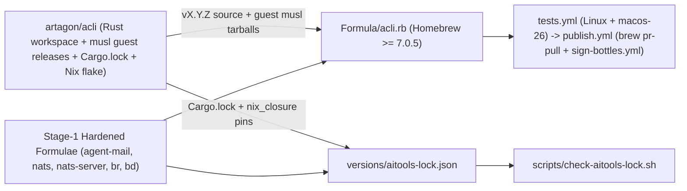

# Design: `artagon/aitools` Packaging, Hardened Bus Formulae, & Lockfile Parity for `acli`

## Context

This document covers the Homebrew tap packaging, runtime wrapper hardening, bottle provenance, and lockfile parity surface inside `artagon/homebrew-aitools`. The upstream Rust source workspace (`crates/acli-common`, `crates/acli`, `crates/aclid`, `crates/aclid-telemetry`, `crates/acli-shim`, `crates/acli-guest-supervisor`, `crates/acli-guest-proxy`) and its 5 runtime OpenSpec specs live in `artagon/acli` (`https://github.com/artagon/acli`).

See [proposal.md](proposal.md), [research/04-homebrew-aitools-tap-and-nix-parity.md](research/04-homebrew-aitools-tap-and-nix-parity.md), and [research/05-adversarial-review-ledger.md](research/05-adversarial-review-ledger.md) (`640` cumulative findings across `18` dual-swarm rounds).

## Goals / Non-Goals

**Goals:**
- Enforce `Homebrew >= 7.0.5` (`702cc64b18` `std_cargo_fetch_args`, `def fetch`, offline `deny_network_access! [:build, :postinstall]`) as the verified source-build floor across Go and Rust formulae while publishing bottle-pour compatibility separately.
- Harden all Stage-1 bus dependencies (`agent-mail 0.3.41_1`, `nats 0.5.2_1`, standalone `nats-server 2.15.3` with `libexec/bin/nats-bind-preflight`, `br 0.7.6_1`, `bd 1.3.4_2`) with `/bin/bash` 3.2 wrappers, loopback defaults, blocked self-updaters (`exit 2`), and unconditional telemetry suppression.
- Prepare pure-Rust `Formula/acli.rb` consuming tagged source and static musl guest `resource` archives from `https://github.com/artagon/acli` with a zero-Bash `bin/acli` symlink (`< 3 ms` `acli hook emit`), `/bin/bash` 3.2 `bin/aclid` wrapper (`ACLI_SHIM_PATH`), hypervisor-only `--id com.artagon.acli.shim` slot 5/7 signing verification, and zero Python/DuckDB/`ELv2` runtime dependencies.
- Maintain per-artifact/platform `versions/aitools-lock.json` parity (`scripts/check-aitools-lock.sh`) covering `agent-mail`, `nats`, `nats-server`, `br`, `bd`, `acli` (including guest musl `resource`s), `artagon/acli` `Cargo.lock` (`statig == 0.4.1`, zero commercial `statsig*`), and Split-System Nix (`--option builders ''`).

**Non-Goals:**
- Hosting Rust source crates, `configs/cli-meta/`, or the Split-System Nix flake inside `artagon/homebrew-aitools`.
- Adding `service do` launchd/systemd units to `Formula/nats-server.rb` (managed by `aclid`).
- Bundling Python, DuckDB, PyArrow, or `ELv2` packages into `Formula/acli.rb`.

## Component Topology

## Security & Trust Boundaries

| Boundary | Enforcement |
| --- | --- |
| **Offline Formula Build** | `def fetch` + `deny_network_access! [:build, :postinstall]` with cold Cargo/Go caches; `Formula/acli.rb` uses `std_cargo_fetch_args` and verifies `statig == 0.4.1` with zero `statsig*` crates. |
| **Wrapper & Telemetry Hygiene** | `/bin/bash` 3.2 (`set -euo pipefail`, flag scan stopping at `--`); `am`/`mcp-agent-mail` and `br` block self-updaters (`exit 2`); `bd` exports `BD_DISABLE_METRICS=1 BD_DISABLE_EVENT_FLUSH=1 DOLT_METRICS_DISABLED=1 DO_NOT_TRACK=1` unconditionally; `nats-server` runs field-independent `libexec/bin/nats-bind-preflight` (`127.0.0.1:4222`, `exit 78` on ambiguity). |
| **Entitlement Isolation (`acli-shim`)** | `bin/acli` and `bin/aclid` remain unentitled; `libexec/bin/acli-shim` clears `CS_LINKER_SIGNED` and is signed with ONLY `com.apple.security.hypervisor = true`, verified by exact `CodeDirectory` `Identifier == "com.artagon.acli.shim"` plus decoded binary XML slot 5 (`0xfade7171`) and DER slot 7 (`0xfade7172`). |
| **Bottle Provenance** | All formula updates land via `publish.yml` (`brew pr-pull`) and `.github/workflows/sign-bottles.yml@refs/heads/main` (SLSA v1 + `bottle-lineage/v1` + `cosign` v3 keyless OIDC) with unmodified outer `.tar.gz` bottles. |

## Decisions

1. **Separate Upstream Rust Repo (`artagon/acli`) vs Monorepo Tap:** Keep Rust source, guest musl builds, and the 5 runtime OpenSpec specs in `artagon/acli` so `Formula/acli.rb` consumes immutable tagged release archives and `publish.yml` stays isolated to tap packaging. *Alternative rejected:* Storing Rust crates inside `artagon/homebrew-aitools`.
2. **Standalone Stage-1 `Formula/nats-server.rb` + `nats-bind-preflight`:** Compile a self-contained Go preflight binary during `def install` with zero `acli` dependency, resolving `address` and `port` independently (`CLI > config > 127.0.0.1 / 4222`) and exiting `78` on ambiguous per-field setters. *Alternative rejected:* Depending on Stage-2 `acli` from Stage-1 `nats-server`.
3. **Zero-Bash `bin/acli` Symlink + `/bin/bash` 3.2 `bin/aclid` Wrapper:** Keep `bin/acli` a direct symlink to `libexec/bin/acli` so `< 3 ms` `acli hook emit` avoids `/bin/bash` fork overhead, blocking `self-update|update` natively in Rust (`exit 2`), while `bin/aclid` exports `ACLI_SHIM_PATH`. *Alternative rejected:* Wrapping `bin/acli` in `/bin/bash`.
4. **Unconditional `Formula/bd.rb` Telemetry Suppression (`revision 2`):** Force `export BD_DISABLE_METRICS=1 BD_DISABLE_EVENT_FLUSH=1 DOLT_METRICS_DISABLED=1 DO_NOT_TRACK=1` unconditionally (never `${VAR:-1}` fallbacks) and verify all four child env vars equal `1` before the fixture's first embedded-Dolt operation. *Alternative rejected:* Default-fallback `${VAR:-1}` exports.

## Risks / Trade-offs

- **Cross-repo synchronization (`artagon/acli` <-> `artagon/homebrew-aitools`):** Mitigated by `versions/aitools-lock.json`, `scripts/check-aitools-lock.sh --cargo-lock`, and `scripts/autobump.sh` co-updating source + guest musl `resource` entries.
- **Intel macOS (`x86_64`) lacks `libkrun` HVF support:** Mitigated by `on_macos { on_arm { depends_on "libkrun" } }` in `Formula/acli.rb`, keeping Intel macOS on default host `os-sandbox`.

## Migration Plan

1. **Stage 0 (Complete on `main`):** Tap scripts, `ast-grep` rules, `check-aitools-lock.sh`, `install-agent-skills.sh`, `autobump.sh`, and `plan-ci.sh`.
2. **Stage 1 (Complete on `main`):** 3-OS signed bottles for `agent-mail`, `nats`, `nats-server`, `br`, `bd`, and `versions/aitools-lock.json` (`acli: "staged"`).
3. **Stage 2+ (Pending `artagon/acli` release):** Add `Formula/acli.rb`, flip `acli` to `status: "present"` and populate `nix_closure` pins in `versions/aitools-lock.json`, run `tests.yml` (Linux + `include_macos=true`), and publish via `publish.yml`.

## Open Questions

- **Initial `artagon/acli` release tag (`v0.1.0`):** `Formula/acli.rb` URLs, SHA-256 digests, and `nix_closure` pins wait for the first tagged `artagon/acli` release containing both source and static musl guest tarballs.
- **Hypervisor-restricted CI runners:** `Formula/acli.rb` `test do` verifies slot 5/7 signing, `Identifier`, `self-update -> exit 2`, and managed-bus smoke tests unconditionally while gating live `HVF`/`/dev/kvm` VM boot tests on hypervisor availability.
