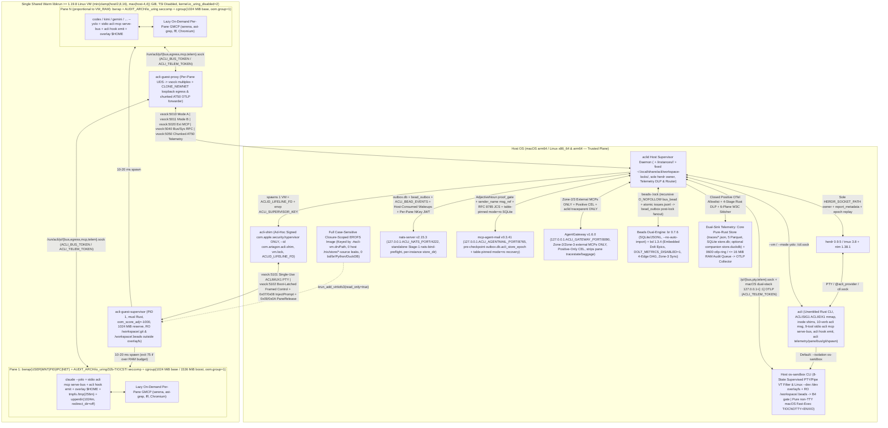
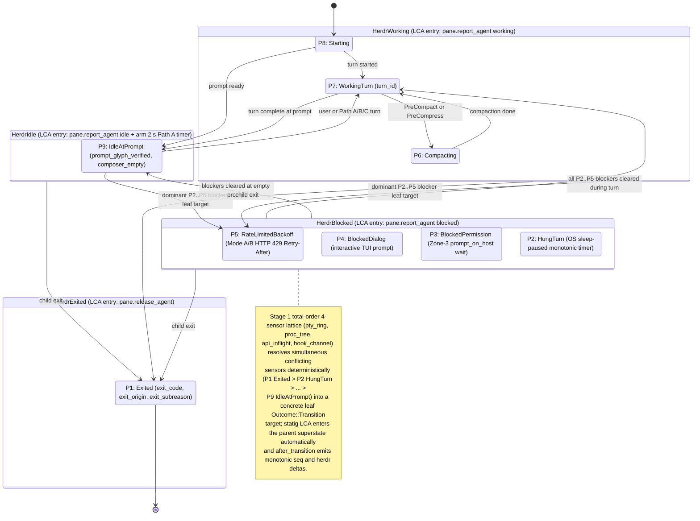
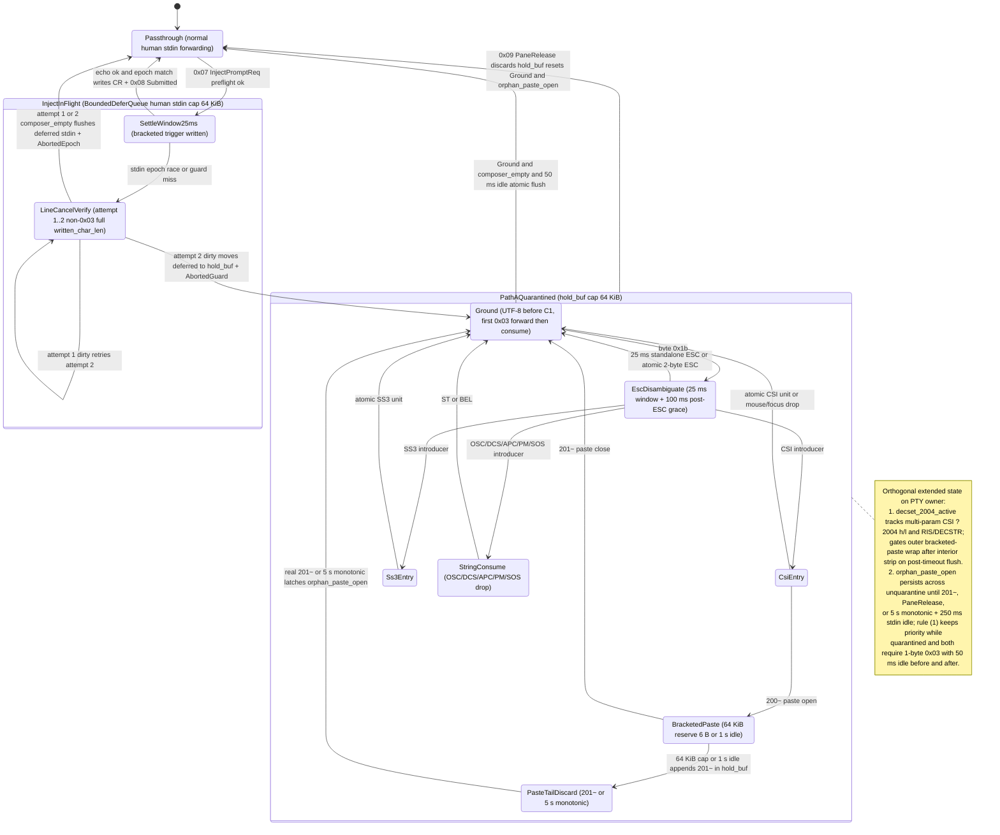
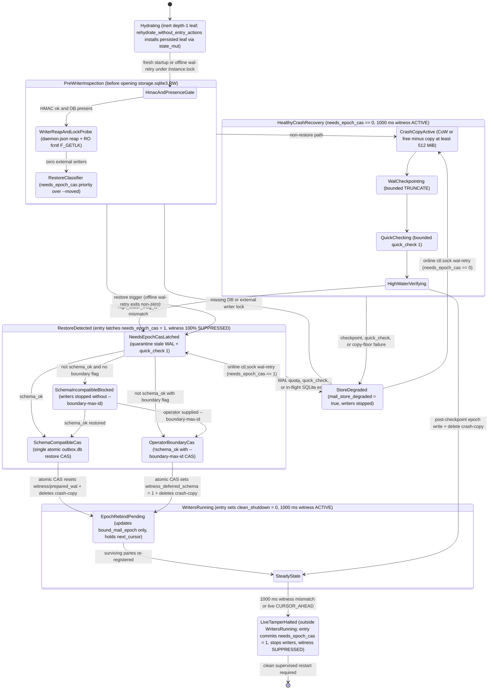

# Design: Unified Sandboxed AI CLI Launcher (`acli`), Shared Nix VM, Inter-Agent Bus, and Tap Packaging

## Context

See [proposal.md](proposal.md) for motivation and capability boundaries, [research/README.md](research/README.md) for live workstation benchmarks and audits, [research/06-production-agent-cli-and-hook-telemetry.md](research/06-production-agent-cli-and-hook-telemetry.md) for broker-terminated zero-exfiltration telemetry & `artagon-harness-eval` companion store analysis, [research/07-rust-hsm-state-machine-architecture.md](research/07-rust-hsm-state-machine-architecture.md) for the pure-Rust `statig = "0.4.1"` hierarchical state machine (`acli-common::hsm`) and compile-time linear typestate architecture, and [research/05-adversarial-review-ledger.md](research/05-adversarial-review-ledger.md) for the Round 1 (`104`), Round 2 (`66`), Round 3 (`50`), Round 4 (`49`), Round 5 (`47`), Round 6 (`41`), Round 7 (`31`), Round 8 (`25`), Round 9 (`17`), Round 10 (`17`), Round 11 (`53`), Round 12 (`30`), Round 13 (`32`), Round 14 (`20`), Round 15 (`17`), Round 16 (`15`), Round 17 (`15`), and Round 18 (`11`) dual-swarm adversarial remediation ledger (`640` cumulative findings across `18` rounds).

This architecture operates under five hard platform and operational constraints:

1. **Host Memory & Virtualization Limits:** Target developer workstations include `16–32+ GiB` Apple Silicon macOS hosts (down to `8 GiB` with `4 GiB` host headroom; `< 8 GiB` exits `69` `E69:insufficient_vm_ram` unless overridden) where `Hypervisor.framework` (`HVF`) provides **no cross-VM page deduplication (no KSM)**, alongside Linux `x86_64`/`arm64` KVM hosts. The seven native CLI binaries occupy `1.54 GiB` on disk (`182–347 MiB` each); a single shared warm VM sized by `min(clamp(host_ram_gib / 2, 8, 16), max(host_ram_gib - 4, 4)) GiB` (`16 GiB` max `--vm-memory`) with `1024 MiB` per-pane baseline (`1536 MiB` boosted) + `1024 MiB` PID-1 reserve enforces `sum(active_memory_max) + 1024 MiB <= VM_RAM` (`exit 75` `E75:vm_memory_budget` on overflow).
2. **macOS Security, Socket, & Process Constraints:** Endpoint Security (ESF) imposes `~22 ms` baseline overhead per `exec` and `~143.5 ms` for `/usr/bin/sandbox-exec`. XNU forbids nested `sandbox_apply` (`rc=71`), enforces a `104`-byte `sockaddr_un.sun_path` limit, rejects IPv4 literals in SBPL network rules (`rc=65`, requiring TCP `"localhost:<port>"` paired with dual-stack `127.0.0.1`+`[::1]` exclusive bind), runs case-insensitive APFS by default, uses `CLOCK_UPTIME_RAW` (whereas `CLOCK_MONOTONIC` advances during sleep), and derives `tmux` `pane_current_command` from `pbsi_comm` rather than `argv[0]`.
3. **Zero-Linux-Builder macOS Nix Environments:** Many macOS developer machines build with stock `--option builders ''` and a case-insensitive APFS `/nix` volume (`~nix~case~hack~1` filename mangling).
4. **Homebrew Tap & Bottle Provenance Constraints:** `artagon/homebrew-aitools` publishes 3-platform bottles (`arm64_tahoe`, `arm64_linux`, `x86_64_linux`) attested unmodified as outer tarballs via `.github/workflows/sign-bottles.yml@refs/heads/main` (SLSA v1 + `bottle-lineage/v1` + `cosign` v3). Source builds of `Formula/acli.rb`, `Formula/nats.rb`, and `Formula/nats-server.rb` require **`Homebrew >= 7.0.5`** (`std_cargo_fetch_args`, `def fetch`, offline `std_cargo_args`; bottle-pour compatibility published separately). `Formula/nats-server.rb` ships standalone in Stage 1 with ZERO `acli` dependency via its own compiled `libexec/bin/nats-bind-preflight`. `Formula/agent-mail.rb` (`v0.3.41` `revision 1`), `Formula/nats.rb` (`v0.5.2` `revision 1`), `Formula/br.rb` (`v0.7.6` `revision 1`, blocking `br upgrade -> exit 2`), and `Formula/bd.rb` (`v1.3.4` `revision 2`, unconditionally exporting `BD_DISABLE_METRICS=1 BD_DISABLE_EVENT_FLUSH=1 DOLT_METRICS_DISABLED=1 DO_NOT_TRACK=1`) ship alongside pure-Rust `Formula/acli.rb` (direct zero-Bash `bin.install_symlink libexec/"bin/acli"` + `/bin/bash` `3.2` `bin/aclid` wrapper setting `ACLI_SHIM_PATH`, zero Python/DuckDB/`ELv2` runtime bloat). Dynamic linkage against `libkrun.1.dylib` uses `cellar: :any` relocation (`CS_LINKER_SIGNED` `0x20000` cleared in `def install` + `__TEXT,__info_plist` + exact `CodeDirectory` `Identifier == "com.artagon.acli.shim"`), and dependencies use `on_macos { on_arm { depends_on "libkrun" } }` + `on_linux { depends_on "bubblewrap"; depends_on "libkrun"; depends_on "slirp4netns" }` alongside `artagon/aitools/{agent-mail,nats-server,br,bd}`.
5. **Heterogeneous Nine-CLI Ecosystem:** All nine CLIs (`claude`, `codex`, `agy`, `copilot`, `kimi`, `grok`, `opencode`, `gemini`, `qwen`) diverge in flags, MCP schemas, `ACLIIDX1`-recorded `stdio_env_mode`, `supports_hook_context_injection`, non-`0x03` composer reset keys, hook wire dialects/timeouts, native OTLP traps, and auth flows, while live host services (`mcp-agent-mail`, `nats-server`, `br`, `bd`, `AgentGateway 1.6.0`, `herdr 0.9.5`, `tmux 3.8` / `ntm 1.38.1`) integrate without upstream forks.

## Goals / Non-Goals

**Goals:**

- Enforce the complete 8-state `isatty(0..2)` **Supervised Launch > Fast-Exec Launch** table (closed reserved top-level subcommand noun set, zero terminal fds outside PTY relay and un-relayed `--isolation host`, repeatable `--pass-fd <N>` (`N >= 3`) caller FD declaration allocating internal descriptors above `max(2, max_declared_caller_fd)` + normalizing lexical/repeated-slash/symlink/joined `--opt=<path>` fd aliases incl. `//dev/fd/N` before `E66:fd_arg_unsupported`), default-deny host reads (blocking foreign `/dev/tty*` and sibling `<ACLI_RUN_DIR>/panes` & `<ACLI_STATE_DIR>/tmp`), per-pane immutable `<ACLI_RUN_DIR>/ca/pane-<pane_id>-ca-bundle.pem`, RO `<ACLI_RUN_DIR>/plugins/opencode/acli-telemetry-plugin.js` + write-denied `<ACLI_STATE_DIR>/<tier>/opencode/plugins`, per-pane RO `CODEX_HOME`, per-tier zero-exfiltration telemetry (`telem.sock`, macOS dual-stack `127.0.0.1`+`[::1]` persisted `<aclid_otlp_port>` + `http://127.0.0.1:<aclid_otlp_port>` + TCP SBPL `(remote tcp "localhost:<aclid_otlp_port>")` + `Bearer <ACLI_TELEM_TOKEN>` preserving surviving panes' tokens across normal `aclid` restarts and disabling/revoking only HTTP OTLP ingress on bind failure while keeping `telem.sock`, `fallback_mac_key`, and Path B `--drain` valid, Linux in-netns relay, `--vm` chunked `vsock:5050`), `openat2`/`O_NOFOLLOW_ANY`-verified RO `/workspace/.beads` bind-mounted through the validated open directory `fd` (`bwrap --ro-bind-fd <fd> /workspace/.beads` / `/proc/self/fd/<fd>` + `ACLIVM01` host-validated `.beads` directory cookie / passthrough `st_ino` check without comparing guest FUSE `st_dev` to host `st_dev` + post-mount guest-local `(st_dev, st_ino)` check) directly outside `overlayfs` lowerdir (macOS `BEADS_DIR` RO in linked worktrees), Linux host anonymous session keyring + `keyctl`/`add_key`/`request_key` seccomp deny, split unsafe-root checks, Linux Supervised `--dev /dev` + userns `overlayfs`/`fuse-overlayfs`, canonical B4 set (`.beads/**`, `.beads.gate.lock*`, `.acli.toml`, absent Git includes, indirect `.envrc`/`mise`), closed `sys_git` + monotonic `sys_spawn`.
- Confine all autonomous `--mode yolo` runs and multi-CLI swarms inside **one shared warm `libkrun >= 1.19.8` Linux VM** (`min(clamp(host_ram_gib / 2, 8, 16), max(host_ram_gib - 4, 4)) GiB`, `1024 MiB` base / `1536 MiB` boost + `1024 MiB` reserve, lazy on-demand per-pane `GMCP`), full case-sensitive closure-scoped EROFS `/nix/store` keyed by `.#acli-vm.drvPath` (omitting `bd`, `br`, Python, DuckDB, and OTel Collector), RFC 3986 Mode A/B proxies with streaming TTFT/token/`429` extraction, 4-zone MCP firewall (unconditionally stripping pane `tracestate`/`baggage` toward Zone-2/3), fixed `$HOME/.local/share/acli/workspace-locks/` (`promotion_mutex -> registry_epoch_mutex -> .owner state_mutex`), and single-flight 4-barrier verbatim-content-mode `fchmod`/`fsync` diff-promotion gate with `COMMITTED`/`PENDING`/`ABORTED` recovery and Barrier-4 `O(|modified|)` `file_diffs`.
- Eliminate pane-side AgentMail polling, shared writer tokens, raw loopback reachability, VM HTTP `acli-bus` identity collapse, and `~500 MiB` per-pane Node `mcp-remote` processes via explicit `ACLI_INSTANCE` isolation, **dual-engine `Beads` (`br v0.7.6` `--no-auto-import --no-auto-flush` / consistent-read `state_rev` `br-<canonical_db_blake3_16>-<issues_jsonl_sha256_16>` with pre/post-scan 5-field `(main_change_counter, wal_salt1, wal_salt2, wal_max_frame, wal_last_commit_chksums)` digest cache / `br dep list` / `--limit 0` reap preserving `blocked`/`deferred` + `bd v1.3.4` embedded Dolt epics, 4-edge DAG, `5 m` lease claims + `--limit 0` non-closed pane-reap `unclaim`, atomic `.beads/issues.jsonl` export, pre-engine `PENDING_INTENT` + `last_enqueued_bead_state` + split local `LOCK_EX` reconciler vs separate async post-lock NATS drainer [`<= 4 s` export / `<= 15 s` read & local mutation / `<= 60 s` remote `bd sync` deadlines returning `-32003` `bead_subprocess_timeout` (`"outcome_unknown": true` on killed mutations) + `5 s` failed-reconcile backoff, startup admission with `"reconcile_pending": true` after first `4 s` attempt, `bead_seq_counters(proj_hash, next_bead_seq)`, bounded `5 s` `bd` reader `LOCK_SH | LOCK_NB` & writer `LOCK_EX | LOCK_NB` returning `-32003` `bead_reconcile_busy` on expiry, explicit `plan`-mode `.beads/issues.jsonl` export carve-out] + post-lock `bead_outbox` fanout to dedicated `32 MiB` `ACLI_BEAD_EVENTS_<proj_hash>` [`newly_ready_ids <= 64`], targeted `bead_wake` [`seq=<bead_seq>`, `<= 2 / 60 s`], `epic:<epic_id>` threads, Zone-3-gated non-`file://` `bd sync` `pull|push|sync`)**, authoritative **`19`-data-column + `row_hmac_sha256` `outbox.db.acli_store_epoch`** (`high_water_created_ts_us: i64`; `store-epoch.json` derived RO mirror; managed `mcp-agent-mail` lifetime bound via dedicated supervisor thread + lifeline-pipe `SIGTERM -> 2 s -> SIGKILL` / Linux `PR_SET_PDEATHSIG` + `getppid()`; read-only `fcntl(F_GETLK)` `-shm`/`RESERVED|EXCLUSIVE` writer probe + fail-closed missing `storage.sqlite3`; durable `needs_epoch_cas = 1` committed BEFORE moving `-wal`/`-shm` or running `quick_check(1)` + non-restore-only [`needs_epoch_cas == 0`] `1000 ms` 6-column witness heartbeat incl. offline `wal-retry` + guarded post-reap refresh + `?mode=ro` `high_water_msg_id > 0 && witness_deferred_schema == 0` forward-`mtime` carve-out; mandatory witness + `prepared_wal` reset in restore CAS; `restore-prepare [--from <backup_db>] [--with-wal <backup_wal>] [--moved] [--boundary-max-id <N>]` in both `clean_shutdown == 0|1` rejecting `--from`+`--moved`, validating `32`-B WAL magic `0x377f0682`/`0x377f0683`, creating exclusive-`mkdirat` `quarantine/<utc_ts>-<store_gen>-<rand8>/` outside `<= 256 MiB` WAL quota, `linkat`ing prior `storage.sqlite3` before `renameat`, `needs_epoch_cas == 1` priority over `--moved`, failed `--moved` non-zero exit + `st_mtime_nsec < db_mtime_nsec`; same-FS `<ACLI_PERSIST_DIR>/instances/<instance_id>/agent-mail/quarantine/<utc_ts>-<store_gen>/` [`<= 256 MiB` WAL] + outside-quota auto-released `agent-mail/quarantine/crash-copy/` [`clonefile`/`FICLONE` first, else `free - copy >= 512 MiB` & `<= 1 GiB`, replaced only when new crash WAL `st_size > 0` exists and deleted after checkpoint or restore CAS] + `acli bus wal-inspect` + validated leading-digit `acli bus quarantine-prune -- <entry>` [durable disk-derived `crash-copy` gate] + `acli bus wal-retry [--timeout-secs <1..300>] [--skip-copy]` + `st_size > 0` WAL + bounded `PRAGMA wal_checkpoint(TRUNCATE)` & `PRAGMA quick_check(1)` on BOTH crash and restore paths + `!schema_ok` restore writer hold + `bound_mail_epoch` vs `cursor_mail_epoch` split + unconditional `while epoch_rebind_pending` cursor hold), UTC-microsecond `created_ts_us` `sender_name`-hashed immutable `msg_ref` required on `{msg_ref, mark_read}`-only `bus_ack`, `acli msg inbox --ack <msg_ref>`, and `bus_send(reply_to)` with participant & `!schema_ok` `fetch_inbox` verification, bounded `50`/`200`-row `<= 16 KiB` `summarize=true`, `QUEUED_LOCAL` / `IN_FLIGHT_SUBMITTED` + durable `continuity_unproved` latch -> `DELIVERY_UNKNOWN` + `(object_sha256, object_bytes, blob_uploaded)` with `blob_uploaded == 0` `ACLI_OBJ` adoption & reference-counted version-checked blob GC only & unified `48 h` `QUEUED_LOCAL` grant lifetime + 3-way `ConfirmedValid`/`ConfirmedInvalid`/`TransientError` pre-submit atomically updating `expires_at = submitted_at + 7 d` at `IN_FLIGHT_SUBMITTED`, epoch-qualified `acli_obj_grants` PK `(object_sha256, kind, mail_epoch, ref_id, grantee_agent)` (`outbox:<row_id>` -> `msg:<msg_id>`, `mail_outbox` before grant GC, CAS abort on `IN_FLIGHT_SUBMITTED` lookup error + orthogonal `QUEUED_LOCAL` -> `PROVISIONAL` directly on BOTH `schema_ok` & `!schema_ok` restores while `QUARANTINED_SCHEMA` applies exclusively to prior-epoch `LIVE` + unresolved `IN_FLIGHT_SUBMITTED`-linked `< 7 d` grants & `EXPIRED_MISSING`), persisted `session_seq: u64` in `panes-registry.json` + Path A mail suppression `(kind="mail", session_seq, mail_epoch, max_id)`, two-step `0x81`/`0x82` pipe-handoff Path B acks + same-registration `SessionStart`/respawn unread check [`sess:...`] (+ host-only `acli msg status` / `acli msg inbox --agent <retired_agent>`), pre-minted `128-bit` `lease_gen` + `current_revision` KV CAS, and `ACLIIDX1`-driven `stdio` 10-verb `acli msg` + 9-tool `acli mcp serve-bus`.
- Deliver **broker-terminated, zero-exfiltration production telemetry (`specs/agent-cli-production-telemetry/spec.md`)** across all nine CLIs authenticated by dedicated `ACLI_TELEM_TOKEN` (telemetry + same-pane content-free Path B `0x81`/`0x82` ONLY; preserving surviving live panes' `sha256_telem_token`/`fallback_mac_key` across normal `aclid` restarts and minting fresh tokens only for newly spawned panes; accepted residual: macOS loopback TCP HTTP OTLP best-effort vs same-UID downtime port-squatter, `telem.sock` preferred), `< 3 ms` `acli hook emit [--drain]` (two-step `0x81`/`0x82` pipe-handoff Path B receipt + `SessionStart`/respawn unread check + `blake3::derive_key("acli 2026 hook-fallback-mac v1", ACLI_TELEM_TOKEN.as_bytes())` content-free `<= 1 MiB` writer / first-`1 MiB` valid-line prefix reader `acli_telemetry_fallback_truncated_total` `openat`/`unlinkat` host `hooks-fallback.jsonl`, zero `otel.jsonl`), 9-CLI trap normalization, strict `delete -> per-(provider,metric)-canonicalize -> closed-positive-allowlist -> stamp` pipeline (scoping step (a) client target-key deletion strictly to target keys produced by a matching `(provider, metric_or_span_name)` rename entry so unmapped native GenAI-semconv keys pass untouched; `claude_code.{token,cost}.usage`, `lines_of_code.count` -> `acli.loc.change_type`, `code_edit_tool.decision` -> `acli.edit.{decision,source,language}` [out-of-enum `"other"`] + `gen_ai.tool.name`, merging colliding `Sum`/`Histogram` [deterministic lowest pre-projection RFC 8785 JCS attribute-set `SHA-256` tie-break + `acli_telemetry_merge_conflict_total` on `explicit_bounds` mismatch]/`ExponentialHistogram` [min-`scale` downscaling on matching `zero_threshold`]/`Gauge` points, wildcard `process.*`/`os.*` strip, authoritative `service.{name,version,instance.id}` & `13` `acli.*`) + 6-plane W3C stitching (Zone-1/2/3 `tracestate`/`baggage` dropped), 3 privacy tiers + 4-stage pre-write Rust DLP (raw/Base64/URL-safe-Base64/percent-encoded RAM secrets + RFC 5322 email scrubbing; `age`-backed offline `Sink 1` / macOS Keychain or Linux `0600` `instances/<instance_id>/keys/audit-spool.age` `X25519` opt-in `Sink 2` with locked-key `drop-newest` precedence `acli_telemetry_ring_locked_dropped_total` vs collector-only `0`-disk-spool `<= 16 MiB` RAM audit queue), unified `<= 5 MiB`/`<= 16 MiB` decompression + `<= 2 MiB/min` (`burst 5 MiB`, `<= 32 MiB/session`, `HTTP 413` above `5 MiB`) & `HTTP 429` per-pane buckets + `256 MiB`/`14 d` (`<= 64 MiB` per-lineage) cap + `512 MiB` `statvfs` floor, non-blocking Dual-Sink fanout (core pure-Rust `traces/*.json` + `5` Parquet tables + SQLite `store.db` with optional companion `store.duckdb` + tier-gated `0600` `64 MiB` `drop-oldest` `otlp-ring` enforcing `https://` `TLS >= 1.3` and `0` redirects non-loopback), and `acli telemetry status|flush|doctor|export`.
- Achieve zero-patch `aclid`-owned `herdr` protocol-22 push authority (`pane.report_metadata` + reconnect replay) and `tmux`/`ntm` compatibility via dual-channel `acli-mux/v1` (`vsock:5101` + `vsock:5102` boot-latched alongside `vsock:5040` and `vsock:5050` before `ACLI_SUPERVISOR_KEY` zeroization, typed `0x07`/`0x08` `InjectPrompt` and `0x09`/`0x0A` `PaneRelease`, UTF-8-before-C1 complete ECMA-48 quarantine tokenizer tracking child `DECSET 2004` via multi-param PTY output `CSI ? ... 2004 ... h`/`l` + `RIS`/`DECSTR` reset with out-of-band `acli pane release <pane_id>` atomically discarding held bytes and resetting `tokenizer_state = Ground` + `orphan_paste_open = false`, giving rule (1) strict priority over `orphan_paste_open` while `path_a_quarantined == true` and consuming every subsequent `Ground`-state standalone `0x03`, `paste_tail_discard` with non-standalone `0x03`, exiting back to `Ground` with host notice on `\x1b[201~` OR `5 s` monotonic absolute elapsed time while setting `orphan_paste_open` on timeout exit [host `Attention` entry/exit/`> 30 s` open, forwarding `0x03` once `!path_a_quarantined` ONLY on standalone 1-byte read bounded by `>= 50 ms` stdin idle before/after] to keep dropping unbracketed late paste bytes until `\x1b[201~` or `5 s` monotonic + `250 ms` stdin idle even after quarantine clears, stripping interior `\x1b[200~`/`\x1b[201~` before wrapping a post-timeout `Ground`-state hold-buffer flush inside a single outer `\x1b[200~...\x1b[201~` ONLY when `DECSET 2004` is active [else keeping held + `Attention`], and `Ground`-gated unquarantine, and `60 s` `req_id` cache + OS sleep-paused clocks) and priority-ordered 9-state FSM fusion.
- Ship hardened `artagon/aitools` formulae (`Homebrew >= 7.0.5` source floor, standalone Stage-1 `libexec/bin/nats-bind-preflight`, `Formula/br.rb` `revision 1`, `Formula/bd.rb` `revision 2` with unconditional `export BD_DISABLE_METRICS=1 BD_DISABLE_EVENT_FLUSH=1 DOLT_METRICS_DISABLED=1 DO_NOT_TRACK=1` verified in `test do` BEFORE the fixture's first embedded-Dolt DB operation, pure-Rust `Formula/acli.rb` zero-Bash `bin/acli` symlink + `bin/aclid` wrapper, exact `CodeDirectory` `Identifier` equality, per-artifact/platform `versions/aitools-lock.json` covering `br`+`bd` verified under `--option builders ''`).
- Execute all event-driven runtime lifecycles, PTY quarantine parsers, and durable `outbox.db` recovery/grant state machines on a pure-Rust **`statig = "0.4.1"`** hierarchical statechart core (`acli-common::hsm`, `default-features = false, features = ["macro", "serde"]`, `MIT`, `#![no_std]`, zero `"std"` feature, zero heap allocations inside `Inner<M>`) with Lowest Common Ancestor (LCA) entry/exit actions, side-effect-free `Effect` emission into `HsmContext<'_, Efx>`, bounded event deferral (`BoundedDeferQueue<E>`), `after_transition`-only hooks (`mdeloof/statig#76` mitigation keeping internal `acli_hsm_transitions_total` metrics isolated from Sink 1/2 OTLP exports), and zero-side-effect SQLite crash rehydration (`rehydrate_without_entry_actions` over explicit versioned `outbox.db` columns), while keeping acyclic lock-order (`PromotionGuard -> RegistryEpochGuard -> OwnerStateGuard` + disjoint `BeadsFileLock::acquire(&Level0Unlocked)`), 7-stage pre-`execve` `LaunchTopology` / `--pass-fd` sanitization, and 4-barrier diff-promotion invariants as compile-time `PhantomData` linear typestates.

**Non-Goals:**

- Running macOS-native GUI/SDK toolchains (`xcodebuild`, SwiftUI simulators) inside the Linux `libkrun` VM; those remain on default host `--isolation os-sandbox`.
- Forking `mcp_agent_mail_rust`, `nats-server`, `libkrun`, `herdr`, or `ntm`.
- Supporting multi-host WAN federation, remote cloud microVMs, or third-party NATS MCP shell wrappers (`mcp-nats`).
- Mutating user dotfiles (`~/.claude*`, `~/.codex*`, `~/.config/*`, `~/.homebrew/trust.json`, `~/.sigstore`) during `brew install`/`brew upgrade` or CI tests.
- Adopting or permitting commercial **`Statsig`** analytics or feature-flag SDKs (`statsig.com`, which Codex CLI disables via `[analytics] enabled = false` and `acli` overrides inside per-pane `CODEX_HOME` `[otel]`): **`statig = "0.4.1"`** (`mdeloof/statig`, `MIT`, `#![no_std]` pure-Rust hierarchical state-machine crate with zero network or OS I/O) is completely distinct from commercial `Statsig`, and all `statsig*` dependencies are banned from `Cargo.toml` and `Cargo.lock`.

## Component Topology

### End-to-End Runtime Architecture (Mermaid)



### Canonical Runtime Root, Per-Instance Persistent State Root, Ports, & Identifiers Glossary (ASCII)

```text
Volatile Runtime Socket Root (<ACLI_RUN_DIR>, canonicalized O_NOFOLLOW, UID-owned, 0700, len <= 64 B so sun_path <= 103 B):
  1. Explicit $ACLI_RUN_DIR (if set, 0700, UID-owned, len <= 64)
  2. Linux: $XDG_RUNTIME_DIR/acli (if set, 0700, len <= 64), else $HOME/.acli/run/<blake3_16(/etc/machine-id)> (0700, NEVER /tmp/acli-<uid>)
  3. macOS: $HOME/.acli/run (0700, ~25-45 B; immune to long $TMPDIR / unset XDG_RUNTIME_DIR)

Volatile Sockets, Read-Only Staged Assets, & VM Lock Inside <ACLI_RUN_DIR>:
  <ACLI_RUN_DIR>/ctl.sock                                        0600  Privileged host CLI -> aclid (UID + sandbox_check==0 / NoNewPrivs==0; includes acli pane release / telemetry / bus / approve)
  <ACLI_RUN_DIR>/vm.lock                                         0600  Exclusive flock(LOCK_EX|LOCK_NB) held by acli-shim for VM lifetime
  <ACLI_RUN_DIR>/ca/pane-<pane_id>-ca-bundle.pem                 0444  Supervisor-owned (0755 dir) merged host + ACLI_CA_BUNDLE trust store (read-only to pane)
  <ACLI_RUN_DIR>/plugins/opencode/acli-telemetry-plugin.js       0444  Supervisor-owned RO OpenCode plugin (0755 dir; pane writes to <ACLI_STATE_DIR>/<tier>/opencode/plugins denied)
  <ACLI_RUN_DIR>/panes/pane-<pane_id>/codex-home/config.toml     0400  Per-pane RO CODEX_HOME [otel] config (ACLI_TELEM_TOKEN; per-pane SBPL/bwrap read-isolated; shared auth/sessions linked)
  <ACLI_RUN_DIR>/p/<pane_id>/bus.sock                            0600  Per-pane brokered acli-bus-rpc/v1 + CLI sys_git/sys_spawn UDS (ACLI_BUS_TOKEN; ACLI_TELEM_TOKEN rejected)
  <ACLI_RUN_DIR>/p/<pane_id>/pty.sock                            0600  Owner-only interactive host PTY relay control socket (atomic InjectPrompt + PaneRelease)
  <ACLI_RUN_DIR>/p/<pane_id>/telem.sock                          0600  Per-pane broker-terminated telemetry & < 3 ms acli hook emit [--drain] UDS (Bearer ACLI_TELEM_TOKEN; two-step 0x81/0x82 ack)
  <ACLI_RUN_DIR>/p/<pane_id>/meta.json                           0600  Live pane telemetry (ACLI_LOGICAL_PROVIDER, overlay_backend, exit_origin, exit_subreason, FSM, wakeup_state, tokens/TTFT/bead)

Fixed Non-Overridable Per-User Workspace Ownership & Scope Lock Root (resolved via getpwuid(getuid())->pw_dir; NEVER overridden by ACLI_PERSIST_DIR or ACLI_INSTANCE):
  $HOME/.local/share/acli/workspace-locks/                       0700  Canonical per-user lock root
  $HOME/.local/share/acli/workspace-locks/project-<proj_hash>.lock   0600  Immutable flock(LOCK_EX|LOCK_NB) inode (never unlinked or replaced by rename)
  $HOME/.local/share/acli/workspace-locks/project-<proj_hash>.owner  0600  Atomic temp+fsync+renameat record under one per-project .owner state_mutex (lock order: promotion_mutex -> registry_epoch_mutex -> .owner state_mutex): {owner_instance_id, persist_dir_realpath, registry_path, aclid_pid, aclid_start_time_ns, live_panes, pending_tx}
  $HOME/.local/share/acli/workspace-locks/writable-scopes.json       0600  flock-guarded effective writable mounts ONLY (0 claims in plan/read-only; stale claims reclaimed when .lock flock free & 0 live_panes)
  $HOME/.local/share/acli/workspace-locks/beads-<proj_hash>.lock     0600  Per-project Dual-Engine Beads lock (br writes LOCK_EX / reads lock-free; bd reads LOCK_SH / writes LOCK_EX + atomic issues.jsonl -> bead_outbox; NEVER nested under promotion/registry/.owner mutexes)

Persistent Host State Root (<ACLI_PERSIST_DIR>, default $HOME/.local/state/acli, 0700 — disjoint from ~/.local/share/acli/workspace-locks/):
  Per-Instance Namespace (<instance_id> from explicit ACLI_INSTANCE ^[a-z0-9][a-z0-9_-]{0,31}$, default "default"; macOS Keychain scoped as acli.<blake3_16(realpath(ACLI_PERSIST_DIR))>.<instance_id>):
    <ACLI_PERSIST_DIR>/instances/<instance_id>/instance.lock         0600  Exclusive daemon lock (E78:instance_lock on conflict)
    <ACLI_PERSIST_DIR>/instances/<instance_id>/daemon.json           0600  Persisted instance listener state (incl. dual-stack aclid_otlp_port != runtime nats/agentmail/gateway ports)
    <ACLI_PERSIST_DIR>/instances/<instance_id>/store-epoch.json      0600  Derived read-only diagnostic mirror atomically regenerated after outbox.db commits (authoritative state lives exclusively in outbox.db.acli_store_epoch)
    <ACLI_PERSIST_DIR>/instances/<instance_id>/outbox.db             0600  SQLite WAL authoritative state: single-row HMAC-sealed acli_store_epoch (19 data cols + row_hmac_sha256: mail_epoch: u64, store_gen: str, needs_epoch_cas: bool, clean_shutdown: bool, witness_deferred_schema: bool, restored_boundary_max_id: u64, prepared_wal_size: i64, prepared_wal_sha256: str, last_poll_wall_ns: i64, db_dev: u64, db_ino: u64, db_size: u64, db_mtime_nsec: i64, sqlite_change_counter_be32: u32, sqlite_page_count_be32: u32, db_header_sha256: str, high_water_msg_id: u64, high_water_created_ts_us: i64, high_water_row_sha256_16: str + row_hmac_sha256), mail_outbox (QUEUED_LOCAL->IN_FLIGHT_SUBMITTED->SENT->PUBLISHED|FAILED|DELIVERY_UNKNOWN + origin_mail_epoch + durable continuity_unproved latch + (object_sha256, object_bytes, blob_uploaded)), bead_outbox (PENDING_INTENT->RESOLVED, last_enqueued_bead_state, last_published_bead_seq, PENDING_FANOUT, bead_seq_counters(proj_hash, next_bead_seq)), acli_obj_grants (PK (object_sha256, kind, mail_epoch, ref_id, grantee_agent): PROVISIONAL outbox:<row_id> -> LIVE msg:<msg_id> | QUARANTINED_SCHEMA 7d | EXPIRED_MISSING), per-(project_key, agent_name) (next_cursor, cursor_mail_epoch), per-(project_key, pane_id) recovery_range, & monotonic recovery_incident_id
    <ACLI_PERSIST_DIR>/instances/<instance_id>/promote-<txid>.json   0600  Durable single-flight 4-barrier diff-promotion journal + backups (PENDING|COMMITTED|ABORTED)
    <ACLI_PERSIST_DIR>/instances/<instance_id>/panes-registry.json   0600  HMAC-SHA256 sealed registry: active panes {pid, proc_start_time_ns, sha256_bus_token, sha256_telem_token, fallback_mac_key, session_seq, agent_name, registration_min_msg_id, bound_mail_epoch, parent_pane_id}, never-pruned ever_used_names, 7 d quarantine map, & 64/24h lineage counters
    <ACLI_PERSIST_DIR>/instances/<instance_id>/agent-mail/           0700  Per-instance AgentMail storage.sqlite3 (bound via dedicated supervisor thread + lifeline-pipe SIGTERM->2s->SIGKILL / Linux PR_SET_PDEATHSIG+getppid; RO fcntl(F_GETLK) -shm/RESERVED|EXCLUSIVE writer probe) + same-FS quarantine/<utc_ts>-<store_gen>[-<rand8>]/ (0700, <= 256 MiB WAL quota, prune > 14 d only; --from prior DB copies via exclusive mkdirat + linkat outside WAL quota, bounded by 512 MiB statvfs floor) + outside-quota auto-released quarantine/crash-copy/ (exempt from 14 d retention & 256 MiB WAL quota; clonefile/FICLONE first, else physical free - copy >= 512 MiB & <= 1 GiB, replaced only when new crash WAL st_size > 0 exists, deleted after checkpoint or restore CAS; cleared via acli bus wal-inspect / leading-digit quarantine-prune -- <entry> [durable disk-derived crash-copy gate] / wal-retry [--timeout-secs <1..300>] [--skip-copy]; bounded WAL checkpoint + quick_check(1) on both crash & restore paths; table-column pinned; AM_IDEMPOTENCY_RETENTION_SECS=691200)
    <ACLI_PERSIST_DIR>/instances/<instance_id>/nats/                 0700  Per-instance nats-server JetStream store_dir
    <ACLI_PERSIST_DIR>/instances/<instance_id>/telemetry/            0700  Dual-sink store (256 MiB / 14 d rolling cap, <= 64 MiB per-lineage cap, 512 MiB statvfs floor): live/pane-<pane_id>/, core pure-Rust store/{traces/*.json,parquet/*.parquet,store.db} (optional companion store.duckdb external), & tier-gated 0600 CRC32C otlp-ring/ (64 MiB drop-oldest; age-backed Sink 2 redacted by default or macOS Keychain / Linux keys/audit-spool.age X25519 when full_audit_collector_spool=true with locked-key drop-newest precedence acli_telemetry_ring_locked_dropped_total; collector-only full-audit uses <= 16 MiB zeroized RAM queue, 0 otlp-ring files on disk)
    <ACLI_PERSIST_DIR>/instances/<instance_id>/host-ovl/<pane_id>/   0700  Linux host os-sandbox overlay upper/work dirs (survive restart; cleared only after pane exit)
    <ACLI_PERSIST_DIR>/instances/<instance_id>/keys/                 0700  dir (0600 files): Linux NKey, trust-anchor Ed25519 key, headless registry.hmac, & persistent Linux audit-spool.age (X25519; Kernel Keyring cache only)
  Tier-Isolated Provider State & Per-Pane Temp (<ACLI_STATE_DIR>, default $HOME/.local/state/acli-homes, 0700):
    <ACLI_STATE_DIR>/{sandbox,vm,host}/<active_provider>/            0700  Isolated CLI config/state (no shared CA bundle, no shared Codex [otel] tokens; opencode/plugins write-denied)
    <ACLI_STATE_DIR>/beads-host/                                     0700  Isolated empty HOME for host bd/br subprocesses (hides ~/.config/beads/credentials & SSH keys by default)
    <ACLI_STATE_DIR>/tmp/pane-<pane_id>/                             0700  Broker-allocated private per-pane TMPDIR (per-pane SBPL/bwrap read-isolated; explicitly exempt from caller-TMPDIR ACLI_STATE_DIR rule; holds host-only content-free 0600 hooks-fallback.jsonl <= 512 B/line, st_size + line_len <= 1 MiB writer / first-1 MiB valid-line prefix reader dropping trailing overflow with acli_telemetry_fallback_truncated_total, keyed with blake3::derive_key("acli 2026 hook-fallback-mac v1", ACLI_TELEM_TOKEN.as_bytes()); ZERO otel.jsonl)

Guest Per-Pane Bind-Mounted Sockets (ONLY into that pane's bwrap mount ns, 0600):
  /run/acli/p/<pane_id>/bus.sock          -> vsock:5040 (9 MCP bus_* tools + 2 CLI-only sys_git/sys_spawn; ACLI_BUS_TOKEN; ACLIIDX1 per-CLI stdio all 9 CLIs)
  /run/acli/p/<pane_id>/egress.sock       -> vsock:5010 (Mode A) / vsock:5011 (Mode B) via CLONE_NEWNET lo forwarder
  /run/acli/p/<pane_id>/mcp.sock          -> vsock:5020 (Zone-2/Zone-3 external host MCPs ONLY via AgentGateway)
  /run/acli/p/<pane_id>/telem.sock        -> vsock:5050 (Hook events + per-pane CLONE_NEWNET OTLP forwarder; ACLI_TELEM_TOKEN verified per-pane; <= 64 KiB AT50 chunks; <= 8 reassemblies/pane; 512 KiB window)

libkrun virtio-vsock Bridges (krun_disable_implicit_vsock=true; ZERO vsock:4222, ZERO vsock:5030, ZERO :18765, ZERO :18090):
  vsock:5010   Mode A base-URL HTTP credential proxy (RFC 3986 allowlist, Host==allowlisted_fqdn else 421, streaming TTFT/token/429 extraction)
  vsock:5011   Mode B h2/HTTP1.1 TLS-MITM proxy (CONNECT==SNI==(:authority|Host) else 421, rewrites upstream Host/:authority; streaming TTFT/token/429; mlock'd P-256 CA + NameConstraints)
  vsock:5020   4-Zone External Host MCP Firewall -> AgentGateway v1.6.0 (http://127.0.0.1:<ephemeral>/servers/<ext>/mcp; strips pane tracestate/baggage; aclid traceparent + Zone-3 approval span)
  vsock:5040   Boot-latched brokered acli-bus-rpc/v1 + sys_git/sys_spawn -> host aclid (envp ACLI_SUPERVISOR_KEY + ACLI_BUS_TOKEN)
  vsock:5050   Boot-latched telemetry multiplex (<= 64 KiB "AT50" fair-queued chunks over unified <= 5 MiB compressed / <= 16 MiB decompressed payload; signal_type 0x01/0x02/0x03/0x04/0x81/0x82 dropping unknown types with acli_telemetry_invalid_signal_total; <= 8 reassemblies/pane 5 s timeout; per-pane ACLI_TELEM_TOKEN reject + rate-limiting without closing shared vsock:5050; closes strictly on outer proxy corruption; 512 KiB window; ACLI_SUPERVISOR_KEY zeroized strictly after 5040+5050+5102 latch)
  vsock:5101   Per-pane PTY stream (single-use 52 B ACLIMUX1 preamble <= 2000ms; 64 KiB ring / 256 KiB credit window)
  vsock:5102   Boot-latched supervisor control ([u32 len][12B pane_id][u8 type][payload] <= 64 KiB; 0x07/0x08 InjectPrompt, 0x09/0x0A PaneRelease; VM recycle exit 70 on corrupt outer header)

Host Loopback Daemons (aclid-verified child listeners; per-instance overridable):
  127.0.0.1:${ACLI_NATS_PORT:-4222}          nats-server v2.15.3 (standalone Stage-1 nats-bind-preflight; Operator O... + Account A_<proj_hash> + host-held User U...)
  127.0.0.1:${ACLI_AGENTMAIL_PORT:-8765}     mcp-agent-mail v0.3.41 (HTTP_BEARER_TOKEN, CONVERT_IMAGES=false, WORKTREES_ENABLED=true)
  127.0.0.1:${ACLI_GATEWAY_PORT:-8090}       AgentGateway v1.6.0 (LocalAPIKey + positive-only {require}/{allow} CEL, ext MCPs only)
  127.0.0.1 + [::1]:<aclid_otlp_port>        Dedicated macOS host os-sandbox dual-stack OTLP HTTP/gRPC listener (IPV6_V6ONLY=1, persisted in daemon.json, != runtime 4222/8765/8090, passes http://127.0.0.1:<aclid_otlp_port> to SDKs, TCP SBPL "localhost:<aclid_otlp_port>" + Bearer ACLI_TELEM_TOKEN; preserves surviving live panes' sha256_telem_token & fallback_mac_key across normal aclid restarts and mints fresh tokens only for newly spawned panes [accepted residual: loopback TCP OTLP best-effort vs same-UID downtime port-squatter; telem.sock UDS preferred]; on first-start or restart bind failure disables/revokes ONLY HTTP OTLP ingress keeping telem.sock, fallback_mac_key, & Path B --drain valid)

Canonical Identifiers & Constants:
  acli-common      Shared host + musl guest pure-Rust crate providing `acli-common::hsm` (`statig = { version = "0.4.1", default-features = false, features = ["macro", "serde"] }`, `MIT`, `#![no_std]`, zero `"std"` feature, zero `statsig*` deps; `HsmContext<'_, Efx>`, `BoundedDeferQueue<E>`, `rehydrate_without_entry_actions`, `after_transition`-only hook adapter) and compile-time `PhantomData` linear typestates
  blake3_16        First 16 lowercase hex characters (64 bits) of a BLAKE3-256 digest
  pane_id          12-char CSPRNG ^[a-z0-9]{12}$ (never recycled; tmux %N stored as display metadata tmux_pane only)
  proj_hash        16-char lowercase hex BLAKE3 digest (`blake3_16`) of canonical project_key
  pane_input_epoch Monotonic u64 incremented by PTY owner on every human stdin byte read, checked atomically before InjectPrompt \r
  ACLI_BUS_TOKEN   256-bit CSPRNG hex per-pane bus/egress secret (bus.sock / vsock:5040 / egress; rejected on telemetry endpoints)
  ACLI_TELEM_TOKEN 256-bit CSPRNG hex per-pane telemetry secret (telem.sock / vsock:5050 / macOS OTLP HTTP + same-pane content-free Path B 0x81/0x82 ONLY; zero other bus authority; rejected on bus.sock; derives fallback_mac_key = blake3::derive_key("acli 2026 hook-fallback-mac v1", ACLI_TELEM_TOKEN.as_bytes()))
  msg_ref          Opaque immutable message handle `e<mail_epoch>:<msg_id>:<row_sha256_16>` (SHA-256 over project_key, msg_id, UTC-microsecond created_ts_us, sender_name, COALESCE(thread_id, ""), subject, sha256_hex(body_md)) required on `{msg_ref, mark_read}` bus_ack, `acli msg inbox --ack`, & bus_send(reply_to)
  lease_id         Opaque handle `slot:<slot>:gen:<lease_gen>` (pre-minted 128-bit hex `lease_gen` preserved across renewals & wake; CAS uses `current_revision`)
  Deny RPC Code    JSON-RPC -32003 (denials/rate/stale_lease/object_expired/identity_pool_exhausted/unauthorized_prior_epoch/unauthorized_object/store_epoch_rebind_pending/unverified_store_restore/restore_schema_incompatible/schema_verification_unavailable/stale_message_ref/bus_degraded_summary_unavailable/ambiguous_bead_engine/bead_workspace_uninitialized/bead_engine_mismatch/unsafe_bead_workspace_config/unsupported_bead_engine_op/plan_readonly/claim_required/already_claimed/bead_sync_conflict/bead_reconcile_busy/bead_subprocess_timeout); -32602 (invalid RPC parameter values)
  Mode Total Order read-only = plan < ask < edits < auto < yolo (`accept-edits` aliases `edits`)
  FSM Priority     exited > hung_turn > blocked_permission > blocked_dialog > rate_limited_backoff > compacting > working_turn > starting > idle_at_prompt
  Launch Modes     Supervised Launch (`isatty(0..2)` outside un-relayed `--isolation host`, `--vm`, `--mode yolo`, `--timeout`, `--format canonical-jsonl`, `--otel-wrap`, `acli auth login`, stdin `SecretRef`, Linux `os-sandbox`, or session-leader fallback) > Fast-Exec Launch (pure non-TTY macOS/host or un-relayed `--isolation host`, 0 surviving acli procs)
  CLI / MCP Counts 10 acli msg verbs + 9 acli-bus MCP tools (+ 2 CLI-only sys_git/sys_spawn internal RPCs on bus.sock; 20 bus_bead ops: 9 shared + 11 bd-only)
  Exit Codes       See `44` closed canonical subreason taxonomy in `specs/acli-launcher-and-metadata/spec.md` (`0`, child `1..255` incl. `137` OOM signal, native pre-exec `3`, `4`, `9`, `64`, `65`, `66`, `69`, `70`, `71`, `73`, `75`, `77`, `78`, `124`, `125`, `126`, `127`)
```

### Normative NATS Subject, Stream, KV, and Object-Store Table

| Resource | Name / Subject Pattern | Retention / Limits | Publish / Write Authority | Subscribe / Read Authority |
| --- | --- | --- | --- | --- |
| **Wakeups Stream** | `ACLI_WAKEUPS_<proj_hash>` -> `acli.<proj_hash>.wake.<pane_id>` | `retention: limits`, `max_bytes: 64 MiB`, `max_age: 7d`, `discard: old`, `max_msgs_per_subject: 4096`, `duplicate_window: 24h`, `W3C-Traceparent` header, `Nats-Msg-Id: am:<proj_hash>:<pane_id>:e<mail_epoch>:<msg_id>` (`bind:<pane_id>:e<mail_epoch>:<max_id>`, **`sess:<proj_hash>:<pane_id>:<session_seq>:e<mail_epoch>:<max_id>`**, `drift:<proj_hash>:<pane_id>:inc<recovery_incident_id>:exp\|ahead:<cursor>`, **`bead:<proj_hash>:<pane_id>:<bead_seq>:<state_rev>:<bead_id>:<wake_kind>`** [`wake_kind` in `unblocked\|epic_eligible\|unclaimed`, Path A `<= 2 / 60 s` per `(pane_id, bead_id)`]) | Host `aclid` service NKey ONLY (purged on pane reap; bead wakes drained post-lock in strict `bead_seq` order by separate async NATS drainer from `bead_outbox`) | Consumed on host by `aclid` ONLY (pane NKeys need zero `$JS.API`/`$JS.ACK` rights) |
| **Events Stream** | `ACLI_EVENTS_<proj_hash>` -> `acli.<proj_hash>.evt.<pane_id>.<topic>` | `max_bytes: 128 MiB`, `duplicate_window: 24h`, `discard: old`, `W3C-Traceparent` header, `Nats-Msg-Id: evt:<proj_hash>:<pane_id>:<id>` (`allow_spill=true` rejected `-32602` on broadcast `pub.*`) | Pane's own NKey connection for own `evt.<pane_id>.>` (**`pub.deny: ["acli.<proj_hash>.sys.>"]`**) | Project panes (subscribe allowlisted to `acli.<proj_hash>.evt.>`) |
| **Bead Events Stream** | `ACLI_BEAD_EVENTS_<proj_hash>` -> `acli.<proj_hash>.sys.bead.<event_kind>` | `max_bytes: 32 MiB`, `max_age: 7d`, `duplicate_window: 24h`, `discard: old`, `W3C-Traceparent` header, `Nats-Msg-Id: sbead:<proj_hash>:<state_rev>:<bead_seq>:<event_kind>:<bead_id>` (`12` closed bead event kinds incl. `epic.close_eligible`, `acli-bead-event/v1` with `newly_ready_ids <= 64` + `newly_ready_truncated`; isolated from pane `evt.>` churn) | Host `aclid` service NKey ONLY (published post-lock in strict `bead_seq` order from durable `outbox.db` `bead_outbox`; pane JWT `pub.deny: ["acli.<proj_hash>.sys.>"]`) | Project panes (subscribe allowlisted to `acli.<proj_hash>.sys.bead.>`) |
| **Request / Reply** | `acli.<proj_hash>.req.<target_pane>.>` + `_INBOX.<pane_id>.*` | Core NATS (ephemeral); `inbox_prefix: "_INBOX.<pane_id>"` (no wildcard `_INBOX.>`); opaque `reply_handle`; multi-token topics; `allow_spill` inserts durable `LIVE` `kind="req"` rows in `outbox.db` `acli_obj_grants` (`mail_epoch = 0`) for `{sender_pane_id, target_pane_id}` | Pane's own NKey connection (validated `target_pane`, `topic`, `reply_handle`) | Target pane subscribes to `acli.<proj_hash>.req.<pane_id>.>` + own `_INBOX.<pane_id>.*` |
| **Leases KV** | Bucket `KV_LEASES_<proj_hash>` | `TTL: 30s`, `SubjectDeleteMarkerTTL`, pre-minted `128-bit` `lease_generation` + optional `bead_id` in JSON record (`lease_id = slot:<slot>:gen:<lease_gen>`), CAS against `current_revision`, `max_hold_s` `600`/`1800 s`, mirror `acli:<slot>:gen:<lease_gen>` (preserved across wake) | Host `aclid` service NKey ONLY (sole renewer) | Host `aclid` / project status read via `aclid` (zero direct pane KV `$JS.API` rights) |
| **Presence KV** | Bucket `KV_PRESENCE_<proj_hash>` | `MaxMsgsPerSubject: 1`, heartbeat TTL | Host `aclid` service NKey ONLY | Project panes via `bus_who` through `aclid` (zero direct pane KV `$JS.API` rights) |
| **Object Store** | `ACLI_OBJ_<proj_hash>` (`$O.ACLI_OBJ_<proj_hash>.>`) | `256 MiB` bucket, `max_age: 7d` (re-put/refreshed on every new upload AND before committing `QUARANTINED_SCHEMA` for extant candidate blobs), `16 MiB` max object, `64 MiB` quota per **root spawn lineage** (each grant charges its own `root_lineage_id` full `object_bytes` until expiry/reap), `128 KiB` SHA-256 chunks decoupled from durable **`outbox.db` `acli_obj_grants`** (epoch-qualified PK `(object_sha256, kind, mail_epoch, ref_id, grantee_agent)`, `mail_epoch = 0` for `kind != 'mail'`: `PROVISIONAL` `outbox:<row_id>` -> atomic `LIVE` `msg:<msg_id>` \| `!schema_ok` `QUARANTINED_SCHEMA` `7 d` grace \| confirmed-absent `EXPIRED_MISSING`; spilled `QUEUED_LOCAL` rows record `(object_sha256, object_bytes, blob_uploaded = 0)` before put, startup/restore reconciliation runs strictly BEFORE grant expiry & blob GC, never blindly fails `blob_uploaded == 0` [verifying `(object_sha256, info.size == object_bytes)` in `ACLI_OBJ` to adopt `blob_uploaded = 1` + refresh `7 d` TTL on verified presence, failing ONLY that `QUEUED_LOCAL` row + deleting ONLY its own `PROVISIONAL` grants `WHERE ref_id = 'outbox:' || row_id` in `outbox.db` without row-local physical deletion in `ACLI_OBJ_<proj_hash>` on confirmed absence/mismatch, or retaining GC-protected on transient NATS error], unifies live `QUEUED_LOCAL` `PROVISIONAL` grant lifetime with the exact **`48 h`** retry window [`expires_at = row.created_at + 48 h`; `24 h` applies solely to orphan grants with no live `QUEUED_LOCAL`/`IN_FLIGHT_SUBMITTED` row; `48 h` expiry fails row + deletes grants atomically; pre-submit uses 3 explicit outcomes: `ConfirmedValid` atomically updates `expires_at = submitted_at + 7 d` on all participant `PROVISIONAL` grants inside the SAME `BEGIN IMMEDIATE ... COMMIT` tx setting `IN_FLIGHT_SUBMITTED` before HTTP `send_message`, `ConfirmedInvalid` transitions `QUEUED_LOCAL -> FAILED` + deletes only its own `PROVISIONAL` grants in `outbox.db`, `TransientError` retains `QUEUED_LOCAL` + grants unchanged for jittered retry within `48 h`]; orthogonal `QUEUED_LOCAL` vs `QUARANTINED_SCHEMA`: under BOTH `schema_ok` AND `!schema_ok` (`--boundary-max-id <N>`) restores, verified-blob non-expired (`< 48 h`) `QUEUED_LOCAL` rows (`submitted_at IS NULL`) NEVER enter `QUARANTINED_SCHEMA` — after verifying `(object_sha256, info.size == object_bytes)` + refreshing `7 d` TTL, the restore CAS migrates/reconstructs their authenticated participant grants directly to `state = 'PROVISIONAL', mail_epoch = new_mail_epoch, expires_at = row.created_at + 48 h` for normal submission before hour `48`; under `schema_ok`: aborts CAS with `mail_store_degraded = true` if `IN_FLIGHT_SUBMITTED` lookup errors, else (1a) reconciles surviving `IN_FLIGHT_SUBMITTED`+`PROVISIONAL` -> `LIVE`, (1b) migrates unresolved `IN_FLIGHT_SUBMITTED` (`< 7 d`) `PROVISIONAL` grants to `new_mail_epoch` with refreshed TTL keeping `state = 'PROVISIONAL'`, (2) migrates surviving `LIVE` to `new_mail_epoch`, (3) deletes ONLY non-surviving prior-epoch `LIVE` grants & orphaned/terminal `PROVISIONAL` grants before GC; under `!schema_ok`: `QUARANTINED_SCHEMA` applies exclusively to prior-epoch (`< new_mail_epoch`) `LIVE` (`msg:*`) + unresolved `IN_FLIGHT_SUBMITTED`-linked (`outbox:*`, `< 7 d`) `kind = 'mail'` grants [retiring expired grants, refreshing extant blobs -> `QUARANTINED_SCHEMA`, marking confirmed-absent `ObjectNotFound` `EXPIRED_MISSING` (`missing_attachments_total`) without blocking writers, blocking ONLY on transient NATS/JetStream errors]; physical deletion in `ACLI_OBJ_<proj_hash>` runs exclusively via reference-counted, version-checked blob GC when zero `LIVE`/`PROVISIONAL`/`QUARANTINED_SCHEMA` grants remain; `--allow-spill` required `> 128 KiB`, `-32003` quota/`object_expired`) | Host `aclid` service NKey ONLY | Project panes via `bus_inbox(object_sha256)` matching ANY `LIVE` grant (`kind=="mail"` `now < expires_at && !unverified_store_restore && !epoch_rebind_pending && state=="LIVE" && grant.mail_epoch == mail_epoch` + `grantee_agent == caller_agent_name` + live `row_sha256_16` match + `msg.id > registration_min_msg_id`; `EXPIRED_MISSING` returns `-32003` `object_expired`; `kind=="req"` `grant.mail_epoch == 0` & non-recycled `pane_id` match; body-text `sha256:` never authorizes; `exit 65` on hash mismatch) |

## Hierarchical State Machine (`statig`) & Linear Typestate Architecture

All runtime event-driven lifecycles, stateful ECMA-48 PTY quarantine parsers, and durable `outbox.db` recovery/grant protocols execute on a shared pure-Rust hierarchical statechart core (**`crates/acli-common` -> `acli-common::hsm`**) backed by **`statig = "0.4.1"`**, paired with zero-cost compile-time `PhantomData` linear typestates for acyclic lock-order, FD-sanitization, and 4-barrier diff-promotion invariants (see [research/07-rust-hsm-state-machine-architecture.md](research/07-rust-hsm-state-machine-architecture.md)).

### Crate Pin & Mandatory `statig 0.4.1` Safeguards (`acli-common::hsm`)

1. **Exact Pure-Rust Crate Pin (`statig = { version = "0.4.1", default-features = false, features = ["macro", "serde"] }`):** Single-licensed **`MIT`**, `build = false`, 100% pure Rust (`statig_macro = "^0.4.0"`, `syn`, `quote`, `proc-macro2`, `proc-macro-error2`, `serde`) with zero C/C++ `-sys` crates or build-time network fetches, MSRV `1.66` (`blocking` pure functional core; leaving `async` and `bevy` disabled to avoid unused codegen), and full compatibility with Homebrew `std_cargo_fetch_args` offline builds and static `aarch64`/`x86_64-unknown-linux-musl` guest binaries. **NEVER pass `"std"`** in `features` because `statig 0.4.1` is unconditionally `#![no_std]` and defines no `std` feature (`Cargo` feature resolution fails if `"std"` is specified). All handlers MUST return `statig 0.4.1` **`Outcome::{Handled, Super, Transition}`** — never deprecated `0.3` `Response`, `on_dispatch`, or `on_transition` — and workspace `ast-grep` + `Cargo.lock` gates ban any commercial `statsig*` dependency.
2. **Pure Functional Core (`HsmContext<'_, Efx>`):** Every `#[state]`, `#[superstate]`, and `#[action]` method is side-effect-free and pushes typed `Effect` values into `context: &mut HsmContext<'_, Efx>` (supplying monotonic clock readings and pure read snapshots) with **zero** direct OS syscalls, socket/PTY writes, process spawns, or SQLite queries inside state handlers. Both shared storage `M` and generated `State` derive `Debug, Clone, PartialEq, Eq` so `proptest` suites can clone, step, and compare `InitializedStateMachine<M>` deterministically in memory.
3. **Bounded Event Deferral (`BoundedDeferQueue<E>`):** Because `statig::Outcome` has **NO** built-in `Defer` variant or internal deferred-event queue (`Outcome::Super` bubbles synchronously up the superstate chain during the current `handle_with_context` call and is dropped at implicit `Top`), `acli_common::hsm::BoundedDeferQueue<E>` implements UML event deferral with hard byte and event caps (**`MAX_DEFERRED_BYTES = 65_536` [`64 KiB`]** for human `stdin` bytes held during `PtyInputQuarantineHsm::InjectInFlight`; **`MAX_DEFERRED_EVENTS = 64`** for control/bus HSMs) and per-transition-epoch FIFO replay (**`MAX_REPLAY_MICROSTEPS = 16`** via `dispatch_with_bounded_deferral` tracking monotonic `transition_epoch()` from `after_transition` and splicing unconsumed tail events at `prefix_len` — after earlier re-deferred items and ahead of newly deferred items — via `splice_in_flight_at` while reserving in-flight event and byte counts), failing closed losslessly on overflow (`DeferError::QueueFull(E)` / `DeferError::ByteBudgetExceeded { event, attempted, max_bytes }` for caller read backpressure) and step-cap breach (`ReplayStepLimitExceeded`) with zero OOM, double-dispatch, stranded-queue, or livelock risk.
4. **Zero-Side-Effect SQLite Rehydration (`rehydrate_without_entry_actions`):** Because `InitializedStateMachine<M>` implements `Serialize` **only** (intentionally omitting `Deserialize`) and `UninitializedStateMachine::init_with_context` invokes `Inner::init_with_context` (`self.state.enter(..., self.state.depth())`), naively deserializing and calling `.init_with_context(...)` after an `aclid` crash **re-executes all root-to-leaf superstate and leaf entry actions**. Durable `outbox.db` machines (`StoreEpochRecoveryHsm`, `MailOutboxHsm`, `ObjGrantHsm`) keep explicit versioned SQLite columns (**never** opaque `serde`/`bincode` blobs) as sole crash-durable truth and rehydrate inside `BEGIN IMMEDIATE` via an inert top-level `#[state_machine(initial = "State::hydrating()")]` leaf (depth `1`, no superstate, no `entry_action`) plus `*unsafe { sm.state_mut() } = persisted_state` encapsulated inside the single audited `acli_common::hsm::rehydrate_without_entry_actions` helper (workspace `ast-grep` rules reject `inner_mut()` and `state_mut()` everywhere outside `acli-common::hsm::{defer, rehydrate}`).
5. **`after_transition`-Only Hook Rule (`mdeloof/statig#76` Mitigation & OTLP Allowlist Isolation):** Because `statig 0.4.1` `blocking::Inner::transition` swaps `(&target, &self.state)` in `before_transition` (`mdeloof/statig#76`, unreleased on `crates.io`), all transition telemetry, `PaneLifecycleHsm` monotonic `seq` + `herdr` protocol-22 emission, and `proptest` transition-edge assertions hook **`after_transition(source, target, context)`** exclusively (`before_transition` is banned via a workspace `ast-grep` rule until `statig >= 0.4.2`). Internal daemon HSM health counters (`acli_hsm_transitions_total{machine, from, to}`) live **strictly** on local operator diagnostics (`acli telemetry status`, `acli telemetry doctor`, and `acli bus status`) and NEVER inject non-allowlisted attributes into Sink 1 (`traces/*.json` / Parquet / `store.db`) or Sink 2 (`otlp-ring` / remote OTLP Collector) exports.

### Hierarchical Statechart Topology (`stateDiagram-v2`)

#### 1. `PaneLifecycleHsm` (2-Stage Sensor Lattice -> 4 `herdr` Superstates) & `PtyInputQuarantineHsm`





#### 2. Durable `outbox.db` HSMs (`StoreEpochRecoveryHsm`, `MailOutboxHsm`, & `ObjGrantHsm`)



```mermaid
stateDiagram-v2
    state "MailOutboxHsm (outbox.db.mail_outbox)" as MailOutboxHsm {
        [*] --> MailHydrating
        state "Hydrating (inert depth-1 leaf; rehydrate_without_entry_actions uses state_mut)" as MailHydrating
        MailHydrating --> BlobPending : fresh spilled row
        MailHydrating --> BlobUploaded : fresh inline row
        state "Unsent: QueuedLocal (48 h window, NEVER QUARANTINED_SCHEMA)" as Unsent {
            state "BlobPending (blob_uploaded == 0, ACLI_OBJ adoption check)" as BlobPending
            state "BlobUploaded (3-way ConfirmedValid/Invalid/Transient pre-submit)" as BlobUploaded
            BlobPending --> BlobUploaded : upload ok or startup ACLI_OBJ adoption
        }
        state "Submitted: InFlightSubmitted (grants extended to submitted_at + 7 d)" as Submitted {
            state "ContinuityProved (continuity_unproved == 0)" as ContinuityProved
            state "ContinuityUnproved (one-way latch = 1, forbids Failed and resend)" as ContinuityUnproved
            ContinuityProved --> ContinuityUnproved : clean_shutdown == 0 or restore CAS
        }
        state "Terminal" as MailTerminal {
            state "Sent (msg_id, promotes grants PROVISIONAL to LIVE)" as Sent
            state "Published (ACLI_WAKEUPS PubAck, next_cursor untouched)" as Published
            state "Failed" as Failed
            state "DeliveryUnknown" as DeliveryUnknown
            Sent --> Published : positive PubAck
        }
        BlobPending --> Failed : confirmed ObjectNotFound (own grants deleted, 0 blob delete)
        BlobUploaded --> ContinuityProved : ConfirmedValid atomic tx before HTTP send_message
        BlobUploaded --> Failed : ConfirmedInvalid or 48 h expiry
        ContinuityProved --> Sent : HTTP msg_id or idempotency_key match
        ContinuityProved --> Failed : confirmed absent 24 h..8 d
        ContinuityProved --> DeliveryUnknown : age over 8 d
        ContinuityUnproved --> Sent : idempotency_key and payload hash match
        ContinuityUnproved --> DeliveryUnknown : confirmed absent or age over 8 d
    }

    state "ObjGrantHsm (outbox.db.acli_obj_grants)" as ObjGrantHsm {
        [*] --> GrantHydrating
        state "Hydrating (inert depth-1 leaf; rehydrate_without_entry_actions uses state_mut)" as GrantHydrating
        GrantHydrating --> Provisional48h : fresh grant created
        state "Active (100% forbids physical ACLI_OBJ bucket GC)" as GrantActive {
            state "Provisional48h (outbox:row_id, direct PROVISIONAL across all restores)" as Provisional48h
            state "ProvisionalInFlight7d (outbox:row_id, submitted_at + 7 d)" as ProvisionalInFlight7d
            state "Live7d (msg:msg_id or req_id, sole bus_inbox object_sha256 authority)" as Live7d
            state "QuarantinedSchema7d (prior-epoch LIVE and in-flight under 7 d on !schema_ok)" as QuarantinedSchema7d
            Provisional48h --> ProvisionalInFlight7d : ConfirmedValid IN_FLIGHT_SUBMITTED tx
            ProvisionalInFlight7d --> Live7d : SENT(msg_id) or schema_ok survival
            ProvisionalInFlight7d --> QuarantinedSchema7d : !schema_ok extant blob 7 d TTL refresh
            Live7d --> QuarantinedSchema7d : !schema_ok extant blob 7 d TTL refresh
            QuarantinedSchema7d --> Live7d : survival + participant + body sha256 verified
        }
        state "Terminal" as GrantTerminal {
            state "ExpiredMissing (ObjectNotFound on !schema_ok, writers unblocked)" as ExpiredMissing
            state "DeletedRefCountedGc (version-checked ACLI_OBJ GC when 0 Active rows)" as DeletedRefCountedGc
        }
        ProvisionalInFlight7d --> ExpiredMissing : !schema_ok confirmed ObjectNotFound
        Live7d --> ExpiredMissing : !schema_ok confirmed ObjectNotFound
        GrantActive --> DeletedRefCountedGc : expiry, ConfirmedInvalid, DeliveryUnknown, or non-survival
    }
```

### Three-Bucket State Machine & Linear Typestate Inventory

| Bucket & ID | Machine / Typestate (`crates/acli-common` + Owning Crate) | Backing Store & Durability | Superstates / Stages & Key Preserved `R1`–`R18` Invariants |
| --- | --- | --- | --- |
| **Bucket A.1** (`statig` In-Memory) | **`PaneLifecycleHsm`** + **`HerdrBridgeSessionHsm`** (`crates/aclid`) | In-memory (`panes-registry.json` HMAC rehydration on `aclid` restart) | Stage 1 pure total-order 4-sensor lattice (`pty_ring`, `proc_tree`, `api_inflight`, `hook_channel`) -> Stage 2 `statig` 4 `herdr` superstates (`HerdrExited` > `HerdrBlocked` [`HungTurn`, `BlockedPermission`, `BlockedDialog`, `RateLimitedBackoff`] > `HerdrWorking` [`Compacting`, `WorkingTurn`, `Starting`] > `HerdrIdle` [`IdleAtPrompt`]) with OS sleep-paused clocks, `after_transition` monotonic `seq`, and `HerdrBridgeSessionHsm` (`Disconnected -> RegisteringEpoch -> ReplayingSnapshot -> StreamingDeltas`) replaying full snapshots (incl. Fast-Exec panes) before deltas. |
| **Bucket A.2** (`statig` In-Memory) | **`PtyInputQuarantineHsm`** + **`OutboundVtFilterHsm`** / **`Aclimux1StreamBindHsm`** / **`At50ChunkReassemblerHsm`** (`crates/acli`, `crates/acli-guest-supervisor`, `crates/acli-guest-proxy`, `crates/aclid`, `crates/aclid-telemetry`) | In-memory single-threaded PTY owner / `vsock:5101` / `vsock:5050` | `Passthrough` / `InjectInFlight` (`SettleWindow25ms`, `LineCancelVerify { attempt: 1\|2 }` erasing full `written_char_len` via non-`0x03` `ACLIIDX1` reset, `BoundedDeferQueue <= 64 KiB`) / `PathAQuarantined` (`Ground` UTF-8-before-C1 + first `0x03` forward & subsequent `0x03` consume, `EscDisambiguate`, `CsiEntry`, `Ss3Entry`, `BracketedPaste` `64 KiB` reserving `6 B` / `1 s` idle in-buffer `\x1b[201~`, `PasteTailDiscard` `\x1b[201~` or `5 s` monotonic, `StringConsume`) + orthogonal `orphan_paste_open` (`>= 50 ms` idle-bounded 1-byte `0x03` in both rule (1) and post-quarantine) & `decset_2004_active` + superstate `0x09`/`0x0A` `PaneRelease`; companion `(prefix, intermediate, final)` VT allowlist (`CSI 5n`/`6n`/`DA` local reply), `52 B` single-use `ACLIMUX1` bind (`<= 2000 ms`), and `AT50` chunk reassembler (`<= 8`/pane, `5 s` timeout, `<= 5 MiB`/`<= 16 MiB`). |
| **Bucket A.3** (`statig` In-Memory) | **`WakeupDeliveryHsm`** + **`InboxTailerCursorHsm`** / **`KvBuildSlotLeaseHsm`** (`crates/aclid`) | In-memory + `ACLI_WAKEUPS_<proj_hash>` (`AckExplicit`), `outbox.db` `(next_cursor, cursor_mail_epoch)`, `KV_LEASES_<proj_hash>` | `Idle` vs `Pending` superstate (`Coalescing` `2 s` idle timer, `DeliveringPathB` two-step `0x81`/`0x82` pipe-handoff ack gated on `supports_hook_context_injection`, `DeliveringPathA` fixed ASCII zero-escape trigger suppressed by `(session_seq, mail_epoch, max_id)` / `recovery_incident_id` / `(bead_seq, bead_id, wake_kind)` + surviving-pane `SessionStart`/respawn `sess:...` unread check, `ParkedPathC` non-acking cancel) with orthogonal `undeliverable_escalated: bool` latched after `60 s` inside `Pending` and cleared strictly on `Pending` superstate exit to `Idle` or acknowledged delivery; companion `InboxTailerCursorHsm` (`EpochRebindHold` unconditional `while bound_mail_epoch < mail_epoch`, `SqlCatchup`, `PostRestoreRebase`, `CursorExpiredDrift`, `SteadyPolling` `after=`, `TamperHalted`) and `KvBuildSlotLeaseHsm` (pre-minted `128-bit` `lease_gen` + `current_revision` CAS + post-sleep grace). |
| **Bucket A.4** (`statig` In-Memory) | **`BeadReconcilerHsm`** & **`BeadDrainerHsm`** (`crates/aclid`) | In-memory + `beads-<proj_hash>.lock` + `outbox.db.bead_outbox` (`PENDING_INTENT`, `last_enqueued_bead_state`, `bead_seq_counters`) | `BeadReconcilerHsm` (`Uninitialized -> StartupFirstAttempt4s` admitting RPCs with `"reconcile_pending": true` -> `IdleSynced` with `writer_pending` holdback & pre/post-scan 5-field `br` WAL digest cache / `MutatingLockEx` pre-spawn `PENDING_INTENT` returning success + `"reconcile_pending": true` when a `0`-exit local mutation hits `<= 4 s` export timeout vs releasing `LOCK_EX` immediately to `IdleSynced` and returning `-32003` `bead_subprocess_timeout` `"outcome_unknown": true` on killed `<= 15 s`/`<= 60 s` subprocesses / `ReconcilingLockEx4s` after closing `LOCK_SH` fd / `FailedCooldown5s`) decoupled from zero-lock async post-lock `BeadDrainerHsm` (`Idle -> DrainingStrictBeadSeq -> NatsOutageBackoff` publishing to `ACLI_BEAD_EVENTS_<proj_hash>` & `ACLI_WAKEUPS_<proj_hash>`). |
| **Bucket A.5** (`statig` In-Memory) | **`VmSandboxInstanceHsm`** / **`GuestSupervisorLifecycleHsm`** / **`AclidDaemonLifecycleHsm`** / **`LinuxHostOverlayLifecycleHsm`** (`crates/aclid`, `crates/acli-shim`, `crates/acli-guest-supervisor`, `crates/acli`) | In-memory + `vm.lock`, `instance.lock`, `daemon.json`, `host-ovl/<pane_id>/` | `VmSandboxInstanceHsm` (`Stopped -> PreflightValidating -> BootingAndLatching` over `libkrun >= 1.19.8` & `ACLIVM01` `.beads` cookie/passthrough `st_ino` without guest-to-host FUSE `st_dev` comparison -> `WarmReady` enforcing `sum(active_memory_max) + 1024 MiB <= VM_RAM` -> `DrainingRestart \| FaultRecycling` `exit 70` `E70:vsock_control_corrupt`); `GuestSupervisorLifecycleHsm` (`BootInit -> AwaitingThreeChannelBootLatch { c5040, c5050, c5102 }` exit-zeroizing `ACLI_SUPERVISOR_KEY` -> `ServingPanes -> DrainingTeardown`); `AclidDaemonLifecycleHsm` (`Starting` [`HttpOtlpBound` vs `HttpOtlpDegradedDisabled` preserving surviving-pane tokens + dedicated-thread `mcp-agent-mail` lifeline] -> `Ready -> Draining -> Stopped`); `LinuxHostOverlayLifecycleHsm` (`Active -> MidSessionPromoting` `syncfs()` + retained `upper` inodes + `E4:overlay_dirty` -> `ClearedPostExit`). |
| **Bucket A.6** (`statig` In-Memory) | **`SpoolPolicyHsm`** + **`ExporterBreakerHsm`** + **`DiskFloorHsm`** (`crates/aclid-telemetry`) | In-memory + `0600` `otlp-ring/` (`64 MiB`) or `<= 16 MiB` zeroized RAM queue | Independent single-active-leaf machines: **`SpoolPolicyHsm`** (`DiskRingSpool::{PlainOrKeyUnlockedDropOldest \| AgeKeyLockedDropNewest}` overriding `drop-oldest` with `acli_telemetry_ring_locked_dropped_total` vs `CollectorOnlyRamSpool` writing `0` disk files), **`ExporterBreakerHsm`** (`Healthy` dropping `400`/`413`/`415` poison batches immediately -> `OpenSpoolOnly` `1 s..30 s` jittered/`Retry-After` -> `HalfOpenProbe` enforcing non-loopback `https://` `TLS >= 1.3` & `0` redirects), and orthogonal **`DiskFloorHsm`** (`DiskHealthy <-> DiskFloorHalted` below `512 MiB` `statvfs`). |
| **Bucket B.1** (`statig` SQLite-Hydrated) | **`StoreEpochRecoveryHsm`** (`crates/aclid`, `crates/acli`) | Authoritative `19`-data-col + `row_hmac_sha256` `outbox.db.acli_store_epoch` (`rehydrate_without_entry_actions`; `store-epoch.json` RO mirror) | `PreWriterInspection` (online & offline `wal-retry` reap + RO `fcntl(F_GETLK)` probe + step-1 restore evaluation) -> `HealthyCrashRecovery` (`needs_epoch_cas == 0`, `1000 ms` 6-col witness active, `crash-copy/` auto-released) \| `RestoreDetected` (`needs_epoch_cas = 1` committed pre-move/pre-`quick_check(1)`, witness 100% suppressed until single atomic restore CAS resets all 7 store witness cols + `prepared_wal` + high-water) \| `StoreDegraded` -> `WritersRunning` (`EpochRebindPending`, `SteadyState`) -> top-level `LiveTamperHalted` (exits `WritersRunning` via LCA, commits `needs_epoch_cas = 1`, stops writers until clean supervised restart). |
| **Bucket B.2** (`statig` SQLite-Hydrated) | **`MailOutboxHsm`** (`crates/aclid`) | `outbox.db.mail_outbox` (`state` strictly `'QUEUED_LOCAL' \| 'IN_FLIGHT_SUBMITTED' \| 'SENT' \| 'PUBLISHED' \| 'FAILED' \| 'DELIVERY_UNKNOWN'` + `continuity_unproved` + `blob_uploaded`) | `Unsent::QueuedLocal` (`BlobPending` `ACLI_OBJ` adoption vs row-local `FAILED`, `BlobUploaded` `48 h` retry + 3-way `ConfirmedValid`/`ConfirmedInvalid`/`TransientError` pre-submit extending participant grants to `submitted_at + 7 d`; **never** enters `QUARANTINED_SCHEMA`!) -> `Submitted::InFlightSubmitted` (`ContinuityProved` vs one-way `ContinuityUnproved` latch forbidding `FAILED`/resend -> `DELIVERY_UNKNOWN`) -> `Terminal` (`Sent`, `Published`, `Failed`, `DeliveryUnknown`). |
| **Bucket B.3** (`statig` SQLite-Hydrated) | **`ObjGrantHsm`** (`crates/aclid`) | `outbox.db.acli_obj_grants` (PK `(object_sha256, kind, mail_epoch, ref_id, grantee_agent)`, `state` `'PROVISIONAL' \| 'LIVE' \| 'QUARANTINED_SCHEMA' \| 'EXPIRED_MISSING'`) | `Active` (100% forbids physical `ACLI_OBJ_<proj_hash>` GC: `Provisional48h` migrating directly to `PROVISIONAL` on both `schema_ok` & `!schema_ok` restores, `ProvisionalInFlight7d`, `Live7d` sole `bus_inbox(object_sha256)` authority, `QuarantinedSchema7d` strictly on prior-epoch `LIVE` + unresolved `< 7 d` `IN_FLIGHT_SUBMITTED` mail grants under `!schema_ok` with refreshed `7 d` TTL) -> `Terminal` (`ExpiredMissing` on `ObjectNotFound` without blocking writers, `DeletedRefCountedGc` triggering reference-counted version-checked `ACLI_OBJ` GC). |
| **Bucket C.1** (Linear Typestate) | **Mutex Hierarchy & Disjoint Beads Lock** (`crates/acli-common`, `crates/aclid`) | Compile-time `PhantomData` tokens + immutable `project-<proj_hash>.lock` `flock` | Enforces `Level0Unlocked -> PromotionGuard -> RegistryEpochGuard -> OwnerStateGuard` (requiring `.lock` `flock` proof to write `project-<proj_hash>.owner`, reverse acquisition unrepresentable) + `BeadsFileLock::acquire(&Level0Unlocked)` preventing `beads-<proj_hash>.lock` nesting at compile time. |
| **Bucket C.2** (Linear Typestate) | **Seven-Stage `LaunchTopology` & `--pass-fd` Token** (`crates/acli-common`, `crates/acli`) | Compile-time `PhantomData` move-only pipeline pre-`execve` | `RawCliInvocation -> ValidatedRootsAndBinaryPin<T0T2Verified> -> NormalizedFdPlan (--pass-fd >= 3 & //dev/fd/N aliases) -> AllocatedInternalFds (> max(2, max_declared_caller_fd)) -> ScrubbedFdTable -> TerminalIsolatedTopology -> SandboxedReadyToExec`. |
| **Bucket C.3** (Linear Typestate) | **Four-Barrier Diff-Promotion Gate + 3-Marker Recovery** (`crates/acli-common`, `crates/aclid`, `crates/acli`) | Compile-time `PhantomData` barriers + `promote-<txid>.json` (`PENDING\|COMMITTED\|ABORTED`) | `UnverifiedUpper (&mut PromotionGuard, syncfs() + B4 + 3 overlay marker formats) -> Barrier1PendingAnchored -> Barrier2StagedFchmodFsynced (verbatim host mode on content-only edit) -> Barrier3RenamedDirFsynced (retains Linux upper until exit) -> Barrier4CommittedAndCleared (O(\|modified\|) file_diffs)`, paired with exhaustive 3-marker recovery (`COMMITTED` forward-only, `PENDING` rollback + `ABORTED`, `ABORTED` idempotent cleanup, unknown -> `E70:recovery_corrupt`). |

## Security & Trust Boundaries

| Boundary | Enforcement Mechanism | Assets Protected | Compromise Blast Radius |
| --- | --- | --- | --- |
| **B0: Host OS / `aclid` -> Host `os-sandbox` CLI** | Complete 8-state `isatty(0..2)` Supervised > Fast-Exec table (closed reserved top-level subcommand noun set; zero terminal fds outside PTY relay and un-relayed `--isolation host`; repeatable `--pass-fd <N>` (`N >= 3`, `fcntl(F_GETFD)`) allocating internal fds above `max(2, max_declared_caller_fd)` & closing undeclared fds via Linux `close_range` / macOS `/dev/fd` scan, normalizing lexical/repeated-slash/symlink/joined `--opt=<path>` fd aliases incl. `//dev/fd/N` before `E66:fd_arg_unsupported`; `(prefix, intermediate, final)` allowlist outbound VT filter seeding pre-launch `CSI 6n` and replying locally to `CSI 5n`/`6n`/`DA`; mode `(a)` `setsid()`+`TIOCSCTTY` vs `(b)`–`(d)` `/dev/tty` `ENXIO`; scoped `SIGHUP` ignore restored to `SIG_DFL` on Fast-Exec); **global default-deny `file-read*`** + per-pane SBPL/`bwrap` isolation on `<ACLI_RUN_DIR>/panes` & `<ACLI_STATE_DIR>/tmp`; immutable per-pane `<ACLI_RUN_DIR>/ca/pane-<pane_id>-ca-bundle.pem` (`0444`), RO `<ACLI_RUN_DIR>/plugins/opencode/acli-telemetry-plugin.js` (`0444`) + write-denied `<ACLI_STATE_DIR>/<tier>/opencode/plugins`, per-pane RO `CODEX_HOME=<ACLI_RUN_DIR>/panes/pane-<pane_id>/codex-home/config.toml` (`0400`); per-pane `<ACLI_RUN_DIR>/p/<pane_id>/telem.sock` + macOS dual-stack `127.0.0.1`+`[::1]` persisted `<aclid_otlp_port>` passing `http://127.0.0.1:<aclid_otlp_port>` to SDKs with TCP SBPL `(remote tcp "localhost:<aclid_otlp_port>")` (`Bearer <ACLI_TELEM_TOKEN>`, preserving surviving panes' tokens across normal `aclid` restarts and disabling/revoking ONLY HTTP OTLP ingress on first-start or restart bind failure while keeping `telem.sock`, `fallback_mac_key`, & Path B `--drain` valid, keeping `:4222/:8765/:8090` denied) / Linux in-netns relay; `(deny signal/process-info*)` + `(allow ... (target same-sandbox))`; canonical 10-service Mach allowlist + `/private/var/run/mDNSResponder`; Linux Supervised `--dev /dev` + backend-specific userns `overlayfs`/`fuse-overlayfs` + `openat2`/`O_NOFOLLOW_ANY`-verified direct RO `/workspace/.beads` bind-mounted through the validated open dir `fd` (`bwrap --ro-bind-fd <fd> /workspace/.beads` / `/proc/self/fd/<fd>` + post-mount `(st_dev, st_ino)` check) outside `overlayfs` lowerdir (macOS `BEADS_DIR` RO in linked worktrees, failing closed on symlink/invalid `.beads`) + fresh anonymous session keyring + seccomp denial of `keyctl`, `add_key`, `request_key`; split unsafe-root checks; canonical B4 set (incl. `.beads/**`, `.beads.gate.lock*`, `.acli.toml`, raw `--get-regexp` absent Git includes & indirect `.envrc`/`mise`); closed `sys_git` allowlist + monotonic `sys_spawn`; fail-closed `exit 71`. | Other terminal sessions' keystrokes (`/dev/ttys*`), sibling panes' overlays/configs/temp files, non-system host data, shell histories, foreign CLI creds, `<ACLI_PERSIST_DIR>`, Linux Kernel Keyring cache, `$HOME/.local/share/acli/workspace-locks`, `$HOME/.ssh`, `$HOME/.aws`, Keychains, sibling repos, `ps -E`, `aclid` PID, `tmux`/`herdr`/`ctl.sock`, loopback daemons (`:4222/:8765/:8090`), external OTLP collector creds, `.beads/**`, `.beads.gate.lock*`, `.acli.toml`, absent Git include & indirect `.envrc`/`mise` files, all canonical B4 paths, `--isolation host` config. | Compromised host CLI cannot open foreign `/dev/ttys*`, cannot read/poison sibling panes' `codex-home`, `opencode/plugins`, `TMPDIR`, or CA bundle, cannot read host Kernel Keyring secrets (`keyctl`/`add_key`/`request_key` denied), cannot use `ACLI_TELEM_TOKEN` on `bus.sock` or hijack `[::1]:<aclid_otlp_port>`, cannot exfiltrate via external OTLP sockets or symlinked/swapped `.beads`, cannot symlink `.beads.gate.lock` or widen `.acli.toml`, cannot create absent Git includes or `.envrc.local`, cannot mutate tracked files or refs from `plan`/`read-only` via `acli git`, cannot smuggle `--` flags or escalate via `acli spawn`, and cannot escape via Mach/UDS/`TIOCSTI`/loopback. |
| **B1: Host `aclid` -> `acli-shim` -> Shared `libkrun` VM** | Unentitled `acli`/`aclid`; `acli-shim` carries ONLY `com.apple.security.hypervisor = true` (`--id com.artagon.acli.shim`, `__TEXT,__info_plist`, `__TEXT,__restrict`, spawned with `env_clear()`); `ACLID_LIFELINE_FD` + `vm.lock`; `ACLI_SUPERVISOR_KEY` via `krun_set_exec` `envp` (never `/proc/cmdline`, zeroized strictly after all 3 channels `vsock:5040`/`5050`/`5102` boot-latch); `krun_disable_implicit_vsock`; `krun_add_virtiofs3(..., read_only=true)`; full case-sensitive closure-scoped EROFS `/nix/store` (0 `bd`/`br`/Python/DuckDB); workspace secret masking + synthetic RO linked-worktree `/workspace/.git` and `openat2`/`O_NOFOLLOW_ANY`-verified direct RO `/workspace/.beads` passing a host-validated `.beads` directory cookie / passthrough `st_ino` over `ACLIVM01` (never comparing guest FUSE `st_dev` literally to host `st_dev`), re-validated in guest via `openat2(RESOLVE_NO_SYMLINKS)`, and bind-mounted through the validated open dir `fd` (`bwrap --ro-bind-fd <fd> /workspace/.beads` / `/proc/self/fd/<fd>` + post-mount guest-local `(st_dev, st_ino)` check) outside `overlayfs`. | Host kernel, host filesystem, host `/nix/store/*-source` derivations, workspace `.env*`/`*.key`, real OAuth/API tokens, collector mTLS keys, NKey `SU...` seeds, `SSH_AUTH_SOCK`. | Guest kernel compromise cannot write host mounts (`EROFS`), cannot see unrelated `/nix/store` sources or cmdline keys, and holds zero real API, OAuth, OTLP collector, NATS, or AgentMail secrets. |
| **B2: Shared VM (`acli-guest-supervisor`) -> Per-Pane `bwrap`** | PID 1 `oom_score_adj=-1000` + `1024 MiB` root reserve; bounded RAM sizing `min(clamp(host_ram_gib/2, 8, 16), max(host_ram_gib - 4, 4)) GiB` + admission `sum(active_memory_max) + 1024 MiB <= VM_RAM` (`exit 75` overflow); per-pane `bwrap(USER|MNT|PID|IPC|NET)` + `openat2`-verified FD-bound direct RO `/workspace/.beads` (`bwrap --ro-bind-fd <fd> /workspace/.beads` + `ACLIVM01` `.beads` cookie / passthrough `st_ino` + post-mount guest-local `(st_dev, st_ino)` check) outside `overlayfs` + `AUDIT_ARCH` seccomp (killing compat ABIs, blocking `io_uring_*`, `AF_VSOCK`, nested `CLONE_NEW*`, 32-bit masked `TIOCSTI`/`TIOCLINUX`, `ptrace`, `mount`, `bpf`, `keyctl`, `add_key`, `request_key`) + `kernel.io_uring_disabled=2` + locked `user.max_user_namespaces` + cgroup v2 (`memory.swap.max=0`, `memory.oom.group=1`, `oom_score_adj=+500`, `pids.max=512`/`1024`, `tmpfs /tmp(256m/512m)`, `upperdir(1024m, redirect_dir=off,metacopy=off)`) + **lazy on-demand per-pane `GMCP`** + per-pane `CLONE_NEWNET` egress & chunked `<= 64 KiB` `"AT50"` OTLP forwarder (`telem.sock` -> `vsock:5050`, dropping unknown `signal_type` with `acli_telemetry_invalid_signal_total`, `<= 8` reassemblies/pane, `512 KiB` isolated window, per-pane `ACLI_TELEM_TOKEN` verification + rate-limited auth rejects isolating bad tokens from shared `vsock:5050`, priority for `0x03`/`0x81`/`0x82`) + separate `ACLI_BUS_TOKEN`. | Peer pane processes, peer `$HOME` & `/workspace` upperdirs, shared VM and host memory headroom, cross-provider billing, supervisor `vsock:5040`/`5050`/`5102` streams. | Multi-process OOM bomb kills only offending pane; `5 MiB` OTLP batches never HoL-block `< 3 ms` hooks or stall `Ctrl-C`/`InjectPrompt`/`bus_send`; invalid token on one pane never tears down peer panes' `vsock:5050`; rogue `--mode yolo` pane cannot starve host RAM, cannot reach `AF_VSOCK` via `io_uring`, cannot bypass `TIOCSTI`, cannot escape via shared `serena`, and cannot spoof peer tokens or elevate `ACLI_TELEM_TOKEN` to `bus.sock`. *(Intra-VM isolation is bounded by the guest Linux kernel; B1/B3/B4 enforce host safety even under guest-root compromise.)* |
| **B3: Guest -> Host Egress, External MCP, Bus, & Telemetry Proxies (`vsock:5010/5011/5020/5040/5050`)** | Boot-latched supervisor connections (`vsock:5040`/`5050`/`5102` before `ACLI_SUPERVISOR_KEY` zeroize) + distinct constant-time `SHA-256(ACLI_BUS_TOKEN)` vs `SHA-256(ACLI_TELEM_TOKEN)` (telemetry + same-pane content-free Path B `0x81`/`0x82` ONLY); Mode B `CONNECT == SNI == (:authority \| Host)` (`421`) vs Mode A `Host == allowlisted_fqdn` (`421`); RFC 3986 path normalization (`403`), smuggling/upgrade rejection (`400`), `0` redirects, streaming TTFT/token/`429` telemetry (`NO_CONTENT`, default outbound `traceparent` strip), `mlock`ed `Zeroizing` P-256 CA + `NameConstraints`; Zone-2 `2 MiB/session` cap + no URL-fetch in yolo + DLP + **unconditional strip of pane `tracestate`/`baggage` across Zone-1/2/3**; out-of-band Zone-3 `prompt_on_host` (`acli.zone3_approval_wait`, including **all non-`file://` `bd sync` modes `pull\|push\|sync`**); allowlist-only 9-tool `acli-bus-rpc/v1` (+ look-around-free Zone-1 `traceparent` validation dropping `tracestate`/`baggage`, closed `sys_git` / monotonic `sys_spawn`, dual-engine `br`+`bd` `20`-op `bus_bead` with consistent-read `br` `state_rev` & pre/post-scan 5-field WAL-salt/frame digest cache, split local `LOCK_EX` reconciler vs separate async post-lock NATS drainer [`<= 4 s` export / `<= 15 s` read & local mutation / `<= 60 s` remote `bd sync` deadlines returning `-32003` `bead_subprocess_timeout` (`"outcome_unknown": true` on killed mutations) + `5 s` backoff, startup admission with `"reconcile_pending": true` after first `4 s` attempt, closing `LOCK_SH` fd, `5 s` `bd` reader `LOCK_SH \| LOCK_NB` & writer `LOCK_EX \| LOCK_NB` `-32003` `bead_reconcile_busy`, `plan` export carve-out], recursive `O_NOFOLLOW` `.beads/` + `.beads.gate.lock*` `lstat` + separate `.beads/config.yaml` & `.dolt/repo_state.json` allowlists + non-`sync` network denial + `DOLT_METRICS_DISABLED=1` + `BD_ACTOR`/`BD_OWNER=acli` + pre-engine `PENDING_INTENT`/`last_enqueued_bead_state`/`bead_outbox` post-lock fanout to `32 MiB` `ACLI_BEAD_EVENTS_<proj_hash>`, authoritative `19`-data-col + `row_hmac_sha256` `outbox.db.acli_store_epoch` + `mcp-agent-mail` dedicated-thread lifeline binding (`SIGTERM -> 2 s -> SIGKILL` / `PR_SET_PDEATHSIG` + `getppid()`) + read-only `fcntl(F_GETLK)` `-shm`/`RESERVED\|EXCLUSIVE` writer probe + fail-closed missing `storage.sqlite3` + durable `needs_epoch_cas = 1` pre-move/pre-`quick_check(1)` + non-restore-only (`needs_epoch_cas == 0`) `1000 ms` 6-column witness heartbeat incl. offline `wal-retry` + guarded post-reap refresh + `?mode=ro` `high_water_msg_id > 0 && witness_deferred_schema == 0` forward-`mtime` carve-out + witness & `prepared_wal` reset in restore CAS + `restore-prepare [--from <backup_db>] [--with-wal <backup_wal>] [--moved]` in `clean_shutdown == 0\|1` rejecting `--from`+`--moved`, validating `32`-B WAL magic `0x377f0682`/`0x377f0683`, creating exclusive-`mkdirat` `quarantine/<utc_ts>-<store_gen>-<rand8>/` outside `<= 256 MiB` WAL quota, `linkat`ing prior `storage.sqlite3` before `renameat`, `needs_epoch_cas == 1` priority over `--moved`, failed `--moved` non-zero exit + `st_mtime_nsec < db_mtime_nsec` + same-FS quarantine `<ACLI_PERSIST_DIR>/instances/<instance_id>/agent-mail/quarantine/<utc_ts>-<store_gen>/` [`<= 256 MiB` WAL] + outside-quota auto-released `agent-mail/quarantine/crash-copy/` [`clonefile`/`FICLONE` or `free - copy >= 512 MiB` & `<= 1 GiB`, replaced only when new crash WAL `st_size > 0` exists and deleted after checkpoint or restore CAS] + `acli bus wal-inspect`/leading-digit `quarantine-prune -- <entry>` [durable disk-derived `crash-copy` gate]/`wal-retry [--timeout-secs <1..300>] [--skip-copy]` + bounded `PRAGMA quick_check(1)` on both crash & restore paths + `!schema_ok` writer hold + live `unverified_store_restore` guard, UTC-microsecond `created_ts_us` `sender_name`-hashed immutable `msg_ref` on `{msg_ref, mark_read}` `bus_ack` with participant & `!schema_ok` `fetch_inbox` verification, bounded `50`/`200` `<= 16 KiB` `summarize=true`, `QUEUED_LOCAL`/`IN_FLIGHT_SUBMITTED` + durable `continuity_unproved` latch -> `DELIVERY_UNKNOWN` + `(object_sha256, object_bytes, blob_uploaded)` with `blob_uploaded == 0` `ACLI_OBJ` adoption & reference-counted version-checked blob GC only [zero row-local delete] & unified `48 h` `QUEUED_LOCAL` grant lifetime + 3-way `ConfirmedValid`/`ConfirmedInvalid`/`TransientError` pre-submit atomically setting `expires_at = submitted_at + 7 d` at `IN_FLIGHT_SUBMITTED`, epoch-qualified `acli_obj_grants` PK `(object_sha256, kind, mail_epoch, ref_id, grantee_agent)` + `mail_outbox` before grant GC + CAS abort on lookup error & orthogonal `QUEUED_LOCAL` -> `PROVISIONAL` directly on BOTH `schema_ok` & `!schema_ok` restores while `QUARANTINED_SCHEMA` applies exclusively to prior-epoch `LIVE` + unresolved `IN_FLIGHT_SUBMITTED`-linked `< 7 d` grants/`EXPIRED_MISSING`, persisted `session_seq: u64` + Path A mail suppression `(kind="mail", session_seq, mail_epoch, max_id)`, pre-minted `lease_gen` CAS, `pub.deny: ["acli.<proj_hash>.sys.>"]`); `vsock:5050` strict `delete -> per-(provider,metric)-canonicalize -> closed-positive-allowlist -> stamp` pipeline (scoped step (a) target-key deletion passing unmapped native GenAI-semconv keys untouched, `acli.loc.change_type`, `acli.edit.{decision,source,language}` [out-of-enum `"other"`], `gen_ai.token.type`, authoritative `service.{name,version,instance.id}`, merging colliding `Sum`/`Histogram` [deterministic lowest pre-projection RFC 8785 JCS attribute-set `SHA-256` tie-break + `acli_telemetry_merge_conflict_total`]/`ExponentialHistogram` [min-`scale` downscaling on matching `zero_threshold`]/`Gauge` points, wildcard `process.*`/`os.*` strip) + 4-stage pre-write Rust DLP (raw/Base64/URL-safe-Base64/percent-encoded RAM secrets + RFC 5322 email) + unified `<= 5 MiB`/`<= 16 MiB` gunzip + `<= 2 MiB/min` (`burst 5 MiB`, `<= 32 MiB/session`, `HTTP 413` above `5 MiB`) & `HTTP 429` per-pane buckets + `256 MiB`/`14 d` (`<= 64 MiB`/lineage) + `512 MiB` `statvfs` floor + macOS Keychain / Linux `0600` `keys/audit-spool.age` `X25519` opt-in (locked-key `drop-newest` precedence `acli_telemetry_ring_locked_dropped_total`) / collector-only `0`-disk-spool `<= 16 MiB` RAM audit queue + non-loopback `Sink 2` `https://` `TLS >= 1.3` & `0` redirects. | Upstream API spend, GitHub repo write APIs, host browser SSO (`playwright`), host shells (`cao-ops`), `.beads/` Dolt/SQLite integrity & remote Dolt exfiltration, peer inboxes & prior-epoch history, build slots, `ACLI_OBJ` capacity, host disk headroom, fleet OTLP ingestion pipelines & credentials. | Prompt-injected guest cannot forge `acli.*` telemetry or `sys.bead.*` events, cannot exfiltrate workspace secrets over OTLP, `tracestate`/`baggage`, `hooks-fallback.jsonl`, or remote `bd sync`, cannot corrupt a restored DB with stale WAL, cannot starve `outbox.db` disk space, cannot reply/ack replacement rows post-restore (`stale_message_ref`) or bypass `!schema_ok` verification, cannot poison `storage.sqlite3` undetected (`unverified_store_restore`), cannot flood `bus_wait` or stall panes via collector outages, and cannot call unlisted AgentMail or Beads admin commands. |
| **B4: Guest / Linux-Overlay `/workspace` Upperdir -> Host Workspace (Single-Flight 4-Barrier Diff-Promotion Gate)** | Non-overridable `$HOME/.local/share/acli/workspace-locks/project-<proj_hash>.lock` (immutable `flock` inode) + atomic `project-<proj_hash>.owner` under single per-project `.owner` state mutex **(lock order: `promotion_mutex -> registry_epoch_mutex -> .owner state_mutex`; `beads-<proj_hash>.lock` is NEVER nested under these locks)** + effective writable-only `writable-scopes.json` (client-only `exit 78`) + single-flight per-project promotion mutex -> canonical B4 set (incl. `.beads/**`, `.beads.gate.lock`, `.beads.gate.lock.*`, `.acli.toml`, `E77:protected_path`) -> all 3 overlay marker formats & reject unknown/`redirect`/`metacopy` -> base-file conflict & peer `bus_reserve` (`E4:file_reserved`) -> `O_NOFOLLOW_ANY`/`openat2` -> **4 barriers** preserving `existing_host_st_mode & 0777` verbatim on content-only edits via `fchmod` + `fsync` before `renameat`, emitting `O(|modified|)` Layer 4 `file_diffs` + `acli.diff_promotion` span in Barrier 4, and explicit `COMMITTED`/`PENDING`/`ABORTED` 3-marker recovery. | Canonical B4 paths (Git hooks, absent Git includes, `.mcp.json`, wrapper scripts, `.envrc*`, `mise*`, `.beads/`, `.beads.gate.lock*`, `.acli.toml`, CLI/IDE/CI configs), peer reserved files, restrictive `0600`/`0640`/`0700`/`0740`/`0744`/`0755` permissions, open-fd Linux writes, cross-instance & same-broker concurrent promotion durability, post-`COMMITTED`/`ABORTED` crash integrity. | Two daemons with different `ACLI_PERSIST_DIR`s or overlapping writable `--add-dir`s cannot split ownership; concurrent same-broker spawn/reap or promotions cannot clobber `pending_tx`; private `0600`/`0700`/`0740`/`0744` files never widen; post-`COMMITTED` crashes never roll back committed data; post-`ABORTED` crashes clean up idempotently. |

## Decisions

### Decision 1: Host-Headroom-Bounded Shared Warm `libkrun >= 1.19.8` VM Sizing + Per-Pane Lazy `GMCP`

- **Choice:** Strictly route `--mode yolo` (and `--vm`) into **one** shared warm `libkrun >= 1.19.8` Linux VM sized by `min(clamp(host_ram_gib / 2, 8, 16), max(host_ram_gib - 4, 4)) GiB` (`exit 69` `E69:insufficient_vm_ram` if `host_ram_gib < 8` without explicit `--vm-memory` override; `16 GiB` max) with `1024 MiB` per-pane baseline (`1536 MiB` boosted while holding Chromium/build-slot headroom) + `1024 MiB` PID-1 reserve, enforcing `sum(active_memory_max) + 1024 MiB <= VM_RAM` (`exit 75` `E75:vm_memory_budget`) and lazy on-demand per-pane `GMCP` inside each pane's `bwrap`.
- **Rationale:** Guarantees at least `4 GiB` of host RAM headroom even on `8–12 GiB` hosts while cleanly admitting `7` panes on `16 GiB` (`8 GiB` VM) and `8–9+` panes on `>= 20 GiB` (`10–16 GiB` VM).
- **Alternatives Rejected:** Uncapped `clamp(host_ram_gib / 2, 8, 16)` (allocates `100%` of RAM on `8 GiB` hosts); per-pane microVMs; shared in-guest `GMCP`.

### Decision 2: Complete 8-State Launch Table, `--pass-fd <N>` Non-Aliasing FDs, Default-Deny Host Reads, Per-Pane Isolation, Closed `sys_git`, & Monotonic `sys_spawn`

- **Choice:** Enforce the closed reserved top-level `acli` subcommand noun set (`auth`, `mcp`, `msg`, `bus`, `vm`, `daemon`, `pane`, `hook`, `telemetry`, `git`, `spawn`, `promote`, `discard`, `approve`, `ps`, `explain`, `describe`, `schema`, `self-update`, `update`) and the zero-terminal-fd invariant (explicit repeatable `--pass-fd <N>` (`N >= 3`, `fcntl(F_GETFD)`) declaring pass-through caller fds, allocating `acli` internal descriptors — including `qwen --otel-wrap --json-fd <internal_fd>` — above `max(2, max_declared_caller_fd)`, closing undeclared fds via Linux `close_range` / macOS `/dev/fd` scan, normalizing lexical/repeated-slash/symlink/joined `--opt=<path>` fd aliases `/dev/fd/N`, `//dev/fd/N`, `/dev/./fd/N`, `/proc/self/fd/N`, `/proc/thread-self/fd/N`, `/proc/<pid>/fd/N` before rejecting undeclared `N` with `E66:fd_arg_unsupported`) outside the `isatty(0) && isatty(1)` PTY relay and un-relayed `--isolation host` across all 8 `isatty(0..2)` states (Supervised wins on `isatty(0..2)` outside un-relayed `--isolation host`, `--vm`, `--mode yolo`, `--timeout`, `--format canonical-jsonl`, `--otel-wrap`, `acli auth login`, stdin `SecretRef`, Linux `os-sandbox`, or session-leader fallback; mode `(a)` `setsid()`+`TIOCSCTTY` vs `(b)`–`(d)` `/dev/tty` `ENXIO`; `(prefix, intermediate, final)` allowlist outbound VT filter seeding pre-launch `CSI 6n` and replying locally to `CSI 5n`/`6n`/`DA`; `SIGHUP` ignored ONLY around `TIOCNOTTY` then restored to `SIG_DFL`). Switch macOS SBPL to global `(deny file-read*)`, per-pane SBPL/`bwrap` isolation on `<ACLI_RUN_DIR>/panes` & `<ACLI_STATE_DIR>/tmp`, RO `<ACLI_RUN_DIR>/plugins/opencode/acli-telemetry-plugin.js` (`0444`) + write-denied `<ACLI_STATE_DIR>/<tier>/opencode/plugins`, per-pane RO `CODEX_HOME=<ACLI_RUN_DIR>/panes/pane-<pane_id>/codex-home/config.toml` (`0400`), foreign `/dev/(tty[^/]*|ttys[0-9]+|pty[pqrs][0-9a-f]|ptmx)` deny while allowing `PANE_SLAVE_TTY`, `/dev/fd/*`, `/dev/std*`, Apple CLT/Xcode, timezone dirs, `<ACLI_RUN_DIR>/p/<pane_id>/telem.sock`, and TCP-narrowed `(allow network-outbound (remote tcp "localhost:<aclid_otlp_port>"))` backed by exclusive dual-stack `127.0.0.1`+`[::1]` bind (`IPV6_V6ONLY=1`, passing explicit `http://127.0.0.1:<aclid_otlp_port>` to SDKs, preserving surviving panes' tokens across normal `aclid` restarts, and disabling/revoking ONLY HTTP OTLP ingress on first-start or restart bind failure while keeping `telem.sock`, `fallback_mac_key`, & Path B `--drain` valid) + `Bearer <ACLI_TELEM_TOKEN>` when `ACLI_TELEMETRY=otlp` (keeping `:4222/:8765/:8090` denied), Linux `--dev /dev` private `devpts` PTY + `openat2`/`O_NOFOLLOW_ANY`-verified direct RO `/workspace/.beads` bind-mounted through the validated open directory `fd` (`bwrap --ro-bind-fd <fd> /workspace/.beads` / `/proc/self/fd/<fd>` + post-mount `(st_dev, st_ino)` check) outside `overlayfs` lowerdir (macOS `BEADS_DIR` RO in linked worktrees, failing closed if `.beads` is a symlink/invalid) + fresh anonymous session keyring + `keyctl`/`add_key`/`request_key` seccomp deny + in-place mid-session overlay promotion (`syncfs()` pre-read, host `fstat` baseline, retaining promoted `upper` inodes intact until pane exit, uniform `E4:overlay_dirty`), split unsafe-root checks, per-pane read-only `<ACLI_RUN_DIR>/ca/pane-<pane_id>-ca-bundle.pem` (`0444`), expanded B4 set (adding `.beads/**`, `.beads.gate.lock`, `.beads.gate.lock.*`, `.acli.toml`, absent Git includes, and indirect `.envrc`/`mise`), positive read-only `sys_git` allowlist in `plan`/`read-only` (`E77:plan_readonly`, `stash drop` removed, `--no-ext-diff --no-textconv` on `diff`/`log` only, `git -C <workspace> config --includes --get` 8-key commit identity), reject all `ACLIIDX1` bypass flags after `--` in non-`yolo` host modes, and lock `sys_spawn` to `read-only = plan < ask < edits < auto < yolo` with zero raw `--` passthrough, `aclid`-derived depth (`E78:spawn_depth_exceeded`), and `<= 8` live descendants (`E75:spawn_quota_exceeded`).
- **Rationale:** Closes caller/internal fd aliasing and joined/repeated-slash fd-path bypasses, sibling-pane plugin/config/temp leakage, symlinked `.beads` read exposure, macOS SBPL IPv4-literal `rc=65` and `[::1]` hijacking, `overlayfs` lowerdir `-ESTALE` on `.beads/issues.jsonl`, `/dev/ttys*` keystroke sniffing, non-system host reads, `SIGHUP` teardown breakage, writable shared CA poisoning, `.beads.gate.lock`/`.acli.toml` tampering, mid-session open-fd/EBUSY corruption, absent Git include creation, `plan`-mode `sys_git` writes, and `sys_spawn` `--` flag smuggling.
- **Alternatives Rejected:** Renumbering caller fds into `3..k` overlapping internal fds; shared writable `codex/config.toml` or `opencode/plugins/`; SBPL IPv4 literals (`rc=65`); unisolated `isatty(1) || isatty(2)`; denylist VT filtering; `$HOME`-only read-deny; mid-session `upper` unlink/remount; writable shared `ca-bundle.pem`; client-trusted `ACLI_SPAWN_DEPTH`.

### Decision 3: Canonical Workspace Lock, Single-DB `outbox.db.acli_store_epoch`, `continuity_unproved`, `created_ts_us` `msg_ref`, Atomic Grant State Machine, & Pre-Minted `lease_gen`

- **Choice:** Hold `flock(LOCK_EX | LOCK_NB)` on immutable `$HOME/.local/share/acli/workspace-locks/project-<proj_hash>.lock` (`0600`, never unlinked/renamed), atomically persist self-describing `project-<proj_hash>.owner` via temp-file + `fsync` + `renameat` + dir `fsync` strictly under one per-project `.owner` state mutex with global lock order **`(lock order: promotion_mutex -> registry_epoch_mutex -> .owner state_mutex)`** (`beads-<proj_hash>.lock` is never nested under these locks), keep effective writable-only `writable-scopes.json` and `beads-<proj_hash>.lock` in fixed `$HOME/.local/share/acli/workspace-locks/` (`0700`, client-only `exit 78`), scope macOS Keychain items by `acli.<blake3_16(realpath(ACLI_PERSIST_DIR))>.<instance_id>`, serialize per-project promotions preserving `existing_host_st_mode & 0777` verbatim on content-only edits via `fchmod` before `fsync` with explicit `COMMITTED`/`PENDING`/`ABORTED` recovery, pre-mint `128-bit` `lease_gen` before `kv.Create` (`lease_id = "slot:<slot>:gen:<lease_gen>"`, preserved across renewals and sleep wake) with `current_revision` CAS, supervise `storage.sqlite3` (binding managed `mcp-agent-mail` lifetime to `aclid` via a dedicated long-lived supervisor thread + lifeline-pipe EOF wrapper enforcing `SIGTERM` -> `2 s` -> `SIGKILL`, plus Linux `PR_SET_PDEATHSIG(SIGTERM)` followed immediately by `getppid()` check) via **authoritative single-row HMAC-sealed `outbox.db.acli_store_epoch`** (`19` data columns + `row_hmac_sha256` incl. `witness_deferred_schema`, `restored_boundary_max_id`, `prepared_wal_size`, `prepared_wal_sha256`, `last_poll_wall_ns`, `high_water_created_ts_us: i64` [8-byte BE in MAC]; `store-epoch.json` retained solely as derived RO diagnostic mirror regenerated after `outbox.db` commits) evaluated **pre-checkpoint BEFORE opening `storage.sqlite3` RW or launching `mcp-agent-mail`** (after reaping any surviving `daemon.json` `mcp-agent-mail` PID and probing for active external SQLite write transactions via a read-only `fcntl(F_GETLK)` probe on `storage.sqlite3-shm` `WAL_WRITE_LOCK` [byte `120`] and `storage.sqlite3` `RESERVED`/`EXCLUSIVE` lock bytes [`0x40000001..0x40000002`] before reading metadata — failing closed `mail_store_degraded = true` and keeping writers stopped if `daemon.json` is corrupt or PID fails `proc_start_time_ns` while a writer holds `storage.sqlite3`, if any external writer holds those locks, or if `storage.sqlite3` is missing when `db_ino != 0 || mail_epoch > 0` — and updating `last_poll_wall_ns` and header columns post-reap only when `needs_epoch_cas == 0 && (st_dev, st_ino) == (db_dev, db_ino) && st_size >= db_size && st_mtime_nsec >= db_mtime_nsec`): committing `needs_epoch_cas = 1` durably in `outbox.db.acli_store_epoch` the instant startup pre-checkpoint evaluation detects a restore (BEFORE moving `-wal`/`-shm` or running `quick_check(1)`), requiring **offline `acli bus wal-retry` under `instance.lock` to run that same startup writer reap, read-only `fcntl(F_GETLK)` writer probe, and step (1) restore evaluation BEFORE any witness write, checkpoint, or `quick_check(1)` (committing `needs_epoch_cas = 1` and exiting non-zero if a restore is detected!)**, running `1000 ms` 6-column witness heartbeat updates and before/after attempt witness refreshes **ONLY on verified non-restore paths (`needs_epoch_cas == 0`)** (inside `aclid` while `mcp-agent-mail` runs even with `0` panes and during non-restore checkpoints/`quick_check(1)`, AND inside offline `acli bus wal-retry` during verified non-restore `needs_epoch_cas == 0` checkpoints/`quick_check(1)` — NEVER overwriting witness columns on a restore path `needs_epoch_cas == 1` until the single atomic restore CAS commits), writing `last_poll_wall_ns = now_wall_ns` across `clean_shutdown = 0`, `clean_shutdown = 1` (`needs_epoch_cas == 0`), and restore CAS, defining unexpected WAL strictly as `st_size > 0`, running `acli bus restore-prepare [--from <backup_db>] [--with-wal <backup_wal>] [--moved] [--boundary-max-id <N>]` in BOTH `clean_shutdown == 0` AND `clean_shutdown == 1` over `ctl.sock` (stopping writers first) or offline under `instance.lock` (running reap + read-only `fcntl(F_GETLK)` probe first; rejecting `--from` combined with `--moved`; `--from <backup_db>` **first committing `needs_epoch_cas = 1` durably before any file step**, verifying `O_NOFOLLOW` regular file != live `storage.sqlite3`, `16`-byte SQLite DB magic header, and `32`-byte SQLite WAL magic `0x377f0682`/`0x377f0683` on `--with-wal <backup_wal>`, same-FS temp copy + `fsync` enforcing `free_bytes - copy_bytes >= 512 MiB` `statvfs` post-copy floor, creating unique **`quarantine/<utc_ts>-<store_gen>-<rand8>/`** via exclusive `mkdirat` [`<utc_ts>` `YYYYMMDDTHHMMSSZ`, lowercase UUIDv4 `<store_gen>`, lowercase 8-hex `<rand8>`; prior DB copies inside `quarantine/` explicitly outside the `<= 256 MiB` stale-WAL quota like `crash-copy/`, bounded by the `512 MiB` `statvfs` floor], **`linkat`ing the prior live `storage.sqlite3` into that quarantine entry if present [tolerating `ENOENT` when prior `storage.sqlite3` is already absent] BEFORE `renameat`ing the validated temp backup onto `storage.sqlite3`**, and moving prior `-wal`/`-shm` sidecars into that same quarantine entry immediately after `renameat`; `needs_epoch_cas == 1` taking priority over `--moved`; failed `--moved` exiting non-zero keeping writers stopped without mutating `acli_store_epoch`), requiring explicit `--moved` to accept `(st_dev, st_ino)` changes without bumping `mail_epoch`, detecting post-`SIGKILL` offline overwrites via `st_mtime_nsec < db_mtime_nsec`, `st_size < db_size`, or `st_mtime_nsec > last_poll_wall_ns + 5_000_000_000` (not treating forward `mtime` alone as a restore when `-wal` is absent/`0` B AND **`high_water_msg_id > 0 && witness_deferred_schema == 0`** AND `schema_ok` high-water row witness matches via `?mode=ro` SQLite open; `2 s` lifeline-`SIGKILL` + mid-stall checkpoint window accepted as bounded false-positive-epoch-bump residual), quarantining stale `-wal`/`-shm` into exclusive-`mkdirat` same-FS `<ACLI_PERSIST_DIR>/instances/<instance_id>/agent-mail/quarantine/<utc_ts>-<store_gen>/` (`0700`, `<= 256 MiB` WAL quota — zero-cost `renameat` moves exempt from copy-only `512 MiB` `statvfs` floor — pruning only `> 14 d` entries; clearable via validated `acli bus quarantine-prune -- <entry>` over `ctl.sock` under `registry_epoch_mutex` or offline under `instance.lock` matching leading-digit `^[0-9][0-9TZ-]*-[0-9a-f-]{36}(-[0-9a-f]{8})?$` or `crash-copy` via `openat(..., O_NOFOLLOW | O_DIRECTORY)`, deriving `crash-copy` refusal strictly from durable state whenever `storage.sqlite3-wal` has `st_size > 0`, `needs_epoch_cas == 1`, a checkpoint/`quick_check(1)` is in progress, OR `clean_shutdown == 0` without a live post-checkpoint `mcp-agent-mail` heartbeat [defined as a `daemon.json`-verified running `aclid` with `mcp-agent-mail` started after a successful post-checkpoint `acli_store_epoch` write, so offline prune under `instance.lock` always refuses whenever `clean_shutdown == 0`; manual offline removal is the explicit full-disk break-glass override]) and storing pre-checkpoint crash copies in dedicated auto-released **`<ACLI_PERSIST_DIR>/instances/<instance_id>/agent-mail/quarantine/crash-copy/`** (explicitly outside the `<= 256 MiB` stale-WAL quota and exempt from `14 d` retention, replaced ONLY when a new crash WAL with `st_size > 0` exists and deleted/released immediately once checkpoint + `quick_check(1)` + post-checkpoint `acli_store_epoch` write succeed OR after a successful restore CAS; APFS `clonefile` / Linux `FICLONE` first, else physical post-copy `free_bytes - copy_bytes >= 512 MiB` & `<= 1 GiB` streaming copy, failing closed `mail_store_degraded = true` on `> 1 GiB` non-CoW stores or a failed `512 MiB` `statvfs` post-copy floor; `acli bus wal-inspect` / `acli bus wal-retry [--timeout-secs <1..300>] [--skip-copy]` over `ctl.sock` — continuing directly through steps (3)–(4) and clearing `mail_store_degraded = false` on pass — or offline under `instance.lock` after running reap, writer probe, and step (1) restore evaluation first), running bounded (`<= 5 s` default; `--timeout-secs <1..300>` via `wal-retry`) `PRAGMA wal_checkpoint(TRUNCATE)` (crash or verified `--with-wal <backup_wal>`) AND **bounded `PRAGMA quick_check(1)` on BOTH crash and restore paths (`schema_ok`)**, querying `WHERE id = high_water_msg_id` (when `witness_deferred_schema == 0`), holding `mcp-agent-mail` writers STOPPED with `-32003` `restore_schema_incompatible` under restore + `!schema_ok` without `--boundary-max-id <N>`, recording **`(object_sha256, object_bytes, blob_uploaded = 0)`** on spilled `QUEUED_LOCAL` rows before put (never blindly failing `blob_uploaded == 0`: checking `ACLI_OBJ` `(object_sha256, info.size == object_bytes)` to adopt `blob_uploaded = 1` + refresh `7 d` TTL on verified presence, failing ONLY that `QUEUED_LOCAL` row and deleting ONLY its own `PROVISIONAL` grants `WHERE ref_id = 'outbox:' || row_id` in `outbox.db` — NEVER deleting shared blobs row-locally in `ACLI_OBJ_<proj_hash>`, routing physical deletion exclusively through reference-counted, version-checked blob GC — on confirmed absence/mismatch, or retaining GC-protected on transient NATS error), unifying live `QUEUED_LOCAL` `PROVISIONAL` grant lifetime with the exact **`48 h`** retry window (`expires_at = row.created_at + 48 h`; `24 h` applies solely to orphan grants with no live `QUEUED_LOCAL`/`IN_FLIGHT_SUBMITTED` row; `48 h` expiry fails row + deletes grants atomically; pre-submit uses 3 explicit outcomes: `ConfirmedValid` atomically updates `expires_at = submitted_at + 7 d` on all participant `PROVISIONAL` grants inside the SAME `BEGIN IMMEDIATE ... COMMIT` tx setting `IN_FLIGHT_SUBMITTED` before HTTP `send_message`, `ConfirmedInvalid` transitions `QUEUED_LOCAL -> FAILED` and deletes only its own `PROVISIONAL` grants in `outbox.db` without sending or row-local blob delete, and `TransientError` retains `QUEUED_LOCAL` + grants unchanged for jittered retry within `48 h`), separating unsubmitted `QUEUED_LOCAL` rows orthogonally from `QUARANTINED_SCHEMA` (under BOTH `schema_ok` AND `!schema_ok` `--boundary-max-id <N>` restores, verified-blob non-expired `< 48 h` `QUEUED_LOCAL` rows `submitted_at IS NULL` NEVER enter `QUARANTINED_SCHEMA` — after verifying `(object_sha256, info.size == object_bytes)` and refreshing `7 d` TTL, the restore CAS migrates/reconstructs their authenticated participant grants directly to `state = 'PROVISIONAL', mail_epoch = new_mail_epoch, expires_at = row.created_at + 48 h` for normal submission before hour `48`, while `QUARANTINED_SCHEMA` applies exclusively to prior-epoch `< new_mail_epoch` `LIVE` [`msg:*`] and unresolved `IN_FLIGHT_SUBMITTED`-linked `< 7 d` [`outbox:*`] `kind = 'mail'` grants, using that identical candidate set for pre-`QUARANTINED_SCHEMA` presence check/TTL refresh and `QUARANTINED_SCHEMA`/`EXPIRED_MISSING` without blocking writers, blocking ONLY on transient NATS/JetStream errors), aborting `schema_ok` restore CAS (`mail_store_degraded = true`) if `IN_FLIGHT_SUBMITTED` lookup errors, and executing ONE atomic `outbox.db` `BEGIN IMMEDIATE ... COMMIT` restore CAS advancing `mail_epoch`, **overwriting all 7 store witness columns from the post-checkpoint restored `storage.sqlite3`, resetting `prepared_wal_size = -1, prepared_wal_sha256 = ""`, writing `last_poll_wall_ns = now_wall_ns`, AND resetting `(high_water_msg_id, high_water_created_ts_us, high_water_row_sha256_16)`** (`schema_ok`: restored `MAX(id)` tuple / `witness_deferred_schema = 0`; `!schema_ok` + `--boundary-max-id`: `(0, 0, "")` / `witness_deferred_schema = 1`), latching durable `continuity_unproved = 1` on unresolved `IN_FLIGHT_SUBMITTED` rows (never cleared by later clean restarts; absent rows transition unconditionally to `DELIVERY_UNKNOWN`; `48 h` `FAILED` requires `submitted_at IS NULL OR continuity_unproved == 0`), AND reconciling epoch-qualified `acli_obj_grants` (PK `(object_sha256, kind, mail_epoch, ref_id, grantee_agent)`, `mail_epoch = 0` for `kind != 'mail'`, `PROVISIONAL` `outbox:<row_id>` -> `LIVE` `msg:<msg_id>`, running `mail_outbox` startup/restore reconciliation strictly BEFORE grant expiry & blob GC and exempting unresolved `IN_FLIGHT_SUBMITTED`-linked `PROVISIONAL` grants from `24 h` expiry up to `7 d`: migrating/reconstructing verified-blob `< 48 h` `QUEUED_LOCAL` participant grants directly to `state = 'PROVISIONAL', mail_epoch = new_mail_epoch` on BOTH `schema_ok` and `!schema_ok`; additionally under `schema_ok` (1a) promoting surviving `IN_FLIGHT_SUBMITTED`+`PROVISIONAL` -> `LIVE`, (1b) migrating unresolved `IN_FLIGHT_SUBMITTED` (`< 7 d`) `PROVISIONAL` grants to `new_mail_epoch` with refreshed TTL keeping `state = 'PROVISIONAL'`, (2) migrating surviving `LIVE`, (3) deleting ONLY non-surviving prior-epoch `LIVE` grants & orphaned/terminal `PROVISIONAL` grants; under `!schema_ok` + `--boundary-max-id` marking extant candidate prior-epoch `LIVE` and unresolved `IN_FLIGHT_SUBMITTED`-linked mail grants `QUARANTINED_SCHEMA` for `7 d` and confirmed-absent ones `EXPIRED_MISSING`), deleting `crash-copy/` after a successful restore CAS, running live 6-column witness + `(st_dev, st_ino)` + `WHERE id = high_water_msg_id` checks on the instance-level `1000 ms` timer, updating **ONLY `bound_mail_epoch = mail_epoch`** on proof-gate re-registration (advancing `cursor_mail_epoch = mail_epoch` ONLY atomically with rebased `next_cursor` post-`PubAck`, holding `next_cursor` unconditionally `while epoch_rebind_pending`), requiring canonical UTC-microsecond `created_ts_us` `sender_name`-hashed immutable `msg_ref = "e<mail_epoch>:<msg_id>:<row_sha256_16>"` on `{msg_ref, mark_read}`-only `bus_ack`, `acli msg inbox --ack <msg_ref>`, and `bus_send(reply_to)` (`-32003` `stale_message_ref`) with mandatory caller participant + `row_sha256_16` verification under BOTH `schema_ok` and `!schema_ok`, capping always-local deterministic `bus_inbox(thread_id, summarize=true)` to newest `50`/`200` authorized rows and `<= 16 KiB` UTF-8-truncated output, persisting monotonic per-pane **`session_seq: u64`** in `panes-registry.json` (incremented on each verified CLI process generation / `SessionStart` / respawn inside surviving `<pane_id>`, clearing prior-session Path A mail suppression and keying Path A mail duplicate suppression by `(kind="mail", session_seq, mail_epoch, max_id)`), scoping Path B next-turn unread recovery strictly to surviving registrations of the same pane via authorized `SessionStart`/respawn unread-level checks (`sess:...` / direct `0x81 HookDrainResp`, surfacing retired-agent unread mail to `coordinator`/operator via `acli msg status` and host-only `acli msg inbox --agent <retired_agent>`), and driving `acli mcp sync` from signed `ACLIIDX1` `stdio_env_mode`.
- **Rationale:** Eliminates two-store (`store-epoch.json` vs `outbox.db`) crash split-brain, prevents checkpointing stale crash WAL into restored DBs, closes multi-restart `IN_FLIGHT_SUBMITTED` amnesia via durable `continuity_unproved`, prevents premature blob GC of `!schema_ok` restored grants via `QUARANTINED_SCHEMA`, prevents false `CURSOR_AHEAD` halts during post-restore rebase via `bound_mail_epoch`/`cursor_mail_epoch` separation, and standardizes `created_ts_us` hashing identically across SQLite and MCP ISO-8601.
- **Alternatives Rejected:** Two-file non-atomic epoch + outbox commits; checkpointing WAL before restore evaluation; clearing `clean_shutdown` without a per-row `continuity_unproved` latch; advancing `cursor_mail_epoch` during re-registration; guessing `restored_max_id` under `!schema_ok`; bare integer `reply_to`/`message_id`.

### Decision 4: `Homebrew >= 7.0.5` Source Floor, Stage-1 `nats-bind-preflight`, Zero-Bash `bin/acli`, `Formula/br.rb` `revision 1`, & Unconditional `Formula/bd.rb` `revision 2`

- **Choice:** Pin **`Homebrew >= 7.0.5`** (`702cc64b18` `std_cargo_fetch_args`, bottle-pour compatibility separate); compile standalone Stage-1 Go `libexec/bin/nats-bind-preflight` inside `Formula/nats-server.rb` (ZERO `acli` dep) resolving client `address` and `port` **independently** (`CLI > config > 127.0.0.1/4222`), normalizing Go `flag.FlagSet` `-`/`--` prefixes, rejecting empty/whitespace CLI bind addresses and per-field duplicate setters (`exit 78` `E78:ambiguous_nats_bind`); harden `Formula/agent-mail.rb` (`v0.3.41` `revision 1`), `Formula/nats.rb` (`v0.5.2` `revision 1`), `Formula/br.rb` (`v0.7.6` `revision 1`, staging `libexec.install "br"` with `/bin/bash` `3.2` `bin/br` wrapper blocking `br upgrade -> exit 2` while `aclid` invokes `opt_libexec/"br"` directly), and `Formula/bd.rb` (`v1.3.4` `revision 2`, enforcing **unconditional forced exports** `export BD_DISABLE_METRICS=1 BD_DISABLE_EVENT_FLUSH=1 DOLT_METRICS_DISABLED=1 DO_NOT_TRACK=1` — never `${VAR:-1}` fallbacks — in `bin/bd`, install-time bare `libexec/"bd"` completion generation, `caveats`, native Linux Nix `bd` wrapper, and `test do` first verifying all four effective child env vars equal `1` BEFORE executing the fixture's first embedded-Dolt DB operation followed by the due-metrics smoke check); keep `Formula/acli.rb` and static musl `acli-guest-proxy` pure Rust (`bin.install_symlink libexec/"bin/acli"` direct zero-Bash entrypoint with native Rust `self-update|update -> exit 2`, plus `/bin/bash` `3.2` `bin/aclid` wrapper setting `ACLI_SHIM_PATH`; zero Python, DuckDB, PyArrow, or `ELv2` `arize-phoenix` deps, producing core `traces/*.json` + `5` Parquet + SQLite `store.db` and interoperating with existing tap `Formula/phoenix-cli.rb` `1.22.1`, `Formula/arize-phoenix.rb` `21.1.0`, `Formula/langfuse-cli.rb` `1.3.1`, `Formula/openlit.rb` `2.1.1`, `Formula/mlflow.rb` `3.18.0`, and optional companion `Formula/artagon-harness-eval.rb` `store.duckdb`); declare `artagon/aitools/{agent-mail,nats-server,br,bd}` deps and cover all 4 `br 0.7.6` + all 4 `bd 1.3.4` archives in `versions/aitools-lock.json`; verify exact `CodeDirectory` `Identifier == "com.artagon.acli.shim"` + binary XML slot 5 / DER slot 7.
- **Rationale:** Keeps `acli hook emit` `< 3 ms` with zero `/bin/bash` fork overhead, guarantees caller `=0` env vars can never re-enable `bd send-metrics` or embedded Dolt gRPC telemetry, prevents `br upgrade` from bypassing Homebrew provenance, keeps `Formula/acli.rb` pure Rust and `deny_network_access!`-clean, and guarantees deterministic Stage-1 bind hygiene.
- **Alternatives Rejected:** Default-fallback `${VAR:-1}` exports in `Formula/bd.rb` (trivially bypassed by caller `=0`); wrapping `bin/acli` in `/bin/bash`; bundling Python/DuckDB inside `Formula/acli.rb` or guest EROFS; calling Stage-2 `acli` from Stage-1 `nats-server.rb`; blocking `bd update`/`bd upgrade`; substring `Identifier` matching.

### Decision 5: Signed `ACLISIG1` `ACLIIDX1` + File-and-Directory Manifest `T0` + Allowlisted `cmd://` Helpers

- **Choice:** Sign `ACLIIDX1` with Ed25519 (`ACLISIG1`, carrying per-CLI `stdio_env_mode`, `supports_hook_context_injection`, hook wire dialects/timeout units, telemetry trap rules, and non-`0x03` composer line-reset capabilities), key `T0` in `aclid` host RAM on `(st_dev, st_ino, mtime_nsec, ctime_nsec, size)` of **both every covered file AND every covered directory** in the signed bundle manifest, hash kernel-selected Mach-O `CodeDirectory` (`T2`), allowlist `cmd://` helpers strictly (`/opt/homebrew/bin/op`, `/usr/local/bin/op`, `/usr/bin/security`, `/usr/bin/secret-tool`) in `0600` `auth.toml`, and broker rotating OAuth refresh write-backs through `aclid`.
- **Rationale:** Detects both in-place JS rewrites and added extensionless sibling files, lets `acli mcp sync`, hook/telemetry compilers, and `InjectPrompt` adapt via signed metadata updates without binary rebuilds, eliminates interpreter-denylist evasion, and isolates OAuth refreshes.
- **Alternatives Rejected:** File-only `T0` stats; hardcoded `agy`/`grok` `inherit_parent` MUST; name-based interpreter denylist for `cmd://`.

### Decision 6: Full Case-Sensitive Closure-Scoped EROFS Keyed by `.#acli-vm.drvPath` & Stock `--option builders ''`

- **Choice:** Key closure caching on `nix eval --raw .#acli-vm.drvPath --option allow-import-from-derivation false --option builders ''`, build a full case-sensitive closure-scoped EROFS image natively on `pkgsHost` (omitting `bd` `137.5–147.4 MiB` glibc ELFs, `br`, Python, DuckDB, and OTel Collector from guest EROFS while patching host Linux `devShell` `bd` ELFs per-arch via `pkgsHost.patchelf --set-interpreter ... --set-rpath "${pkgsHost.glibc}/lib"` [`x86_64-linux`: `libc.so.6` + `/lib64/ld-linux-x86-64.so.2`; `aarch64-linux`: `libc.so.6` + `ld-linux-aarch64.so.1`] wrapped with unconditional `export BD_DISABLE_METRICS=1 BD_DISABLE_EVENT_FLUSH=1 DOLT_METRICS_DISABLED=1 DO_NOT_TRACK=1`), and gate CI on a cold store with stock `--option builders ''` and per-artifact/platform `versions/aitools-lock.json` plus a separate native Linux cold-store `bd` smoke gate.
- **Rationale:** Captures every transitive local flake import, saves `~145 MiB` of guest EROFS/page cache where `bd --readonly` structurally fails (`rc=1`), eliminates host `/nix/store/*-source` leaks and Darwin `lstat` case bugs, ensures clean glibc resolution on NixOS/Linux, and catches single-platform or guest-resource drift.
- **Alternatives Rejected:** Shipping `bd` or Python/DuckDB inside guest EROFS; patching `PT_INTERP` without `--set-rpath "${pkgsHost.glibc}/lib"`; hardcoded `flake.nix + nix/**/*.nix` hash list; collision-only EROFS; `external-builders = []`.

### Decision 7: Single-Use `ACLIMUX1` PTY, Allowlist VT Filter, Boot-Latch VM Recycle, & Out-of-Band `0x09`/`0x0A` Quarantine Release

- **Choice:** Atomically consume single-use `pty_stream_token` on `vsock:5101` (`64 KiB` ring / `256 KiB` credit window; `(prefix, intermediate, final)` allowlist outbound VT filter seeding pre-launch `CSI 6n` and replying locally to `CSI 5n`/`6n`/`DA` on both PTY relay and `--vm` client without forwarding `DSR`/`DA`, permitting base64-set `OSC 52` ONLY under host-invoked `--allow-osc52` outside `--mode yolo`/`sys_spawn`, dropping `OSC 52;...;?`), pass `ACLI_SUPERVISOR_KEY` exclusively via `krun_set_exec` `envp` and zeroize it strictly AFTER all 3 channels (`vsock:5040`, `vsock:5050`, `vsock:5102`) boot-latch, recycle the VM (`exit 70` `E70:vsock_control_corrupt`) on corrupt `vsock:5102` outer envelopes, define typed `vsock:5102` `0x07 InjectPromptReq`/`0x08 InjectPromptAck` AND **`0x09 PaneRelease`/`0x0A PaneReleaseAck`** preflighting non-`0x03` `ACLIIDX1` reset capability (`exit 9` if an index entry contains `0x03`), holding newly arriving human stdin bytes during the `<= 25 ms` settle window, cancelling full `written_char_len` + verifying `composer_empty == true` within `50 ms` (retrying cancel once then having the **PTY owner** set `path_a_quarantined = true`, print one out-of-band host status notice, and continuously parse host `stdin` with a complete stateful UTF-8-before-C1 ECMA-48 / `DECSET 2004` tokenizer: first `Ground`-state standalone `Ctrl-C` forwards `0x03`, discards held units, and runs non-`0x03` erase/verify (with rule (1) taking strict priority over `orphan_paste_open` for `0x03` while `path_a_quarantined == true`, and BOTH rule (1) and post-quarantine `orphan_paste_open` requiring a standalone 1-byte `stdin` read bounded by `>= 50 ms` idle before and after whenever `orphan_paste_open == true`); **every** subsequent `Ground`-state standalone `0x03` while `path_a_quarantined == true` is **consumed by the PTY owner (not forwarded)** with a host hint pointing to out-of-band **`acli pane release <pane_id>`** over `ctl.sock` [direct on host; `0x09`/`0x0A` `PaneRelease` on `vsock:5102` in `--vm`], which **atomically discards all held bytes** returning `discarded_bytes: u32`, **resets `tokenizer_state = Ground`**, AND **resets `orphan_paste_open = false`** before clearing `path_a_quarantined = false`; `Ground`-state standalone `Escape` forwards after `25 ms` disambiguation with `100 ms` post-ESC continuation drop; valid multi-byte UTF-8 decodes before `C1` [`U+0080..U+009F`/bare `0x80..0x9F`] drops; 2-byte/intermediate `ESC` buffers atomically; X10/SGR mouse, focus, `OSC`/`DCS`/`APC`/`PM`/`SOS` are dropped; BOTH `64 KiB` mid-paste truncation [reserving `6 B`] AND `1 s` paste-idle auto-close append `\x1b[201~` strictly into the hold buffer and transition to `paste_tail_discard`, which never treats embedded `0x03` as standalone `Ctrl-C` and exits back to `Ground` with a host notice on `\x1b[201~` OR **`5 s` monotonic absolute elapsed time** since entering `paste_tail_discard` (whichever comes first) — setting **`orphan_paste_open = true`** on timeout exit with host `Attention` on entry, exit, AND if open **`> 30 s`**, continuing to drop unbracketed late paste tail bytes (while `path_a_quarantined == true`, rule (1) keeps strict priority over `0x03`; once `!path_a_quarantined` during `orphan_paste_open`, forwarding `0x03` ONLY on a standalone 1-byte read bounded by `>= 50 ms` host `stdin` idle both before and after) until `\x1b[201~` or **`5 s` monotonic + `250 ms` stdin idle** even after quarantine clears; initializing child `DECSET 2004` to `false` and tracking multi-param PTY output `CSI ? ... 2004 ... h`/`l` + `RIS`/`DECSTR` resets, stripping all interior `\x1b[200~` and `\x1b[201~` sequences from held bytes before wrapping a post-timeout `Ground`-state hold-buffer flush inside a single outer `\x1b[200~...\x1b[201~` ONLY when `DECSET 2004` is active on the child PTY (else keeping post-timeout bytes held and raising `Attention`); ONLY when **`tokenizer_state == Ground`** AND `composer_empty == true` AND `50 ms` idle do held bytes flush and quarantine clear atomically), plus a `60 s` `(req_id -> InjectPromptAck)` cache, OS sleep-paused clocks, and `aclid`-owned `herdr` protocol-22 push (`pane.report_metadata` + reconnect replay).
- **Rationale:** Prevents repeated `Ctrl-C` quarantine recovery from terminating the child CLI even after `1.5 s`, prevents stale held bytes from replaying onto a dirty prompt on manual release, preserves non-ASCII UTF-8 input intact, prevents `paste_tail_discard` from wedging indefinitely if `\x1b[201~` is never received or forwarding embedded `0x03`/unbracketed late paste tail fragments even after quarantine clears, never forwards response-generating queries (`DSR`, `DA`, `DECRQM`, `XTWINOPS`, `XTVERSION`), handles delayed/zero echo races cleanly, and prevents duplicate submissions.
- **Alternatives Rejected:** Treating `0x03` inside `paste_tail_discard` as standalone `Ctrl-C`; unquarantining while `tokenizer_state != Ground`; unbounded `paste_tail_discard` without a `5 s` monotonic absolute timeout; forwarding unbracketed late paste tail bytes after quarantine clears without `orphan_paste_open`; preserving held bytes on `acli pane release`; dropping `0x80..0x9F` bytes before UTF-8 decoding; zeroizing `ACLI_SUPERVISOR_KEY` before `vsock:5050` boot-latches.

### Decision 8: Dual-Engine Plane 3 Beads (`br v0.7.6` + `bd v1.3.4`), Pre-Engine `PENDING_INTENT` / `last_enqueued_bead_state`, & Dedicated `ACLI_BEAD_EVENTS_<proj_hash>`

- **Choice:** Retain `br v0.7.6` (lightweight single-checkout SQLite + Git JSONL with `--no-daemon --no-auto-import --no-auto-flush` on ALL lock-free reads, consistent-read `state_rev` `br-<canonical_db_blake3_16>-<issues_jsonl_sha256_16>` with pre/post-scan 5-field `(main_change_counter, wal_salt1, wal_salt2, wal_max_frame, wal_last_commit_chksums)` digest cache, `br dep list --direction up -t parent-child` for `children`, and `--limit 0` pane-reap auto-unclaim setting `--status open` ONLY on `in_progress` beads while preserving `blocked`/`deferred`) AND add `bd v1.3.4` (embedded Dolt hierarchical epics, 4-edge readiness DAG, `5 m` lease claims + `--limit 0` non-closed pane-reap `unclaim`, atomic `.beads/issues.jsonl` export for `bv v0.27.0`, pre-engine **`PENDING_INTENT`** + separated **`last_enqueued_bead_state`** vs **`last_published_bead_seq`** + split per-project **local `LOCK_EX` reconciler** vs **separate async post-lock NATS drainer** [startup reconciler runs after `outbox.db` opens and admits `bus_bead` RPCs with `"reconcile_pending": true` + host `Attention` after the first `4 s` attempt finishes or times out; every `bd`/`br` subprocess — BOTH reads AND local mutations — is bounded (`<= 4 s` export, `<= 15 s` read or local mutation/query, `<= 60 s` remote `bd sync`; `SIGTERM` -> `500 ms` -> `SIGKILL`, releasing any held `LOCK_SH`/`LOCK_EX` immediately: returning **`-32003` `bead_subprocess_timeout`** with **`"outcome_unknown": true` + `"intent_id"`** on killed mutations whose `PENDING_INTENT` is reconciled on the next read/startup reconcile, whereas when a local mutation exits `0` and only the `<= 4 s` export times out returning **success with `"reconcile_pending": true`** + host `Attention` and arming a `5 s` failed-reconcile backoff); `writer_pending` holds back new `LOCK_SH` `bd` readers while writers/reconcilers wait; writer `LOCK_EX` acquisition is bounded via `<= 5 s` `flock(LOCK_EX | LOCK_NB)` polling returning `-32003` `bead_reconcile_busy` + `retry_after_ms`; on `bd` reads, both initial `LOCK_SH` acquire and post-reconcile re-acquire use `flock(LOCK_SH | LOCK_NB)` polling within a bounded `5 s` monotonic lock-wait/reconcile budget (distinct from the `<= 15 s` read subprocess deadline) — closing `LOCK_SH` fd before awaiting ONLY the local `LOCK_EX` reconciler with explicit `plan`-mode `.beads/issues.jsonl` export carve-out, durable `bead_seq_counters(proj_hash, next_bead_seq)`, unconditional `last_enqueued_bead_state.state_rev = post_flush_state_rev` update even on empty semantic diff, `actor = "external"` on out-of-band diffs, and direct `RESOLVED` for no-change/failed intents — returning `-32003` `bead_reconcile_busy` + `retry_after_ms` if `LOCK_EX` is still held at budget expiry or `"reconcile_pending": true` + Attention on failed/backed-off export] + strict `bead_seq`-ordered async post-lock `bead_outbox` fanout into dedicated `32 MiB` **`ACLI_BEAD_EVENTS_<proj_hash>`** [`acli.<proj_hash>.sys.bead.<event_kind>`, `acli-bead-event/v1` with `newly_ready_ids <= 64` + `newly_ready_truncated`, pane `pub.deny`], targeted `bead_wake` Path A [`seq=<bead_seq>`]/B/C wakeups [`bead:<proj_hash>:<pane_id>:<bead_seq>:<state_rev>:<bead_id>:<wake_kind>`, `<= 2 / 60 s`], `epic:<epic_id>` AgentMail threads, and Zone-3-gated non-`file://` `bd sync` covering ALL modes `pull|push|sync`) behind the unchanged `10` pane `acli msg` verbs, `9` `acli mcp serve-bus` tools, and `20`-op 3-tier mode matrix (`9` read `all` / `6` claim-state `ask+` / `5` graph-remote `edits+`; `9` shared + `11` `bd`-only; `--bead-engine auto|br|bd`, pane-launch `openat2`/`O_NOFOLLOW_ANY` FD-bound `<beads_dir>` mount `bwrap --ro-bind-fd <fd> /workspace/.beads` + `ACLIVM01` host-validated `.beads` directory cookie / passthrough `st_ino` re-validation without comparing guest FUSE `st_dev` to host `st_dev` + post-mount guest-local `(st_dev, st_ino)` check, recursive `O_NOFOLLOW` `.beads/**` + `.beads.gate.lock*` `lstat` + separate `.beads/config.yaml` & `.dolt/repo_state.json` positive allowlists + non-`sync` network denial + B4 `.beads/**`/`.beads.gate.lock*`/`.acli.toml` + RO `/workspace/.beads` outside `overlayfs` lowerdir + scrubbed `BD_DISABLE_METRICS=1`, `BD_DISABLE_EVENT_FLUSH=1`, `DOLT_METRICS_DISABLED=1`, `BD_ACTOR=<instance_id>:<agent_name>:<pane_id>`, `BD_OWNER=acli`, `GIT_AUTHOR_EMAIL=acli@local.invalid`, `GIT_CONFIG_GLOBAL=/dev/null` subprocess env, engine-complete ownership + `coordinator` [`AgentGateway` group `coordinator`] + non-closed `-32003` `already_claimed` guards).
- **Rationale:** Closes the crash window between `bd`/`br` commit and `outbox.db` commit (`PENDING_INTENT` + startup/read reconciler), prevents consecutive mutations during a NATS outage from overwriting each other's diffs (`last_enqueued_bead_state` vs `last_published_bead_seq`), prevents symlinked `.beads` read leaks at pane launch (`openat2`/`O_NOFOLLOW_ANY`), preserves full B4 confinement, and gives real-time unforgeable swarm epic distribution with zero pane polling.
- **Alternatives Rejected:** Updating a single `last_published_bead_state` watermark before/during NATS outages; skipping pre-engine intent logging; publishing to NATS while holding `beads-<proj_hash>.lock`; multiplexing `sys.bead.>` inside `ACLI_EVENTS_<proj_hash>`; gating only `bd sync push` instead of all non-`file://` `pull|push|sync`; leaving non-closed `br`/`bd` claims unreleased on reap.

### Decision 9: Broker-Terminated Zero-Exfiltration Production Telemetry (`ACLI_TELEM_TOKEN`), Enumerated Positive Allowlist, & Core vs Optional Companion Store

- **Choice:** Terminate 100% of native CLI OTLP streams, `< 3 ms` Rust `acli hook emit [--drain]` frames (two-step `0x81 HookDrainResp` / `0x82 HookDrainAck` pipe-handoff Path B receipt gated by `ACLIIDX1` `supports_hook_context_injection` + same-registration `SessionStart`/respawn unread-level check [`sess:...`], host-only content-free `<= 512 B/line` / `st_size + line_len <= 1 MiB` writer & first-`1 MiB` valid-line prefix reader [`acli_telemetry_fallback_truncated_total`] enum `hooks-fallback.jsonl` signed with restart-verifiable `fallback_mac_key = blake3::derive_key("acli 2026 hook-fallback-mac v1", ACLI_TELEM_TOKEN.as_bytes())` persisted in `panes-registry.json` and consumed via `openat`/`unlinkat`, zero `otel.jsonl`), RO `<ACLI_RUN_DIR>/plugins/opencode/acli-telemetry-plugin.js` + write-denied `<ACLI_STATE_DIR>/<tier>/opencode/plugins`, per-pane RO `CODEX_HOME`, Mode A/B streaming TTFT/token/`429` metrics, `acli-bus-rpc/v1` spans, external MCP spans (unconditionally stripping pane `tracestate`/`baggage` across Zone-1/2/3; look-around-free `traceparent` validation on `bus.sock`), and Barrier-4 `O(|modified|)` `file_diffs` inside host `aclid` via per-tier zero-exfiltration channels authenticated strictly by dedicated **`ACLI_TELEM_TOKEN`** (telemetry + same-pane content-free Path B `0x81`/`0x82` ONLY: `telem.sock`, boot-latched chunked `<= 64 KiB` `"AT50"` fair-queued `vsock:5050` with unknown `signal_type` drop `acli_telemetry_invalid_signal_total`, per-pane token rejection + rate-limiting isolating bad tokens from shared `vsock:5050`, `<= 8` reassemblies/pane, & `512 KiB` isolated window, Linux in-netns relay, macOS exclusive dual-stack `127.0.0.1`+`[::1]` persisted `<aclid_otlp_port>` passing `http://127.0.0.1:<aclid_otlp_port>` to SDKs + TCP SBPL `(remote tcp "localhost:<aclid_otlp_port>")` keeping `:4222/:8765/:8090` denied, preserving surviving live panes' `sha256_telem_token` and `fallback_mac_key` across normal `aclid` restarts and minting fresh tokens only for newly spawned panes [`accepted residual`: macOS loopback TCP HTTP OTLP best-effort vs same-UID downtime port-squatter; `telem.sock` preferred], and disabling/revoking ONLY HTTP OTLP ingress on first-start or restart bind failure while keeping `telem.sock`, `fallback_mac_key`, & Path B `--drain` valid with surviving panes' existing tokens). Run strict four-step sanitization **`delete-client-keys -> per-(provider,metric)-canonicalize -> closed-positive-allowlist -> stamp-authoritative-service/acli`** (scoping step (a) client target-key deletion strictly to target keys produced by a matching `(provider, metric_or_span_name)` rename entry so unmapped native GenAI-semconv keys pass untouched; `claude_code.{token,cost}.usage`, `lines_of_code.count` -> `acli.loc.change_type`, `code_edit_tool.decision` -> `acli.edit.{decision,source,language}` [out-of-enum `"other"`] + `gen_ai.tool.name`, merging colliding `Sum`/`Histogram` [deterministic lowest pre-projection RFC 8785 JCS attribute-set `SHA-256` tie-break, ties by earliest `start_time_unix_nano`, + `acli_telemetry_merge_conflict_total` on `explicit_bounds` mismatch]/`ExponentialHistogram` [downscaling to minimum `scale` + summing `zero_count` when `zero_threshold` matches, same deterministic tie-break on mismatch]/`Gauge` points, dropping prompts/completions/tool bodies/`log.body`/`x.*` and `user.*`/`enduser.*`/`organization.*`/`host.*`/`client.*`/wildcard `process.*`/`os.*` across all tiers, stamping authoritative `acli.*`, `service.{name,version,instance.id}`, & `gen_ai.provider.name`), stitch 6 planes via W3C `traceparent`/`SpanLink` (`acli.link.type = "mail_wakeup"|"bead_unblocked"|"epic_eligible"|"bead_unclaimed"`), scrub raw/Base64/URL-safe-Base64/percent-encoded RAM secrets + vendor tokens + RFC 5322 emails + paths in 4 pre-write Rust DLP stages under 3 privacy tiers (default `redacted-traces` `NO_CONTENT`; `age`-backed `full-audit-encrypted` encrypts `Sink 1` to offline `age1...` and spools redacted `NO_CONTENT` on `Sink 2` by default or macOS Keychain / Linux `0600` `instances/<instance_id>/keys/audit-spool.age` `X25519` [Kernel Keyring cache only] when `full_audit_collector_spool = true` with locked-key `drop-newest` overflow precedence `acli_telemetry_ring_locked_dropped_total` preserving existing encrypted segments on disk; collector-only `full-audit-encrypted` uses strictly a `<= 16 MiB` zeroized RAM queue with `0` `otlp-ring/` files on disk), enforce unified `<= 5 MiB`/`<= 16 MiB` decompression caps + `<= 2 MiB/min` (`burst 5 MiB`, `<= 32 MiB/session`, `HTTP 413` above `5 MiB`) & `HTTP 429` per-pane buckets + `256 MiB`/`14 d` (`<= 64 MiB` per-lineage) rolling cap + `512 MiB` `statvfs` free-space floor, and fan out non-blockingly to (1) core pure-Rust local store (`traces/<trace_id>.json`, `5` Parquet tables, SQLite `store.db` with forest-DP token dedup; optional `store.duckdb` owned solely by companion `artagon-harness-eval`) and (2) tier-gated `0600` `64 MiB` `drop-oldest` CRC32C `otlp-ring` enforcing `https://` (`TLS >= 1.3`) and `0` redirects for non-loopback collectors.
- **Rationale:** Separates telemetry credentials from bus authority, lets restarted `aclid` verify `hooks-fallback.jsonl` immediately via `fallback_mac_key` without persisting live `ACLI_TELEM_TOKEN`, prevents a single pane's invalid token from tearing down shared `vsock:5050`, prevents `age`-backed collector spool deadlocks by separating offline `Sink 1` keys from Keychain-backed `Sink 2` keys, closes all 9 live CLI traps, and guarantees collector outages or telemetry bursts never stall panes or starve `outbox.db`.
- **Alternatives Rejected:** Closing shared `vsock:5050` on one pane's invalid `ACLI_TELEM_TOKEN`; keying `hooks-fallback.jsonl` directly with un-persisted `ACLI_TELEM_TOKEN`; encrypting `otlp-ring/` to an offline-only `age1...` key; reusing `ACLI_BUS_TOKEN` on telemetry; staging `otel.jsonl` or raw stdin in `hooks-fallback.jsonl`; `env_remove()` on Claude's `DISABLE_TELEMETRY`; `agy` `--ack agy-allow` `{"decision":"allow"}`; bundling DuckDB inside `Formula/acli.rb`.

### Decision 10: Pure-Rust `statig 0.4.1` HSM Core, Bounded Deferral, SQLite Hydration, & Linear Typestates

- **Choice:** Pin **`statig = { version = "0.4.1", default-features = false, features = ["macro", "serde"] }`** (single-licensed `MIT`, `build = false`, unconditionally `#![no_std]` with **zero `"std"` feature**, zero unused `async` codegen, and **zero commercial `statsig*` crates** in `Cargo.lock`, using `Outcome::{Handled, Super, Transition}` exclusively) inside shared pure-Rust `crates/acli-common` (`acli-common::hsm`) for all Bucket A event-driven runtime lifecycles (`PaneLifecycleHsm` 2-stage lattice + 4 `herdr` superstates, `HerdrBridgeSessionHsm`, `PtyInputQuarantineHsm` + `OutboundVtFilterHsm` / `Aclimux1StreamBindHsm` / `At50ChunkReassemblerHsm`, `WakeupDeliveryHsm` + `InboxTailerCursorHsm` / `KvBuildSlotLeaseHsm`, `BeadReconcilerHsm` & `BeadDrainerHsm`, `VmSandboxInstanceHsm` / `GuestSupervisorLifecycleHsm` / `AclidDaemonLifecycleHsm` / `LinuxHostOverlayLifecycleHsm`, `SpoolPolicyHsm` + `ExporterBreakerHsm` + `DiskFloorHsm`) and Bucket B SQLite-hydrated durable state machines (`StoreEpochRecoveryHsm`, `MailOutboxHsm`, `ObjGrantHsm`). Enforce four runtime safeguards across `acli-common::hsm`: (1) side-effect-free `HsmContext<'_, Efx>` effect emission keeping `M` and `State` `Clone + PartialEq + Eq` for `10,000`-case `proptest` state-space fuzzing; (2) `BoundedDeferQueue<E>` (`MAX_DEFERRED_BYTES = 65_536` [`64 KiB`] for PTY human `stdin` during `InjectInFlight`, `MAX_DEFERRED_EVENTS = 64` for control HSMs, `MAX_REPLAY_MICROSTEPS = 16` per-`transition_epoch` FIFO replay failing closed losslessly on `QueueFull(E)` / `ByteBudgetExceeded { event, attempted, max_bytes }`); (3) zero-side-effect SQLite crash rehydration inside `BEGIN IMMEDIATE` over explicit versioned `outbox.db` columns via inert depth-1 `State::hydrating()` + `*unsafe { sm.state_mut() } = persisted_state` in `rehydrate_without_entry_actions` (with workspace `ast-grep` rules banning `inner_mut()` and `state_mut()` outside `acli-common::hsm::{defer, rehydrate}`); and (4) `after_transition(source, target, context)`-only hook instrumentation (`before_transition` banned via workspace `ast-grep` rule to mitigate `mdeloof/statig#76`, with internal `acli_hsm_transitions_total` health metrics exposed solely on `acli telemetry status` / `acli telemetry doctor` / `acli bus status` and never injected into Sink 1 or Sink 2 OTLP exports). Keep Bucket C acyclic invariants (`PromotionGuard -> RegistryEpochGuard -> OwnerStateGuard` + disjoint `BeadsFileLock::acquire(&Level0Unlocked)`, 7-stage pre-`execve` `LaunchTopology` & `--pass-fd` sanitization token, and 4-barrier diff-promotion gate + 3-marker crash recovery enum) as compile-time `PhantomData` linear typestates verified by `trybuild` compile-fail suites.
- **Rationale:** Collapses duplicated shutdown, quarantine-release, witness-suppression, and blob-GC cleanup edges into Lowest Common Ancestor (LCA) superstate entry/exit actions with variant-owned state-local storage, preserves 100% pure-Rust offline Homebrew (`std_cargo_fetch_args`) and static musl guest builds, prevents `stdin`/IPC deferral OOM or livelock, prevents duplicate entry-action side effects on `aclid` crash recovery, eliminates swapped `(target, source)` transition telemetry (`mdeloof/statig#76`), and proves lock/FD/promotion ordering at compile time with zero runtime cost.
- **Alternatives Rejected:** Manual flat `enum` + boolean flags (`path_a_quarantined`, `needs_epoch_cas`, `is_draining` cross-product bugs); flat FSM DSL crates (`smlang 0.8.0`, `rust-fsm 0.8.0` — lack hierarchical superstates, LCA exit/entry ordering, and `Superstate<'sub>` borrows); `state-machines 0.35.0` (requires `rust-version = "1.99"` and `edition = "2024"`, breaking non-bleeding-edge Homebrew/CI runners with rapid `0.x` churn); storing opaque `serde`/`bincode` HSM blobs in `outbox.db` or calling `UninitializedStateMachine::init_with_context` directly on deserialized active states (re-fires root-to-leaf entry actions on crash recovery); hooking `before_transition` on `statig 0.4.1` (`mdeloof/statig#76` swaps `(target, source)` in blocking mode); modeling acyclic compile-time lock/FD/promotion barriers as runtime HSMs; commercial `statsig*` crates.

## Failure Modes & Recovery

| ID | Failure Mode | Detection | Immediate Containment | Recovery Semantics |
| --- | --- | --- | --- | --- |
| **F1** | **`aclid` Crash / `SIGKILL` / `brew upgrade`** | `acli-shim` observes `EOF` on `ACLID_LIFELINE_FD`; host clients see `ECONNREFUSED`/EOF. | `acli-shim` runs guest `syncfs()`, exits `70`, and releases `<ACLI_RUN_DIR>/vm.lock`; `project-<proj_hash>.lock` + atomic `.owner` refuses takeover (`exit 78`) while any recorded `live_panes` PID remains alive or `.owner` is unparseable. | `acli daemon install` or next unsandboxed host `acli` of the owning instance acquires `instance.lock` & `project-<proj_hash>.lock`, resolves any recorded `pending_tx` (`COMMITTED`/`PENDING`/`ABORTED`), clears stale sockets, verifies `vm.lock` free, rebinds persisted `<aclid_otlp_port>` on BOTH `127.0.0.1` and `[::1]` (preserving surviving live panes' `sha256_telem_token` & `fallback_mac_key` across normal `aclid` restarts and minting fresh tokens only for newly spawned panes; on bind failure, disables/revokes ONLY HTTP OTLP ingress, marks `telemetry_health = "degraded"`, and keeps `telem.sock`, `fallback_mac_key`, + Path B `--drain` valid with surviving panes' existing tokens without allocating a second port), verifies BOTH `panes-registry.json` and `19`-data-col + `row_hmac_sha256` `outbox.db.acli_store_epoch` HMACs (**reaping all surviving panes fail-closed via `SIGTERM` -> `SIGKILL` after `2 s` on HMAC failure or missing key**), **reaps any surviving managed `mcp-agent-mail` child recorded in `daemon.json` (`(pid, proc_start_time_ns)` verified, `SIGTERM` -> `2 s` -> `SIGKILL`, bound via dedicated supervisor thread + lifeline-pipe `SIGTERM -> 2 s -> SIGKILL` / Linux `PR_SET_PDEATHSIG` + `getppid()`) and probes for any active external writer via read-only SQLite `-shm` WAL-write-lock / `storage.sqlite3` `RESERVED|EXCLUSIVE` `fcntl(F_GETLK)` before reading metadata (failing closed `mail_store_degraded = true` and keeping writers stopped on corrupt/unverified `daemon.json` PID while a writer holds `storage.sqlite3`, on any active external writer, or on missing `storage.sqlite3`)** (updating `last_poll_wall_ns` and header columns post-reap only when `needs_epoch_cas == 0 && (st_dev, st_ino) == (db_dev, db_ino) && st_size >= db_size && st_mtime_nsec >= db_mtime_nsec`), evaluates restore **pre-checkpoint** BEFORE opening `storage.sqlite3` RW (committing `needs_epoch_cas = 1` durably in `outbox.db.acli_store_epoch` the instant restore is detected — BEFORE moving `-wal`/`-shm` or running `quick_check(1)`, and requiring offline `acli bus wal-retry` under `instance.lock` to run startup writer reap, read-only `fcntl(F_GETLK)` probe, and step (1) restore evaluation first — committing `needs_epoch_cas = 1` and exiting non-zero if restore is detected; in both `clean_shutdown == 0|1`, requiring explicit `acli bus restore-prepare --moved` for `(st_dev, st_ino)` moves with `needs_epoch_cas == 1` taking priority, rejecting `--from`+`--moved`, committing `needs_epoch_cas = 1` first on `--from`, validating `32`-B WAL magic `0x377f0682`/`0x377f0683`, creating exclusive-`mkdirat` `quarantine/<utc_ts>-<store_gen>-<rand8>/` outside `<= 256 MiB` WAL quota, `linkat`ing prior `storage.sqlite3` [tolerating `ENOENT`] before `renameat` then moving `-wal`/`-shm`, and failed `--moved` exiting non-zero without mutating `acli_store_epoch`; detecting post-`SIGKILL` offline overwrites via `st_mtime_nsec < db_mtime_nsec`, `st_size < db_size`, or `st_mtime_nsec > last_poll_wall_ns + 5_000_000_000` [not treating forward `mtime` alone as a restore when `-wal` is absent/`0` B AND `high_water_msg_id > 0 && witness_deferred_schema == 0` AND `schema_ok` high-water witness matches via `?mode=ro` open; `2 s` lifeline-`SIGKILL` + mid-stall checkpoint window accepted as bounded residual]; moving stale `st_size > 0` `-wal`/`-shm` into exclusive-`mkdirat` same-FS `<ACLI_PERSIST_DIR>/instances/<instance_id>/agent-mail/quarantine/<utc_ts>-<store_gen>/` [`<= 256 MiB` WAL] and storing pre-checkpoint crash backups in outside-quota auto-released `agent-mail/quarantine/crash-copy/` [`clonefile`/`FICLONE` first, else physical `free - copy >= 512 MiB` & `<= 1 GiB`, replaced only when new crash WAL `st_size > 0` exists and deleted once checkpoint + `quick_check(1)` + post-checkpoint `acli_store_epoch` write succeed OR after a successful restore CAS; `acli bus wal-inspect`/leading-digit `quarantine-prune -- <entry>` [durable disk-derived `crash-copy` gate refusing offline whenever `clean_shutdown == 0`]/`wal-retry [--timeout-secs <1..300>] [--skip-copy]`] unless `acli bus restore-prepare --with-wal <backup_wal>` matches; keeping the `1000 ms` 6-column witness heartbeat + before/after witness refresh active ONLY on verified non-restore paths `needs_epoch_cas == 0` [incl. offline `wal-retry` checkpoints/`quick_check(1)`], NEVER overwriting witness columns on restore paths `needs_epoch_cas == 1` until restore CAS commits, and running bounded `PRAGMA wal_checkpoint(TRUNCATE)` AND bounded `PRAGMA quick_check(1)` on BOTH crash and restore paths, stopping writers with `mail_store_degraded = true` on timeout/failure; running startup high-water check), resolves non-expired `blob_uploaded == 0` spilled `QUEUED_LOCAL` rows via `ACLI_OBJ` `(object_sha256, info.size == object_bytes)` adoption vs confirmed-absent row-local `FAILED` + own-grant delete (NEVER row-local physical blob delete — reference-counted version-checked blob GC only; retaining GC-protected on transient error), separates unsubmitted `QUEUED_LOCAL` rows orthogonally from `QUARANTINED_SCHEMA` (under BOTH `schema_ok` & `!schema_ok` restores, verified-blob `< 48 h` `QUEUED_LOCAL` rows NEVER enter `QUARANTINED_SCHEMA` — migrating/reconstructing participant grants directly to `state = 'PROVISIONAL', mail_epoch = new_mail_epoch, expires_at = row.created_at + 48 h` for normal submission before hour `48`, while `QUARANTINED_SCHEMA` applies exclusively to prior-epoch `LIVE` + unresolved `IN_FLIGHT_SUBMITTED`-linked `< 7 d` grants: retiring expired grants, refreshing extant blobs' `7 d` NATS TTL, marking confirmed-absent `ObjectNotFound` `EXPIRED_MISSING` [`missing_attachments_total`] without blocking writers, and blocking ONLY on transient NATS errors), aborts `schema_ok` restore CAS (`mail_store_degraded = true`) if `IN_FLIGHT_SUBMITTED` lookup errors, runs ONE single atomic `outbox.db` `BEGIN IMMEDIATE ... COMMIT` restore CAS (overwriting all 7 store witness columns + resetting `prepared_wal_size = -1, prepared_wal_sha256 = ""`, `last_poll_wall_ns = now_wall_ns`, and `(high_water_msg_id, high_water_created_ts_us, high_water_row_sha256_16)` / `witness_deferred_schema`, latching `continuity_unproved = 1` on unresolved `IN_FLIGHT_SUBMITTED` rows, and reconciling epoch-qualified `PROVISIONAL`/`LIVE`/`QUARANTINED_SCHEMA`/`EXPIRED_MISSING` `acli_obj_grants` together with `mail_epoch += 1`, or holding writers stopped `-32003` `restore_schema_incompatible` under restore + `!schema_ok` without `--boundary-max-id`), deletes `crash-copy/` after a successful restore CAS, regenerates derived RO `store-epoch.json`, runs `mail_outbox` startup/restore reconciliation strictly BEFORE `acli_obj_grants` expiry & blob GC, runs startup `PENDING_INTENT` / `last_enqueued_bead_state` reconciler strictly **after `outbox.db` opens** (admitting `bus_bead` RPCs with `"reconcile_pending": true` + `Attention` after the first `4 s` attempt finishes or times out) & wakes separate async post-lock NATS drainer for `PENDING_FANOUT` `bead_outbox`, starts `mcp-agent-mail` + instance-level `1000 ms` 6-column witness heartbeat timer, runs fresh Ed25519 proof-gate re-registration (updating ONLY `bound_mail_epoch = mail_epoch`) before admitting RPCs, consumes verified content-free host `hooks-fallback.jsonl` (first-`1 MiB` valid-line prefix dropping trailing overflow with `acli_telemetry_fallback_truncated_total`) immediately via `blake3::derive_key` `fallback_mac_key` + `openat`/`unlinkat`, preserves unpromoted `host-ovl/<pane_id>/`, and reaps dead panes' registration state, all non-closed `bd`/`br` claims (`--limit 0`, preserving `blocked`/`deferred` on `br`), `recovery_range`, `req` spill grants, reservations, and slots. |
| **F2** | **Shared VM Kernel Panic / `acli-shim` Abort** | `aclid` sees `acli-shim` exit (`waitpid`) or 3 consecutive sleep-paused missed `Pong`s (`6000 ms`) + failed shim probe. | `aclid` revokes VM pane `ACLI_BUS_TOKEN`s, `ACLI_TELEM_TOKEN`s, & NATS User JWTs (`$SYS.REQ.CLAIMS.UPDATE`), zeroizes `mlock`ed Mode B P-256 CA, CAS-demotes owned `KV_LEASES_<proj_hash>`, unclaims dead VM panes' non-closed `bd`/`br` claims (`--limit 0`), and closes PTY streams (`exit 70`). | `acli vm restart` or next `--vm` launch spawns fresh `acli-shim` after `vm.lock` clears, mints new CA, and verifies `ACLIVM01` manifest digest (`exit 70` `E70:vm_handshake_failed` on drift). |
| **F3** | **NATS Outage / Commit-to-Publish Crash / `CURSOR_EXPIRED` / `CURSOR_AHEAD` / Store Restore / Live Tamper / Schema Drift** | `QUEUED_LOCAL`/`IN_FLIGHT_SUBMITTED`/`SENT` row in `outbox.db`, `PENDING_INTENT`/`PENDING_FANOUT` `bead_outbox` row, `async-nats` reconnect, AgentMail `CURSOR_EXPIRED`/`CURSOR_AHEAD`, pre-checkpoint `outbox.db.acli_store_epoch` mismatch, `1000 ms` poll `(st_dev, st_ino)`/high-water tamper, or `PRAGMA table_info` mismatch. | Fast `bus_send` marks ONLY its own outbox row `PUBLISHED` without modifying `next_cursor`; `mail_outbox` reconciliation runs strictly BEFORE grant expiry & blob GC (exempting unresolved `IN_FLIGHT_SUBMITTED`-linked `PROVISIONAL` grants from `24 h` expiry up to `7 d`); durable `continuity_unproved = 1` latched in `outbox.db` on EVERY `clean_shutdown == 0` startup or restore CAS (never cleared by later clean restarts) forces absent `IN_FLIGHT_SUBMITTED` rows unconditionally to **`DELIVERY_UNKNOWN`** (NEVER `FAILED` or blind resend), while committed `SENT(msg_id)` atomically finalizes per-participant `PROVISIONAL` (`outbox:<row_id>`) `acli_obj_grants` -> `LIVE` (`msg:<msg_id>`). Pre-checkpoint offline restore commits `needs_epoch_cas = 1` durably BEFORE moving `-wal`/`-shm` or running `quick_check(1)` (never overwriting witness columns on restore paths until restore CAS commits), resolves non-expired `blob_uploaded == 0` `QUEUED_LOCAL` rows via `ACLI_OBJ` adoption vs confirmed-absent row-local `FAILED` + own-grant delete (reference-counted version-checked blob GC only, never row-local physical blob delete; retaining GC-protected on transient error), separates unsubmitted `QUEUED_LOCAL` rows orthogonally from `QUARANTINED_SCHEMA` (under BOTH `schema_ok` & `!schema_ok` restores, verified-blob `< 48 h` `QUEUED_LOCAL` rows NEVER enter `QUARANTINED_SCHEMA` — migrating/reconstructing participant grants directly to `state = 'PROVISIONAL', mail_epoch = new_mail_epoch, expires_at = row.created_at + 48 h`, while `QUARANTINED_SCHEMA` applies exclusively to prior-epoch `LIVE` + unresolved `IN_FLIGHT_SUBMITTED`-linked `< 7 d` grants: retiring expired grants, refreshing extant blobs' `7 d` NATS TTL, marking confirmed-absent `ObjectNotFound` `EXPIRED_MISSING` without blocking writers, blocking ONLY on transient NATS errors; pre-submit uses 3-way `ConfirmedValid` [atomically setting `expires_at = submitted_at + 7 d` at `IN_FLIGHT_SUBMITTED`] / `ConfirmedInvalid` / `TransientError`), aborts `schema_ok` restore CAS (`mail_store_degraded = true`) if `IN_FLIGHT_SUBMITTED` lookup errors, and runs exact ONE single-DB `outbox.db` restore CAS rewriting all witness columns + resetting `prepared_wal`/high-water (`witness_deferred_schema`) + `last_poll_wall_ns = now_wall_ns` + epoch-qualified grant reconciliation + deleting `crash-copy/` + Ed25519 re-registration (or keeps writers STOPPED with `-32003` `restore_schema_incompatible` under `!schema_ok` without `--boundary-max-id`); live `1000 ms` instance-timer witness failure or `cursor_mail_epoch == mail_epoch` `CURSOR_AHEAD` while running **durably commits `needs_epoch_cas = 1` in `outbox.db.acli_store_epoch` BEFORE stopping managed `mcp-agent-mail` writers**, setting `unverified_store_restore = true` and failing mail/summary/reply/ack/mail-grant ops closed with `-32003` (`unverified_store_restore`). | `aclid` runs tailers **only** for live panes, tracking `(next_cursor, cursor_mail_epoch, high_water)` per `(project_key, agent_name)`: proof-gate re-registration updates ONLY `bound_mail_epoch = mail_epoch`, keeping `cursor_mail_epoch < mail_epoch` until rebase completes; `next_cursor` advancement is held **unconditionally `while epoch_rebind_pending`**; under verified post-restore `cursor_mail_epoch < mail_epoch`, stale tailers rebase and atomically persist `(next_cursor, cursor_mail_epoch = mail_epoch)` post-`PubAck` without incrementing `mail_epoch` again; under `CURSOR_EXPIRED`, reads `oldest_available_cursor` / `position_now=true`, publishes/confirms `drift:...`, and advances `next_cursor` post-`PubAck` (`bus_degraded=true` until `events == []`). Under `unverified_store_restore`, the next supervised restart sees `needs_epoch_cas = 1` and executes the single-DB restore CAS cleanly (or operator runs `acli bus restore-prepare [--from <backup_db>] [--with-wal <backup_wal>] [--moved] [--boundary-max-id <N>]`, `acli bus wal-inspect`, `acli bus quarantine-prune -- <entry>`, and `acli bus wal-retry [--timeout-secs <1..300>] [--skip-copy]`). Split local `LOCK_EX` startup/read reconciler (admitting RPCs with `"reconcile_pending": true` after first `4 s` startup attempt; `<= 4 s` export [returning success + `"reconcile_pending": true` when only export times out after a `0`-exit local mutation] / `<= 15 s` read & local mutation / `<= 60 s` remote `bd sync` deadlines returning `-32003` `bead_subprocess_timeout` [`"outcome_unknown": true` + `"intent_id"` on killed mutations] + `5 s` backoff, `writer_pending` reader holdback, closing `LOCK_SH` fd, `5 s` lock-wait/reconcile `bd` reader `LOCK_SH | LOCK_NB` & writer `LOCK_EX | LOCK_NB` returning `-32003` `bead_reconcile_busy` on expiry; detecting out-of-band `br` `beads.db` WAL writes via consistent-read `br-<canonical_db_blake3_16>-<issues_jsonl_sha256_16>` with pre/post-scan 5-field `(main_change_counter, wal_salt1, wal_salt2, wal_max_frame, wal_last_commit_chksums)` digest cache) resolves unfinished `PENDING_INTENT` / `state_rev` drift without blocking on NATS while the separate async post-lock NATS drainer replays `PENDING_FANOUT` `bead_outbox` in strict `bead_seq` order until `PubAck`. |
| **F4** | **Laptop Sleep / Monotonic Jump (`> 5 s`) / Stale Release** | `IORegisterForSystemPower` wake notification (macOS) or sleep-paused clock vs wall-clock skew `> 5 s`, or stale `lease_id` on `bus_build_slot`. | Heartbeat window resets without false `hung_turn`; `aclid` enters post-wake grace window before admitting new `KV_LEASES_<proj_hash>` claimants; `extend`/`release` require `lease_id` (`slot:<slot>:gen:<lease_gen>`). | `aclid` copies the existing pre-minted `128-bit` `lease_generation` and mirror name `acli:<slot>:gen:<lease_gen>` on post-sleep re-creation and performs CAS against `current_revision` (re-reading on internal contention); current handles stay valid across renewals and wake while stale `lease_id`s fail `-32003` (`stale_lease`) without touching successor leases or cgroup boosts. |
| **F5** | **Mode B MITM CA Rotation / Untrusted SNI, Traversal, or Smuggling** | Unlisted `(provider, fqdn, method, path_prefix)`, RFC 3986 traversal (`403`), Mode B `CONNECT != SNI` / HTTP/2 `:authority != SNI` / HTTP/1.1 `Host != SNI` or Mode A `Host != fqdn` (`421`), `Upgrade`/`h2c`/CL+TE (`400`), `3xx` redirect, or `24 h`/boot expiry. | Fail-closed HTTP `403`/`421`/`400` or TLS alert; upstream `Host`/`:authority` overwritten from allowlisted FQDN; zero credentials injected; `mlock`ed `Zeroizing` key never touches disk/swap/core. | Ephemeral P-256 CA rotates automatically on VM boot or `24 h` max lifetime (`acli vm restart` forces immediate rotation). |
| **F6** | **Diff-Promotion Case-Fold, Overlay Marker, Concurrent Same-Broker, or Power Cut** | Canonical B4 match (incl. `.beads/**`/`.beads.gate.lock*`/`.acli.toml`), unknown/`redirect`/`metacopy` marker (`E77:protected_path`), peer reservation or base-file conflict (`E4:file_reserved`), symlink error, or power cut across barriers. | Non-overridable `$HOME/.local/share/acli/workspace-locks/project-<proj_hash>.lock` (`flock`) + atomic `.owner` under global lock order `promotion_mutex -> registry_epoch_mutex -> .owner state_mutex` + effective writable-only `writable-scopes.json` + single-flight per-project promotion mutex; 4 barriers preserving `existing_host_st_mode & 0777` verbatim on content-only edits via `fchmod` + `fsync` before `renameat`. | Recovery handles all 3 markers explicitly: `COMMITTED` -> **forward cleanup ONLY** (`fsync` `pending_tx = null` + parent dir BEFORE unlinking journal); `PENDING` -> idempotent rollback from `fsync`ed pre-images -> `fsync` `ABORTED` -> `fsync` `pending_tx = null` + unlink; **`ABORTED`** -> idempotent cleanup (`fsync` `pending_tx = null` + parent dir, then unlink); unreadable/unknown -> `exit 70` `E70:recovery_corrupt`. |
| **F7** | **Guest-Host Artifact Drift (`ACLIVM01`), Missing Prereq, or Over-Admission** | Preflight (`libkrun < 1.19.8`, `host_ram_gib < 8`, missing guest binary -> `exit 69`), VM RAM admission or descendant cap overflow (`exit 75`), or `ACLIVM01` manifest check (`exit 70`). | `aclid` aborts fail-closed without falling back to host `os-sandbox` or `--isolation host`. | Operator upgrades tap formula, frees panes / adjusts `--vm-memory` (up to `16 GiB`), or runs `acli vm refresh` under `--option builders ''`. |
| **F8** | **Corrupt `vsock:5102`/`vsock:5050` Outer Envelope or Unreachable `herdr` Daemon** | Truncated/oversized/invalid outer envelope on boot-latched `vsock:5102` or `vsock:5050` (`magic != "AT50"` / `chunk_len > 65536`), unknown `AT50` `signal_type`, invalid per-pane `ACLI_TELEM_TOKEN`, or `HERDR_SOCKET_PATH` EOF. | Well-framed `vsock:5102` pane errors emit `PaneProtocolError{pane_id}` only; **corrupt `vsock:5102` outer envelopes close `vsock:5102` and trigger bounded VM recycle terminating active VM panes with observable `exit 70` (`acli: error[E70:vsock_control_corrupt]:`)**; unknown `AT50` `signal_type` drops the frame incrementing `acli_telemetry_invalid_signal_total`; invalid per-pane `ACLI_TELEM_TOKEN` on `vsock:5050` drops/rejects strictly that `(pane_id, req_id)` (`acli_telemetry_auth_rejected_total`, rate-limited per pane) **without** closing shared `vsock:5050`, while outer proxy frame corruption (`magic != "AT50"` or `chunk_len > 65536`) closes `vsock:5050` and sets `telemetry_health = "degraded"` without post-zeroization key re-auth or halting panes; `herdr` disconnect logs once without halting panes. | Next `--vm` launch or `acli vm restart` boots a fresh VM with a new boot-latched `envp` `ACLI_SUPERVISOR_KEY` (zeroized strictly after `vsock:5040`, `5050`, and `5102` latch); `aclid` reconnects to `herdr` with a new `server_epoch` and replays full current state snapshots before deltas. |
| **F9** | **OTLP Collector Outage / Poison Batch / Disk Floor / `telem.sock` Restart / `bd sync` Conflict** | Collector timeout/5xx/429/4xx, `statvfs` free space `< 512 MiB`, `telem.sock` `ECONNREFUSED`, or `bd sync` `exit 2`. | In disk-enabled tiers (`metrics-only`, `redacted-traces`, or `age`-backed `full-audit-encrypted`), `aclid` spills scrubbed protobuf batches into `0600` `otlp-ring/` (`64 MiB` `drop-oldest`, `<= 16 MiB` per-pane fair share; when `full_audit_collector_spool = true` and the macOS Keychain / Linux `keys/audit-spool.age` decryption identity is locked/unavailable at the `64 MiB` cap, **locked-key precedence overrides `drop-oldest`**, preserving all existing encrypted segments on disk and dropping incoming batches with `acli_telemetry_ring_locked_dropped_total`), whereas collector-only `full-audit-encrypted` writes `0` `otlp-ring/` files on disk and drops from its `<= 16 MiB` zeroized RAM queue (`acli_telemetry_audit_ram_dropped_total`); `aclid` halts telemetry disk writes below `512 MiB` `statvfs` floor (`acli_telemetry_dropped_records_total{reason="disk_floor"}`), drops permanent `400`/`413`/`415` poison batches immediately, and never stalls PTY/hooks/Mode A/B/bus; host `acli hook emit` spills content-free `<= 512 B/line` (`st_size + line_len <= 1 MiB` writer / first-`1 MiB` valid-line prefix reader dropping trailing overflow with `acli_telemetry_fallback_truncated_total`) `blake3::derive_key` `fallback_mac_key`-signed enum records to `0600` `hooks-fallback.jsonl` (in `--vm`, emits safe `--ack` and exits `0` with zero disk fallback) and exits `0`; `bd sync` `exit 2` halts cleanly returning `-32003` (`bead_sync_conflict`). | On collector recovery, `aclid` drains `otlp-ring/` in FIFO order with full-jitter backoff (`1 s..30 s`); on `aclid` restart, `aclid` immediately validates and consumes host `hooks-fallback.jsonl` (first-`1 MiB` valid-line prefix) via persisted `fallback_mac_key` + `openat(O_NOFOLLOW)` + `fstat` + `unlinkat` (`acli_telemetry_fallback_refused_total` on non-regular/foreign/multi-link files, `acli_telemetry_fallback_truncated_total` on trailing overflow); operator resolves Dolt conflicts on host (`bd conflicts list --json`). |

## Risks / Trade-offs

- **Shared VM Linux kernel is the intra-VM security boundary -> Mitigation:** Mitigate via `AUDIT_ARCH` + `io_uring`/userns/32-bit-masked `TIOCSTI` seccomp AND host-enforced B1/B3/B4 boundaries. Users needing separate kernels across mutually untrusted disjoint repositories run separate `ACLI_INSTANCE`s with isolated `<ACLI_PERSIST_DIR>/instances/<instance_id>/`, non-overridable `$HOME/.local/share/acli/workspace-locks/` checks, and configurable `ACLI_NATS_PORT`/`ACLI_AGENTMAIL_PORT`/`ACLI_GATEWAY_PORT`.
- **Zone-2 `2 MiB/session` cap still permits bounded non-secret outbound text -> Mitigation:** Enforce `<= 512 B` query, `<= 10 req/min`, `<= 2 MiB/session`, secret-regex DLP, unconditional stripping of pane `tracestate`/`baggage` across Zone-1/2/3, deny arbitrary URL-fetch tools in `--mode yolo`, and provide `--mcp-profile offline`.
- **macOS `fexecve` absence leaves a sub-ms path-exec window for JS bundles -> Mitigation:** Default `os-sandbox` denies writes to bundle paths; file+directory `T0` manifest checks catch both in-place edits and added sibling files (`exit 77`); the concurrent unsandboxed host-writer race is explicitly accepted.
- **Supervised Launch adds `1` host `acli` process (`< 3 MiB` RSS) when any fd is a TTY (outside un-relayed `--isolation host`) or on Linux host `os-sandbox` -> Mitigation:** Required to guarantee zero terminal fds outside the PTY relay, allowlist outbound VT filtering on all 5 partial-TTY shapes, atomic `InjectPrompt`, and Linux host overlay promotion; pure non-TTY macOS/host and un-relayed `--isolation host` invocations still use Fast-Exec (`0` surviving `acli` processes), and logical provider identity is exported via `meta.json` and `tmux` `@acli_provider`.
- **Intel macOS (`x86_64`) lacks `libkrun` HVF VM support -> Mitigation:** `Formula/acli.rb` uses `on_macos { on_arm { depends_on "libkrun" } }` and `on_linux { depends_on "bubblewrap"; depends_on "libkrun"; depends_on "slirp4netns" }`, keeping Intel macOS on default host `os-sandbox` and exiting `69` if `--vm`/`--mode yolo` is requested.
- **Remote OTLP collector downtime, telemetry disk pressure, or `bd sync` exfiltration -> Mitigation:** Bounded `64 MiB` `drop-oldest` `otlp-ring` (`<= 16 MiB` per-pane share), `256 MiB`/`14 d` (`<= 64 MiB` per-lineage) store cap, and `512 MiB` `statvfs` free-space floor decouple pane latency and `outbox.db` durability completely from collector availability; enumerated closed positive OTel allowlist + 4-stage pre-write Rust DLP (`NO_CONTENT` default; `0` `otlp-ring/` files on disk in collector-only audit) blocks secret/email leakage; all non-`file://` remote `bd sync` modes (`pull|push|sync`) from sandboxed/VM panes require Zone-3 out-of-band host approval.
- **`statig 0.4.1` lacks built-in event deferral, re-executes entry actions on `UninitializedStateMachine::init_with_context`, and swaps `(target, source)` in blocking `before_transition` (`mdeloof/statig#76`) -> Mitigation:** Centralize all HSM primitives in `acli-common::hsm`: wrap deferral in `BoundedDeferQueue<E>` (`<= 64 KiB` PTY human `stdin` / `<= 64` control events, `<= 16` replay microsteps, per-`transition_epoch` FIFO drain failing closed losslessly on `QueueFull(E)` / `ByteBudgetExceeded`), rehydrate durable `outbox.db` HSMs exclusively from explicit versioned SQLite columns via inert depth-1 `State::hydrating()` + `rehydrate_without_entry_actions` (verified by `proptest` crash-rehydration equivalence suites; `inner_mut()`/`state_mut()` banned outside `acli-common::hsm::{defer, rehydrate}` via `ast-grep`), ban `before_transition` and commercial `statsig*` crates via workspace `ast-grep` and `Cargo.lock` CI gates in favor of `after_transition`, and keep `acli_hsm_transitions_total` strictly on local `acli telemetry status` / `acli telemetry doctor` / `acli bus status` out of Sink 1/2 OTLP exports.

## Migration Plan

1. **Stage 0 — Tap CI & Script Prerequisites (Dedicated PR to `main` before Formula Bottles):** Land `scripts/check-aitools-lock.sh` (per-artifact/platform covering `br 0.7.6` + `bd 1.3.4` + guest musl `resource` checks), `scripts/ci/plan-ci.sh` (`versions/*` lint trigger), `scripts/autobump.sh` (`versions/aitools-lock.json` + `acli` guest `resource` co-bump), multi-tool 9-CLI `scripts/install-agent-skills.sh` (`--tool ripwire|agent-mail|acli|all`), `rules/ruby/formula-conflicts-same-name.yml` (`"nats-server"`), and `tests/ci_workflow_plan.bats` so `publish.yml` (`check_protected_paths`) never blocks Stage 1 bottle PRs.
2. **Stage 1 — Hardened Tap Formulae & Lockfile (`status: "staged"` for `acli`, ZERO `acli` Dependency):** Land `Formula/agent-mail.rb` (`0.3.41` `revision 1`), `Formula/nats.rb` (`0.5.2` `revision 1`), `Formula/br.rb` (`0.7.6` `revision 1`, blocking `br upgrade -> exit 2`), `Formula/bd.rb` (`1.3.4` `revision 2`, enforcing unconditional `export BD_DISABLE_METRICS=1 BD_DISABLE_EVENT_FLUSH=1 DOLT_METRICS_DISABLED=1 DO_NOT_TRACK=1` in wrapper, completions, `caveats`, Nix `bd` wrapper, and `test do` first verifying all four effective child env vars equal `1` BEFORE the fixture's first embedded-Dolt DB operation followed by the due-metrics smoke check), standalone `Formula/nats-server.rb` (`2.15.3`, compiling field-independent `libexec/bin/nats-bind-preflight` with zero `acli` dep), and per-artifact/platform `versions/aitools-lock.json` (`acli` `status: "staged"`, `agent-mail`/`nats`/`nats-server`/`br` `0.7.6`/`bd` `1.3.4` `status: "present"`) via `tests.yml` (`Homebrew >= 7.0.5` source floor, cold Cargo/Go caches, standalone Stage-1 port-only CLI + hostless config test with `acli` absent, `include_macos=true`) + `publish.yml` (`brew pr-pull`).
3. **Stage 2 — `acli` Host Launcher, `os-sandbox`, Telemetry, & `Formula/acli.rb` (`status: "present"`):** Ship pure-Rust `Formula/acli.rb` (`Homebrew >= 7.0.5`, `std_cargo_fetch_args` vendoring pure-Rust `crates/acli-common` `statig = { version = "0.4.1", default-features = false, features = ["macro", "serde"] }` [`MIT`, `build = false`, zero `"std"` feature, zero `statsig*` crates in `Cargo.lock`], zero-Bash `bin.install_symlink libexec/"bin/acli"` + `/bin/bash` `3.2` `bin/aclid` wrapper setting `ACLI_SHIM_PATH`, platform-accurate `libkrun`/`bubblewrap`/`slirp4netns` + `artagon/aitools/{agent-mail,nats-server,br,bd}`, pinned musl guest `resource`s incl. chunked `vsock:5050`/`telem.sock`, hypervisor-only `--id com.artagon.acli.shim` verified by exact `Identifier` equality + binary slot 5/7, default `--isolation os-sandbox`, signed `ACLIIDX1`, closed `acli git` / monotonic `acli spawn`, `< 3 ms` `acli hook emit [--drain]`, `acli telemetry status|flush|doctor|export`, `acli bus status`, `acli bus restore-prepare [--from <backup_db>] [--with-wal <backup_wal>] [--moved] [--boundary-max-id <N>]`, `acli bus wal-inspect`, `acli bus quarantine-prune -- <entry>`, `acli bus wal-retry [--timeout-secs <1..300>] [--skip-copy]`, `acli pane release <pane_id>`, `acli daemon install`, `aclid`-owned `HERDR_SOCKET_PATH` push, `acli ps --json`); flip `acli` to `status: "present"`.
4. **Stage 3 — Shared `libkrun >= 1.19.8` VM, Proxies, Telemetry Multiplex, & Strict `--mode yolo`:** Enable `aclid` + `acli-shim` shared VM (`min(clamp(host_ram_gib/2, 8, 16), max(host_ram_gib - 4, 4)) GiB`), full case-sensitive closure-scoped EROFS (`.drvPath` cache, `--option builders ''`, zero `bd`/`br`/Python/DuckDB in guest EROFS) + `openat2`/`O_NOFOLLOW_ANY`-verified FD-bound direct RO `/workspace/.beads` (`ACLIVM01` host-validated `.beads` directory cookie / passthrough `st_ino` re-validation + `bwrap --ro-bind-fd <fd> /workspace/.beads` + post-mount guest-local `(st_dev, st_ino)` check) outside `overlayfs`, Mode A/B RFC 3986 proxies with streaming TTFT/token/`429` telemetry, chunked `vsock:5050` `"AT50"` telemetry multiplex + Dual-Sink host fanout (`ACLI_TELEM_TOKEN`), 4-zone MCP firewall (stripping Zone-1/2/3 `tracestate`/`baggage`), fixed `$HOME/.local/share/acli/workspace-locks/` ownership & scope lock, and single-flight 4-barrier `fchmod`/`fsync` diff-promotion gate emitting `O(|modified|)` `file_diffs`.
5. **Stage 4 — Unified 3-Plane Bus (Dual-Engine `br`+`bd`) & `ACLIIDX1`-Driven `stdio` 9-CLI `acli mcp sync` Cutover:** Update `artagon-scripts` (`lib/mcp.sh` pin `0.3.29 -> 0.3.41`, `WORKTREES_ENABLED=true`, positive-only `AgentGateway` CEL for Zone-2/3 external MCPs, optional Pluggy `acli_fast_shim` calling `acli hook emit`), run `acli mcp sync` across all 9 CLIs (driven by signed `ACLIIDX1` `stdio_env_mode` and verified by live `bus_who`, replacing Node `mcp-remote`), switch `ntm_swarm`/`herdr_swarm` to `aclid` push wakeups (`mail` + `bead_wake` via `ACLI_BEAD_EVENTS_<proj_hash>` & `PENDING_INTENT`/`bead_outbox`), and retire `hcom`/`herdr-message`/`autoswarm`/`cao-ops` inbox from defaults.
6. **Rollback Strategy:** Every stage is independently reversible without data loss: restore `acli mcp sync` from pruned `0600` `.bak` files; use interactive-confirmed `--no-sandbox` for non-yolo host fallback; stop `aclid` and point `am`/`br`/`bd` directly on host (AgentMail SQLite and `.beads/` formats are untouched); disable remote OTLP export without losing core pure-Rust local `store/` traces; or pin prior signed bottles via Homebrew.

## Open Questions

- **`agy` Linux CLI / gRPC Mode B & Live `agy`/`grok` `stdio` Env Verification:** Live verification of `agy`'s Linux headless CLI binary inside `--vm`, Mode B `vsock:5011` HTTP/2 gRPC trailer handling, and `agy`/`grok` `stdio_env_mode` (`inherit_parent` vs `dollar_brace` `${VAR}`) is gated by the Phase 4 & Task 6.4 live tests; until verified, `--mode yolo agy` exits `69` if the Linux guest binary is absent and `ACLIIDX1` updates `stdio_env_mode` without binary rebuilds.
- **Native Linux Cold-Store `pkgsHost.patchelf` Verification on `bd 1.3.4` Linux ELFs:** Per-arch Linux `bd` ELF relocation (`x86_64-linux`: `libc.so.6` + `/lib64/ld-linux-x86-64.so.2`; `aarch64-linux`: `libc.so.6` + `ld-linux-aarch64.so.1`) uses `pkgsHost.patchelf --set-interpreter ... --set-rpath "${pkgsHost.glibc}/lib"` wrapped with unconditional `export BD_DISABLE_METRICS=1 BD_DISABLE_EVENT_FLUSH=1 DOLT_METRICS_DISABLED=1 DO_NOT_TRACK=1`; live native Linux cold-store execution (`bd --version` + isolated embedded-Dolt smoke test under `--option builders ''`) is tracked as a pending native Linux CI gate (`not yet executed`, separate from Darwin EROFS substitution).
- **Optional North-South A2A Gateway:** Future bridging of external cloud agents via `AgentGateway`'s `a2a.task.state` support is deferred beyond this change and does not affect local 3-plane bus contracts.
- **Hypervisor-Restricted CI Containers:** Unprivileged Linux CI containers and Homebrew's sandboxed `brew test` environment run unit, `bwrap`/Landlock/`slirp4netns`/userns-overlay, seccomp, protocol framing, exact `CodeDirectory` `Identifier` + binary slot 5/7 entitlement decoding, and managed-bus checks while gating live `HVF`/`/dev/kvm` VM boot tests on hypervisor availability.
