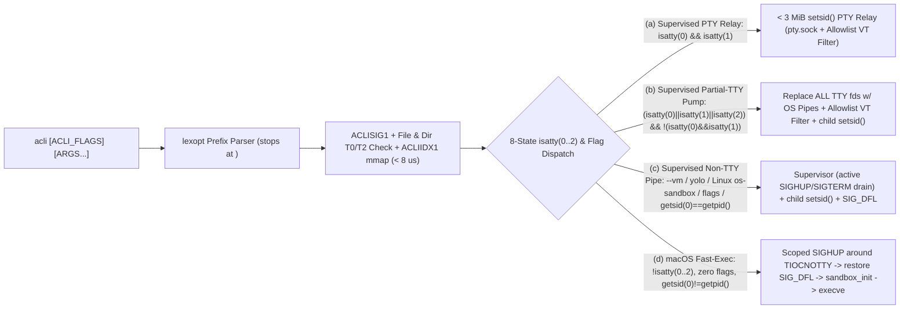

# Iteration 1 Research: Canonical Fast Agent CLI Launcher (`acli`), 9-CLI Translation, & `ACLIIDX1` Metadata

**Date:** 2026-11-22  
**Target CLIs Audited Live (`verified`):** `claude 2.1.330`, `codex 0.171.0`, `agy 1.5.14`, `copilot 1.0.114`, `kimi 2.7.2`, `grok 1.0.92`, `opencode 1.19.6`, `gemini 0.70.0`, `qwen 0.28.4` (plus `ntm 1.38.1`, `am 0.3.41`, `br 0.7.6`, and `bd 1.3.4`)

> [!IMPORTANT]
> **Iteration 1 Verdict:** Build `acli` as a 3-binary Rust suite (`acli` unsigned launcher `367.5 KiB` prototype / `1.5–2.5 MiB` full, `aclid` host supervisor/broker, and `acli-shim` hypervisor worker) using `lexopt` streaming prefix parsing over a **closed reserved `acli` subcommand noun set** (`auth`, `mcp`, `msg`, `bus`, `vm`, `daemon`, `pane`, `hook`, `telemetry`, `git`, `spawn`, `promote`, `discard`, `approve`, `ps`, `explain`, `describe`, `schema`, `self-update`, `update` — plus `--bead-engine auto|br|bd` and repeatable `--pass-fd <N>`), `build.rs`-compiled `ACLISIG1` Ed25519-signed zero-copy `ACLIIDX1` metadata (`include_bytes!` + optional `0600` `$HOME/.cache/acli/index.bin` `mmap` overlay), file-and-directory `T0/T1/T2` cryptographic binary + JS/SEA bundle verification, and a complete **8-State `isatty(0..2)` Launch Engine** (**Supervised Launch** vs **Fast-Exec Launch**, guaranteeing that outside interactive PTY relay `isatty(0) && isatty(1)`, child processes hold **zero** file descriptors referring to any host terminal device):
> 1. **Supervised Launch (`isatty(0) || isatty(1) || isatty(2)` on sandboxed/VM runs [whereas `--isolation host` without `--timeout`/`--otel-wrap`/`--format canonical-jsonl` uses un-relayed direct exec], plus `--vm`, `--mode yolo`, `--timeout`, `--format canonical-jsonl`, `--otel-wrap`, `acli auth login`, or Linux host `os-sandbox`):** Preserves caller pass-through fds explicitly declared via repeatable `--pass-fd <N>` (`N >= 3`, verified open via `fcntl(F_GETFD)`) without renumbering, allocates `acli`'s own internal descriptors (such as `qwen --otel-wrap` `--json-fd <internal_fd>`) strictly above `max(2, max_declared_caller_fd)` so caller fds never alias internal descriptors, and closes all undeclared inherited fds via `close_range` / `/proc/self/fd` on Linux and `/dev/fd` scan setting `FD_CLOEXEC`/`close()` on macOS (normalizing lexical/symlink/joined `--opt=<path>` fd aliases `/dev/fd/N`, `/dev/./fd/N`, `//dev/fd/N`, `/proc/self/fd/N`, `/proc/thread-self/fd/N`, and `/proc/<pid>/fd/N` and rejecting undeclared `N` with `exit 66` `E66:fd_arg_unsupported`, plus closing/rejecting any inherited TTY `fd >= 3`):
>    - **(a) Interactive Supervised PTY Relay (`isatty(0) && isatty(1)`):** Host-owned `< 3 MiB` PTY relay where the child calls `setsid()` + `ioctl(TIOCSCTTY)` on `PANE_SLAVE_TTY` (`0` host terminal fds), paired with `pty.sock` (`0600`), pre-launch host `CSI 6n` cursor seed (`100 ms` timeout, fallback `1;1`), local `CSI 5n` (`CSI 0 n`) / `CSI 6n` / primary `DA` (`CSI ? 62 ; 22 c`) replies (never forwarding `DSR`/`DA` queries, matching the `--vm` interactive mux client), and an **explicit `(prefix, intermediate, final)` VT allowlist** (permitting UTF-8 printable text, C0 `BEL`/`BS`/`HT`/`LF`/`CR`, `ESC 7`/`8`/`M`/`=`/`>`/`( B`, unprefixed/no-intermediate CSI finals `@ABCDEFGHJKLMPSXZbdfgmrs` [safe SGR `m`; `i` Media Copy removed; `n` answered locally or dropped; non-private `h`/`l` dropped], `CSI Ps SP q`, DEC `? Pm h/l` strictly for `Pm in {1, 7, 12, 25, 1000, 1002, 1003, 1004, 1006, 1015, 1047, 1048, 1049, 2004, 2026}`, `OSC 0`/`2` window title, and base64-set `OSC 52;<sel>;<base64>` **ONLY** under host `--allow-osc52` while **rejecting** any CSI with `$`/`>`/`=`/`<`/`?` outside listed tuples, `OSC 52;...;?` clipboard-read queries, `XTWINOPS`, `OSC 4/8/10/11/12/50/1337`, `DCS`, `APC`, `PM`, `SOS`). If `!isatty(2)` (`(1,1,0)`), `fd 2` stays the redirected file; if `isatty(2)` (`(1,1,1)`), **`fd 2` is attached to `PANE_SLAVE_TTY`**.
>    - **(b) Partially Redirected Terminal Supervised Pump (`(isatty(0) || isatty(1) || isatty(2)) && !(isatty(0) && isatty(1))`, covering all `5` partial-TTY combinations `001, 010, 011, 100, 101` such as `acli claude -p x | jq`, `acli claude -p x > out.log 2>&1`, and `v=$(acli claude -p x)`):** Replaces **EVERY** terminal-backed descriptor among `{0, 1, 2}` with an OS pipe (pumping host `stdin` -> child `stdin` pipe or `/dev/null` on `-p` runs, and pumping child `stdout`/`stderr` pipes through the `(prefix, intermediate, final)` outbound VT allowlist whenever the corresponding host `fd` is a TTY), calling `setsid()` in the forked child and verifying `open("/dev/tty", O_RDWR) == -1 (ENXIO)` (`E71:tty_detach_failed`) before `sandbox_init_with_parameters`.
>    - **(c) Pure Non-TTY Supervised Pipe (`!isatty(0) && !isatty(1) && !isatty(2)` with any Supervised flag or session-leader fallback):** Forked child calls `setsid()` and verifies `/dev/tty` `ENXIO` before `sandbox_init_with_parameters`; supervisor installs an active `SIGHUP`/`SIGTERM` teardown/drain handler and resets child `SIGHUP` to `SIG_DFL` pre-`execve`.
> 2. **Fast-Exec Launch (`0` surviving `acli` processes; macOS host `os-sandbox` or un-relayed `--isolation host` without Supervised flags, `7.06 ms` macOS `sandbox_init_with_parameters` FFI):** Preserves `--pass-fd <N>` caller fds, allocates any internal fds strictly above `max(2, max_declared_caller_fd)`, rejects normalized undeclared `/dev/fd/N`, `/dev/./fd/N`, `//dev/fd/N`, or `/proc/{self,thread-self,<pid>}/fd/N` path-valued CLI args with `exit 66` `E66:fd_arg_unsupported`, and scans `/dev/fd` to close/set `FD_CLOEXEC` on all undeclared inherited fds `>= 3` (never calling macOS-absent `closefrom`/`close_range`); on `!isatty(0..2)` checks `getsid(0) == getpid()` first (transitioning cleanly to Supervised fork `(c)` if session leader), otherwise ignores `SIGHUP` **ONLY** around `ioctl(TIOCNOTTY)` (`O_CLOEXEC`), **immediately restores `SIGHUP` to `SIG_DFL` before `sandbox_init_with_parameters` and `execve`**, and verifies `open("/dev/tty", O_RDWR) == -1 (ENXIO)` (`exit 71` `E71:tty_detach_failed` otherwise).

---

## 1. Prior-Art Consolidation, Runtime Benchmarks, & Process Semantics

### 1.1 Empirical Drift Across Four Existing Wrapper Tables (`verified`)

Auditing `artagon-model-cli` (`openspec/changes/unify-ai-cli-wrappers/design.md`, `scripts/ai`), `artagon-scripts` (`ntm-agent-mode.sh`, `agent-identity.sh`, `artagon-harness-eval/data/harnesses/*.yaml`, `configs/art-swarm/providers.json`), `$HOME/.artagon/ntm/agent-cli-catalog.json`, and `acpx` revealed four separate, actively diverging capability definitions:

| Drift Dimension | `artagon-model-cli/scripts/ai` | `ntm-agent-mode.sh` | `artagon-harness-eval/*.yaml` | Live 2026-11-22 CLI Reality (`verified`) |
| --- | --- | --- | --- | --- |
| **CLIs covered** | 3 (`codex`, `claude`, `gemini`) | 6 (`cc`, `cod`, `agy`, `cop`, `grok`, `kimi`) | 6 (`claude`, `codex`, `agy`, `copilot`, `grok`, `kimi`) | **9 CLIs** (`+ opencode`, `gemini`, `qwen`); `agent-cli-catalog.json` tracks only 4 |
| **Codex `auto` & `-a`** | `--full-auto -c approval_policy=never` | `--approve-for-me` | `--dangerously-bypass-approvals-and-sandbox` | `--full-auto` **removed** in `codex 0.171.0`; `-a` dropped from `codex exec` (`on-request\|never` only) |
| **Claude `auto` & prompts** | `--permission-mode bypassPermissions` | `--permission-mode auto` | `--dangerously-skip-permissions`; `--append-system-prompt-file` gated at `>=99.0.0` | `claude 2.1.330` supports `--permission-mode auto` and hidden `--append-system-prompt-file` (`2.1.318+`) |
| **Grok flags & OTel** | Absent | `--permission-mode ...` | `-d`, `--max-tool-rounds 50`, `XAI_BASE_URL`, `otel: none` | `grok 1.0.92` uses `--cwd`, `--max-turns`, `--reasoning-effort`, `GROK_XAI_API_BASE_URL`, `GROK_EXTERNAL_OTEL=1` |
| **Kimi modes & base URL** | Absent | `auto -> --yolo`, `yolo -> --auto` | `headless` uses `--yolo`, `MOONSHOT_BASE_URL` | `kimi 2.7.2` `--yolo` still prompts (*"Ask When Needed"*); `--auto` is *"Never Ask"*; uses `KIMI_BASE_URL` / `KIMI_CODE_BASE_URL` |
| **`gemini` vs `agy` key** | `gemini` | Absent (`agent_identity.sh:45` aliases `gemini -> antigravity`) | Absent | `@google/gemini-cli` (`0.70.0`) and `agy` (`1.5.14`) have incompatible flags and must be distinct providers |
| **ACP (`acpx`) boundary** | N/A | N/A | N/A | Headless stdio JSON-RPC only (no interactive TUI/`tmux`); external JS bridges add `~2 s` cold start (`zod`/SDK eager imports = `77%` of startup); Homebrew Node disables SEA (`112.12 MiB` binary copy) |

### 1.2 Empirical 8-Runtime Startup & Memory Benchmark on `darwin/arm64` (`hyperfine 2.0.0`, `verified`)

Unloaded user-space startup floors on `darwin/arm64` separate native compiled binaries (`0.61 ms` native user CPU) from stock macOS `/bin/bash` 3.2 (`13.47 ms`) and Python (`57.28 ms` cold interpreter init; `170.7+ ms` with stdlib imports), while real multi-subshell Bash wrappers (`ntm-agent-mode.sh` at `181.56 ms` median and `scripts/ai --dry-run` at `309.31 ms` median) pay 6–10 macOS Endpoint Security Framework (ESF) `fork`/`exec` inspections per call (`verified`).

| Launcher Runtime (`darwin/arm64`) | Artifact Size | `exec` Median CPU (`user + sys`) | `--skill` Min Wall / Median CPU | `--skill` Peak RSS | Fast-Exec `acli` Overhead | `tmux` / `ntm` Process Semantics & Verdict |
| --- | --- | --- | --- | --- | --- | --- |
| *Baseline (`/usr/bin/true`)* | — | `1.81 ms` (`0.59 + 1.21 ms`, `5.71M` cyc) | — | `0.97 MiB` | `0 KiB` | Single Mach-O `execve` ESF floor (`30.81 ms` min wall under swarm load) |
| **Rust (`rustc 1.96 -O`, `panic=abort`, `CommandExt::exec`)** | **`367.5 KiB`** (`376,352 B`) | **`4.29 ms`** (`1.60 + 2.69 ms`, `13.77M` cyc) | **`22.46 ms` / `2.43 ms`** (`1.01 ms` user) | **`1.91 MiB`** | **`0 KiB`** (`< 3 MiB` Supervised relay/pump) | **SELECTED:** `.arg0()` preserved, `< 3 MiB` relay, memory-safe TOML/JSON/Mach-O/Keychain |
| **C (`clang -O3 + execv`)** | `33.0 KiB` (`33,784 B`) | `3.95 ms` (`1.25 + 2.69 ms`, `12.74M` cyc) | `22.83 ms` / `2.08 ms` (`0.66 ms` user) | `1.70 MiB` | `0 KiB` | Reject: memory-safety risk for JSON Schema, TOML v1.0, OAuth, & Mach-O `SuperBlob` parsing |
| **Go (`go 1.27 -ldflags="-s -w"`, `syscall.Exec`)** | `1.51 MiB` (`1,587,714 B`) | `5.50 ms` (`1.87 + 3.65 ms`, `17.74M` cyc) | `24.55 ms` / `3.66 ms` | `4.31 MiB` (`2.3x` Rust) | `0 KiB` | Reject: GC/scheduler init on every call; `syscall.Exec` unsafe after goroutine spawn; `4.2x` size |
| **Bash 5.3 (`exec`) / `/bin/bash` 3.2** | `1.13 KiB` (`1,155 B`) | `9.61 ms` (`13.47 ms` Bash 3.2; `181.6–309.3 ms` real scripts) | `26.61 ms` / `7.71 ms` (`64.61M` instr) | `6.66 MiB` (`3.5x` Rust) | `0 KiB` after `exec` | Reject: real scripts fork `getopt`/`jq`/`awk` 6–10x (`+180–300 ms` ESF tax); BSD `getopt` traps |
| **Bun 1.4.4 (`--compile` binary)** | `83.3 MiB` (`87,355,554 B`) | `13.51 ms` (`37.87M` cyc) | `35.19 ms` (script) / `15.75 ms` | `25.02 MiB` (`13.1x` Rust) | `20.95 MiB` (`spawnSync`) | Reject: `232x` binary size; leaves wrapper in process tree unless FFI `execve` |
| **Bun 1.4.4 (script)** | `1.36 KiB` (`1,396 B`) + runtime | `14.57 ms` (`41.13M` cyc) | `35.19 ms` / `15.75 ms` | `25.02 MiB` | `22.61 MiB` (`spawnSync`) | Reject: JSC init + `spawnSync` parent residency |
| **Python 3.15 (`os.execv`)** | `1.45 KiB` (`1,489 B`) + runtime | `20.85 ms` (`57.28 ms` cold; `170.7+ ms` w/ stdlib) | `70.08 ms` / `20.32 ms` (`152.63M` instr) | `13.22 MiB` (`6.9x` Rust) | `0 KiB` after `execv` | Reject: `3.1x–8.4x` slower; venv / PEP 668 / `PYTHONPATH` fragility |
| **Node 24.11 (`spawnSync`)** | `1.36 KiB` + `112.1 MiB` runtime | `30.01 ms` (`91.05M` cyc, `277.75M` instr) | `56.82 ms` / `28.12 ms` | `44.14 MiB` (`23.1x` Rust) | **`44.34–45.4 MiB`** | Reject: no stdlib `execve`; wastes `~720 MiB` across 16 NTM panes |

### 1.3 Complete 8-State `isatty(0..2)` Launch Table, Allowlist VT Filter, & Scoped `SIGHUP` (`verified`)

1. **Non-Aliasing `--pass-fd <N>` Scrub, Mode `(a)` `TIOCSCTTY` vs `(b)`–`(d)` `ENXIO`, `(prefix, intermediate, final)` VT Allowlist, & Scoped `SIGHUP` (`OPUS-R7-05,06,07,09`, `OPUS-R11-05`, `FABLE-R7-02,03,04`):**
   - **Non-Aliasing `--pass-fd <N>` Scrub:** Pre-`sandbox_init`/`execve`, `acli` keeps caller pass-through fds explicitly declared via repeatable `--pass-fd <N>` (`N >= 3`, verified open via `fcntl(F_GETFD)`) intact without renumbering, allocates any `acli`-owned internal descriptors (such as `qwen --otel-wrap` `--json-fd <internal_fd>`) strictly above `max(2, max_declared_caller_fd)` so caller fds never alias internal descriptors, normalizes lexical, symlink, and joined `--opt=<path>` fd aliases (`/dev/fd/N`, `/dev/./fd/N`, `//dev/fd/N`, `/proc/self/fd/N`, `/proc/thread-self/fd/N`, `/proc/<pid>/fd/N`) rejecting undeclared `N` with `exit 66` `E66:fd_arg_unsupported`, and closes all undeclared inherited fds `>= 3` via `close_range` / `/proc/self/fd` on Linux and `/dev/fd` scan setting `FD_CLOEXEC`/`close()` on macOS (never calling macOS-absent `closefrom`/`close_range`).
   - **Sub-modes `(a)`–`(c)` (Supervised Launch):** Whenever `isatty(0) || isatty(1) || isatty(2)` holds on sandboxed/VM runs (whereas `--isolation host` without `--timeout`/`--otel-wrap`/`--format canonical-jsonl` uses un-relayed direct exec) or any Supervised flag is active, `acli` supervises the child. In `(a)` (`(1,1,1)` attaches `fd 2` to `PANE_SLAVE_TTY`; `(1,1,0)` keeps redirected `fd 2`), the child calls `setsid()` + `ioctl(TIOCSCTTY)` on `PANE_SLAVE_TTY`, while both host `(a)` and the `--vm` interactive client seed virtual cursor `(row, col)` via one pre-launch host `CSI 6n` (`100 ms` timeout, fallback `1;1`) and answer `CSI 5n` (`CSI 0 n`), `CSI 6n`, and primary `DA` (`CSI ? 62 ; 22 c`) locally without forwarding `DSR`/`DA` queries. In `(b)` (`5` partial-TTY states `001, 010, 011, 100, 101`), every terminal-backed fd among `{0, 1, 2}` is replaced by an OS pipe (`0` host terminal fds in child; `0` `ONLCR` on piped outputs), pumping any TTY-backed output fd through the `(prefix, intermediate, final)` VT allowlist (`BEL`, `ESC 7/8/M/=/ >/( B`, unprefixed `@ABCDEFGHJKLMPSXZbdfgmrs`, `CSI Ps SP q`, DEC `? Pm h/l` for `{1,7,12,25,1000,1002,1003,1004,1006,1015,1047,1048,1049,2004,2026}`, `OSC 0/2`, and base64-set `OSC 52;<sel>;<base64>` **only** under host `--allow-osc52` while rejecting `i` Media Copy, non-private `h`/`l`, `$`/`>`/`=`/`<`/`?` outside listed tuples, and `OSC 52;...;?`). Non-PTY modes `(b)` and `(c)` call `setsid()`, verify `open("/dev/tty", O_RDWR) == -1 (ENXIO)` (`E71:tty_detach_failed`), and reset `SIGHUP` to `SIG_DFL` pre-`sandbox_init_with_parameters`.
   - **Sub-mode `(d)` (macOS Fast-Exec):** Runs on macOS `os-sandbox` when `!isatty(0) && !isatty(1) && !isatty(2)` and zero Supervised flags are set (or un-relayed `--isolation host` without Supervised flags), after the non-aliasing `/dev/fd` scrub. On `!isatty(0..2)` checks `getsid(0) == getpid()` first (transitioning cleanly to Supervised fork `(c)` if session leader); otherwise ignores `SIGHUP` **only** across `open("/dev/tty", O_RDWR|O_NOCTTY|O_CLOEXEC)` + `ioctl(TIOCNOTTY)` + `close(fd)`, **restores `SIGHUP` to `SIG_DFL` immediately**, verifies `open("/dev/tty", O_RDWR) == -1 (ENXIO)` (`exit 71` `E71:tty_detach_failed` otherwise), applies `sandbox_init_with_parameters` (`exit 71` `E71:sandbox_init_failed` on error), and `execve`s (`0` surviving `acli` processes).
   - **Compile-Time `LaunchTopology` Linear Typestate & `statig 0.4.1` PTY/VT HSMs ([07-rust-hsm-state-machine-architecture.md](07-rust-hsm-state-machine-architecture.md) §5.1.A.2 & §5.3.C.2):** Pre-`execve` launch ordering is enforced at compile time via the 7-stage move-only `PhantomData` typestate pipeline (`RawCliInvocation -> ValidatedRootsAndBinaryPin<T0T2Verified> -> NormalizedFdPlan -> AllocatedInternalFds -> ScrubbedFdTable -> TerminalIsolatedTopology -> SandboxedReadyToExec`), while runtime interactive/pump stream filtering and Path A quarantine run on `statig = "0.4.1"` via `OutboundVtFilterHsm` and `PtyInputQuarantineHsm` (`BoundedDeferQueue` `64 KiB` human `stdin` hold + orthogonal `orphan_paste_open`).
2. **Exact `tmux` `#{pane_current_command}` Truth & `@acli_provider` (`ASTRA-R2-04`):**
   - On **Supervised Launch** `(a)`–`(c)`, `#{pane_current_command}` reports `acli`; on **un-relayed `--isolation host` (`--no-sandbox`) direct `execve`**, XNU `pbsi_comm` reports `<active_provider>` (or versioned binary basename) for native Mach-O/ELF binaries and **`node`** for Node.js CLIs (`gemini`, `qwen`). `acli` stamps `ACLI_LOGICAL_PROVIDER` into `<ACLI_RUN_DIR>/p/<pane_id>/meta.json` and `tmux` **`@acli_provider`**.
3. **Inode Multicall Shims & Canonical `project_key` (`ASTRA-R2-02`, `OPUS-R6-10`, `OPUS-R7-02,07`):**
   - Multicall `argv[0]` shims skip `current_exe()` and `<shim_dir>` via `fstat` `(st_dev, st_ino)` checks (`ACLI_SHIM_DEPTH > 4 -> exit 78` `E78:shim_depth_exceeded`) and scrub internal `ACLI_*` overrides (`--allow-osc52` is rejected on `--mode yolo` CLI calls with `E64:flag_denied` and under `sys_spawn` with `E64:spawn_escalation`; **all `ACLIIDX1`-declared per-CLI approval/sandbox bypass flags** — including `--yolo`, `-y`, `--dangerously-skip-permissions`, `--dangerously-bypass-approvals-and-sandbox`, `claude --settings` sandbox overrides, `grok --permission-mode bypassPermissions`, `kimi`/`opencode --auto`, `codex -c approval_policy=*`/`sandbox_mode=*`, and unsupported `opencode --` passthrough — after `--` are rejected across **all** non-`yolo` modes on host `os-sandbox` with `E64:flag_denied`).
   - Canonical `project_key` (via hardened `git rev-parse` with `GIT_CONFIG_GLOBAL=/dev/null`, `GIT_CONFIG_NOSYSTEM=1`, `-c core.fsmonitor=false`, `-c core.hooksPath=/dev/null`; the sole narrow carve-out without `GIT_CONFIG_GLOBAL=/dev/null` is `sys_git commit` pre-dispatch reading the closed 8 commit-identity/signing keys via `git -C <workspace> config --includes --get <key>`): (1) inside `/.git/modules/<sub_name>` -> `realpath(--show-toplevel)`; (2) `basename(realpath(--git-common-dir)) == ".git"` -> `dirname(realpath(--git-common-dir))`; (3) bare repo OR `--separate-git-dir` not named `.git` -> `realpath(--git-common-dir)`; (4) non-Git -> `realpath(cwd)`.

---

## 2. Self-Documenting Agentic CLI & Closed Subreason Taxonomy

### 2.1 Measured Token & Latency Efficiency (`verified`)

| Introspection Surface | Measured Payload | Token Cost | Latency | Assessment |
| --- | --- | --- | --- | --- |
| `ntm --robot-capabilities` (unfiltered / `--capability-compact`) | `248,725 B` / `42,089 B` | `~62,200` / `~10,500` tok | `~120 ms` | Exhausts agent context window |
| `art-swarm.sh capabilities` / `schema` | `47,528 B` / `157,830 B` | `~11,900` / `~39,500` tok | `6,670 ms` | Synchronous live version probes stall startup |
| **`acli --skill` (Router `SKILL.md`)** | **`~3.4 KiB` (`96` lines)** | **`~820` tok** | **`< 2 ms` offline** | **Optimal progressive disclosure (`0` `lint_skill.py` warnings)** |
| **`acli --skill <topic\|provider>`** | **`~2.2–3.6 KiB` (`45–95` lines)** | **`400–850` tok** | **`< 2 ms` offline** | Rendered from compiled `ACLIIDX1` + `stat()` pin cache |

### 2.2 Canonical Exit-Code & Subreason Taxonomy (`FABLE-R6-07`, `FABLE-R7-10`, `OPUS-R7-11`)

Once a child CLI starts, its exit code (`1..255`) passes through verbatim (`2` is reserved for child pass-through and tap self-update wrappers, and `130`/`137`/`143` are strictly child/drain signal exits `128 + sig` without `acli: error[E...]:`). For `acli`-originated subreasoned error codes (`4`, `64`, `65`, `69`, `70`, `71`, `75`, `77`, `78`, `125`, plus `E66:fd_arg_unsupported` on undeclared `/dev/fd/N` or `/proc/self/fd/N` path-valued CLI args), `acli` prints **`acli: error[E<code>:<subreason>]: <message>`** on stderr matching the closed launcher spec subreason table (`specs/acli-launcher-and-metadata/spec.md`, while missing-file exit `66` and single-cause codes `3`, `9`, `73`, `124`, `126`, `127` emit `acli: error[E<code>]:`), recording `exit_origin: "acli"` and `exit_subreason` in `meta.json` on pre-exec abort (`exit_origin: "child"` is recorded strictly on **Supervised Launch**):

| Exit | Symbolic Name | Canonical Closed Subreasons & Automated Agent Action |
| --- | --- | --- |
| `0` | `OK` | Clean execution, `explain`, `describe`, or `--skill-install --check` match. |
| `2` | *(Child / Tap Self-Update)* | Reserved for child CLI exit `2` pass-through (and Homebrew wrapper blocking `self-update\|update`). |
| `3` | `UNSUPPORTED_OR_DRIFT` | Target CLI lacks a `fail_closed` capability (`kimi --mode edits`) or `behavioral` capability under `--strict`. |
| `4` | `AUTH_OR_LOCK_CONFLICT` | `E4:file_reserved`, `E4:overlay_dirty` (`sys_git switch` or `stash push\|pop\|apply` over any retained `upper` entry), `E4:slot_mirror_failed`, `E4:billing_conflict`, or `E4:auth_helper_failed`. |
| `9` | `STALE_SCHEMA_OR_PLAN` | Stale/mismatched `ACLIIDX1` metadata schema or `--confirm-plan` `plan_hash` mismatch. |
| `64` | `EX_USAGE` | `E64:unsafe_root`, `E64:yolo_host_forbidden`, `E64:path_jail`, `E64:git_flag_denied`, `E64:spawn_escalation` (incl. `--allow-osc52` or `--` args in `sys_spawn`), or `E64:flag_denied` (`--mode yolo` + `--no-sandbox`/`--allow-osc52`, or `ACLIIDX1` bypass flags after `--` on host `os-sandbox`). |
| `65` | `EX_DATAERR` | `E65:spill_denied` (oversized bus payload without `--allow-spill`) or `E65:rpc_input_invalid` (SHA-256 mismatch or malformed schema/RPC input). |
| `66` | `EX_NOINPUT` | `E66:fd_arg_unsupported` (undeclared `/dev/fd/N` or `/proc/self/fd/N` path-valued CLI arg) or missing prompt, system-prompt, schema, or `--with-skill` path. |
| `69` | `EX_UNAVAILABLE` | `E69:insufficient_vm_ram` (`host_ram_gib < 8`), `E69:libkrun_too_old` (`< 1.19.8`), `E69:hypervisor_unavailable`, `E69:nix_substitute_missing` (`--option builders ''`), `E69:guest_binary_missing` (`--mode yolo` never falls back to host!), or `E69:auth_helper_unavailable`. |
| `70` | `EX_SOFTWARE` | `E70:vm_boot_failed`, `E70:vm_handshake_failed` (`ACLIVM01` / guest handshake failure), `E70:vsock_control_corrupt` (`vsock:5102` outer-envelope VM recycle), or `E70:recovery_corrupt` (corrupt journal state). |
| `71` | `EX_OSERR` | `E71:sandbox_init_failed` (`sandbox_init_with_parameters`, `bwrap`, Landlock `ABI >= 1`, `seccomp`) or `E71:tty_detach_failed` (modes `(b)`–`(d)` pre-sandbox `/dev/tty` `ENXIO` check). |
| `73` | `EX_CANTCREAT` | Atomic `ACLIIDX1`/config/skill write failure or symlinked state target refused (`O_NOFOLLOW`). |
| `75` | `EX_TEMPFAIL` | `E75:vm_memory_budget` (shared-VM `memory.max` admission budget full), `E75:spawn_quota_exceeded` (`> 8` live descendants or `> 64/24h` lineage names), or `E75:probe_timeout` (`--live` probe `> 2 s`). |
| `77` | `EX_NOPERM` | `E77:plan_readonly`, `E77:protected_path` (B4 / unknown-whiteout / `git config` error), `E77:bundle_pin_mismatch`, `E77:signer_untrusted`, or `E77:index_signature_invalid` (`index.bin` `ACLISIG1` failure). |
| `78` | `EX_CONFIG` | `E78:instance_lock`, `E78:workspace_owned`, `E78:writable_scope_overlap`, `E78:ambiguous_nats_bind`, `E78:cmd_helper_denied`, `E78:shim_depth_exceeded`, `E78:spawn_depth_exceeded` (`spawn_depth > 3`), `E78:surface_missing`, or `E78:metadata_corrupt` (corrupt `versions.jsonl`). |
| `124` / `125` | `TIMEOUT` / `AUTH_TTY` | Managed supervisor `--timeout` expired (`124`) or `E125:interactive_auth_required` (non-TTY interactive OAuth login refused). |
| `126` / `127` | `NOT_EXEC` / `NOT_FOUND` | Target CLI binary is non-executable (`126`) or absent from `PATH` (`127`). |
| `130` / `137` / `143` | *(Child / Drain Signal)* | Child or drain signal exit (`128 + sig`, including `137` per-pane `memory.max` cgroup OOM kill; never emitted with `acli: error[E137]:`). |

---

## 3. Canonical Option Mapping Across All 9 Agent CLIs (`verified`)

Total canonical mode order (`OPUS-R5-06`): **`read-only = plan < ask < edits < auto < yolo`** (`accept-edits` aliases `edits`; unknown mode names exit `64`):

| Canonical Key | `claude 2.1.330` | `codex 0.171.0` | `agy 1.5.14` | `copilot 1.0.114` | `kimi 2.7.2` | `grok 1.0.92` | `opencode 1.19.6` | `gemini 0.70.0` | `qwen 0.28.4` |
| --- | --- | --- | --- | --- | --- | --- | --- | --- | --- |
| **Interactive TUI** | `claude [prompt]` | `codex [PROMPT]` | `agy [-i prompt]` | `copilot [-i prompt]` | `kimi` *(rejects pos!)* | `grok [PROMPT]` | `opencode [--prompt txt]` | `gemini [query]` *(TTY=TUI)* | `qwen [-i prompt]` *(pos=headless!)* |
| **One-shot (`-p`)** | `-p` *(bool)* + `<prompt>` | **`codex exec`** `<PROMPT>` | `-p <prompt>` *(str)* | `-p <text>` *(str)* | `-p <prompt>` | `-p <prompt>` | **`opencode run`** `<msg>` | `-p <prompt>` | `<query>` *(pos; `-p` deprecated)* |
| **ACP server** | Unsupported (`mcp serve` only) | Unsupported (`app-server` custom) | `agy acp [--stdio]` | `copilot --acp` | `kimi acp` | `grok agent stdio` | `opencode acp` | `gemini --acp` | `qwen --acp` (`qwen serve`) |
| **Model (`-m`)** | `--model <id>` *(hyphen: `claude-opus-5-5`)* | `-m <slug>` *(dotted: `gpt-6.2-sol`)* | `--model <slug>` *(effort-folded)* | `--model <id>` *(dotted for ALL: `claude-opus-5.5`!)* | `-m <model>` | `-m <MODEL>` | `-m <prov/model>` *(req `/`)* | `-m <model>` | `-m <model>` |
| **Effort (`-e`)** | `--effort <low..max>` *(5 tiers)* | `-c model_reasoning_effort="<low..ultra>"` *(6 tiers)* | Fold `<base>-<low..xhigh>`, else `--effort` | `--reasoning-effort <none..max>` *(7 tiers)* | Env `KIMI_MODEL_THINKING_EFFORT` | `--reasoning-effort <EFFORT>` (`--effort`) | `run --variant <min..max>` *(run only!)* | `settings.json` `thinkingLevel` | `settings.json` `reasoningEffort` |
| **`mode=plan`** *(outer RO workspace!)* | `--permission-mode plan` | `-s danger-full-access -c approval_policy="on-request"` *(outer RO!)* | `--mode plan --sandbox=false` *(outer RO!)* | `--plan --no-sandbox --trust-folder <ws>` *(outer RO!)* | `--plan` *(outer RO!)* | `--permission-mode plan --sandbox off` *(outer RO!)* | `--agent plan` + `OPENCODE_PERMISSION='{"bash":"deny"}'` *(outer RO!)* | `--approval-mode plan --sandbox=false` *(never `-s`!)* | `--approval-mode plan --sandbox false` *(outer RO!)* |
| **`mode=read-only`** *(outer RO workspace!)* | `--permission-mode plan --permission-prompts none` | `exec -s danger-full-access -c approval_policy="never"` *(outer RO!)* | `--mode plan --sandbox=false` *(outer RO!)* | `--plan --no-sandbox --trust-folder <ws> --deny-tool write --deny-tool shell` *(outer RO!)* | Enforced by outer RO `os-sandbox` (`exit 3` under `--no-sandbox`) | `--permission-mode plan --sandbox off` *(outer RO!)* | `--agent plan` + deny `edit,bash,webfetch` *(outer RO!)* | `--approval-mode plan --sandbox=false` *(never `-s`!)* | `--approval-mode plan --sandbox false` *(outer RO!)* |
| **`mode=edits`** *(`accept-edits` alias)* | `--permission-mode acceptEdits` | `-s danger-full-access -c approval_policy="on-request"` *(outer `os-sandbox`!)* | `--mode accept-edits --sandbox=false` | `--no-sandbox --trust-folder <ws> --allow-tool write` | **Unsupported (`exit 3`)** | `--permission-mode acceptEdits --sandbox off` | `OPENCODE_PERMISSION='{"edit":"allow","bash":"ask"}'` | `--approval-mode auto_edit --sandbox=false` *(never `-s`!)* | `--approval-mode auto-edit --sandbox false` *(hyphen!)* |
| **`mode=auto`** | `--permission-mode auto` | `--approve-for-me` | `--mode auto --sandbox=false` | `--no-sandbox --trust-folder <ws> --assisted-approval` | **`--yolo`** *("Ask When Needed"!)* | `--permission-mode auto --sandbox off` | `--auto` | **Unsupported (`exit 3` strict; never `-s` or `yolo`!)** | `--approval-mode auto --sandbox false` |
| **`mode=yolo`** *(always `--isolation vm`!)* | `--dangerously-skip-permissions --settings '{"sandbox":{"enabled":false}}' --strict-mcp-config` | `--dangerously-bypass-approvals-and-sandbox` | `--dangerously-skip-permissions --sandbox=false` | `--yolo --no-sandbox --disable-builtin-mcps --trust-folder <ws>` | **`--auto`** *("Never Ask"!)* | `--permission-mode bypassPermissions --sandbox off` | `--auto` | `-y --sandbox=false --skip-trust` *(never `-s` or `--approval-mode`!)* | `-y --sandbox false` |
| **`output=json`** | `--output-format json` | `-o <file>` + `--output-schema` | `--output-format json` | *JSONL only* (`--output-format json` = JSONL!) | *Stream only* (`stream-json`) | `--output-format json` | *Stream only* (`run --format json` = NDJSON) | `-o json` | `-o json` |
| **`output=jsonl`** | `--output-format stream-json --verbose` | `codex exec --json` | `--output-format stream-json` | `--output-format json` | `--output-format stream-json` | `--output-format streaming-json` | `opencode run --format json` | `-o stream-json` | `-o stream-json` |
| **`json_schema`** | `--json-schema <json>` | `exec --output-schema <FILE>` *(staged)* | `--json-schema <json\|file>` | Unsupported | Unsupported | `--json-schema <JSON>` | Unsupported | Unsupported | `--json-schema <JSON\|@FILE>` |
| **System replace** | `--system-prompt[-file]` | `-c model_instructions_file="<path>"` | Staged `agent.md` + `--agent` | Staged `.agent.md` + `--agent` | `--agent-file <path>` | `--system-prompt-override` / `-file` | `OPENCODE_CONFIG_CONTENT` | `GEMINI_SYSTEM_MD=<path>` | `--system-prompt <txt>` / `QWEN_SYSTEM_MD` |
| **System append** | `--append-system-prompt[-file]` | `-c developer_instructions="<toml>"` | Unsupported CLI flag | `COPILOT_CUSTOM_INSTRUCTIONS_DIRS` | Workspace `AGENTS.md` only | `--rules <RULES>` | `OPENCODE_CONFIG_CONTENT` `instructions` | Workspace `GEMINI.md` only | `--append-system-prompt <txt>` |
| **Extra dirs** | `--add-dir <dir...>` | `--add-dir <DIR>` | `--add-dir <dir>` | `--add-dir <dir>` | `--add-dir <dir>` | `--add-dir <DIR>` | `OPENCODE_PERMISSION` `external_directory` | `--include-directories <dir>` | `--add-dir <dir>` |
| **Worktree** | `-w[=<name>]` / `--worktree[=<name>]` | `--worktree` *(bool)* | Unsupported | `-w[=<name>]` / `--worktree[=<name>]` *(`verified`)* | Unsupported | `-w[=<NAME>]` / `--worktree[=<NAME>]` | Unsupported | `-w[=<name>]` | `--worktree[=<slug>]` *(no `-w`!)* |
| **Continue / Resume** | `-c` / `--resume=<id>` | `[exec] resume --last` / `<ID>` | `-c` / `--conversation <id>` | `--continue` / `--resume=<id>` | `-c` / `-S <id>` | `-c` / `--resume=<id>` | `-c` / `-s <id>` | `--resume=latest` / `--resume=<id>` | `-c` / `--resume=<id>` |
| **Session fork** | `--fork-session` | `fork [--last\|ID]`; `exec fork <ID>` | Unsupported | Interactive `/fork` only | `kimi fork [id]` | `--fork-session` | `--fork` | Unsupported | `--fork-session` |
| **Tool deny** | `--disallowed-tools <rules...>` | `--disable <feat>` / execpolicy | `--settings` `permissions.deny` | `--deny-tool <rules...>` | Unsupported via CLI | `--disallowed-tools <CSV>` / `--deny <RULE>` | `OPENCODE_PERMISSION` | `--policy <toml>` | `--exclude-tools <tools...>` |
| **MCP config** | `--mcp-config <file\|json>` (`--strict-mcp-config`) | `-c 'mcp_servers.<n>={...}'` | `$HOME/.gemini/config/mcp_config.json` | `--additional-mcp-config @<file>` | `$KIMI_CODE_HOME/mcp.json` | `$GROK_HOME/config.toml` | `OPENCODE_CONFIG_CONTENT` | `$GEMINI_CLI_HOME/.gemini/settings.json` | `--mcp-config <file\|json>` |

- **`gemini` Never Emits `-s` (`OPUS-R3-17`):** Across **every** `--mode` (`plan`, `read-only`, `ask`, `edits`, `auto`, `yolo`), `acli` sets `--sandbox=false` / `GEMINI_SANDBOX=false` and **never** emits `-s` (which re-enables Gemini's inner Seatbelt -> `rc=71`). `copilot` pairs `--trust-folder <ws>` + `"sandbox":{"enabled":false}` in `COPILOT_HOME` + `ACLIIDX1`-verified `--no-sandbox`.

---

## 4. Tier-Partitioned `ACLI_STATE_DIR`, Immutable Per-Pane `ca-bundle.pem`, 9-CLI OTel Normalization, & `acli auth` (`OPUS-R5-13`)

- **Tier-Partitioned `ACLI_STATE_DIR` (`$HOME/.local/state/acli-homes/{sandbox,vm,host}/<active_provider>/`, `0700`) & Per-Pane Read-Only CA Bundle:** Pre-sandbox, `acli` merges the macOS/host system + admin root CAs **plus any user `ACLI_CA_BUNDLE` file** into **`<ACLI_RUN_DIR>/ca/pane-<pane_id>-ca-bundle.pem`** (`0444` file in `0755` dir owned by supervisor/`aclid`, granted explicit read-only access and `deny file-write*` inside SBPL/Landlock) and sets `NODE_EXTRA_CA_CERTS` and `SSL_CERT_FILE` alongside `NODE_USE_SYSTEM_CA=1` — keeping the CA bundle 100% immutable outside the writable `<ACLI_STATE_DIR>/sandbox/<active_provider>/` directory!
- **9-CLI OTel, Privacy Lock, & Hook Normalization (`ACLI_TELEMETRY=off|otlp`, `--otel-wrap`, `< 3 ms` `acli hook emit [--drain]` — see [06-production-agent-cli-and-hook-telemetry.md](06-production-agent-cli-and-hook-telemetry.md) §2.2 & §3):** Across **all** modes, `acli`'s privacy/auto-update lock sets `DO_NOT_TRACK=1`, `DOLT_METRICS_DISABLED=1`, `BD_DISABLE_METRICS=1`, `BD_DISABLE_EVENT_FLUSH=1`, `DISABLE_TELEMETRY=1`, `DISABLE_ERROR_REPORTING=1`, `DISABLE_AUTOUPDATER=1`, and `CLAUDE_CODE_DISABLE_NONESSENTIAL_TRAFFIC=1`. Panes receive a dedicated per-pane **`ACLI_TELEM_TOKEN`** (authorizing telemetry ingestion plus same-pane content-free Path B wakeup drain/ack `0x81`/`0x82` ONLY; `0` `bus.sock`/mail-body/bead/lock/git authority) over `telem.sock` / `vsock:5050` or dual-stack macOS SBPL `(remote tcp "localhost:<aclid_otlp_port>")` (passing explicit `http://127.0.0.1:<aclid_otlp_port>` to macOS pane SDKs while `aclid` binds both `127.0.0.1` and `[::1]`, **preserving each surviving live pane's `sha256_telem_token` and `fallback_mac_key` across normal `aclid` restarts** — minting fresh `ACLI_TELEM_TOKEN`s **only** for newly spawned panes, with `telem.sock` UDS preferred and loopback TCP OTLP documented as an accepted best-effort residual against a same-UID host port-squatter during unmanaged daemon downtime [`OPUS-R15-01`, `NEON-R15-01`, `FABLE-R15-03`] — and if either dual-stack bind fails on first start or restart, disabling/revoking **only HTTP OTLP ingress** while keeping `telem.sock`, `fallback_mac_key`, and Path B `--drain` valid): `claude` (**never** removes `DISABLE_TELEMETRY`/`DISABLE_ERROR_REPORTING`/`DISABLE_AUTOUPDATER`/`CLAUDE_CODE_DISABLE_NONESSENTIAL_TRAFFIC` — adds `CLAUDE_CODE_ENABLE_TELEMETRY=1` alongside them when `ACLI_TELEMETRY=otlp`), `codex` (per-pane RO `CODEX_HOME=<ACLI_RUN_DIR>/panes/pane-<pane_id>/codex-home` `0400` `config.toml` overriding `"statsig"`, `log_user_prompt=false`, `0` hook `stdout` bytes), `gemini` (`GEMINI_TELEMETRY_LOG_PROMPTS=false`, `{}\n` hook `stdout`), `qwen` (`QWEN_TELEMETRY_LOG_PROMPTS=false` + `QWEN_TELEMETRY_INCLUDE_SENSITIVE_SPAN_ATTRIBUTES=false`, user-scope `$QWEN_HOME/settings.json` `timeout: 5000` ms, non-aliasing `--json-fd <internal_fd>`), `opencode` (supervisor-owned RO `<ACLI_RUN_DIR>/plugins/opencode/acli-telemetry-plugin.js` `0444` + write-denied `<ACLI_STATE_DIR>/<tier>/opencode/plugins`), `copilot` (`OTEL_EXPORTER_OTLP_CERTIFICATE` on `https://` **ONLY** — never on `http://` loopback! — + `COPILOT_TRACEPARENT` + `< 3 ms` unconditional `exit 0` on fail-closed `preToolUse`), `kimi` (`[[hooks]]` + proxy/`wire.jsonl` fusion), `grok` (`GROK_EXTERNAL_OTEL=1` double opt-in), and `agy` (flat lifecycle vs grouped tool `hooks.json` + **`--ack agy-noop`** `{}\n` so telemetry hooks never auto-approve tools), paired with `acli telemetry status|flush|doctor|export` and out-of-band `acli pane release <pane_id>`.
- **Allowlisted `cmd://` Helpers & Brokered Rotating OAuth Refresh (`OPUS-R3-19`):**
  - `cmd://` URIs are permitted **ONLY** in `0600` `$HOME/.config/acli/auth.toml`, restricted to an **explicit helper binary allowlist** (`/opt/homebrew/bin/op`, `/usr/local/bin/op`, `/usr/bin/security`, `/usr/bin/secret-tool`) with zero writable-root arguments (`exit 78` `E78:cmd_helper_denied` otherwise); env SecretRefs accept strictly `ACLI_SECRET_REF_<PROVIDER>` (`keychain://` / `op://`).
  - For providers using rotating OAuth refresh tokens, `aclid` brokers token refresh on the host (or atomically syncs refreshed tokens back from `<ACLI_STATE_DIR>/sandbox/<active_provider>/` on clean exit) so sandbox refreshes never orphan the host credential.

---

## 5. File-and-Directory `T0` Manifest Cache & `ACLISIG1`-Signed `ACLIIDX1` (`OPUS-R3-18`, `FABLE-R5-02`)

1. **File + Directory `T0` Stat Tuple & Read-Allowlist Integration:** `T0` in `aclid` RAM keys on `(st_dev, st_ino, mtime_nsec, ctime_nsec, size)` of **both every covered file AND every covered directory** in the `ACLISIG1`-signed bundle manifest (`node` `realpath` + all `copilot` SEA / `gemini` `819` / `qwen` `1,704` JS files and parent dirs), catching both in-place file rewrites and newly dropped extensionless files (`exit 77` on mismatch; Linux uses `fexecve`), and feeds the verified `T0` executable and bundle realpaths directly into the host `os-sandbox` `$HOME` read-allowlist.
2. **`41.6 KiB` Zero-Copy `ACLIIDX1` (`verified` Across 450 Releases):** `configs/cli-meta/<cli>/{baseline.toml, versions.jsonl}` (`138.5 KiB`) compiles to `ACLISIG1`-signed `ACLIIDX1` (`41.6 KiB`, `1.69 µs` pin / `7.58 µs` SemVer lookup, `0` heap allocs, `exit 9` on schema mismatch), encoding each CLI's `stdio` MCP env-forwarding mode, hook dialect/ack rules, `supports_hook_context_injection: bool` per `(provider, hook_event)`, per-`(provider, metric_or_span_name)` pre-allowlist OTel attribute canonicalization maps (scoping step-1 client target-key deletion strictly to target keys produced by a matching `(provider, metric_or_span_name)` rename entry so unmapped native GenAI-semconv keys pass through untouched, merging colliding `Sum`/`Histogram`/`ExponentialHistogram`/`Gauge` points — when `ExponentialHistogram` `zero_threshold` matches, downscaling points to the lower `scale` and re-indexing before summing with `zero_count` summed and `start_time_unix_nano = min`, and on `Histogram` `explicit_bounds` or `ExponentialHistogram` `zero_threshold` mismatch deterministically retaining the point with the lowest pre-projection RFC 8785 JCS attribute-set `SHA-256` [ties broken by earliest `start_time_unix_nano`] + incrementing `acli_telemetry_merge_conflict_total` — and mapping unrecognized `acli.edit.{source,language}` values to `"other"`, e.g., `claude_code.{token,cost}.usage` -> `gen_ai.token.type`/`gen_ai.request.model`, `claude_code.lines_of_code.count` -> `acli.loc.change_type`, `claude_code.code_edit_tool.decision` -> `acli.edit.{decision,source,language}`/`gen_ai.tool.name`, `OPUS-R13-01`, `OPUS-R14-01`, `OPUS-R15-02`, `OPUS-R16-01`, `OPUS-R17-02`, `CARBON-R16-02`), `bypass_flags`, and **non-`0x03` line-cancel/erase adapter sequences** consumed by `PtyInputQuarantineHsm` ([07-rust-hsm-state-machine-architecture.md](07-rust-hsm-state-machine-architecture.md) §5.1.A.2; any index entry containing `0x03` in a line-cancel/erase sequence is rejected at load with `exit 9` so automated `InjectPrompt` recovery never triggers child CLI exit, `OPUS-R11-03`).
