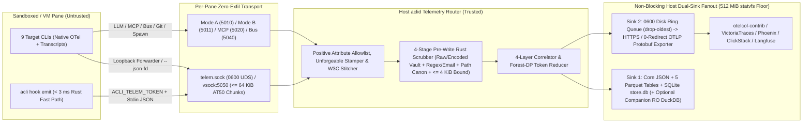

# Iteration 4 Research: Production Agent CLI & Hook Telemetry (`artagon-harness-eval` + Zero-Exfil OTLP Stack)

**Date:** 2026-11-22  
**Change:** `add-acli-sandbox-and-messaging-bus` (`acli`, `aclid`, `acli-shim`, `acli-guest-supervisor`, `acli-guest-proxy`)  
**Audited Binaries & Companion Packages (`verified`):** `claude 2.1.330`, `codex 0.171.0`, `gemini 0.70.0`, `qwen 0.28.4`, `opencode 1.19.6`, `copilot 1.0.114`, `kimi 2.7.2`, `grok 1.0.92`, `agy 1.5.14`, `bd 1.3.4`, `br 0.7.6`, `artagon-harness-eval 0.1.0` (`ADR-0011`, `ADR-0012`), `artagon-swarm` (`observe.py`), `artagon-entire-graph v0.6.0`, `replace-shell-agent-hooks-with-pluggy`, and `add-apm-agent-coordination-hooks`.

> [!IMPORTANT]
> **Iteration 4 Verdict:** Implement a **broker-terminated, zero-exfiltration, dual-sink telemetry architecture** across all nine target agent CLIs. Sandboxed host panes (`--isolation os-sandbox`) and shared `libkrun` VM panes (`--vm` / `--mode yolo`) hold **zero** collector credentials (`mTLS` keys, API tokens, Basic auth), **zero** direct outbound sockets to external OpenTelemetry Protocol (OTLP) collectors, and a dedicated per-pane `256-bit` **`ACLI_TELEM_TOKEN`** (authorizing telemetry ingestion plus **same-pane content-free Path B wakeup drain/ack `0x81`/`0x82` ONLY** — `0` cross-pane, mail-body, bead, reservation, or git authority; rejected on `bus.sock`, while `ACLI_BUS_TOKEN` is rejected on telemetry endpoints) (`verified`). Every CLI native OTLP stream, `< 3 ms` Rust hook event (`acli hook emit [--drain]`), Mode A/B proxy inference metric, `acli-bus-rpc/v1` coordination span, Zone-2/Zone-3 Model Context Protocol (MCP) call, and Barrier-4 Diff-Promotion file diff terminates inside host `aclid` (with the sole accepted residual on macOS `ACLI_TELEMETRY=otlp` being a same-UID unsandboxed host port-squatter during unmanaged `aclid` downtime). Host `aclid` executes in strict order **`delete-client-identity-and-matched-rename-targets -> per-(provider,metric_or_span_name) ACLIIDX1 canonicalization -> closed-positive-allowlist -> stamp-authoritative-service/acli`** (deleting client rename-target keys strictly when a map entry for that `(provider, metric_or_span_name)` renames into them so native GenAI-semconv keys pass through untouched, merging colliding `Sum`/`Histogram`/`ExponentialHistogram`/`Gauge` points after projection, mapping unknown `acli.edit.{source,language}` values to `"other"`, and unconditionally stripping wildcard `user.*`/`enduser.*`/`organization.*`/`host.*`/`client.*`/`process.*`/`os.*`/`billing.*` identity/cost-center fields across **all** tiers), stamps unforgeable broker metadata (`acli.{instance_id,pane_id,parent_pane_id,root_lineage_id,project_hash,provider,isolation_tier,permission_mode,agent_name,bead_engine,epic_id,bead_id,dolt_head}`), runs a **4-stage pre-write Rust Data Loss Prevention (DLP) scrubber** (`aho-corasick` raw/Base64/URL-encoded RAM vault + `regex-automata` keys/JWTs/PEMs/RFC-5322 emails + path canonicalization + `<= 4 KiB` structural bound), enforces per-pane ingest buckets (`<= 2 MiB/min` sustained, `burst 5 MiB`, `<= 32 MiB/session`, `HTTP 429` / `HTTP 413` above `5 MiB`) and a **`512 MiB` `statvfs` volume free-space floor**, and fans out non-blockingly to two host sinks:
> 1. **Local Analytical Tier (Core Pure-Rust Store + Optional Companion DuckDB):** Core `acli`/`aclid` (`Formula/acli.rb`, `0` Python/DuckDB/C++ runtime deps) writes 1:1 **`artagon-harness-eval` 4-layer JSON traces** (`traces/<trace_id>.json`), the **5 Apache Parquet tables** (`parquet/*.parquet`), and bare-host **SQLite `store.db`** (`256 MiB` / `14 d` rolling `drop-oldest` cap with a `<= 64 MiB` per-lineage share); optional `store.duckdb` materialization and read-only DuckDB analytical queries belong exclusively to the optional host-only `artagon-harness-eval` companion (`Formula/artagon-harness-eval.rb` / `uv tool`).
> 2. **Production Fleet Tier (Optional OTLP Export):** An asynchronous **OTLP/gRPC or OTLP/HTTP (`application/x-protobuf`) exporter** (`0` HTTP redirects `RedirectPolicy::none()` and mandatory `https://` `TLS >= 1.3` for non-loopback endpoints) backed on disk-enabled sink tiers (`metrics-only`, `redacted-traces`, or `age`-backed `full-audit-encrypted`) by a bounded `0600` on-disk Write-Ahead Log (WAL) ring queue (`16 x 4 MiB = 64 MiB` default cap, `<= 16 MiB` per-pane fair share, `ATLM` CRC32C-framed, `drop-oldest` never blocking panes; under `age`-backed `full-audit-encrypted`, spooling redacted `NO_CONTENT` OTLP by default or `X25519` `age` segments wrapped with macOS Keychain / Linux `0600` `<ACLI_PERSIST_DIR>/instances/<instance_id>/keys/audit-spool.age` when `full_audit_collector_spool = true` [locked-key overflow preserves existing segments and drops incoming batches]; under collector-only `full-audit-encrypted` without an `age` key, using a zeroized `<= 16 MiB` RAM-only queue with `0` `otlp-ring/` files on disk) feeding **`otelcol-contrib`**, **`VictoriaTraces` / `VictoriaStack`**, **`Arize Phoenix`** (`Formula/arize-phoenix.rb` `21.1.0` + `Formula/phoenix-cli.rb` `1.22.1`), **`ClickStack` (`ClickHouse` + `HyperDX`)**, **`Langfuse OSS v3/v4`** (`Formula/langfuse-cli.rb` `1.3.1`), or **`Grafana LGTM`**.



---

## 1. Primary-Source Audit of `artagon-scripts` Telemetry, Hook, & Graph Packages (`verified`)

All findings in §1 are `SUPPORTED` (`verified` read-only against `<artagon-scripts>`).

### 1.1 `artagon-harness-eval` Four-Layer Trace Architecture (`ADR-0011`)

`plugins/artagon-harness-eval` (`artagon_harness_eval 0.1.0`, Python `>= 3.12`, `MIT`) fuses four orthogonal local telemetry channels per trial (`docs/adr/0011-harness-eval-four-layer-trace-and-duckdb-store.md`, `verified`) because no single CLI channel is complete: hooks give deterministic tool boundaries, OTLP gives streaming Time To First Token (TTFT) and cache token breakdowns, transcripts capture model reasoning when native OTel is absent, and supervisor records capture MCP RPCs and workspace file diffs.

| Layer | `layers_present` ID | Primary Module (`src/artagon_harness_eval/`) | Wire / File Source & Exact Boundaries (`verified`) | Captured Ground Truth |
| --- | --- | --- | --- | --- |
| **Layer 1** | `"hook"` | `shims/hook_sink.py`, `shims/scrub.py` | Out-of-workspace `0600` `AF_UNIX` `SOCK_STREAM` (`<tmp>/art-htrc-<8hex>/sock`, `sun_path <= 99 B`, `MAX_HOOK_STDIN_BYTES = 4 MiB`, `MAX_SOCKET_FRAME_BYTES = 5 MiB`, `2.5 s` client timeout, `signal.alarm(4)` `os._exit(0)`) with HMAC-SHA256 `O_APPEND \| O_NOFOLLOW` `0600` fallback. | Deterministic `PreToolUse` / `PostToolUse` monotonic `recv_mono_ns` tool latencies, lifecycle boundaries, `pid`/`ppid`, and zero-perturbation `stdout` acks. |
| **Layer 2** | `"otel"` | `otlp_sink.py` | `LoopbackOtlpSink` (`127.0.0.1:0`, constant-time `Authorization: Bearer <token>`, `/v1/{traces,logs,metrics}`, `opentelemetry-proto` protobuf + UTF-8 JSON). | `gen_ai.*` span trees, OTLP log events (`claude_code.*`, `codex.*`) normalized into span records, TTFT (`ttft_ms`), cache read/write tokens, and API cost. |
| **Layer 3** | `"transcript"` | `transcript.py`, `data/harnesses/*.yaml` | Streaming JSONL / JMESPath parsers over `claude` `projects/*.jsonl`, `codex` `rollout-*.jsonl`, `agy` `brain/<id>/.system_generated/logs/transcript_full.jsonl`, `copilot` `session-state/*/events.jsonl`, and `kimi` `wire.jsonl`. | `observed_model`, assistant output (`final_output_text <= 256 KiB`), reasoning token counts, and `tool_use_id` call/result pairs when OTel is absent (`agy`, `kimi`). |
| **Layer 4** | `"supervisor"` | `shims/trampoline.py`, `materializer.py`, `outcome.py` | `O_EXCL` `shim-exec.json` (`shim-exec/v1`), `child-execs.jsonl`, `mcp_calls.jsonl` (`mcp-call/v1` with RFC 8785 JSON Canonicalization Scheme [JCS] SHA-256), `shim-exit.json`, and workspace SHA-256 `file_diffs`. | Binary SHA-256 / `/nix/store` pin verification (`exit 5`), subscription billing-guard enforcement (`exit 4`, Keychain/D-Bus deny stubs exiting `44`), MCP cassette hits/misses, and promoted `file_diffs`. |

#### Checked-In JSON Schemas (`data/schemas/*.schema.json`, Draft 2020-12, `additionalProperties: false`)

| Schema `$id` & `schema_version` | Required Fields (`verified`) | Key Enum & Bound Constraints (`verified`) |
| --- | --- | --- |
| `artagon/harness-eval/hook-event/v1` (`"harness-eval-hook-event/v1"`) | `schema_version`, `trial_id`, `harness`, `event_name`, `recv_wall_ns`, `recv_mono_ns`, `pid`, `ppid`, `transport`, `payload` | `harness`: `["claude", "codex", "agy", "copilot", "kimi"]`; `transport`: `["unix_socket", "hmac_append"]`; optional `truncated`, `hmac_sha256`, `tool_name`, `tool_use_id`, `turn_id`. |
| `artagon/harness-eval/span/v1` (`"harness-eval-span/v1"`) | `schema_version`, `trial_id`, `campaign_id`, `arm_id`, `task_id`, `harness`, `trace_id`, `span_id`, `span_kind`, `name`, `source_layer`, `start_wall_ns`, `end_wall_ns`, `duration_ms`, `status` | `span_kind`: `["invoke_agent", "chat", "execute_tool", "mcp_rpc", "hook_lifecycle", "subagent", "supervisor"]`; `source_layer`: `["hook", "otel", "transcript", "supervisor", "fused"]`; `status`: `["ok", "error", "unset"]`. |
| `artagon/harness-eval/mcp-call/v1` (`"mcp-call/v1"`) | `schema_version`, `trial_id`, `server_name`, `seq`, `recv_wall_ns`, `recv_mono_ns`, `duration_ms`, `method`, `match_tier`, `cassette_miss`, `is_error` | `exact_jcs_sha256` & `normalized_jcs_sha256`: `^[a-f0-9]{64}$`; `match_tier`: `["protocol", "exact", "normalized", "match_keys", "default_response", "miss"]`. |
| `artagon/harness-eval/shim-exec/v1` (`"harness-eval-shim-exec/v1"`) | `schema_version`, `trial_id`, `harness`, `auth_mode`, `pin_mode`, `pid`, `ppid`, `started_wall_ns`, `started_mono_ns`, `real_binary`, `observed_binary_sha256`, `final_argv`, `cwd`, `billing_guard_verified`, `secret_file_consumed` | `auth_mode`: `["subscription", "api_key"]`; `pin_mode`: `["nix", "host"]`; `observed_binary_sha256`: `^[a-f0-9]{64}$`. |
| `artagon/harness-eval/descriptor/v1` (`"harness-eval-descriptor/v1"`) | `schema_version`, `trial_id`, `campaign_id`, `arm_id`, `task_id`, `harness`, `auth_mode`, `pin_mode`, `execution_mode`, `trial_root`, `workspace_dir`, `real_binary`, `expected_binary_sha256`, `shim_receipt_path`, `child_execs_path`, `hook_socket_path`, `hook_fallback_path`, `hook_hmac_key_hex` | `HotPathShimDescriptor` (`shims/wire.py`, `msgspec.Struct(frozen=True)` with stdlib `@dataclass` fallback); secret fields masked in `__repr__`. |
| `artagon/harness-eval/trace/v1` (`"harness-eval-trace/v1"`) | `schema_version`, `trial_id`, `campaign_id`, `arm_id`, `task_id`, `harness`, `auth_mode`, `execution_mode`, `status`, `verified_success`, `redaction_applied`, `started_wall_ns`, `ended_wall_ns`, `duration_ms`, `layers_present`, `metrics`, `spans`, `tool_calls`, `mcp_calls`, `file_diffs` | `execution_mode`: `["headless", "ntm", "herdr", "cao"]`; `status`: `["completed", "failed", "timeout", "quota_censored", "billing_violation", "isolation_failed", "cassette_miss_failed", "multiplexer_failed"]`; `workspace_rel_path` forbids leading `/`, `..`, `//`, `\`, trailing `/`. |

#### Forest-DP Token Deduplication, Redaction Vault, & Five-Table Analytical Store (`transcript.py`, `redact.py`, `store.py`)

1. **Cross-Layer Tool Fusion (`_correlate_tool_calls`):** Joins Layer 1 (`PreToolUse`/`PostToolUse` paired by `tool_use_id` via monotonic `(post.recv_mono_ns - pre.recv_mono_ns) / 1e6`), Layer 2 (`execute_tool` spans), and Layer 3 (transcript `tool_use` blocks), setting `source_layer = "fused"` whenever `>= 2` layers confirm the call (`verified`).
2. **Forest Dynamic-Programming Token Aggregation (`_aggregate_otel_span_forest`):** Bottom-up tree DP computes `max(own_value, child_sum)` per token field across nested `invoke_agent -> subagent -> chat` spans when both are non-null, preventing `2x`–`3x` token double-counting (`verified`).
3. **Five Relational Tables & Export Bridges:** `trials` (`29` cols), `spans` (`15` cols), `tool_calls` (`9` cols), `mcp_calls` (`11` cols), and `file_diffs` (`7` cols). Core pure-Rust `aclid` writes `traces/<trace_id>.json`, `parquet/{trials,spans,tool_calls,mcp_calls,file_diffs}.parquet`, and SQLite `store.db` (`?mode=ro` + `set_authorizer`), while the optional Python `artagon-harness-eval` companion materializes/queries `store.duckdb` (`read_only=True, enable_external_access=False`, lexical single-`SELECT`/`WITH` validator blocking `ATTACH`/`COPY`/`INSTALL`/`LOAD`/`PRAGMA`/`READ_*`/`GLOB`). Exporting any trace with `redaction_applied != true` aborts fail-closed (`exit 9` in `acli telemetry export`), non-loopback URLs and HTTP redirects are rejected unless `--allow-remote-export` is set, and holdout splits require `--hash-holdout-payloads`.

### 1.2 Hook Compilers, Coordination Ledger, Swarm Observer, & `artagon-entire-graph` (`verified`)

| Subsystem (`<artagon-scripts>`) | Primary Files | Architecture & Telemetry/Hook Contract (`verified`) |
| --- | --- | --- |
| **Pluggy Harness Hook Compiler** (`ADR-0012`) | `src/artagon_harness_eval/{hookspecs.py,hooks.py}` | `pluggy.PluginManager("harness_core")` compiling `4` wire dialects (`nested_matcher_groups` for `claude`/`codex`/`grok`, `namespaced_lifecycle` for `agy`, `versioned_flat_map` for `copilot`, `event_array` `[[hooks]]` for `kimi`) with `O_NOFOLLOW` `0600` atomic writes. |
| **Bash -> Python Stdlib Hook Cutover** | `openspec/changes/replace-shell-agent-hooks-with-pluggy/` | Replaces `4,270` lines of Bash/`jq` (`12–25 ms` per call) with `<python3> -I -S -B artagon_agent_hooks_run.py`, fixing Copilot JSON-string `toolArgs <= 64 KiB` decoding and top-level `{"permissionDecision":"deny",...}` + `exit 2`. |
| **APM Agent Coordination Bridge** | `scripts/lib/apm_coordination*.py` | 8-field `EventEnvelope` (`session_start`, `turn_complete`, `session_stop`; `<= 16 KiB`), `WITHOUT ROWID` `events.sqlite3` (`0600`, `trusted_schema=OFF`) dedup, and `sandbox-exec (deny network*)` HCOM hooks. |
| **Swarm Transcript Observer** | `plugins/artagon-swarm/scripts/lib/art_swarm/observe.py` | Descriptor-anchored `O_RDONLY \| O_DIRECTORY \| O_NOFOLLOW` `_open_beneath` verifying 5-tuple `(st_dev, st_ino, st_size, st_mtime_ns, st_ctime_ns)` pre/post read (`<= 64 MiB`), `[art-swarm nonce=<hex> run=<id> worker=<id>]` attribution, and `31`-field `art-swarm/status/v1`. |
| **Code/Commit/Session Graph (`artagon-entire-graph`)** | `plugins/artagon-entire-graph/**` (`entireio/entire-graph v0.6.0`, `MIT`) | Offline skills-only AST/commit/session graph (`"no_egress": true`, `GIT_NO_LAZY_FETCH=1`, `GIT_ALLOW_PROTOCOL=`) linking entity-level AST diffs to `entire-graph commit <sha>` and `Entire-Checkpoint: <id>` commit trailers (`entire-graph checkpoint <id>`). |

### 1.3 Schema Compatibility & `v1 -> v1.1` Dual-Mode Contract

All five relational Parquet/SQLite tables store `harness` and `execution_mode` as unconstrained `TEXT` (`verified`), accepting all 9 canonical provider names (`claude`, `codex`, `gemini`, `qwen`, `opencode`, `copilot`, `kimi`, `grok`, `agy`) and `execution_mode` (`acli-headless`, `acli-pty`, `acli-vm`, `herdr`, `ntm`) with zero migration. For JSON trace files, `harness-eval-trace/v1.1` and `harness-eval-hook-event/v1.1` expand `harness` to all 9 providers, add `"acli"` / `"acli-vm"` to `execution_mode`, and add optional `cache_creation_tokens` (`integer | null`), while `--schema-compat v1` emits strict `v1` JSON for the 5 `v1` providers (`execution_mode` mapped to `"herdr"`, `"ntm"`, or `"headless"`).

---

## 2. 2025–2026 Open-Source Agent CLI & Hook Telemetry Landscape

### 2.1 OpenTelemetry GenAI (`gen_ai.*`) & MCP (`mcp.*`) Semantic Conventions (`verified`)

1. **Canonical Operations:** `invoke_agent {gen_ai.agent.name}` (root turn/subagent span), `create_agent {gen_ai.agent.name}` (`sys_spawn`), `chat {gen_ai.request.model}` / `generate_content {gen_ai.request.model}` (LLM call), and `execute_tool {gen_ai.tool.name}` (`gen_ai.tool.call.id`).
2. **`gen_ai.provider.name` & Cached Token Subset Rule:** Stamp Weaver `v1.37+` `gen_ai.provider.name` (`anthropic`, `openai`, `gcp.gemini`, `gcp.vertex_ai`, `aws.bedrock`, `x_ai`, `moonshot`, `qwen`, `github.copilot`; `gen_ai.system` populated only for legacy sinks). `gen_ai.usage.cache_read.input_tokens` and `gen_ai.usage.cache_creation.input_tokens` (`cache_write.input_tokens` in `copilot 1.0.114`) are **subsets** of `gen_ai.usage.input_tokens` (`non_cached_input = input_tokens - cache_read - cache_creation`).
3. **Standard Histograms, `NO_CONTENT` Default, & Scoped MCP `params._meta`:** Emit `gen_ai.client.token.usage`, `gen_ai.client.operation.duration`, `gen_ai.server.time_to_first_token`, and `gen_ai.server.time_per_output_token`; default `OTEL_INSTRUMENTATION_GENAI_CAPTURE_CONTENT` strictly to **`NO_CONTENT`**; and propagate validated W3C `traceparent` inside JSON-RPC `params._meta.traceparent` on Zone-1 `acli-bus` while stripping pane-supplied `tracestate` and `baggage` toward Zone-2/Zone-3 external MCPs (§4.2).

### 2.2 Complete Nine-CLI Native OTel, Hook, & Trap Normalization Matrix (`verified` on Live Binaries)

| CLI (`Version`) | Native OTel Signals & Protocol | Lifecycle Hook Surface & Dialect | Critical Live Traps (`verified`) | `acli` Normalization (`ACLIIDX1` + `--otel-wrap` + `acli hook emit`) |
| --- | --- | --- | --- | --- |
| **`claude`** (`2.1.330`) | Metrics + Logs + Beta Traces (`grpc`, `http/json`, `http/protobuf`) via `CLAUDE_CODE_ENABLE_TELEMETRY=1` + `CLAUDE_CODE_ENHANCED_TELEMETRY_BETA=1` | `17` events (`nested_matcher_groups` JSON in `$CLAUDE_CONFIG_DIR/settings.json`); `"onFailure": "block"` (`v2.1.295+`) | `CLAUDE_CODE_ENABLE_TELEMETRY` is **orthogonal** to Anthropic's 1st-party Datadog/Sentry/auto-updater (`OPUS-R11-01`: removing `DISABLE_*` re-enables vendor analytics and auto-updates!). Emits `user.email` / `organization.id` in OTel resource attributes. | **Never** `env_remove` vendor opt-outs: always enforce `DISABLE_TELEMETRY=1`, `DISABLE_ERROR_REPORTING=1`, `DISABLE_AUTOUPDATER=1`, and `CLAUDE_CODE_DISABLE_NONESSENTIAL_TRAFFIC=1` across all modes, adding `CLAUDE_CODE_ENABLE_TELEMETRY=1` alongside them when `ACLI_TELEMETRY=otlp`; unset `OTEL_LOG_*` content vars; strip `user.*`/`organization.*` in `aclid`. |
| **`codex`** (`0.171.0`) | Logs + Metrics + Traces (`otlp-http` `binary`\|`json`, `otlp-grpc`) in `$CODEX_HOME/config.toml` `[otel]` | `14` events (`nested_matcher_groups` JSON in `$CODEX_HOME/hooks.json` + `[features] hooks = true`) | `metrics_exporter` defaults to **`"statsig"`** (commercial Statsig SaaS, disabled via `[analytics] enabled = false` — unrelated to `acli`'s `#![no_std]` Rust HSM crate `statig = "0.4.1"`, [07-rust-hsm-state-machine-architecture.md](07-rust-hsm-state-machine-architecture.md) §1)! Writing per-pane ports or tokens into shared `<ACLI_STATE_DIR>/<tier>/codex/config.toml` leaks tokens across sibling panes (`NEON-R11-01`). Hook `stdout` must be **`0` bytes** (`supports_hook_context_injection = false`). | Stage per-pane `CODEX_HOME=<ACLI_RUN_DIR>/panes/pane-<pane_id>/codex-home` with a supervisor-owned `0400` RO `config.toml` (SBPL `deny file-write*` / Linux `--ro-bind`, referencing per-pane endpoint + `ACLI_TELEM_TOKEN`, `log_user_prompt = false`; `0` `ps`-visible `-c` tokens) while symlinking/binding shared `auth.json`/`sessions/`/`history.jsonl`. |
| **`gemini`** (`0.70.0`) | Traces + Metrics + Logs (`grpc`, `http`) | `11` events (`SessionStart`, `BeforeAgent`, `BeforeModel`, `BeforeTool`, `AfterTool`, `PreCompress`, `SessionEnd`, ...) in `.gemini/settings.json` | **`GEMINI_TELEMETRY_LOG_PROMPTS` defaults to `true`** when telemetry is enabled! Hook `stdout` MUST be pure JSON (`{}`) — stray text fails open! | Force `GEMINI_TELEMETRY_LOG_PROMPTS=false` by default; map `BeforeTool`/`AfterTool` -> canonical `PreToolUse`/`PostToolUse` in `acli hook emit --cli gemini --ack empty-json` (`stdout` `{}\n`). |
| **`qwen`** (`0.28.4`) | Traces + Metrics + Logs (`http`, `grpc`) + **`--json-fd <N>`** live NDJSON stream | `5` events (`SessionStart`, `UserPromptSubmit`, `PreToolUse`, `PostToolUse`, `Stop`) in `$QWEN_HOME/settings.json` | `--telemetry*` CLI flags deprecated; hook **`timeout` is in ms** (`5000` = `5 s`); workspace `.qwen/settings.json` can enable **`includeSensitiveSpanAttributes`** (`1 MiB` prompts/tool I/O, `CARBON-R11-04`) and blocks unapproved project hooks! | Force **both** `QWEN_TELEMETRY_LOG_PROMPTS=false` **and** `QWEN_TELEMETRY_INCLUDE_SENSITIVE_SPAN_ATTRIBUTES=false`, stage hooks (`timeout: 5000`) in tier-isolated user-scope `$QWEN_HOME/settings.json`, and bind `--json-fd <internal_fd>` above `max(2, max_declared_caller_fd)` (`--pass-fd <N>`). |
| **`opencode`** (`1.19.6`) | Experimental Traces + Metrics (`opencode.json` `experimental.openTelemetry: true` + `OTEL_EXPORTER_OTLP_*`) | In-process Bun `@opencode-ai/plugin` (`< 0.2 ms`): `event`, `tool.execute.before`, `tool.execute.after`, `permission.ask`, `chat.message` | Staging plugins inside pane-writable `<ACLI_STATE_DIR>/<tier>/opencode/plugins/` allows `unlink`/`rename` code-execution persistence across sibling panes (`NEON-R11-01`). | Stage `acli-telemetry-plugin.js` in **supervisor-owned RO `<ACLI_RUN_DIR>/plugins/opencode/acli-telemetry-plugin.js`** (`0444` in `0755` dir, SBPL `deny file-write*` / `bwrap --ro-bind`) and deny pane writes to `<ACLI_STATE_DIR>/<tier>/opencode/plugins`. |
| **`copilot`** (`1.0.114`) | Full GenAI Traces + 25+ Metrics (`http/json` default, `http/protobuf`). **No `grpc`; no OTLP Logs.** | `versioned_flat_map` (`version: 1`, `timeoutSec`) in `$COPILOT_HOME/hooks/*.json`. Injects **`COPILOT_TRACEPARENT`** & **`COPILOT_TRACESTATE`**! | **3 Traps (`verified`):** (1) Rust OTLP ignores `NODE_EXTRA_CA_CERTS` (needs `OTEL_EXPORTER_OTLP_CERTIFICATE`); (2) setting `OTEL_EXPORTER_OTLP_*CERTIFICATE*` on `http://` **silently disables OTLP**; (3) **`preToolUse` is FAIL-CLOSED** (`supports_hook_context_injection = false`)! | Omit `OTEL_EXPORTER_OTLP_CERTIFICATE` on `http://` loopback (set ONLY on `https://`); read `COPILOT_TRACEPARENT` in `acli hook emit`; omit `DRAIN_WAKEUPS` on `preToolUse`; guarantee unconditional `exit 0` (`< 3 ms`). |
| **`kimi`** (`2.7.2`) | **No external OTLP exporter** (`KIMI_DISABLE_TELEMETRY=1` kills vendor telemetry) | `16` events in `$KIMI_CODE_HOME/config.toml` `[[hooks]]` (`event_array`, user scope only; fail-open; `supports_hook_context_injection = false`) | No workspace `hooks.toml`; no native OTLP spans. | Isolate `KIMI_CODE_HOME` per tier; splice `acli hook emit` into `[[hooks]]`; `--otel-wrap` fuses `acli hook emit` spans + Mode A/B proxy usage + `sessions/**/wire.jsonl`. |
| **`grok`** (`1.0.92`) | Metrics + OTLP Logs (`ai.xai.grok_code`) via **Double Opt-In:** `GROK_EXTERNAL_OTEL=1` + `OTEL_{METRICS,LOGS}_EXPORTER=otlp` | `5` events (`SessionStart`, `PreToolUse`, `PostToolUse`, `Stop`, `SessionEnd`) in `$GROK_HOME/hooks/*.json` (`supports_hook_context_injection = false`) | Omitting `GROK_EXTERNAL_OTEL=1` silently suppresses `OTEL_*_EXPORTER`. Emits Metrics/Logs without trace waterfalls. | Set `GROK_EXTERNAL_OTEL=1` when `ACLI_TELEMETRY=otlp` (`OTEL_SDK_DISABLED=true` when `off`); synthesize trace waterfalls in `aclid` from `acli hook emit` + Mode A/B proxy spans. |
| **`agy`** (`1.5.14`) | **No built-in user OTLP exporter** | `6` events (`SessionStart`, `PreInvocation`, `PostInvocation`, `PreToolUse`, `PostToolUse`, `Stop`) in `$HOME/.gemini/config/hooks.json` / `.agents/hooks.json` | Lifecycle events use **flat** handler arrays while `PreToolUse`/`PostToolUse` use `{matcher, hooks}` groups; emitting `{"decision":"allow"}` risks bypassing `agy`'s permission prompt! | Encode flat vs grouped shapes from `ACLIIDX1`; **`acli hook emit --ack agy-noop`** writes safe empty **`{}\n`** (`supports_hook_context_injection = false`, never auto-approving tools); `--otel-wrap` fuses `brain/.../transcript_full.jsonl` + Mode B spans. |

### 2.3 Production Open-Source Observability & Agent Trace Backends Comparison (`2025–2026`)

| System | License (`SPDX`) | OTLP Ingest & Protocol | GenAI / Agent Semantics | Storage Engine & Ops Weight | RAM / CPU Baseline (Local vs Prod) | Production Role in `acli` Ecosystem |
| --- | --- | --- | --- | --- | --- | --- |
| **`artagon-harness-eval` Store** *(Built-In Tier 0)* | `MIT` (core Rust `Apache-2.0`; companion wheels `Apache-2.0`/`MIT`/`BSD`) | Via `aclid` Dual-Sink (`trace/v1[.1]` + `hook-event/v1[.1]`) | Native 4-layer `gen_ai.*` + `mcp_calls` + `file_diffs` + forest-DP token dedup | Core Rust: **JSON + 5 Parquet tables + SQLite `store.db`** (`0` daemons); optional companion: RO `store.duckdb` | **`0 MiB` idle daemon** (`~15–40 MiB` during compaction/query) | **Mandatory always-available local analytical tier** (`0` Python/DuckDB in `Formula/acli.rb`; rich DuckDB/ABBA/ITT stats via optional companion). |
| **OpenTelemetry Collector (`otelcol-contrib`)** | `Apache-2.0` | `:4317` gRPC, `:4318` HTTP (`protobuf`/`json`), `unix://` | Schema-agnostic + **OTTL `transform`** (`gen_ai.system -> provider.name`, `cache_write <-> cache_creation`) | Stateless router + **`file_storage` (`bbolt` WAL)** persistent `sending_queue` | Local: `40–90 MiB` RAM<br>Prod: `2–8 GiB` RAM (w/ `tail_sampling`) | **Recommended workstation/fleet gateway** for defense-in-depth OTTL scrubbing, error/latency tail-sampling, and multi-backend fanout. |
| **VictoriaStack (`VictoriaTraces` + `VictoriaLogs` + `VictoriaMetrics`)** | `Apache-2.0` | `VictoriaTraces` `:4317` gRPC & `:10428/insert/opentelemetry/v1/traces`; `VictoriaLogs` `:9428`; `VictoriaMetrics` `:8428` | Lossless columnar storage of all `gen_ai.*` & `mcp.*` attributes; unified **LogsQL** + Jaeger API + MetricsQL | Single static Go binaries on local disk — **zero S3, zero Postgres, zero Redis, zero JVM** | **`~50–150 MiB` RAM per binary** (`3.7x` less RAM, `2.6x` less CPU than Tempo) | **Best lightweight self-hosted / workstation backend** for high-speed trace + `claude_code.*`/`codex.*` OTLP log retention. |
| **Arize Phoenix (`arize-phoenix`)** | Server: `ELv2` (`openinference`: `Apache-2.0`) | `:4317` gRPC & `:6006/v1/traces` (`application/x-protobuf` required; `x-project-name`) | Native **`OpenInference`** (`AGENT\|LLM\|TOOL`) + renders OTel `gen_ai.*` spans | **SQLite** (`~/.phoenix/`) or **PostgreSQL 14+** | Local: `500 MiB–1.5 GiB` RAM<br>Team: `2–4 GiB` RAM + Postgres | **Best interactive developer trace UI & eval workbench** (`Formula/arize-phoenix.rb` `21.1.0` & `Formula/phoenix-cli.rb` `1.22.1` in `artagon/aitools`; keep `ELv2` server out of `MIT` wheel deps). |
| **ClickStack (`ClickHouse` + `HyperDX`)** | `Apache-2.0` + `MIT` | `:4317` gRPC & `:4318` HTTP via bundled OpAMP Collector -> `otel_traces`, `otel_logs`, `otel_metrics` | Built-in **GenAI trace waterfall UI** + sub-second columnar SQL over `gen_ai.*` | **ClickHouse MergeTree** (`10x–100x` ZSTD compression) + MongoDB (UI config) | Dev: `1–2 GiB` RAM<br>Prod: `8–16+ GiB` RAM | **Best enterprise high-cardinality OLAP backend** for multi-team token/cost/TTFT analytics across millions of turns. |
| **Langfuse OSS (`v3` / `v4`)** | `MIT` core (`ee/` gated) | **HTTP only:** `POST /api/public/otel/v1/traces` (`Basic pk:sk` + **`x-langfuse-ingestion-version=4`**; no gRPC) | Maps OTel `gen_ai.*`, OpenInference, and OpenLLMetry (`llm.*`) to `Generation`/`Tool`/`Span` | **6-service polyglot stack:** ClickHouse + Postgres + Redis/Valkey + S3/MinIO + `web` + `worker` | Self-host min: **`6–8 GiB` RAM**<br>Prod: **`16–32+ GiB` RAM** | **Best dedicated LLM product/prompt/annotation platform** for shared cloud teams (`Formula/langfuse-cli.rb` `1.3.1` in `artagon/aitools` defaults to loopback `127.0.0.1:3000`; never run server stack as a mandatory laptop daemon). |
| **OpenLLMetry (`Traceloop`)** | `Apache-2.0` | Client SDK only (emits OTLP `grpc`/`http`) | Emits legacy `llm.*` + `traceloop.*` (migrating to `gen_ai.*`) | None (Python/Node auto-instrumentation libraries) | `~5–15 MiB` in-app | **Client library layer only**; normalize `llm.usage.* -> gen_ai.usage.*` in `otelcol-contrib` OTTL when present. |
| **Grafana LGTM (`Tempo` + `Prometheus 3` + `Loki 3`)** | `AGPL-3.0` servers (`Prometheus 3` / `Alloy`: `Apache-2.0`) | 100% native OTLP (`Tempo` `:4317/:4318`, `Prometheus 3` `/api/v1/otlp/v1/metrics`, `Loki 3` `/otlp/v1/logs`) | Generic OTel (`TraceQL` over `vParquet4` blocks + `info()` resource joins) | Object storage (S3/GCS/MinIO) + TSDB | Local: `2–4 GiB` RAM<br>Prod: `12–24+ GiB` RAM + S3 | **Corporate SRE integration tier** when organizations already operate Grafana Enterprise / Cloud + S3. |

---

## 3. Zero-Exfiltration Sandboxed Telemetry Transport (`ACLI_TELEM_TOKEN`, `telem.sock`, & `vsock:5050`)

### 3.1 Dedicated `ACLI_TELEM_TOKEN` & Per-Pane Read-Isolation (`NEON-R11-01`, `FABLE-R11-12`, `FABLE-R12-04`)

1. **Least-Privilege `ACLI_TELEM_TOKEN` (Same-Pane Content-Free Path B Exception ONLY):** `aclid` mints a distinct per-pane `256-bit` CSPRNG hex token **`ACLI_TELEM_TOKEN`** valid **solely** for telemetry ingestion (`telem.sock`, `vsock:5050`, and macOS OTLP HTTP `Authorization: Bearer <ACLI_TELEM_TOKEN>`) plus **same-pane content-free Path B wakeup drain/ack (`0x81`/`0x82`) ONLY** (`0` cross-pane, mail-body, bead, reservation, spawn, or git authority). `ACLI_TELEM_TOKEN` is rejected on `bus.sock`, and `ACLI_BUS_TOKEN` is rejected on all telemetry endpoints.
2. **Per-Pane SBPL / `bwrap` Subdirectory Isolation:** In host `os-sandbox` (macOS SBPL and Linux `bwrap`) and `--vm`, `acli` denies `file-read*` and `file-write*` on `<ACLI_RUN_DIR>/panes` and `<ACLI_STATE_DIR>/tmp`, allowing access **only** to the active pane's own `pane-<pane_id>` subdirectory so sibling same-UID panes cannot read each other's overlays, `codex-home/config.toml`, or temp files.

### 3.2 Per-Tier Transport Topology, Dual-Stack macOS Loopback, & Chunked `vsock:5050`

| Isolation Tier | `acli hook emit` & OpenCode Plugin Path | Native CLI OTLP SDK (`OTEL_EXPORTER_OTLP_ENDPOINT`) Path | Kernel Isolation & Auth Guarantee |
| --- | --- | --- | --- |
| **Shared `libkrun` `--vm` (`--mode yolo`)** | `AF_UNIX` `/run/acli/p/<pane_id>/telem.sock` (`0600`, bind-mounted ONLY into that pane's `bwrap` mount namespace) -> `acli-guest-proxy` -> boot-latched **`vsock:5050`**. | Inside each pane's `bwrap(CLONE_NEWNET)` private network namespace, `acli-guest-proxy` binds `127.0.0.1:<ephemeral>` (`http/protobuf`, `http/json`, and `grpc`), verifies per-pane `ACLI_TELEM_TOKEN` pre-multiplex, and forwards chunked `AT50` frames over **`vsock:5050`** to host `aclid`. | Zero shared loopback across VM panes; `AF_VSOCK` blocked in pane seccomp; `acli-guest-supervisor` zeroizes `ACLI_SUPERVISOR_KEY` **only after boot-latching all three channels (`vsock:5040`, `vsock:5050`, AND `vsock:5102`)**; invalid per-pane tokens reject per `(pane_id, req_id)` without closing shared `vsock:5050` (`OPUS-R12-02`). |
| **Linux Host `os-sandbox`** | `AF_UNIX` `<ACLI_RUN_DIR>/p/<pane_id>/telem.sock` (`0600`, `sun_path <= 103 B`, bind-mounted into `bwrap`). | Inside `bwrap --unshare-net` (`slirp4netns --disable-host-loopback`), Supervised `acli` runs a lightweight in-netns `127.0.0.1:<ephemeral>` -> `<ACLI_RUN_DIR>/p/<pane_id>/telem.sock` relay task (`< 256 KiB`). | Host `127.0.0.1` listeners (`nats_port`, `agentmail_port`, `gateway_port`) remain 100% unreachable (`--disable-host-loopback`); `aclid` authenticates `SO_PEERCRED` + constant-time `ACLI_TELEM_TOKEN`. |
| **macOS Host `os-sandbox` (`Seatbelt`)** | `AF_UNIX` `<ACLI_RUN_DIR>/p/<pane_id>/telem.sock` (`0600`, allowed via `(allow network-outbound (literal (param "PANE_TELEM_SOCK")))`). | Apple's SBPL compiler rejects IPv4 literals (`127.0.0.1:<port>` fails `rc=65`, `verified`). When `ACLI_TELEMETRY=otlp`, `aclid` persists `<aclid_otlp_port>` in `daemon.json` (`!= runtime nats_port, agentmail_port, gateway_port`), binds **both `127.0.0.1:<aclid_otlp_port>` AND `[::1]:<aclid_otlp_port>`** (`IPV6_V6ONLY=1`, without `SO_REUSEPORT`), grants TCP-narrowed **`(allow network-outbound (remote tcp "localhost:<aclid_otlp_port>"))`**, and configures pane OTLP SDKs to explicit **`http://127.0.0.1:<aclid_otlp_port>`** (`0` stage-dir `otel.jsonl` files; `qwen --json-fd <internal_fd>`). | Dual-stack exclusive bind + explicit `http://127.0.0.1:<port>` client endpoint closes `[::1]` hijacking (`CARBON-R11-02`, `OPUS-R12-05`); `aclid` **preserves each surviving live pane's `sha256_telem_token` and `fallback_mac_key` across normal `aclid` restarts** (minting fresh `ACLI_TELEM_TOKEN`s **only** for newly spawned panes so `telem.sock`, `SessionStart` unread recovery, Path B `--drain`, `hooks-fallback.jsonl`, and OTLP never hit `401` breakage; `telem.sock` UDS is preferred, and loopback TCP HTTP OTLP is documented as an accepted best-effort residual against a same-UID unsandboxed host port-squatter during unmanaged daemon downtime, `OPUS-R15-01`, `NEON-R15-01`, `FABLE-R15-03`), while on first-start or `aclid` restart (`F1`), if either stack fails to bind, `aclid` sets `telemetry_health = "degraded"`, disables/revokes **only HTTP OTLP ingress** while keeping `telem.sock`, `fallback_mac_key`, and Path B `--drain` valid (`OPUS-R13-05`, `FABLE-R13-07`), and withholds the SBPL TCP rule from new panes. Requires constant-time `Bearer <ACLI_TELEM_TOKEN>` (`HTTP 401`) and omits `OTEL_EXPORTER_OTLP_*CERTIFICATE*` on `http://`. |

- **Chunked Fair-Queued `vsock:5050` Framing (`AT50`, Enumerated `signal_type`, `<= 8` Reassemblies, & Per-Pane Rejection — `At50ChunkReassemblerHsm` in [07-rust-hsm-state-machine-architecture.md](07-rust-hsm-state-machine-architecture.md) §5.1.A.2; `NEON-R11-03`, `OPUS-R12-02`, `FABLE-R12-07`, `FABLE-R13-07`):** Logical payload caps are unified across `--vm` and host at **`<= 5 MiB` (`5,242,880 B`) compressed wire body / `<= 16 MiB` (`16,777,216 B`) post-`gzip`/`zstd` decompressed** (`HTTP 413`), while `vsock:5050` multiplexes **`<= 64 KiB` (`65,536 B`) chunks** (`magic: "AT50"`, `pane_id_12`, **`signal_type`** in closed enum **`0x01 Traces | 0x02 Metrics | 0x03 HookEvent | 0x04 Logs | 0x81 HookDrainResp | 0x82 HookDrainAck`** [dropping any unknown `signal_type` with `acli_telemetry_invalid_signal_total`], `flags`, `req_id: u32`, `chunk_idx: u16`, `chunk_total: u16`, `chunk_len: u32`, capped at **`<= 8` concurrent incomplete `req_id` reassemblies per pane** with a **`5 s` reassembly timeout**) scheduled via per-pane round-robin fair queueing with strict priority for `0x03`/`0x81`/`0x82` inside the `512 KiB` window. `acli-guest-proxy` verifies per-pane `ACLI_TELEM_TOKEN` pre-multiplex, and host `aclid` rejects and rate-limits invalid per-pane tokens per `(pane_id, req_id)` (`acli_telemetry_auth_rejected_total`) **without** closing shared `vsock:5050` — closing `vsock:5050` (`telemetry_health = "degraded"`, `0` post-zeroization key re-auth) **strictly on outer proxy frame corruption** (`magic != "AT50"` or `chunk_len > 65536`).

### 3.3 `acli hook emit` Pipe-Handoff `--drain` Receipt & `fallback_mac_key` `hooks-fallback.jsonl` (`< 3 ms` p99)

```text
acli hook emit --cli <provider> --event <canonical_event> [--ack <none|agy-noop|empty-json>] [--drain]
```

1. **Watchdog, Full-EOF Stdin Drain, & `supports_hook_context_injection`:** Ignores `SIGPIPE`, arms a `400 ms` monotonic watchdog (`_exit(0)` after writing safe `--ack` bytes to `fd 1`), drains `fd 0` `stdin` to `EOF` (parsing the first `<= 256 KiB` for `(session_id, turn_id, tool_name, tool_use_id)` + `TRACEPARENT`/`COPILOT_TRACEPARENT` and discarding excess bytes up to the `400 ms` watchdog so CLIs writing `> 1 MiB` never hit `EPIPE`), and consults `ACLIIDX1` **`supports_hook_context_injection: bool`** (`true` only on verified context-injecting hooks for `claude`, `gemini`, `qwen`, `opencode`; `false` on `copilot` `preToolUse`, `agy` `--ack agy-noop` `{}`, and `codex`/`kimi`/`grok`, omitting `DRAIN_WAKEUPS` when `false`).
2. **Two-Step Path B `--drain` Pipe-Handoff Receipt & Same-Registration `SessionStart` Unread-Level Check (`ASTRA-R12-04`, `ASTRA-R13-03`, `ASTRA-R14-03`, `ASTRA-R15-02`, `FABLE-R11-02`):** When `DRAIN_WAKEUPS` is set, `aclid` replies on `telem.sock` / `vsock:5050` with **`0x81 HookDrainResp {req_id, delivery_batch_id, wakeups[]}`** while holding the JetStream messages in `PENDING_DELIVERY_ACK` (`AckWait = 5 s`). `acli hook emit --drain` formats the provider-specific JSON wrapper carrying the bounded `[acli-bus]` summary string in `additionalContext` / `hookSpecificOutput.additionalContext`, writes + flushes `stdout`, and **only after `stdout` flush succeeds** sends **`0x82 HookDrainAck {req_id, delivery_batch_id}`** to `aclid` before `exit 0`. `0x82 HookDrainAck` attests **hook-stdout pipe handoff** to the parent CLI (`aclid` acks JetStream solely on `0x82`). Because `next_cursor` may already have advanced past that message before the parent CLI exits unread, `aclid` persists monotonic per-pane **`session_seq: u64`** in `panes-registry.json` (incrementing `session_seq` and clearing prior-session Path A mail suppression on every verified CLI process generation / `SessionStart` / CLI respawn inside surviving `<pane_id>`, with Path A mail duplicate suppression keyed by **`(kind="mail", session_seq, mail_epoch, max_id)`**, `ASTRA-R15-02`), and **whenever a surviving same-pane registration emits `SessionStart` (`0x03 HookEvent` with `event == "SessionStart"`) or respawns a CLI process inside the same registered `<pane_id>`**, `aclid` performs an **authorized post-floor unread-level check** for `(project_key, agent_name)` (`read_ts IS NULL AND msg.id > registration_min_msg_id` via RO SQLite under `schema_ok`, or `fetch_inbox(agent_name, unread_only=true, mark_read=false)` under `!schema_ok`, gated by `!epoch_rebind_pending && !unverified_store_restore`) and — when `unread > 0` — returns the unread reminder directly in `SessionStart`'s `0x81 HookDrainResp` (when `supports_hook_context_injection == true`, held until `0x82`) OR enqueues per-session `Nats-Msg-Id: sess:<proj_hash>:<pane_id>:<session_seq>:e<mail_epoch>:<max_id>` for `2 s` idle Path A / Path C `bus_wait` delivery (`ASTRA-R14-03`, `ASTRA-R15-02`). Conversely, when the pane itself exits and is **reaped** (so any newly spawned pane receives a distinct `<agent_name>` and new `registration_min_msg_id` floor, never exposing prior-identity mail), unread messages addressed to `<retired_agent>` surface to `coordinator` (`AgentGateway` group `coordinator`) or the human operator via `acli msg status` and host-only operator `acli msg inbox --agent <retired_agent>` (`ASTRA-R13-03`).
3. **Restart-Verifiable `blake3::derive_key` + `HMAC-SHA256` `hooks-fallback.jsonl` (`ASTRA-R12-07`, `FABLE-R12-05`, `OPUS-R13-08`, `FABLE-R13-07`, `FABLE-R14-07`, `OPUS-R14-07`, `OPUS-R15-06`):** Scoped strictly to **host `os-sandbox` / `host`** during brief `aclid` restart (`0` disk fallback in `--vm`). At pane spawn, `aclid` derives **`fallback_mac_key = blake3::derive_key("acli 2026 hook-fallback-mac v1", ACLI_TELEM_TOKEN.as_bytes())` (`[u8; 32]`, `256-bit`)** and persists `fallback_mac_key` alongside `sha256_telem_token` in `0600` `panes-registry.json` (`fallback_mac_key` is a one-way KDF output that **cannot** authenticate live `telem.sock` or OTLP requests!). On `ENOENT`/`ECONNREFUSED`, `acli hook emit` derives the identical `fallback_mac_key` via `blake3::derive_key`, computes **`hmac_sha256 = HMAC-SHA256(fallback_mac_key, canonical_record_bytes)`** (verified against the fixed RFC 8785 JCS `derive_key` + `HMAC-SHA256` unit-test vector in Task 7.2, `OPUS-R14-07`, `OPUS-R15-06`), and writes **ONLY a fixed-schema content-free counter record** (`line_len <= 512 B`: **`{schema: "acli-hook-fallback/v1", seq: (ts_unix_ns, pid), ts_unix_ns, pane_id, event_enum, provider_enum, tool_category_enum, duration_ms, exit_code, hmac_sha256}`** — **`0` raw hook `stdin`, prompts, tool args/results, file paths, or free-form strings ever touch disk before DLP!**) via `openat(pane_tmp_dirfd, "hooks-fallback.jsonl", O_WRONLY|O_CREAT|O_APPEND|O_NOFOLLOW|O_NONBLOCK|O_CLOEXEC, 0600)` after verifying `S_ISREG`, `st_nlink == 1`, and **`st_size + line_len <= 1 MiB` (`1,048,576 B`)**. On recovery, restarted `aclid` opens via `openat(..., O_RDONLY|O_NOFOLLOW|O_NONBLOCK|O_CLOEXEC)`, verifies `fstat` `S_ISREG`, matching `st_uid`, and `st_nlink == 1` (unlinking invalid file types/links with `acli_telemetry_fallback_refused_total`), **validates and ingests complete `<= 512 B` lines up to the first `1 MiB` (`1,048,576 B`) and drops only trailing overflow bytes beyond `1 MiB` (`acli_telemetry_fallback_truncated_total` — never discarding the valid `1 MiB` prefix when multiple racing hooks append near the cap, `FABLE-R14-07`)** before `unlinkat`, verifying `hmac_sha256` (`HMAC-SHA256(fallback_mac_key)`) immediately without waiting for pane reconnect and stamping authoritative `acli.*` attributes.
4. **Strict Output & 11-Event Lifecycle Mapping:** Emits `0` stderr bytes, exact `stdout` (`0 B` on `--ack none`, `{}\n` on `--ack agy-noop` and `--ack empty-json`, or `additionalContext` JSON when `--drain` delivers a wakeup), and unconditional `exit 0` across all 11 canonical events (`SessionStart`, `UserPromptSubmit`, `PreToolUse`, `PostToolUse`, `PostToolUseFailure`, `SubagentStart`, `SubagentStop`, `PreCompact`, `Notification`, `Stop`, `SessionEnd`), coexisting with `EvalTraceHookPlugin` (`acli_fast_shim = True`), `tgrep-refresh`, `herdr-guard`, and `ste-lint`.

---

## 4. Closed Attribute Allowlist, Unforgeable Broker Stamping, & Six-Plane W3C Stitching

### 4.1 Per-Metric `ACLIIDX1` Canonicalization, Enumerated Closed Positive Allowlist, & Wildcard `process.*` Strip (`OPUS-R12-04`, `OPUS-R13-01,07`, `OPUS-R14-01`, `OPUS-R15-02`, `NEON-R13-03`)

`aclid` processes incoming attributes in strict deterministic order **`delete-client-identity-and-matched-rename-targets -> per-(provider, metric_or_span_name) ACLIIDX1 canonicalization -> closed-positive-allowlist -> stamp-authoritative-service/acli`**:
1. Across **ALL** privacy tiers (including `full-audit-encrypted`), `aclid` **first unconditionally deletes** all client/OS/provider identity, billing, and broker-stamped attributes (`user.*`, `enduser.*`, `organization.*`, `host.*`, `client.*`, **wildcard `process.*`**, **wildcard `os.*`**, client-supplied `service.instance.id`, `cloud.account.id`, `billing.*`, and client-supplied `acli.*`), AND **deletes client-supplied rename-target keys strictly when a matching `(provider, metric_or_span_name)` `ACLIIDX1` map entry for that specific record renames into them** — so native GenAI-semconv emitters (e.g., `copilot`/`codex`/`gemini` emitting `gen_ai.client.token.usage` Histograms with `gen_ai.token.type` and `gen_ai.request.model`, or spans with `gen_ai.tool.name`) pass their native semconv keys through untouched when no rename entry for that `(provider, metric_or_span_name)` targets them (`OPUS-R15-02`)!
2. Next, `aclid` applies **`ACLIIDX1` per-`(provider, metric_or_span_name)` attribute canonicalization** — e.g., `claude_code.{token,cost}.usage` maps `type -> gen_ai.token.type`, `model -> gen_ai.request.model`; `claude_code.lines_of_code.count` maps `type -> acli.loc.change_type` (`{"added","removed"}`); and `claude_code.code_edit_tool.decision` maps `decision -> acli.edit.decision` (`{"accept","reject"}`), `tool_name -> gen_ai.tool.name`, `source -> acli.edit.source`, and `language -> acli.edit.language` (**mapping any unrecognized/out-of-enum `acli.edit.source` or `acli.edit.language` value to `"other"`**), with analogous per-metric rules for peer CLIs in `ACLIIDX1` — and **merges colliding data points after attribute projection across all OTel metric types** (`Sum`: sum values with `start_time_unix_nano = min`; `ExponentialHistogram`: when `zero_threshold` matches, downscale colliding points to the lower `scale` and re-index buckets before summing `count`, `sum`, `zero_count`, and bucket counts with `start_time_unix_nano = min` and `min`/`max` extrema preserved, applying the same lowest pre-projection RFC 8785 JCS attribute-set `SHA-256` tie-break + `acli_telemetry_merge_conflict_total` increment on `zero_threshold` mismatch; `Histogram`: sum `count`, `sum`, and `bucket_counts` with `start_time_unix_nano = min` and `min`/`max` extrema preserved when `explicit_bounds` match, and when `explicit_bounds` differ do **not** merge — deterministically retain the point with the **lowest pre-projection RFC 8785 JCS attribute-set `SHA-256`** [ties broken by earliest `start_time_unix_nano`] and increment `acli_telemetry_merge_conflict_total`; `Gauge`: retain latest timestamped point, `OPUS-R14-01`, `OPUS-R15-02`, `OPUS-R16-01`, `OPUS-R17-02`).
3. Under `metrics-only` and default `redacted-traces` (`NO_CONTENT`), `aclid` enforces an **enumerated closed positive allowlist** permitting **ONLY** `gen_ai.{operation.name,provider.name,request.model,response.model,response.id,response.finish_reasons,token.type,usage.input_tokens,usage.output_tokens,usage.cache_read.input_tokens,usage.cache_creation.input_tokens,tool.name,tool.call.id,tool.type}`, `acli.loc.change_type`, `acli.edit.{decision,source,language}`, `mcp.{method.name,tool.name,server.name}`, `http.{request.method,response.status_code}`, `error.type`, `server.{address,port}`, plus the `13` authoritative `acli.*` and `service.{name,version,instance.id}` stamps (dropping all prompt/completion/tool-body attributes `gen_ai.{prompt,completion,input.messages,output.messages,system_instructions,tool.call.arguments,tool.call.result}`, `log.body` prose, and unrecognized `x.*` attributes), then stamps authoritative values from `aclid` host state:
- `service.name = "acli.<provider>"`, `service.version`, `service.instance.id = "<instance_id>:<pane_id>"`, `acli.instance_id`, `acli.pane_id`, `acli.parent_pane_id` (root panes omit), `acli.root_lineage_id`, `acli.project_hash` (`16`-hex `blake3_16(project_key)`), `acli.provider`, `acli.isolation_tier` (`os-sandbox | vm | host`), `acli.permission_mode`, `acli.agent_name` (bound to `(project_key, bound_mail_epoch)`), `acli.bead_engine` (`br | bd | none`), `acli.epic_id`, `acli.bead_id` (updated on `bus_bead` `claim` / `unclaim` / `close` and pane-reap), and `acli.dolt_head` (`32`-char base32 Dolt commit on `bd`; `acli.state_rev = "br-<canonical_db_blake3_16>-<issues_jsonl_sha256_16>"` on `br`, `ASTRA-R14-04`).

### 4.2 Six-Plane End-to-End W3C `traceparent` & `SpanLink` Stitching (`FABLE-R11-07`, `FABLE-R12-08,11`, `CARBON-R12-01`)

1. **Plane (a) — CLI Turn & Lifecycle Hooks (`telem.sock` / `vsock:5050`):** Adopts validated CLI `trace_id`/`span_id` (`COPILOT_TRACEPARENT` on `copilot`) or synthesizes OTel GenAI `invoke_agent` and `execute_tool` spans (`source_layer = "hook"` or `"fused"`).
2. **Plane (b) — Mode A (`vsock:5010`) & Mode B (`vsock:5011`) Streaming LLM Proxies:** Stream-parses `:status`, `429` `Retry-After` (`rate_limited_backoff`), `x-ratelimit-*`, monotonic **TTFT**, and a **bounded `4 KiB` sliding-window SSE usage trailer** through `Zeroizing` ring buffers with **`0` decrypted prompt/response retention by default** (`NO_CONTENT`) and **outbound `traceparent`/`tracestate`/`baggage` stripped by default** before public LLM APIs (`propagate_upstream_w3c = true` opt-in).
3. **Plane (c) — `acli-bus-rpc/v1` (`bus.sock` / `vsock:5040` & NATS JetStream):** On Zone-1 `bus.sock`, `aclid` validates pane `traceparent` via look-around-free **`^00-[0-9a-f]{32}-[0-9a-f]{16}-[0-9a-f]{2}$` + explicit `trace_id != "0".repeat(32)` and `parent_id != "0".repeat(16)` checks** (`regex-automata`-compatible) whose `trace_id` belongs to that pane or its lineage in `ActivePaneTraceTable`, and **drops pane-supplied `tracestate` and `baggage` on Zone-1 `bus.sock` as well**. Correlates async `ACLI_WAKEUPS_<proj_hash>`, `ACLI_EVENTS_<proj_hash>`, and `ACLI_BEAD_EVENTS_<proj_hash>` (`acli.<proj_hash>.sys.bead.>`) transitions via OTel **`SpanLink`s** (`acli.link.type = "mail_wakeup" | "bead_unblocked" | "epic_eligible" | "bead_unclaimed"`).
4. **Plane (d) — Zone-2 / Zone-3 Host MCP Firewall (`mcp.sock` -> `vsock:5020` -> `AgentGateway 1.6.0`):** Toward Zone-2 and Zone-3 external MCP servers, `aclid` / `aclid-mcp-bridge` **unconditionally strips pane-supplied `tracestate` and `baggage`** (both HTTP headers and JSON-RPC `params._meta`) and injects **only** an `aclid`-generated W3C `traceparent`, emitting `mcp_rpc` spans + Layer 4 `mcp-call/v1` rows and `acli.zone3_approval_wait` spans around `prompt_on_host` approval wait time.
5. **Plane (e) — `sys_spawn` Child Panes (`acli spawn`):** Emits `create_agent`, stamps `parent_pane_id` and `root_lineage_id`, injects `TRACEPARENT`, and links parent `sys_spawn` <-> child `invoke_agent` via `SpanLink`.
6. **Plane (f) — 4-Barrier Diff-Promotion Gate & `Entire-Checkpoint` Correlation:** Emits `acli.diff_promotion`, materializes exact Layer 4 **`file_diffs` in `O(|modified_files|)`** from the promotion journal, and records `vcs.change.id` (`git_commit_sha`) + `acli.entire_checkpoint_id` on `sys_git commit`.

---

## 5. Privacy Tiers, Four-Stage Rust DLP, Ingest/Disk Quotas, & Dual-Sink Fanout

### 5.1 Three Operator Policy Tiers, Keychain-Wrapped `age` Export, & Four-Stage Scrubber (`ASTRA-R11-07`, `ASTRA-R12-06,10`)

Configured in host-owned `$HOME/.config/acli/config.toml` `[telemetry]` or `/etc/acli/policy.toml` (`locked = true`; workspace `.acli.toml` is B4-protected and may **only tighten** privacy toward `metrics-only`, never widen to `full-audit-encrypted`):
1. **`metrics-only`:** `NO_CONTENT` prompts/responses; tool/MCP payloads dropped in favor of `tool_name`, `status`, `duration_ms`, and keyed `hmac-sha256:<64hex>` JCS digest.
2. **`redacted-traces` *(Default when `ACLI_TELEMETRY=otlp` or `--otel-wrap`)*:** `NO_CONTENT` prompts/responses + enumerated closed positive attribute allowlist + scrubbed `<= 4 KiB` structural summary (`0` raw file bodies or shell `stdout`).
3. **`full-audit-encrypted` *(Explicit host operator opt-in only — `ASTRA-R11-07`, `ASTRA-R12-06,10`)*:**
   - **With local `age` recipient public key (`OPUS-R13-02`, `ASTRA-R13-07`):** Active RAM secrets + wildcard `process.*`/`os.*`/`user.*` identity attributes are scrubbed first, then `Sink 1` (`store/` JSON/Parquet/SQLite archive) encrypts to the operator's offline `age1...` recipient public key (decrypted offline solely via **`acli telemetry export --identity <key>`**), while `Sink 2` (`otlp-ring/` continuous collector replay) spools **redacted `NO_CONTENT` OTLP** by default — or, when **`full_audit_collector_spool = true`** is explicitly configured, encrypts `otlp-ring/` segments to an instance **`X25519` `age` decryption identity stored in macOS Keychain (`security`) on Darwin and in persistent `0600` `<ACLI_PERSIST_DIR>/instances/<instance_id>/keys/audit-spool.age` on Linux** (optionally sealed with `systemd-creds`/TPM, using Kernel Keyring only as an in-memory cache so Linux reboots never orphan segments!), which `aclid` loads on restart to unwrap and export over TLS 1.3/mTLS. **Locked-key overflow precedence (`ASTRA-R13-07`):** if that decryption identity is locked/unavailable when `otlp-ring/` reaches `64 MiB`, `aclid` **preserves all existing encrypted segments on disk** (overriding `drop-oldest`) and drops incoming batches (`acli_telemetry_ring_locked_dropped_total`).
   - **Collector-only mTLS audit (no local `age` public key):** Local full-content disk persistence is **strictly disabled** — `Sink 1` (`store/`) writes **redacted `NO_CONTENT` structural metadata only**, and `Sink 2` exports full-content spans directly from a **bounded zeroized-on-drop in-RAM queue (`<= 16 MiB` instance-wide, writing `0` `otlp-ring/` files on disk)**, incrementing `acli_telemetry_audit_ram_dropped_total` during collector outages.

Every record traverses four deterministic Rust stages in `aclid` prior to sink output, stamping **`redaction_applied = true` strictly when all 4 stages complete cleanly** (independent of whether `redacted_secrets_total` is `0` or `> 0`, `NEON-R11-12`):
- **Stage (1) SIMD `AhoCorasick` Exact & Encoded RAM Vault:** Scrubs raw, Base64/URL-safe-Base64, and percent-encoded variants (`len >= 6`, longest-first) of all active RAM secrets (`ACLI_BUS_TOKEN`, `ACLI_TELEM_TOKEN`, `ACLI_SUPERVISOR_KEY`, `auth.toml` `SecretRef` values, OAuth/Mode A/B tokens, `HTTP_BEARER_TOKEN`, NKey seeds, collector auth) -> `"[REDACTED_SECRET]"`.
- **Stage (2) `regex-automata` Token, Key, & Email DLP:** Scrubs `sk-ant-*`, `sk-proj-*`, `gh[pousr]_*`, `github_pat_*`, `AIza*`, JWTs, `ya29.*`, `1//*`, `xox[baprs]-*`, `AKIA`/`ASIA`, PEM private keys, inline `api_key`/`token`/`secret`/`password`/`authorization`, **and RFC 5322 email addresses (`"<REDACTED:EMAIL>"`, `OPUS-R11-02`)**.
- **Stage (3) Host Path & Username Canonicalization:** Replaces `<workspace>` (`$WORKSPACE`), `--add-dir[i]` (`$ADD_DIR_i`), `<ACLI_STATE_DIR>/tmp/pane-<pane_id>` (`$PANE_TMPDIR`), `$HOME`, and OS `$USER`.
- **Stage (4) Structural Summary Bounding & Child Tool Privacy Lock:** Bounds structural summaries to `<= 4 KiB` UTF-8-safe bytes; host `bd`/`br`/`mcp-agent-mail` and non-commit `git` subprocesses run with **`DOLT_METRICS_DISABLED=1`** (`SOL-R11-03`), **`BD_DISABLE_METRICS=1`**, **`BD_DISABLE_EVENT_FLUSH=1`**, **`DO_NOT_TRACK=1`**, `GIT_CONFIG_GLOBAL=/dev/null`, `GIT_CONFIG_NOSYSTEM=1`, **`BEADS_ACTOR=<instance_id>:<agent_name>:<pane_id>`**, **`BD_ACTOR=<instance_id>:<agent_name>:<pane_id>`** (`FABLE-R12-06`), `BD_OWNER=acli`, `GIT_AUTHOR_NAME=acli`, `GIT_AUTHOR_EMAIL=acli@local.invalid`, `GIT_COMMITTER_NAME=acli`, and `GIT_COMMITTER_EMAIL=acli@local.invalid` (preserving the narrow `sys_git commit` 8-key identity lookup carve-out in `research/02` §2.1).

### 5.2 Per-Pane Ingest Quotas, `512 MiB` `statvfs` Floor, & Dual-Sink Layout (`FABLE-R11-06`, `FABLE-R12-07`, `ASTRA-R12-06`, `SOL-R11-01`)

- **Per-Pane Ingest Buckets (`5 MiB` Burst), Over-Limit Responses, & Volume Free-Space Floor (`FABLE-R13-07`):** `aclid` enforces per-pane token buckets (`HookEvent`: **`120 req/min`, `burst 20`, `<= 256 KiB`**; OTLP: **`<= 2 MiB/min` sustained, `burst 5 MiB`, `<= 32 MiB/session`** — rejecting single OTLP bodies `> 5 MiB` with `HTTP 413` so valid `<= 5 MiB` bursts are admittable), returning **`HTTP 429`** on OTLP HTTP listeners and dropping excess frames on `telem.sock`/`vsock:5050` with **`acli_telemetry_dropped_records_total{reason="rate_limit"}`** when a bucket is empty, plus a **`512 MiB` `statvfs` volume free-space floor** (`reason="disk_floor"`) so `outbox.db`, `panes-registry.json`, and diff-promotion journals never starve.
- **Sink 1 (`live/pane-<pane_id>/` -> `store/{traces,parquet,store.db}`, `256 MiB` / `14 d` Rolling `drop-oldest` Cap with `<= 64 MiB` Per-Lineage Share):** Core pure-Rust `aclid` writes `traces/<trace_id>.json` (`redaction_applied: true`), `parquet/{trials,spans,tool_calls,mcp_calls,file_diffs}.parquet`, and SQLite `store.db` (`<= 64 MiB` per root spawn lineage so one noisy lineage never evicts other lineages' traces; `0` `store.duckdb` in core `aclid`, materialized/queried solely by optional companion `artagon-harness-eval`).
- **Sink 2 (`otlp-ring/seg-000001.bin..seg-000016.bin` + `cursor.json`, `0600` `O_NOFOLLOW` on Disk-Enabled Sink Tiers ONLY — `SpoolPolicyHsm`, `ExporterBreakerHsm`, & `DiskFloorHsm` in [07-rust-hsm-state-machine-architecture.md](07-rust-hsm-state-machine-architecture.md) §4.4 & §5.1.A.6):** Active on disk-enabled sink tiers (`metrics-only`, `redacted-traces`, or `age`-backed `full-audit-encrypted`; **bypassed completely with `0` disk files under collector-only `full-audit-encrypted`**): `16 x 4 MiB` (`64 MiB` default, `<= 16 MiB` per-pane fair share; post-DLP batches `> 3.5 MiB` split across span boundaries or drop single oversize spans with `acli_telemetry_ring_oversize_dropped_total`) framed with `[u32 magic = 0x41544C4D ("ATLM")][u32 crc32c][u32 len][u8 signal][protobuf_bytes]` (`drop-oldest` never blocking panes; overridden by `SpoolPolicyHsm::AgeKeyLockedDropNewest` preserving existing encrypted segments when the `age` spool identity is locked). Enforces **`0` HTTP redirects (`RedirectPolicy::none()`)** and mandatory **`https://` (`TLS >= 1.3`)** on every non-loopback (`!= 127.0.0.1`, `!= [::1]`) collector endpoint, with `0600` `auth.toml` `SecretRef` / mTLS credentials and full-jitter backoff (`1 s..30 s`, honoring `429`/`503` `Retry-After` and dropping `400`/`413`/`415` poison batches). All internal `statig 0.4.1` state-machine transitions record `acli_hsm_transitions_total` exclusively from `after_transition` (`before_transition` is banned due to `mdeloof/statig#76`) into `acli telemetry status`, `acli telemetry doctor`, and `acli bus status` without adding `hsm.*` attributes to Sink 1 or Sink 2 OTLP payloads, preserving the §4.1 closed positive allowlist.

---

## 6. Packaging (`Formula/acli.rb`), Operator CLI Surface, & OpenSpec Traceability

1. **Pure-Rust Core Packaging vs Companion DuckDB (`SOL-R11-01`, `CARBON-R11-03`):** `Formula/acli.rb` installs `bin/acli` as a direct symlink to the native Mach-O/ELF Rust binary (`bin.install_symlink libexec/"bin/acli"`, `0` `/bin/bash` wrapper fork so `acli hook emit` stays `< 3 ms`) and `bin/aclid` as a `0755` `/bin/bash` `3.2` wrapper exporting `ACLI_SHIM_PATH`, adding **`0` Python, DuckDB, PyArrow, or `ELv2` runtime dependencies** to `Formula/acli.rb` or the guest VM EROFS image while interoperating with existing tap `Formula/phoenix-cli.rb` (`1.22.1`), `Formula/arize-phoenix.rb` (`21.1.0`), `Formula/langfuse-cli.rb` (`1.3.1`), `Formula/openlit.rb` (`2.1.1`), `Formula/mlflow.rb` (`3.18.0`), and optional `Formula/artagon-harness-eval.rb` (`skillopt.rb` `uv tool install` pattern owning optional `store.duckdb`).
2. **Operator CLI Surface (`ctl.sock` / `telem.sock`):** `acli hook emit --cli <p> --event <ev> [--ack <none|agy-noop|empty-json>] [--drain]` (in-pane `< 3 ms`), `acli telemetry status [--json]`, `acli telemetry flush [--timeout-ms 5000]`, `acli telemetry doctor [--json]`, and `acli telemetry export --format phoenix|mlflow|langfuse-otlp|otlp-json|waza-outcome [--identity <age-key>] [--allow-remote-export] [--hash-holdout-payloads]`, plus live `{tokens_in, tokens_out, cache_read_tokens, ttft_ms, tool_calls, bead_id, epic_id, telemetry_health}` in `acli ps --json` and `herdr` protocol-22 `pane.report_metadata`.
3. **Normative OpenSpec Traceability:** Backs [`specs/agent-cli-production-telemetry/spec.md`](../specs/agent-cli-production-telemetry/spec.md), pairs with [`07-rust-hsm-state-machine-architecture.md`](07-rust-hsm-state-machine-architecture.md) §4.4 & §5.1.A.6, and cross-cuts [`acli-launcher-and-metadata`](../specs/acli-launcher-and-metadata/spec.md), [`acli-os-and-vm-sandboxing`](../specs/acli-os-and-vm-sandboxing/spec.md), [`acli-mux-herdr-ntm`](../specs/acli-mux-herdr-ntm/spec.md), [`interagent-messaging-bus`](../specs/interagent-messaging-bus/spec.md), and [`homebrew-aitools-packaging`](../specs/homebrew-aitools-packaging/spec.md).
