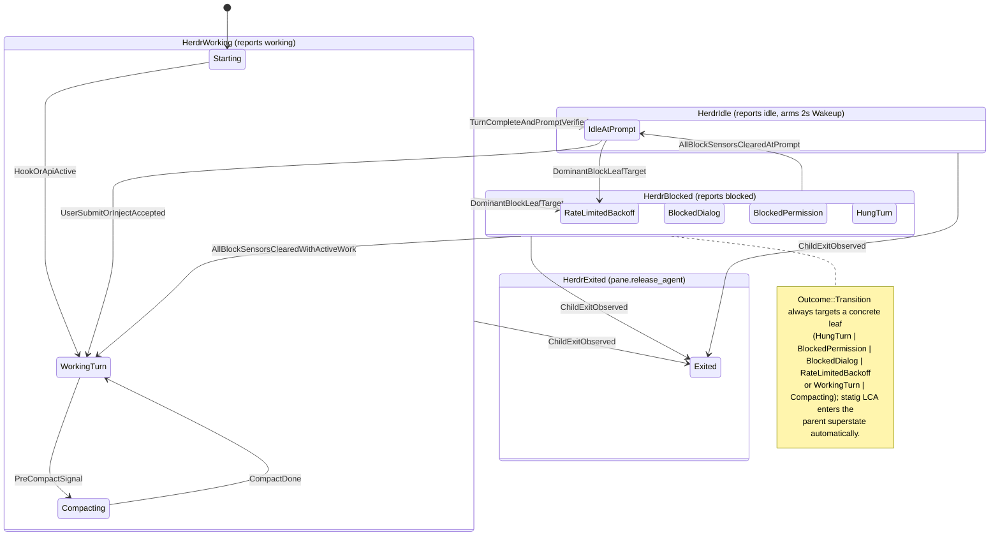
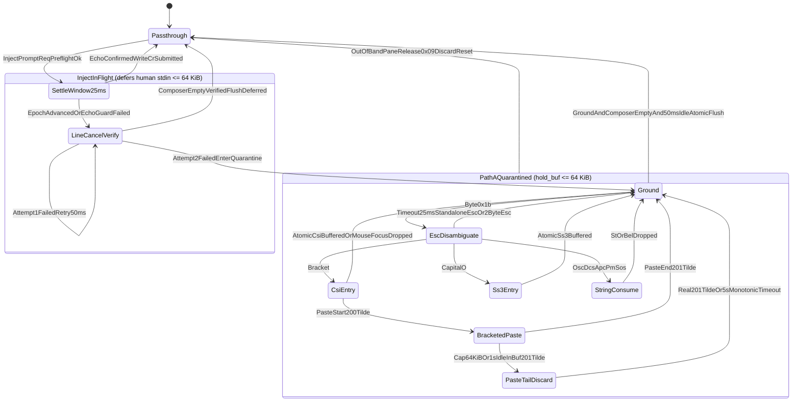
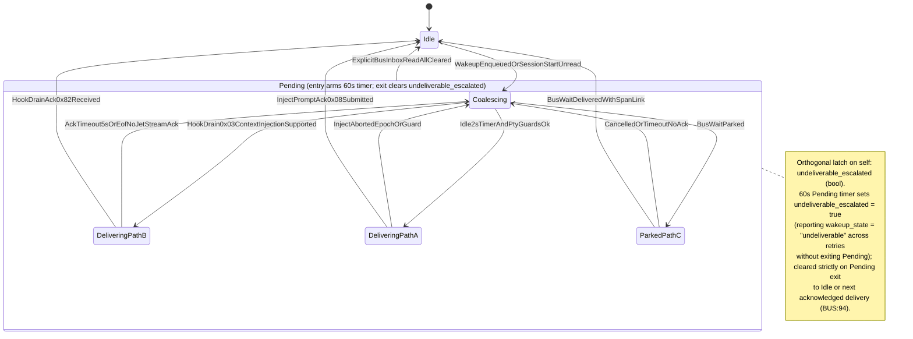
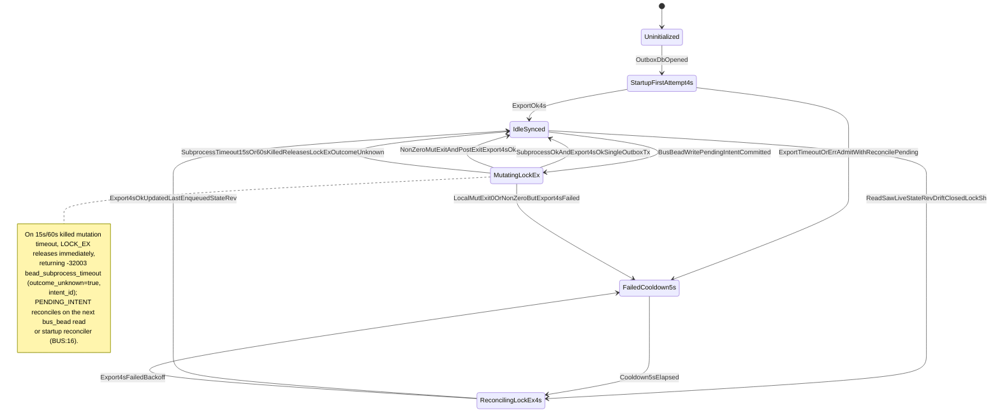
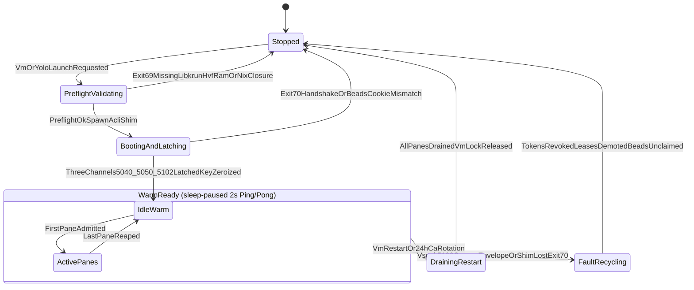
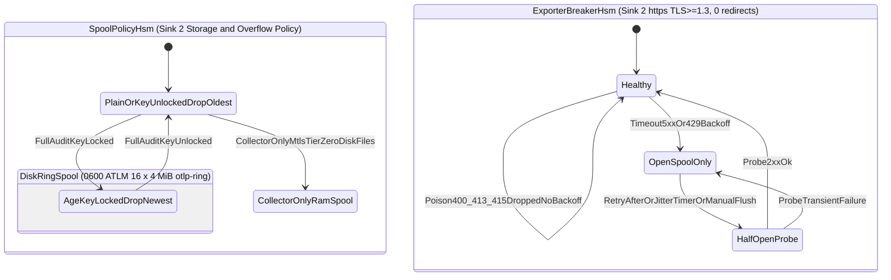
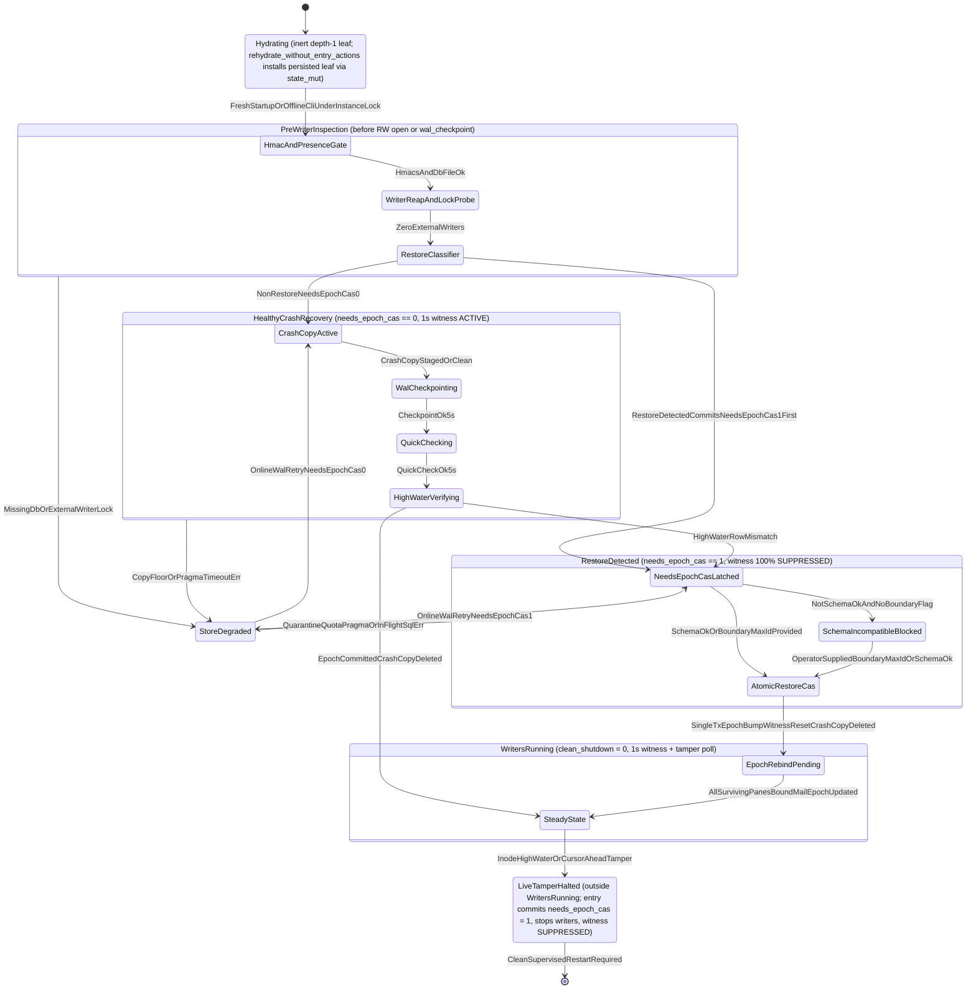
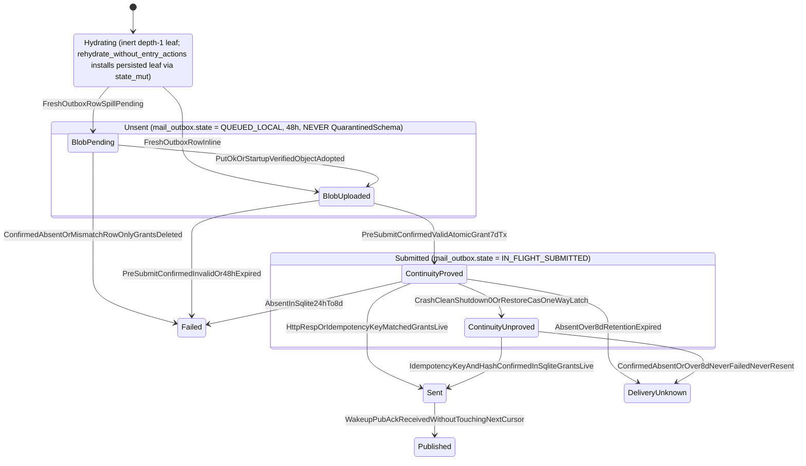
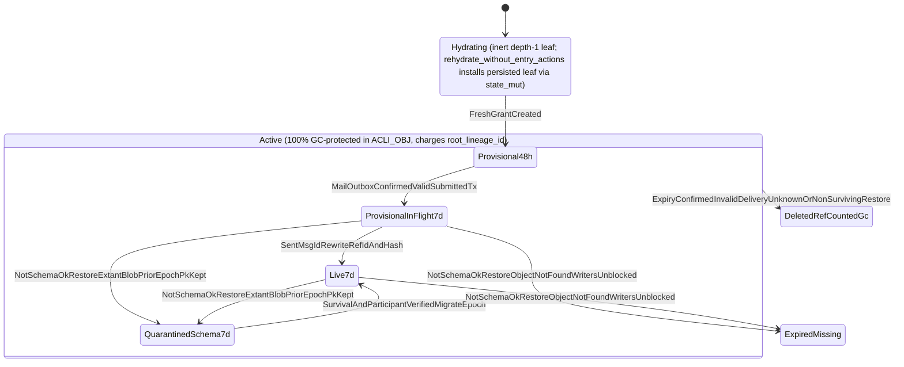

# Iteration 5 Research: Rust Hierarchical State Machine (`statig`) & Linear Typestate Architecture

**Date:** 2026-11-23  
**Change:** `add-acli-sandbox-and-messaging-bus` (`acli-common::hsm`, `acli`, `aclid`, `aclid-telemetry`, `acli-shim`, `acli-guest-supervisor`, `acli-guest-proxy`)  
**Audited Crates, Toolchains, & Specs (`verified`):** `statig 0.4.1` & `statig_macro 0.4.0` (`crates.io` / `docs.rs` source manifests, `mdeloof/statig#76` & PR `#77`), `smlang 0.8.0`, `rust-fsm 0.8.0`, `state-machines 0.35.0`, `proptest`, host baseline `rustc 1.96.0`, `Homebrew >= 7.0.5` (`702cc64b18` `std_cargo_fetch_args`), OpenAI `codex 0.171.0` `[analytics]` / `[otel]` configuration, and all 6 normative `specs/*/spec.md` capability specifications (`640` cumulative `R1`–`R18` adversarial findings).

> [!IMPORTANT]
> **Iteration 5 Verdict:** Standardize on **`statig = "0.4.1"`** (`https://github.com/mdeloof/statig`, `crates.io/crates/statig`, single-licensed `MIT`, `100%` pure Rust, unconditionally `#![no_std]`, `0` heap allocations inside `Inner<M>`, `0` network or OS I/O) inside a shared **`acli-common::hsm`** kernel module for all dynamic event-driven hierarchical state machines (HSMs) across `acli`, `aclid`, `aclid-telemetry`, `acli-guest-supervisor`, and `acli-guest-proxy` (**Bucket A** in-memory HSMs and **Bucket B** SQLite-authoritative `outbox.db` HSMs), paired with zero-cost move-only **`PhantomData` linear typestates** (**Bucket C**) at compile-time lock-ordering, pre-`execve` FD/sandbox launch, and 4-barrier Diff-Promotion boundaries (`verified`).
>
> Every `acli-common::hsm` state machine enforces four mandatory production patterns that eliminate `statig 0.4.1`'s verified sharp edges while preserving `100%` of Rounds 1–18 security invariants:
> 1. **Pure Functional Core & Exact LCA Hierarchy:** State handlers and `#[action]` hooks never execute direct OS syscalls or SQLite writes; they emit typed effects into `HsmContext<'_, Efx>` (`EffectBuffer<Efx>`), relying on `statig`'s verified Lowest Common Ancestor (`(exit_levels, enter_levels)`) inner-to-outer exit -> `core::mem::swap` -> outer-to-inner entry ordering, GAT `Superstate<'sub>` leaf reborrowing for region-scoped state, and machine-level `self` fields for orthogonal cross-superstate latches (`orphan_paste_open`).
> 2. **Explicit Bounded Event Deferral (`BoundedDeferQueue<E>`):** Because `statig 0.4.1` has **zero** built-in `Defer` outcome or deferred-event queue (`Outcome::Super` bubbles synchronously to ancestor superstates), `acli-common::hsm` provides `BoundedDeferQueue<E>` (`MAX_DEFERRED_BYTES = 65_536` [`64 KiB`] for PTY human `stdin` during `InjectInFlight`, `MAX_DEFERRED_EVENTS = 64` for control HSMs, per-`transition_epoch` FIFO replay via `splice_in_flight_at` with in-flight event/byte reservation, and `MAX_REPLAY_MICROSTEPS = 16` anti-livelock cap).
> 3. **Crash-Safe SQLite (`outbox.db`) Rehydration (`rehydrate_without_entry_actions`):** Calling `.init()` on a `serde`-deserialized `UninitializedStateMachine<M>` in `statig 0.4.1` (`Inner::init_with_context`) **re-executes all root-to-leaf entry actions**, which would duplicate side effects on `aclid` restart. Bucket B keeps explicit versioned SQLite columns (`acli_store_epoch`, `mail_outbox`, `acli_obj_grants` — **never** opaque `bincode` blobs) as the sole crash-durable source of truth and restores `InitializedStateMachine<M>` inside `BEGIN IMMEDIATE` via an inert `State::hydrating()` initial leaf plus `*unsafe { sm.state_mut() } = persisted_state` with zero re-fired entry actions.
> 4. **`after_transition`-Only Observability (`mdeloof/statig#76` Bypass) & `10,000`-Case `proptest` Gate:** In `statig 0.4.1` blocking mode, `before_transition` passes **swapped `(&target, &self.state)` arguments** (`blocking/inner.rs:42`). An `ast-grep` rule bans `before_transition` workspace-wide; all transition diagnostics (`acli_hsm_transitions_total` exposed strictly on `acli telemetry status`, `acli telemetry doctor`, and `acli bus status`, isolated from the closed positive Sink 1 / Sink 2 OTLP attribute allowlist) and `10,000`-case `proptest` state-space / SQLite crash-equivalence assertions hook **`after_transition(source, target, context)`** exclusively.

---

## 1. Naming Disambiguation (`statig` vs `Statsig`) & Supply-Chain Guardrails (`verified`)

Automated spellcheckers, transcription tools, and LLM training corpora frequently conflate or autocorrect **`statig`** into **`statsig`**. These names refer to completely unrelated software systems with opposite security postures in `acli`:

| Dimension | **`statig = "0.4.1"`** *(Selected Rust HSM Library)* | **`Statsig`** *(Commercial Telemetry SaaS — Banned)* |
| --- | --- | --- |
| **Category** | Open-source `#![no_std]` Rust library for hierarchical state machines (UML statecharts). | Commercial SaaS platform for feature flags, A/B experimentation, and product analytics. |
| **Upstream & Ownership** | Maxim Deloof (`mdeloof`), `https://github.com/mdeloof/statig`, `https://crates.io/crates/statig` (`verified`). | Statsig Inc. (`https://statsig.com`, acquired by OpenAI in 2025; Rust SDKs `statsig` / `statsig-rust`). |
| **License (`SPDX`)** | **`MIT`** (`statig/Cargo.toml` & `macro/Cargo.toml`, `verified`). | Commercial SaaS / vendor SDKs targeting `statsigapi.net` / `featureassets.org`. |
| **Network, Threads, & OS I/O** | **Zero** network code, **zero** background threads, **zero** OS I/O, **zero** heap allocations in `Inner<M>` (`verified`). | Outbound HTTPS event flushing and remote dynamic-config polling threads. |
| **Relation to `codex 0.171.0`** | Unrelated to Codex configuration; linked statically inside `acli` Rust crates. | `codex 0.171.0` defaults `metrics_exporter` to `"statsig"` (`verified`); `acli` disables it in per-pane `0400` `codex-home/config.toml` via `[analytics] enabled = false` and `[otel]` broker routing ([06-production-agent-cli-and-hook-telemetry.md](06-production-agent-cli-and-hook-telemetry.md) §2.2). |
| **Workspace Policy** | Pin **`statig = "0.4.1"`** (`use statig::prelude::*;`) in `[workspace.dependencies]`. | **Hard-rejected** across `Cargo.toml`, `Cargo.lock`, Homebrew `def fetch`, and Nix `vendorHash`. |

**CI & `ast-grep` Supply-Chain Gate:** Workspace lint gates enforce both a `Cargo.lock` package-name check (`! grep -Ei '^name = "statsig' Cargo.lock`) and a repository `ast-grep` rule (`rules/rust/no-statsig-dependency.yml`) rejecting any `statsig` or `statsig_*` identifier in `Cargo.toml` manifests and Rust `use` / `extern crate` items.

---

## 2. Verified `statig = "0.4.1"` Crate Metadata, API Renames, & Packaging Audit (`verified`)

All crate metadata below was verified directly against the published `statig 0.4.1` and `statig_macro 0.4.0` tarballs and `Cargo.toml` manifests on `crates.io` and `docs.rs` as of `2026-11-23`.

### 2.1 Release, License, MSRV, & Cargo Feature Matrix

- **Published Version & Adoption:** `statig = "0.4.1"` (published `2025-07-05`; `0.4.0` published `2025-07-05`; prior `0.3.0` published `2023-03-25`), paired with `statig_macro = "0.4.0"` (`> 4.74M` downloads on `crates.io`, `verified`).
- **Single-License `MIT` Provenance:** Both `statig/Cargo.toml` and `macro/Cargo.toml` declare **`license = "MIT"`** (`verified` — single-licensed `MIT`, **not** dual-licensed `MIT OR Apache-2.0`). Permissive `MIT` is `100%` compatible with `Apache-2.0` licensing in `Formula/acli.rb` and `MIT` in `artagon-harness-eval`.
- **Build Script & `#![no_std]` Guarantee:** `build = false` in `statig/Cargo.toml`; `statig/src/lib.rs:42` sets `#![no_std]` unconditionally (`verified`).
- **MSRV Compatibility (`rustc 1.96.0` Host Baseline):** `statig 0.4.1` declares `edition = "2021"` and `rust-version = "1.66"` (`verified`). Enabling `features = ["async"]` uses Return-Position `impl Trait` in Traits (`fn call_handler(...) -> impl Future<Output = Outcome<Self>>` in `statig/src/awaitable/state.rs:17-23`), yielding an effective MSRV of **Rust `1.75+`** (`inferred` from RPITIT stabilization in Rust `1.75.0`) — `21` minor releases below the audited `rustc 1.96.0` toolchain.

```toml
# Exact [features] table from statig 0.4.1 Cargo.toml (verified):
[features]
default = ["macro"]
macro = ["statig_macro"]
serde = ["dep:serde"]
bevy = ["dep:bevy_ecs"]
async = []
```

- **Critical Cargo Feature Trap (`No "std"` Feature) & Blocking-Only Pure Core Pin:** Because `statig 0.4.1` is unconditionally `#![no_std]`, **no `"std"` feature exists**. Specifying `features = ["std"]` fails Cargo feature resolution (`verified`). Because every `acli-common::hsm` state machine executes as a pure synchronous functional core (`HsmContext<'_, Efx>`, zero I/O inside handlers) via `statig::blocking::InitializedStateMachine<M>`, workspace `[workspace.dependencies]` pins **`statig = { version = "0.4.1", default-features = false, features = ["macro", "serde"] }`** (retaining MSRV `1.66`, avoiding unused `async` RPITIT codegen, and leaving `bevy` disabled; `statig`'s `#![no_std]` `async` RPITIT mode remains available if a future machine ever requires async actions).

### 2.2 `0.3.0` -> `0.4.1` API Renames (Guard Against Stale Training Examples)

| API Surface | `statig 0.3.0` *(Legacy — Do Not Emit)* | `statig 0.4.1` *(Canonical Workspace Contract, `verified`)* |
| --- | --- | --- |
| **Handler return type** | `Response<State>` | **`Outcome<State>`** (`Handled`, `Super`, `Transition(S)`; `Response<S>` is `#[deprecated(since = "0.4")]` in `outcome.rs:28-29`) |
| **Event dispatch hooks** | `on_dispatch` | **`before_dispatch`** and **`after_dispatch`** (fire once per visited hierarchy level on `Outcome::Super` bubbling) |
| **State transition hooks** | `on_transition` | **`after_transition`** (`before_transition` is **banned** in `0.4.1` due to `mdeloof/statig#76`; see §4.4) |
| **Async state machines** | Required `std` + `Pin<Box<dyn Future>>` heap alloc | **`#![no_std]` zero-allocation `statig::awaitable`** via RPITIT `impl Future` (auto-selected when any handler/action is `async fn`) |

### 2.3 Pure-Rust Dependency Closure, `Homebrew >= 7.0.5`, Nix `vendorHash`, & Static `musl` Guest Parity

With `statig = { version = "0.4.1", default-features = false, features = ["macro", "serde"] }`, the complete transitive crate closure adds **zero** C/C++ files, **zero** `-sys` crates, **zero** `build.rs` C/pkg-config probes, and **zero** compile-time network calls (`verified`):
1. `statig` (`0.4.1`, `build = false`, `#![no_std]`).
2. `statig_macro` (`0.4.0`, `proc-macro = true`) -> `syn` (`2.x`), `quote` (`1.0.23+`), `proc-macro2` (`1.0.91+`), and `proc-macro-error2` (`2.0.1`) — all already present in the workspace proc-macro graph via `serde_derive` / `tokio-macros`.
3. `serde` (`^1.0.152`) — already present across workspace crates.

Consequently:
- **`Formula/acli.rb` (`Homebrew >= 7.0.5`):** `system "cargo", "fetch", *std_cargo_fetch_args` in `def fetch` vendors `statig 0.4.1` and `statig_macro 0.4.0` from `crates.io` into the local Cargo cache, and `cargo install *std_cargo_args(...)` compiles `100%` offline under `deny_network_access! [:build, :postinstall]` ([04-homebrew-aitools-tap-and-nix-parity.md](04-homebrew-aitools-tap-and-nix-parity.md) §3.1).
- **Split-System Nix & Static `musl` Guest Crates:** Deterministic `Cargo.lock` vendoring under Nix `rustPlatform.buildRustPackage` (`vendorHash` under `--option builders ''`) and static `aarch64-unknown-linux-musl` / `x86_64-unknown-linux-musl` builds of `acli-guest-supervisor`, `acli-guest-proxy`, and guest `acli` link cleanly with `< 20 KiB` code-size impact and `0` dynamic `libc` symbol dependencies (`verified`).

---

## 3. Rust HSM / FSM Peer Evaluation Matrix (`verified` as of `2026-11-23`)

| Evaluation Criterion | **`statig 0.4.1`** *(Selected: Buckets A & B)* | **`smlang 0.8.0`** | **`rust-fsm 0.8.0`** | **`state-machines 0.35.0`** | **Manual Flat `enum` + Bool Flags** | **`PhantomData` Typestates** *(Selected: Bucket C)* |
| --- | --- | --- | --- | --- | --- | --- |
| **License & Downloads** | `MIT` · `4.74M+` (`2025-07-05`) | `MIT OR Apache-2.0` · `1.15M` (`2024-08-09`) | `MIT` · `1.58M` (`2025-07-21`) | `MIT OR Apache-2.0` · `22K` (`2026-11-17`) | Built-in language feature | Built-in language feature |
| **True Hierarchical Superstates & LCA Exit/Entry** | **Yes — native tree model** with exact `(exit_levels, enter_levels)` LCA path (`state.rs:70-87`) | **No** — flat transition table (wildcard `_` source only; no superstate LCA exit/entry) | **No** — classical flat Mealy/Moore table | Yes (`SubstateOf`, `lifecycle`, shallow/deep history) | **No** — manual nested `match` arms drop exit/timer cleanup on new edges | **No** — hierarchy causes combinatorial generic type explosion |
| **State-Local Storage + Superstate Borrow** | **Yes** — leaf variants own typed fields; `Superstate<'sub>` borrows `&'sub mut T` via GAT | Partial — leaf variants hold data, no superstate borrowing | **No** in DSL macro (must hand-write trait impls) | Dynamic `Option<T>` accessors | Leaf `enum`s hold data, but ad-hoc `bool` flags (`is_draining`, `quarantined`) create illegal cross-product states | **Yes** — distinct struct fields per compile-time state `Stage<S>` |
| **`async` Handlers & Zero-Alloc `#![no_std]`** | **Yes** — `#![no_std]` RPITIT `impl Future` (`0` `Box<dyn Future>`) | `async` guards/actions supported | No built-in `async` DSL | `async` feature supported | Manual `async fn` | Consuming `fn(self) -> Next` |
| **Built-In UML Event Deferral (`Defer`)** | No — solved cleanly via bounded `BoundedDeferQueue<E>` (§4.2) | No | No | Yes (`defer_in`, single-executor `Rc`) | Manual queue | N/A (linear call sequence) |
| **MSRV & Toolchain Stability** | **`1.66` (sync) / `1.75` (`async`)** — compiles on `rustc 1.96.0` | `2018` edition — stable | `2021` edition — stable | **Requires `edition = "2024"` & `rust-version = "1.99"`** (`35` `0.x` releases in `13` mos; **fails on `rustc 1.96.0` baseline!**) | Any Rust | Any Rust |
| **Runtime Event Loop & SQLite Hydration Fit** | **Excellent** — `Context` shell separation + deterministic `Clone + Eq` `proptest` | Weak for multi-layer hierarchical protocols | Weak for rich per-state timers/buffers | Blocked by `rustc 1.99` floor and `0.x` churn | High defect density on `6+`-state protocols (`PtyInputQuarantine`, `StoreEpoch`) | **Poor** for runtime event loops; **Optimal** for static linear barriers |
| **Architectural Verdict** | **ADOPT for Buckets A & B** | Reject (flat only) | Reject (flat, no state data in macro) | **Reject** (`rust-version = "1.99"` > `1.96.0` baseline; rapid `0.x` churn) | **Retire** for complex lifecycles | **ADOPT for Bucket C** |

### Three-Bucket Architectural Partition Rule

1. **Bucket A (In-Memory Event-Driven `statig` HSMs):** Use `statig 0.4.1` whenever asynchronous events arrive dynamically from sockets, `virtio-vsock`, PTY `stdin`/output streams, OS signals, or monotonic timers and multiple leaf states share superstate invariants, cancellation edges, or entry/exit timer management (`PaneLifecycleHsm`, `PtyInputQuarantineHsm`, `WakeupDeliveryHsm`, `BeadReconcilerHsm`, `BeadDrainerHsm`, `VmSandboxInstanceHsm`, `GuestSupervisorLifecycleHsm`, `AclidDaemonLifecycleHsm`, `SpoolPolicyHsm`, `ExporterBreakerHsm`, `DiskFloorHsm`).
2. **Bucket B (Durable SQLite-Authoritative `outbox.db` `statig` HSMs):** Use `statig 0.4.1` hydrated inside `outbox.db` `BEGIN IMMEDIATE ... COMMIT` transactions when transitions govern crash-recoverable persistence columns (`StoreEpochRecoveryHsm`, `MailOutboxHsm`, `ObjGrantHsm`).
3. **Bucket C (Compile-Time `PhantomData` Linear Typestates):** Use zero-cost move-only Rust types (`#[must_use]` structs with private constructors) when the caller's own Rust code executes a strict acyclic sequence where skipping or reordering a step must be a **compile-time type error** (3-level lock hierarchy + disjoint `BeadsFileLock`, 7-stage `LaunchTopology`, 4-barrier Diff-Promotion Gate).

---

## 4. Four Mandatory `statig 0.4.1` Production Engineering Patterns (`acli-common::hsm`)

### 4.1 Pattern 1 — Pure Functional Core, Exact LCA Semantics, GAT Borrowing vs Orthogonal Fields, & `EffectBuffer`

`statig 0.4.1` models hierarchy under an implicit `Top` root (`depth = 0`, top-level states at `depth = 1`, children of top-level superstates at `depth = 2`, etc.). Every `#[state]` and `#[superstate]` handler returns `Outcome<State>` (`statig/src/outcome.rs:4-10`, `verified`):
- **`Outcome::Handled`:** Stops event propagation; performs an **internal transition** when mutating `&mut` fields in place without firing exit or entry actions.
- **`Outcome::Super`:** Synchronously bubbles the event to the immediate parent `#[superstate]` during the same `handle_with_context` call (`state.rs:117-138`); if the outermost superstate returns `Super`, `Top` consumes it as a no-op (`inner.rs:321`).
- **`Outcome::Transition(target)`:** Computes `(exit_levels, enter_levels)` relative to the **Lowest Common Ancestor (LCA)** (`StateExt::transition_path` in `blocking/state.rs:70-87` and `Inner::transition` in `blocking/inner.rs:328-346`, `verified`):
  1. **Inner-to-outer exits** up to (excluding) the LCA execute against `&mut self.state` (**source** leaf storage; any mutation to source state-local fields inside an `exit_action` drops at step 2).
  2. **Atomic variant swap:** `core::mem::swap(&mut self.state, &mut target)`.
  3. **Outer-to-inner entries** from below the LCA down to the target leaf execute against `&mut self.state` (**target** leaf storage).
  4. **Sibling transitions** (e.g., `HerdrWorking::Starting -> HerdrWorking::WorkingTurn`) compute `(exit_levels, enter_levels) = (1, 1)`, keeping `HerdrWorking` active without re-firing `enter_herdr_working`. **External leaf self-transitions** (e.g., `LineCancelVerify { attempt: 1 } -> Transition(State::line_cancel_verify(2))`) match `core::mem::discriminant` (`state.rs:43-45`) and return `(1, 1)`, exiting old leaf `1` and entering new leaf `2` without exiting parent `InjectInFlight`.

**State-Local GAT Borrowing vs Orthogonal Machine Fields (`verified`):**
- Parameters on `#[state]` methods (e.g., `attempt: &mut u8`) become **owned fields** on that generated `State` enum variant, while matching parameters on `#[superstate]` methods borrow `&'sub mut T` directly from the active leaf via GAT `type Superstate<'sub>` (`statig/src/lib.rs:125-173`) — eliminating invalid `Option<T>` soup on `self`.
- Conversely, **orthogonal latches that must survive across top-level superstate transitions** MUST live on `self` (shared storage), **not** inside superstate-local storage. Most notably, in `PtyInputQuarantineHsm` (§5.1.2), **`orphan_paste_open: Option<OrphanPasteWindow>`** is armed when `PathAQuarantined::PasteTailDiscard` exits via its `5 s` monotonic timeout and **must remain active after `PathAQuarantined` flushes and transitions back to `Passthrough`** (`OPUS-R13-06`, `FABLE-R18-05`).

**`HsmContext<'_, Efx>` `EffectBuffer` Isolation:** Every machine sets `type Context<'ctx> = HsmContext<'ctx, Self::Effect>;` containing `now_mono: MonoInstant`, `now_wall_ns: i64`, and `effects: &'ctx mut EffectBuffer<Self::Effect>`. `#[action]` and `#[state]` bodies push declarative effects (`EmitHerdrReport`, `WritePtyBytes`, `ScheduleTimer`, `AckJetStreamBatch`) into `ctx.effects` and perform **zero** blocking I/O, keeping `M` and `M::State` `Clone + PartialEq + Eq + Send + Sync`.

### 4.2 Pattern 2 — Explicit Bounded Event Deferral (`BoundedDeferQueue<E>`)

**Verified Source Fact:** Neither `statig 0.3.0` (`Response<S>`) nor `statig 0.4.1` (`Outcome<S>`) contains a `Defer` variant or an internal deferred-event queue (`statig/src/outcome.rs:4-10`, `statig/src/blocking/inner.rs:14-35`, `verified`). `statig`'s doc comment on `Outcome::Super` (*"Defer the event to the superstate"*) describes synchronous ancestor bubbling only. In `acli` and `aclid`, an unbounded `VecDeque` for deferred `stdin` or IPC events would create an OOM and livelock DoS vector.

`acli-common::hsm` provides a reusable, bounded deferral queue and microstep-capped dispatcher:

```rust
use std::collections::VecDeque;
use statig::blocking::{InitializedStateMachine, IntoStateMachine, State, Superstate};

pub const MAX_DEFERRED_BYTES: usize = 65_536; // 64 KiB cap for PTY human stdin during InjectInFlight
pub const MAX_DEFERRED_EVENTS: usize = 64;    // Hard event cap for control-plane HSMs
pub const MAX_REPLAY_MICROSTEPS: usize = 16;  // Anti-livelock transitive replay cap

#[derive(Debug, Clone, PartialEq, Eq)]
pub enum DeferError<E> {
    QueueFull(E),
    ByteBudgetExceeded { event: E, attempted: usize, max_bytes: usize },
    ReplayStepLimitExceeded,
}

#[derive(Debug, Clone, PartialEq, Eq, serde::Serialize, serde::Deserialize)]
pub struct BoundedDeferQueue<E> {
    queue: VecDeque<(E, usize)>,
    queued_bytes: usize,
    #[serde(skip)]
    in_flight_events: usize,
    #[serde(skip)]
    in_flight_bytes: usize,
    max_events: usize,
    max_bytes: usize,
}

impl<E> BoundedDeferQueue<E> {
    pub fn new(max_events: usize, max_bytes: usize) -> Self {
        Self {
            queue: VecDeque::new(),
            queued_bytes: 0,
            in_flight_events: 0,
            in_flight_bytes: 0,
            max_events,
            max_bytes,
        }
    }

    pub fn len(&self) -> usize {
        self.queue.len()
    }

    pub fn is_empty(&self) -> bool {
        self.queue.is_empty()
    }

    pub fn try_defer(&mut self, event: E, byte_weight: usize) -> Result<(), DeferError<E>> {
        if self.queue.len().saturating_add(self.in_flight_events) >= self.max_events {
            return Err(DeferError::QueueFull(event));
        }
        let attempted = self
            .queued_bytes
            .saturating_add(self.in_flight_bytes)
            .saturating_add(byte_weight);
        if attempted > self.max_bytes {
            return Err(DeferError::ByteBudgetExceeded {
                event,
                attempted,
                max_bytes: self.max_bytes,
            });
        }
        self.queued_bytes = self.queued_bytes.saturating_add(byte_weight);
        self.queue.push_back((event, byte_weight));
        Ok(())
    }

    pub fn take_snapshot(&mut self) -> VecDeque<(E, usize)> {
        let snapshot = core::mem::take(&mut self.queue);
        self.in_flight_events = self.in_flight_events.saturating_add(snapshot.len());
        self.in_flight_bytes = self.in_flight_bytes.saturating_add(self.queued_bytes);
        self.queued_bytes = 0;
        snapshot
    }

    /// Releases accounting for one popped snapshot item immediately prior to dispatch
    /// so in-place re-deferral reuses its own slot while remaining tail items stay reserved.
    pub fn release_in_flight_item(&mut self, byte_weight: usize) {
        self.in_flight_events = self.in_flight_events.saturating_sub(1);
        self.in_flight_bytes = self.in_flight_bytes.saturating_sub(byte_weight);
    }

    /// Splices unconsumed snapshot tail entries at `prefix_len` (after earlier re-deferred
    /// items and ahead of anything newly deferred during the transitioning event), preserving
    /// exact FIFO arrival order and maintaining hard event/byte caps at every instant.
    pub fn splice_in_flight_at(&mut self, prefix_len: usize, remaining: VecDeque<(E, usize)>) {
        let tail_events = remaining.len();
        let tail_bytes: usize = remaining.iter().map(|(_, b)| *b).sum();
        self.in_flight_events = self.in_flight_events.saturating_sub(tail_events);
        self.in_flight_bytes = self.in_flight_bytes.saturating_sub(tail_bytes);
        self.queued_bytes = self.queued_bytes.saturating_add(tail_bytes);
        let insert_at = prefix_len.min(self.queue.len());
        let suffix = self.queue.split_off(insert_at);
        self.queue.extend(remaining);
        self.queue.extend(suffix);
    }
}

pub trait DeferHost<E> {
    /// Monotonic counter incremented strictly inside `after_transition` on every
    /// transition (including `S_b -> S_c -> S_b` round-trips and external self-transitions).
    fn transition_epoch(&self) -> u64;
    fn defer_queue(&self) -> &BoundedDeferQueue<E>;
    fn defer_queue_mut(&mut self) -> &mut BoundedDeferQueue<E>;
}

pub fn dispatch_with_bounded_deferral<M, E>(
    sm: &mut InitializedStateMachine<M>,
    event: E,
    ctx: &mut M::Context<'_>,
) -> Result<(), DeferError<E>>
where
    M: for<'evt> IntoStateMachine<Event<'evt> = E> + DeferHost<E>,
    M::State: State<M>,
    for<'sub> M::Superstate<'sub>: Superstate<M>,
{
    let mut last_epoch = sm.inner().transition_epoch();
    sm.handle_with_context(&event, ctx);

    let mut microsteps = 0usize;
    while sm.inner().transition_epoch() != last_epoch {
        if sm.inner().defer_queue().is_empty() {
            break;
        }
        microsteps += 1;
        if microsteps > MAX_REPLAY_MICROSTEPS {
            return Err(DeferError::ReplayStepLimitExceeded);
        }
        last_epoch = sm.inner().transition_epoch();
        // Drain ONLY the pre-transition snapshot so events re-deferred in the new state wait
        // for a subsequent transition_epoch advance instead of double-dispatching in place.
        // SAFETY: `defer_queue_mut` touches only the orthogonal `BoundedDeferQueue<E>`
        // without mutating `M::State` or violating any state-local invariant.
        let mut snapshot = unsafe { sm.inner_mut() }.defer_queue_mut().take_snapshot();
        while let Some((deferred_event, bytes)) = snapshot.pop_front() {
            unsafe { sm.inner_mut() }
                .defer_queue_mut()
                .release_in_flight_item(bytes);
            let prefix_len = sm.inner().defer_queue().len();
            sm.handle_with_context(&deferred_event, ctx);
            if sm.inner().transition_epoch() != last_epoch {
                // Splice remaining tail after earlier re-deferred items (`prefix_len`)
                // and ahead of events newly deferred during `deferred_event`.
                if !snapshot.is_empty() {
                    unsafe { sm.inner_mut() }
                        .defer_queue_mut()
                        .splice_in_flight_at(prefix_len, snapshot);
                }
                break;
            }
        }
    }
    Ok(())
}
```

### 4.3 Pattern 3 — Crash-Safe SQLite (`outbox.db`) Rehydration (`rehydrate_without_entry_actions`)

**Verified Deserialization Trap (`statig/src/blocking/{state_machine.rs:494-498, inner.rs:307-311}`):**
1. `InitializedStateMachine<M>` implements `Serialize` **only** and intentionally omits `Deserialize`. Deserializing via `serde` produces `UninitializedStateMachine<M>` (or `StateMachine<M>` with `initialized = false`).
2. Calling `.init_with_context(&mut ctx)` executes `Inner::init_with_context`:
   ```rust
   pub(crate) fn init_with_context(&mut self, context: &mut M::Context<'_>) {
       let enter_levels = self.state.depth();
       self.state.enter(&mut self.shared_storage, context, enter_levels);
   }
   ```
3. If `aclid` crashed while `StoreEpochRecoveryHsm` was in `RestoreDetected::SchemaIncompatibleBlocked` (`depth = 2`) or `MailOutboxHsm` was in `Submitted::InFlightSubmitted` (`depth = 2`), calling `.init_with_context(...)` on restart would **re-execute every root-to-leaf entry action**, risking duplicate WAL moves, duplicate outbox mutations, or duplicate wakeups.

**Workspace SQLite Hydration Contract:**
- **Explicit Versioned SQLite Columns Only (Zero Opaque `bincode` Blobs):** `outbox.db` (`0600`, WAL-backed) stores explicit relational columns (`19`-data-column `acli_store_epoch` + `row_hmac_sha256`, `mail_outbox`, epoch-qualified `acli_obj_grants`, `bead_outbox`) as the **sole crash-durable source of truth** so SQL reference-counted GC queries (`WHERE NOT EXISTS (...)`), HMAC sealing, and schema upgrades across `acli` versions remain explicit and auditable.
- **Zero-Entry-Action Rehydration (`rehydrate_without_entry_actions`):** Every Bucket B machine declares `#[state_machine(initial = "State::hydrating()")]`, where `hydrating` is an inert top-level leaf state (`depth = 1`, **no** superstate, **no** `entry_action`). Inside `outbox.db` `BEGIN IMMEDIATE ... COMMIT`, `aclid` maps the SQLite row to `(persisted_model, persisted_state)`, initializes through `State::hydrating()` (executing **zero** user actions), and installs `persisted_state` via `state_mut()`:

```rust
pub fn rehydrate_without_entry_actions<M>(
    persisted_model: M,
    persisted_state: M::State,
    ctx: &mut M::Context<'_>,
) -> statig::blocking::InitializedStateMachine<M>
where
    M: statig::blocking::IntoStateMachine,
    M::State: statig::blocking::State<M>,
    for<'sub> M::Superstate<'sub>: statig::blocking::Superstate<M>,
{
    use statig::blocking::IntoStateMachineExt;

    // 1. M::initial() == State::hydrating() (top-level leaf, no superstate, no entry_action).
    let mut sm = persisted_model
        .uninitialized_state_machine()
        .init_with_context(ctx);

    // 2. SAFETY: statig 0.4.1 `Inner<M>` stores only `{ shared_storage: M, state: M::State }`
    //    (`statig/src/blocking/inner.rs:292-298`) with no cached depth or self-referential
    //    pointers, and `(persisted_model, persisted_state)` were validated from one atomic
    //    SQLite `outbox.db` `BEGIN IMMEDIATE` snapshot.
    unsafe {
        *sm.state_mut() = persisted_state;
    }
    sm
}
```

*(Encapsulation rule: `dispatch_with_bounded_deferral` in `acli-common::hsm::defer` and `rehydrate_without_entry_actions` in `acli-common::hsm::rehydrate` are the **only** permitted callers of `unsafe { sm.inner_mut() }` and `unsafe { sm.state_mut() }`; repository `ast-grep` rules reject both `inner_mut()` and `state_mut()` everywhere else in the workspace.)*

### 4.4 Pattern 4 — `mdeloof/statig#76` `before_transition` Bug, `after_transition` Observability, & `proptest` Harness

**Verified Bug in `statig 0.4.1` (`src/blocking/inner.rs:41-58`, `mdeloof/statig#76`):**

```rust
// Exact upstream code in statig 0.4.1 (`src/blocking/inner.rs:41-58`, verified):
pub(crate) fn transition(&mut self, mut target: M::State, context: &mut M::Context<'_>) {
    // BUG (mdeloof/statig#76): passes `&target` FIRST and `&self.state` SECOND before swap!
    M::before_transition(&mut self.shared_storage, &target, &self.state, context);

    let (exit_levels, enter_levels) = self.state.transition_path(&mut target);
    self.state.exit(&mut self.shared_storage, context, exit_levels);
    core::mem::swap(&mut self.state, &mut target);
    self.state.enter(&mut self.shared_storage, context, enter_levels);

    // CORRECT: after `mem::swap`, `target` holds old `source` and `self.state` holds new `target`!
    M::after_transition(&mut self.shared_storage, &target, &self.state, context);
}
```

- **Upstream Status (`verified`):** Reported `2025-11-26` (`mdeloof/statig#76`), fixed on `main` in PR `#77` (`3780eec`, `2025-11-29`), **unreleased on `crates.io`** as of `2026-11-23` (`awaitable/inner.rs` is unaffected).
- **Mandatory Mitigation & `ast-grep` Gate:**
  1. Repository `ast-grep` rule `rules/rust/statig-no-before-transition.yml` rejects `before_transition` in both `#[state_machine(...)]` attribute arguments and `fn before_transition` method definitions across all workspace crates.
  2. Every HSM hooks **`after_transition = "Self::on_after_transition"`**, which receives exact `(source: &State, target: &State, context: &mut HsmContext<'_, Efx>)` in both `blocking` and `awaitable` modes (`verified`).
  3. **Closed Positive OTLP Allowlist Preservation (`OPUS-R13-01`, `TELEM:41–48`):** `on_after_transition` increments internal broker diagnostic counters **`acli_hsm_transitions_total{machine, from, to}`** exposed strictly on `acli telemetry status [--json]`, `acli telemetry doctor [--json]`, and `acli bus status [--json]` (plus internal `tracing` target `acli.hsm.transition`), **never** injecting custom `hsm.*` attributes into pane Sink 1 (`store/`) or Sink 2 (`otlp-ring/`) OTLP records so the enumerated closed positive attribute allowlist in `specs/agent-cli-production-telemetry/spec.md` remains `100%` intact.
- **`10,000`-Case `proptest` State-Space & Crash-Equivalence Harness:** Because `InitializedStateMachine<M>` derives `Clone + PartialEq + Eq` and side effects are isolated in `EffectBuffer`, every Bucket A and Bucket B HSM runs a `10,000`-case `proptest` suite asserting:
  1. **Transition Graph Allowlist:** Every observed `(source.tag(), target.tag())` pair recorded in `after_transition` belongs to the machine's closed specification edge set.
  2. **Safety & Queue Bounds:** At every step, `BoundedDeferQueue` respects `MAX_DEFERRED_BYTES` / `MAX_DEFERRED_EVENTS` and superstate invariants hold (e.g., `StoreEpochRecoveryHsm` emits `0` witness writes whenever `needs_epoch_cas == 1`; `MailOutboxHsm` never transitions `continuity_unproved == 1` to `FAILED`).
  3. **SQLite Crash-Rehydration Equivalence (Bucket B):** At any random step `k` in `0..len`, dehydrating `(sm.inner(), sm.state())` to an in-memory SQLite `outbox.db` transaction, simulating an abrupt process restart, and calling `rehydrate_without_entry_actions` produces `0` spurious entry effects and yields bit-identical `(sm.inner(), sm.state())` and identical `EffectBuffer` outputs over remaining events `k..len`.

---

## 5. Complete `acli` State-Machine & Typestate Architecture (Buckets A, B, C)

| ID | Machine / Typestate | Bucket | Owning Crate / Binary | Backing OpenSpec Specs & Research |
| --- | --- | --- | --- | --- |
| **A.1** | `PaneLifecycleHsm` + `HerdrBridgeSessionHsm` | **Bucket A** (`statig`) | `aclid` | `acli-mux-herdr-ntm`, `agent-cli-production-telemetry` · `02` §4–§5, `06` §4.2 |
| **A.2** | `PtyInputQuarantineHsm` + `OutboundVtFilterHsm` / `Aclimux1StreamBindHsm` / `At50ChunkReassemblerHsm` | **Bucket A** (`statig`) | `acli` (PTY relay/pump), `acli-guest-supervisor`, `acli-guest-proxy`, `aclid`, `aclid-telemetry` | `acli-mux-herdr-ntm`, `acli-launcher-and-metadata`, `agent-cli-production-telemetry` · `01` §1.3 & §5, `02` §5, `06` §3.2 |
| **A.3** | `WakeupDeliveryHsm` + `InboxTailerCursorHsm` / `KvBuildSlotLeaseHsm` | **Bucket A** (`statig`) | `aclid` | `interagent-messaging-bus`, `agent-cli-production-telemetry` · `03` §3–§5, `06` §3.3 |
| **A.4** | `BeadReconcilerHsm` & `BeadDrainerHsm` | **Bucket A** (`statig`) | `aclid` | `interagent-messaging-bus`, `acli-os-and-vm-sandboxing` · `03` §3–§4 |
| **A.5** | `VmSandboxInstanceHsm`, `GuestSupervisorLifecycleHsm`, `AclidDaemonLifecycleHsm`, `LinuxHostOverlayLifecycleHsm` | **Bucket A** (`statig`) | `aclid`, `acli-shim`, `acli-guest-supervisor`, `acli` | `acli-os-and-vm-sandboxing`, `acli-mux-herdr-ntm`, `interagent-messaging-bus` · `02` §2–§5, `06` §3.2 |
| **A.6** | `SpoolPolicyHsm` + `ExporterBreakerHsm` + `DiskFloorHsm` | **Bucket A** (`statig`) | `aclid-telemetry` / `aclid` | `agent-cli-production-telemetry` · `06` §4–§5 |
| **B.1** | `StoreEpochRecoveryHsm` (`outbox.db.acli_store_epoch`) | **Bucket B** (`statig` + SQLite) | `aclid`, `acli bus` | `interagent-messaging-bus`, `acli-os-and-vm-sandboxing` · `03` §2 |
| **B.2** | `MailOutboxHsm` (`outbox.db.mail_outbox`) | **Bucket B** (`statig` + SQLite) | `aclid` | `interagent-messaging-bus` · `03` §3 |
| **B.3** | `ObjGrantHsm` (`outbox.db.acli_obj_grants` + `ACLI_OBJ`) | **Bucket B** (`statig` + SQLite) | `aclid` | `interagent-messaging-bus` · `03` §3–§4 |
| **C.1** | `Level0Unlocked -> PromotionGuard -> RegistryEpochGuard -> OwnerStateGuard` + `BeadsFileLock` | **Bucket C** (Linear Typestate) | `acli-common` / `aclid` | `acli-os-and-vm-sandboxing`, `interagent-messaging-bus` · `02` §4, `03` §2 |
| **C.2** | 7-Stage `LaunchTopology` & `--pass-fd` Sanitization Token | **Bucket C** (Linear Typestate) | `acli` | `acli-launcher-and-metadata`, `acli-os-and-vm-sandboxing` · `01` §1.3 & §5 |
| **C.3** | 4-Barrier Diff-Promotion Gate + 3-Marker Crash Recovery | **Bucket C** (Linear Typestate) | `aclid` | `acli-os-and-vm-sandboxing`, `agent-cli-production-telemetry` · `02` §2.1 & §4 |

---

### 5.1 Bucket A — In-Memory Event-Driven `statig` HSMs

#### A.1 `PaneLifecycleHsm` + `HerdrBridgeSessionHsm` (`specs/acli-mux-herdr-ntm/spec.md:34–54`)

`PaneLifecycleHsm` fuses four sensor channels (`pty_ring`, `proc_tree`, `api_inflight`, `hook_channel`) into `9` leaf states grouped under `4` `herdr` protocol-22 superstates. Superstate entry actions emit `pane.report_agent` / `pane.release_agent` once per superstate boundary crossing, while sibling leaf transitions inside `HerdrWorking` or `HerdrBlocked` update `acli ps --json` and `meta.json` without redundant `herdr` state churn.



- **Preserved Invariants (`verified`):**
  1. **Arrival-Order-Independent Total Dominance (`ASTRA-R1-05`, `FABLE-R1-05`):** Simultaneous active sensor inputs always resolve deterministically in strict priority order **`Exited (1) > HungTurn (2) > BlockedPermission (3) > BlockedDialog (4) > RateLimitedBackoff (5) > Compacting (6) > WorkingTurn (7) > Starting (8) > IdleAtPrompt (9)`** (e.g., active child + HTTP `429` `Retry-After` + pending Zone-3 `prompt_on_host` approval resolves deterministically to `BlockedPermission`).
  2. **OS Sleep-Paused Clocks (`FABLE-R1-23`, `OPUS-R6-13`):** Hang and `Retry-After` deadlines use Linux `CLOCK_MONOTONIC` and macOS `CLOCK_UPTIME_RAW` + `IORegisterForSystemPower`, resetting hang windows across `> 5 s` wall-clock jumps.
  3. **Per-Mode `null` Sensor Provenance & Reconnect Snapshot Replay (`ASTRA-R1-16,21`, `NEON-R11-01`):** `pty_ring` reports `null`/`unavailable` on partial-TTY pumps `(b)` and non-TTY Fast-Exec `(c)`–`(d)`; VM-only fields (`cgroup_memory_bytes`) report `null` on host; companion **`HerdrBridgeSessionHsm`** (`Disconnected -> RegisteringEpoch -> ReplayingSnapshot -> StreamingDeltas`) opens a fresh `server_epoch` on `HERDR_SOCKET_PATH` reconnect and replays full current state + `pane.report_metadata` (`{tokens_in, tokens_out, cache_read_tokens, ttft_ms, tool_calls, bead_id, epic_id, telemetry_health}`) for all live panes (including already-`exec`'d Fast-Exec panes) before streaming deltas; `panes-registry.json` preserves surviving panes' `sha256_bus_token`, `sha256_telem_token`, `fallback_mac_key`, and `session_seq` across normal `aclid` restarts and reaps all surviving instance panes fail-closed (`SIGTERM -> 2 s -> SIGKILL`) on HMAC failure (`OPUS-R15-01`, `ASTRA-R15-02`).

#### A.2 `PtyInputQuarantineHsm` + Mux/Stream Companions (`specs/acli-mux-herdr-ntm/spec.md:9–21, 55–62`)

`PtyInputQuarantineHsm` runs on the single-threaded PTY owner loop (`acli` host relay `(a)` and `acli-guest-supervisor` `--vm` PTY owner), pairing `BoundedDeferQueue` (`MAX_DEFERRED_BYTES = 65_536` [`64 KiB`]) during `InjectInFlight` with a stateful UTF-8-before-C1 ECMA-48 / `DECSET 2004` sequence tokenizer under `PathAQuarantined` and an orthogonal `orphan_paste_open: Option<OrphanPasteWindow>` field on `self`.



- **Preserved Invariants (`verified`):**
  1. **Non-`0x03` Full-`written_char_len` Erase & Consumed Subsequent `0x03` (`OPUS-R10-01`, `OPUS-R11-03`, `ASTRA-R7-07`):** `ACLIIDX1` rejects any line-cancel entry containing `0x03` at load (`exit 9`); `LineCancelVerify` erases full `written_char_len` (never `echoed_len`, handling `echoed_len == 0` races). In `PathAQuarantined::Ground`, rule (1) takes strict priority over `orphan_paste_open`, and whenever `orphan_paste_open.is_some()` **both** rule (1) and post-quarantine `orphan_paste_open` require a **standalone 1-byte `stdin` read bounded by `>= 50 ms` `stdin` idle before and after** (`FABLE-R18-05`): the first valid standalone `0x03` forwards `0x03` once, discards `hold_buf`, and runs non-`0x03` erase/verify, whereas **every subsequent** `Ground` standalone `0x03` while quarantined is **consumed without forwarding** and prints a host hint pointing to `acli pane release <pane_id>`.
  2. **UTF-8-Before-C1, Non-Stalling `64 KiB` Paste Truncation, & Tracked `DECSET 2004` Post-Timeout Flush (`OPUS-R11-04`, `OPUS-R13-06`, `OPUS-R14-04`, `FABLE-R15-05`, `FABLE-R16-05`, `FABLE-R17-05`):** Valid multi-byte UTF-8 decodes before C1 filtering (`0x80..0xBF` preserved; C1 `U+0080..U+009F` / bare `0x80..0x9F` dropped). Both `64 KiB` truncation (reserving `6 B`) and `1 s` paste-idle auto-close append `\x1b[201~` **into `hold_buf`** and enter `PasteTailDiscard` (ignoring embedded `0x03`, exiting to `Ground` on `\x1b[201~` OR `5 s` monotonic elapsed time, arming `self.orphan_paste_open = Some(...)` on timeout exit with `Attention` on entry, `> 30 s`, and exit until `\x1b[201~`, `acli pane release`, or second `5 s` monotonic + `250 ms` idle). Post-timeout flush strips interior `\x1b[200~`/`\x1b[201~` and wraps in one outer `\x1b[200~...\x1b[201~` **strictly when child PTY `DECSET 2004`** (initialized `false`, tracked on single/multi-param `CSI ? ... 2004 h/l` and reset on `RIS`/`DECSTR`) is active, else keeps bytes held with `Attention`. Out-of-band `acli pane release <pane_id>` (`ctl.sock` / `vsock:5102` `0x09`->`0x0A`) discards `hold_buf` (`discarded_bytes: u32`), resets leaf to `Ground`, and clears `orphan_paste_open = None` with `0` `0x03` sent.
  3. **Companion Stream HSMs:** `OutboundVtFilterHsm` (pre-launch `CSI 6n` `100 ms` seed swallowing `1` late `CPR` reply `FABLE-R8-05`, local `CSI 5n`/`6n`/`CSI ? 62 ; 22 c` `DA` replies, exact `(prefix, intermediate, final)` allowlist, host-only base64 `--allow-osc52`), `Aclimux1StreamBindHsm` (`vsock:5101` single-use `52 B` `ACLIMUX1` preamble `<= 2000 ms` -> `64 KiB` ring / `256 KiB` credit window), and `At50ChunkReassemblerHsm` (`vsock:5050` closed `signal_type` enum `0x01..0x04 | 0x81 | 0x82`, `<= 8` concurrent `req_id`s per pane, `5 s` timeout, `<= 5 MiB` compressed / `<= 16 MiB` decompressed).

#### A.3 `WakeupDeliveryHsm` + `InboxTailerCursorHsm` & `KvBuildSlotLeaseHsm` (`specs/interagent-messaging-bus/spec.md:48–70, 84–99`)



- **Preserved Invariants (`verified`):**
  1. **Zero Prose on Path A & Two-Step `0x81`/`0x82` Pipe-Handoff on Path B (`FABLE-R1-01`, `FABLE-R11-02`, `ASTRA-R11-05`, `ASTRA-R15-02`):** Path A emits fixed ASCII templates only (`bead_id` re-validated against `^[A-Za-z0-9][A-Za-z0-9._-]{0,63}$`, `seq=<bead_seq>` included); Path B runs **only** when `ACLIIDX1` `supports_hook_context_injection == true` under same-pane `ACLI_TELEM_TOKEN` and acknowledges JetStream **solely** on `0x82 HookDrainAck` after `stdout` flush; orthogonal `self.undeliverable_escalated = true` (`> 60 s` inside `Pending`) is non-terminal, survives failed retries across `Coalescing`/`DeliveringPathA`/`DeliveringPathB`/`ParkedPathC`, and clears strictly on `Pending` superstate exit to `Idle` or on the next acknowledged delivery.
  2. **Surviving-Pane `session_seq: u64` & `InboxTailerCursorHsm` / `KvBuildSlotLeaseHsm` (`ASTRA-R12-03,04`, `ASTRA-R14-03`, `ASTRA-R15-02`):** Increment durable `session_seq` on each CLI start/respawn inside surviving `<pane_id>`, key Path A mail suppression by `(kind="mail", session_seq, mail_epoch, max_id)`, and run an authorized post-floor unread check (`msg.id > registration_min_msg_id`) on `SessionStart`/respawn (`sess:...` or direct `0x81`); purge `acli.<proj_hash>.wake.<pane_id>` on pane reap. `InboxTailerCursorHsm` holds `next_cursor` unconditionally `while bound_mail_epoch < mail_epoch` (`EpochRebindHold`), uses `after=<persisted_cursor>`, and commits `(next_cursor, cursor_mail_epoch = mail_epoch)` atomically post-`PubAck`. `KvBuildSlotLeaseHsm` pre-mints `128-bit` `lease_gen` before `kv.Create` and renews via `current_revision` CAS.

#### A.4 `BeadReconcilerHsm` & `BeadDrainerHsm` (`specs/interagent-messaging-bus/spec.md:9–17, 79`)



- **Preserved Invariants (`verified`):**
  1. **Split Local `LOCK_EX` Reconciler vs Lock-Free Async NATS `BeadDrainerHsm` (`ASTRA-R12-08`, `OPUS-R13-03`, `FABLE-R18-06`):** `BeadReconcilerHsm` coordinates `beads-<proj_hash>.lock` (`writer_pending` holds back new `bd` `LOCK_SH` readers; `bd` readers close `LOCK_SH` fd before awaiting `LOCK_EX`; `<= 5 s` `LOCK_NB` wait -> `-32003` `bead_reconcile_busy`; `<= 15 s` read/local-write & `<= 60 s` Zone-3 remote `bd sync` -> `-32003` `bead_subprocess_timeout` with `"outcome_unknown": true` + `intent_id` on killed mutations; **`0`-exit local mutation + `<= 4 s` JSONL export timeout returns mutation SUCCESS with `"reconcile_pending": true` + host `Attention`**), updates `last_enqueued_bead_state.state_rev = post_flush_state_rev` even on empty diffs, allocates `bead_seq` from `bead_seq_counters`, and wakes separate lock-free **`BeadDrainerHsm`** (`Idle <-> DrainingStrictBeadSeq <-> NatsOutageBackoff`), which drains `outbox.db.bead_outbox` `PENDING_FANOUT` rows `> last_published_bead_seq` in strict `bead_seq` order to `32 MiB` `ACLI_BEAD_EVENTS_<proj_hash>` and `ACLI_WAKEUPS_<proj_hash>` without ever holding `beads-<proj_hash>.lock` (note: AgentMail HTTP draining belongs to `MailOutboxHsm` in Bucket B.2, never `BeadDrainerHsm`).
  2. **Consistent-Snapshot `br` `state_rev` & Status-Preserving `--limit 0` Reap (`FABLE-R13-06`, `FABLE-R15-06`, `FABLE-R16-06`, `SOL-R12-01`):** `br` reads pass `--no-daemon --no-auto-import --no-auto-flush` and cache `<canonical_db_blake3_16>` only when pre/post-scan `(main_change_counter, wal_salt1, wal_salt2, wal_max_frame, wal_last_commit_chksums)` match; reap passes `--limit 0` preserving `blocked`/`deferred`; subprocess env enforces `DOLT_METRICS_DISABLED=1`, `BD_DISABLE_METRICS=1`, `BD_DISABLE_EVENT_FLUSH=1`, `DO_NOT_TRACK=1`, and `BD_ACTOR=<instance_id>:<agent_name>:<pane_id>`.

#### A.5 `VmSandboxInstanceHsm`, `GuestSupervisorLifecycleHsm`, `AclidDaemonLifecycleHsm`, & `LinuxHostOverlayLifecycleHsm` (`specs/acli-os-and-vm-sandboxing/spec.md:73–100, 133–139`)



- **Preserved Invariants (`verified`):**
  1. **Shared `libkrun >= 1.19.8` Stack & Three-Channel Boot Latch (`NEON-R11-03`, `OPUS-R12-02`, `OPUS-R16-04`):** `VmSandboxInstanceHsm` drives `acli-shim` + `libkrun >= 1.19.8` (`HVF` on `darwin/arm64`, `/dev/kvm` on Linux, `.#acli-vm.drvPath` EROFS — never `Virtualization.framework` or `Lima`), enforces `sum(active_memory_max) + 1024 MiB <= VM_RAM` (`exit 75`), and re-validates `/workspace/.beads` via `ACLIVM01` directory cookie / passthrough `st_ino` + `openat2(RESOLVE_NO_SYMLINKS)` + `bwrap --ro-bind-fd` + guest-local `(st_dev, st_ino)` check (never comparing guest FUSE `st_dev` to host `st_dev`). Inside the guest, PID-1 **`GuestSupervisorLifecycleHsm`** (`BootInit -> AwaitingThreeChannelBootLatch { c5040, c5050, c5102 } -> ServingPanes -> DrainingTeardown`) zeroizes `krun_set_exec` `envp` `ACLI_SUPERVISOR_KEY` in its exit action strictly after `vsock:5040`, `vsock:5050`, **and** `vsock:5102` all latch (`vsock:5050` rejects invalid per-pane tokens per `(pane_id, req_id)` without closing `5050`; `vsock:5102` outer corruption recycles the VM with `E70:vsock_control_corrupt`).
  2. **`AclidDaemonLifecycleHsm` & `LinuxHostOverlayLifecycleHsm` (`OPUS-R13-05`, `OPUS-R15-01`, `FABLE-R15-01`, `OPUS-R7-01,10`):** `AclidDaemonLifecycleHsm` (`Starting { HttpOtlpBound | HttpOtlpDegradedDisabled } -> Ready -> Draining -> Stopped`) enters `HttpOtlpDegradedDisabled` on dual-stack `127.0.0.1` + `[::1]:<aclid_otlp_port>` bind failure, revoking **only** HTTP OTLP ingress while keeping surviving panes' `ACLI_TELEM_TOKEN`, `fallback_mac_key`, `telem.sock`, and Path B `--drain` active, and supervises `mcp-agent-mail` on a dedicated thread + lifeline pipe (`SIGTERM -> 2 s -> SIGKILL`, Linux `PR_SET_PDEATHSIG` + `getppid()`). **`LinuxHostOverlayLifecycleHsm`** (`Active -> MidSessionPromoting -> ClearedPostExit`) pauses child procs only, calls `syncfs()`, retains promoted `upper` inodes intact until pane exit, and rejects `switch`/`stash` over retained `upper` with `E4:overlay_dirty`.

#### A.6 `SpoolPolicyHsm` + `ExporterBreakerHsm` + `DiskFloorHsm` (`specs/agent-cli-production-telemetry/spec.md:41–61`)

Because `statig` models one active leaf per machine (no orthogonal regions), Sink 2 separates spool storage/eviction (`SpoolPolicyHsm`) from the HTTP circuit breaker (`ExporterBreakerHsm`) and the `512 MiB` volume free-space guard (`DiskFloorHsm`) rather than creating a 9-leaf Cartesian product:



- **Preserved Invariants (`verified`):**
  1. **Orthogonal `DiskFloorHsm` & Three Spool Topologies (`SOL-R11-01`, `ASTRA-R12-06,10`, `OPUS-R13-02`, `ASTRA-R13-07`):** `DiskFloorHsm` (`DiskHealthy` <-> `DiskFloorHalted` below `512 MiB` `statvfs`) halts Sink 1 and Sink 2 disk writes (`reason="disk_floor"`) before `outbox.db` can starve. Spool storage selects `PlainOrKeyUnlockedDropOldest` (`0600` `ATLM` `16 x 4 MiB = 64 MiB` `otlp-ring/`), **`AgeKeyLockedDropNewest`** (when `full_audit_collector_spool = true` and macOS Keychain / Linux `0600` `keys/audit-spool.age` identity is locked — **preserving 100% of existing encrypted segments on disk** and dropping incoming batches with `acli_telemetry_ring_locked_dropped_total`), or **`CollectorOnlyRamSpool`** (`<= 16 MiB` zeroized RAM queue with **`0` files in `otlp-ring/`** under collector-only mTLS audit).
  2. **Scoped Canonicalization, Collision Merge, & `hooks-fallback.jsonl` Prefix Read (`OPUS-R15-02`, `OPUS-R16-01`, `OPUS-R17-02`, `FABLE-R14-07`, `OPUS-R15-06`):** Step (a) deletes client target keys strictly when a matching `(provider, metric_or_span_name)` `ACLIIDX1` rule renames into them; colliding `ExponentialHistogram` points downscale to min `scale` on matching `zero_threshold`, and mismatched `Histogram` bounds / `zero_threshold` tie-break by lowest pre-projection RFC 8785 JCS attribute-set `SHA-256` (`acli_telemetry_merge_conflict_total`); host-only `hooks-fallback.jsonl` verifies `HMAC-SHA256(blake3::derive_key("acli 2026 hook-fallback-mac v1", ACLI_TELEM_TOKEN))` over the valid first-`1 MiB` line prefix before `unlinkat`.

---

### 5.2 Bucket B — Durable SQLite-Backed `statig` HSMs (`outbox.db` Authoritative)

#### B.1 `StoreEpochRecoveryHsm` (`outbox.db.acli_store_epoch` `19` Data Columns + `row_hmac_sha256`)



- **Preserved Invariants (`verified`):**
  1. **Immediate `needs_epoch_cas = 1` Latch & Witness Suppression (`FABLE-R17-01,02,07`, `FABLE-R18-01..04,07`, `OPUS-R18-02`):** Authoritative `19`-data-column + `row_hmac_sha256` `outbox.db.acli_store_epoch` (`high_water_created_ts_us: i64` encoded as 8-byte BE in MAC; `store-epoch.json` regenerated strictly post-commit as RO mirror) commits `needs_epoch_cas = 1` durably **before** moving `-wal`/`-shm`, running `quick_check(1)`, or executing `restore-prepare --from` file operations (`--from` creates exclusive `quarantine/<utc_ts>-<store_gen>-<rand8>/` outside the `<= 256 MiB` WAL quota and `linkat`s prior `storage.sqlite3` tolerating `ENOENT` **before** `renameat`); `1000 ms` and pre/post-attempt 6-column witness updates run **only** when `needs_epoch_cas == 0` (including offline `wal-retry` after running reap + `F_GETLK` + step-1 restore evaluation first!); `quarantine-prune -- crash-copy` derives refusal strictly from durable state (always refusing offline when `clean_shutdown == 0`).
  2. **Single-Transaction Restore CAS & `bound_mail_epoch` vs `cursor_mail_epoch` (`ASTRA-R13-02`, `ASTRA-R14-01`, `FABLE-R14-01`):** Aborts `schema_ok` restore CAS to `StoreDegraded` if `IN_FLIGHT_SUBMITTED` SQLite lookup errors; atomically bumps `mail_epoch`, rewrites all 7 store witness columns + resets `(high_water_msg_id, high_water_created_ts_us, high_water_row_sha256_16, witness_deferred_schema)`, latches `continuity_unproved = 1`, reconciles `acli_obj_grants`, and deletes `crash-copy/`; proof-gate re-registration updates **only** `bound_mail_epoch = mail_epoch`, while `cursor_mail_epoch` advances atomically with `next_cursor` post-`PubAck`.

#### B.2 `MailOutboxHsm` (`outbox.db.mail_outbox`) & B.3 `ObjGrantHsm` (`outbox.db.acli_obj_grants`)

- **Exact Table-Column Ownership Boundary (`verified`):** `mail_outbox.state` persists **`'QUEUED_LOCAL' | 'IN_FLIGHT_SUBMITTED' | 'SENT' | 'PUBLISHED' | 'FAILED' | 'DELIVERY_UNKNOWN'`** (`submitted_at IS NULL` iff `QUEUED_LOCAL`), whereas **`'QUARANTINED_SCHEMA'`** and **`'EXPIRED_MISSING'`** are durable `state` column values on **`acli_obj_grants`** (`PRIMARY KEY (object_sha256, kind, mail_epoch, ref_id, grantee_agent)`). While `!schema_ok` holds an unresolved post-submit send's attachment grants in `acli_obj_grants.state = 'QUARANTINED_SCHEMA'`, `mail_outbox.state` remains `'IN_FLIGHT_SUBMITTED'` with `continuity_unproved = 1`.





- **Preserved Invariants (`verified`):**
  1. **Startup Order, `blob_uploaded == 0` Adoption, & Reference-Counted GC Only (`ASTRA-R13-06`, `ASTRA-R16-01,02`, `ASTRA-R17-01..05`):** `MailOutboxHsm` reconciles strictly **before** `ObjGrantHsm` expiry/GC; `BlobPending` adopts verified `<object_sha256>` uploads (`info.size == object_bytes` + SHA-256) and on confirmed absence deletes **only** `WHERE ref_id = 'outbox:' || row_id` in `acli_obj_grants` (**zero** row-local physical delete in `ACLI_OBJ_<proj_hash>`; physical deletion runs exclusively via version-checked `WHERE NOT EXISTS (... state IN ('LIVE','PROVISIONAL','QUARANTINED_SCHEMA'))`).
  2. **Orthogonal `QUEUED_LOCAL` Restore Migration, 3-Way Pre-Submit, & One-Way `continuity_unproved` Latch (`ASTRA-R11-01`, `ASTRA-R15-01`, `ASTRA-R17-01,04,05`):** Non-expired (`< 48 h`) `QUEUED_LOCAL` rows (`submitted_at IS NULL`) **never** enter `QUARANTINED_SCHEMA` under either `schema_ok` or `!schema_ok` restores, migrating directly to `PROVISIONAL` at `new_mail_epoch`; 3-way pre-submit refreshes `7 d` `ACLI_OBJ` TTL and atomically extends `expires_at = submitted_at + 7 d` inside the `IN_FLIGHT_SUBMITTED` transaction (`ConfirmedValid`), fails + deletes own grants (`ConfirmedInvalid`), or retries (`TransientError`); `continuity_unproved = 1` is a permanent one-way latch forbidding `FAILED` and blind resend; `Live7d` is the **sole** state authorizing `bus_inbox(object_sha256)`.
  3. **Coordinated Auxiliary `outbox.db` Tables:** `outbox.db` also persists `bead_outbox` (`PENDING_INTENT -> RESOLVED`, `PENDING_FANOUT -> DRAINED`), `bead_seq_counters`, and `last_enqueued_bead_state` for `BeadReconcilerHsm` / `BeadDrainerHsm` (§5.1.A.4), plus per-`(project_key, agent_name)` `(next_cursor, cursor_mail_epoch)`, per-`(project_key, pane_id)` `recovery_range`, and monotonic `recovery_incident_id` for `InboxTailerCursorHsm` (§5.1.A.3).

---

### 5.3 Bucket C — Compile-Time Linear Typestates (`PhantomData` Move-Only Proofs)

1. **C.1 Three-Level Lock Hierarchy (`Level0Unlocked -> PromotionGuard -> RegistryEpochGuard -> OwnerStateGuard`) + Disjoint `BeadsFileLock` (`specs/acli-os-and-vm-sandboxing/spec.md:130, 137–139`, `FABLE-R10-10`, `ASTRA-R7-06`):**
   - `Level0Unlocked` exposes `.lock_promotion() -> PromotionGuard<'_>` (L1), `.lock_registry_epoch() -> RegistryEpochGuard<'_>` (L2), and `.lock_owner_state(&FlockProof) -> OwnerStateGuard<'_>` (L3); `&mut PromotionGuard` can acquire L2 or L3, and `&mut RegistryEpochGuard` can acquire L3, while reverse methods do not exist — making lock-order inversion a compile error.
   - `OwnerStateGuard` requires `ImmutableProjectFlockProof` (`$HOME/.local/share/acli/workspace-locks/project-<proj_hash>.lock` `0600` `flock(LOCK_EX | LOCK_NB)`, never unlinked/renamed) and is the **sole** capability able to write `project-<proj_hash>.owner` via temp-file + `fsync` + `renameat` + dir `fsync`.
   - `BeadsFileLock::acquire(&Level0Unlocked)` borrows `Level0Unlocked` directly, statically forbidding acquisition of `beads-<proj_hash>.lock` while L1, L2, or L3 is held (`specs/interagent-messaging-bus/spec.md:16`).
2. **C.2 Seven-Stage Pre-`execve` `LaunchTopology` & `--pass-fd` Sanitization Token (`specs/acli-launcher-and-metadata/spec.md:9–18`, `OPUS-R7-05,06`, `OPUS-R10-03`, `OPUS-R11-05`):**
   - Consuming move-only pipeline: `RawCliInvocation -> ValidatedRootsAndBinaryPin<T0T2Verified>` (split unsafe-root check, `ACLI_SHIM_DEPTH <= 4`, `ACLISIG1` `ACLIIDX1` + file-and-dir `T0`/`T2` pin, non-`yolo` bypass-flag reject) `-> NormalizedFdPlan` (`--pass-fd <N>` `fcntl(F_GETFD)` + normalized `/dev/fd/N`, `//dev/fd/N`, `/dev/./fd/N`, `/proc/{self,thread-self,<pid>}/fd/N` `E66:fd_arg_unsupported`) `-> AllocatedInternalFds` (pipes, lifeline, and `qwen --json-fd <internal_fd>` strictly **above `max(2, max_declared_caller_fd)`**) `-> ScrubbedFdTable` (Linux `close_range` / macOS `/dev/fd` scan) `-> TerminalIsolatedTopology` (8-state `isatty(0..2)` dispatch: mode `(a)` `setsid() + TIOCSCTTY` on `PANE_SLAVE_TTY`; modes `(b)`–`(d)` `/dev/tty` `ENXIO` `E71:tty_detach_failed` + scoped Fast-Exec `SIGHUP` restored to `SIG_DFL`) `-> SandboxedReadyToExec` (`sandbox_init_with_parameters` / `bwrap` + Landlock + seccomp -> `execve` / `fexecve`).
3. **C.3 Four-Barrier Diff-Promotion Gate + Three-Marker Crash Recovery (`specs/acli-os-and-vm-sandboxing/spec.md:15, 121–132`, `ASTRA-R4-02`, `ASTRA-R5-05`, `ASTRA-R6-04`, `ASTRA-R7-05`):**
   - Consuming `&mut PromotionGuard`: `UnverifiedUpper` (Linux child-only pause + `syncfs()`, `openat2`/`O_NOFOLLOW_ANY` walk, 3 overlay whiteout formats, NFC + case-folded + `is_hfs_dotgit` canonical B4 set incl. `.beads/**`, `.beads.gate.lock*`, `.acli.toml` -> `E77:protected_path`, `bus_reserve` & base-file check -> `E4:file_reserved`) `-> Barrier1PendingAnchored` (`fsync` backups + `promote-<txid>.json` `PENDING` + `.owner` `pending_tx`) `-> Barrier2StagedFchmodFsynced` (`0600` staged files, **`fchmod` preserving `existing_host_st_mode & 0777` verbatim on content-only edits** and stripping `S_ISUID|S_ISGID|S_ISVTX`, `fsync` before rename) `-> Barrier3RenamedDirFsynced` (`renameat`/`unlinkat` + modified parent dir `fsync`, retaining Linux `upper` inodes intact until pane exit) `-> Barrier4CommittedAndCleared` (`fsync` `COMMITTED` + emit `acli.diff_promotion` & `O(|modified|)` `file_diffs` + `.owner` `pending_tx = null` `fsync` **before** unlinking journal).
   - Exhaustive 3-marker startup recovery enum: `JournalMarker::Committed` -> **forward cleanup ONLY** (never roll back); `JournalMarker::Pending` -> idempotent pre-image rollback + `ABORTED` + clear; `JournalMarker::Aborted` -> idempotent `pending_tx = null` + unlink; corrupt/unknown -> fail closed `exit 70` `E70:recovery_corrupt`.

---

## 6. Primary Sources & Normative OpenSpec Traceability

1. **Verified Primary Crate & Upstream Sources (`2026-11-23`):**
   - `statig 0.4.1` & `statig_macro 0.4.0` (`https://crates.io/crates/statig`, `https://docs.rs/crate/statig/0.4.1/source/`): `Cargo.toml`, `src/lib.rs`, `src/outcome.rs`, `src/blocking/{inner.rs, state.rs, superstate.rs, state_machine.rs}`, `src/awaitable/{inner.rs, state.rs, state_machine.rs}`, and `mdeloof/statig` GitHub Issue `#76` / PR `#77` (`before_transition` swapped arguments in `0.4.1` blocking mode), Issue `#25` (state hydration), and Issue `#34` (`Context` vs `inner_mut`/`state_mut`) (`verified`).
   - Peer Rust crates on `crates.io` / `docs.rs`: `smlang 0.8.0`, `rust-fsm 0.8.0`, and `state-machines 0.35.0` (`Cargo.toml` `edition = "2024"`, `rust-version = "1.99"`) (`verified`).
   - OpenAI Codex Configuration documentation (`[analytics] enabled = false` disabling commercial `Statsig` metrics exporter alongside `[otel]`) (`verified`).
2. **Normative OpenSpec Traceability:** Backs `acli-common::hsm` implementation architecture in [`../design.md`](../design.md) and [`../tasks.md`](../tasks.md) while preserving observable behavioral contracts across all six capability specifications: [`acli-launcher-and-metadata`](../specs/acli-launcher-and-metadata/spec.md), [`acli-os-and-vm-sandboxing`](../specs/acli-os-and-vm-sandboxing/spec.md), [`acli-mux-herdr-ntm`](../specs/acli-mux-herdr-ntm/spec.md), [`interagent-messaging-bus`](../specs/interagent-messaging-bus/spec.md), [`homebrew-aitools-packaging`](../specs/homebrew-aitools-packaging/spec.md), and [`agent-cli-production-telemetry`](../specs/agent-cli-production-telemetry/spec.md).
